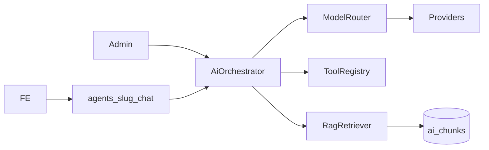

# AI platforma (GEREQ)

Modul `modules/Ai` poskytuje agenty, RAG, multi-provider LLM routing a API pro FE.

## Architektura

- **Capability `ai`** → `Modules\Ai\Application\AiFacade`
- **Drivers** (built-in v Ai): `ollama`, `openai_compat` (OpenRouter), `groq`, `cerebras`, `openai`, `anthropic`, `gemini`, `zai` (GLM), `deepseek`
- **Plug-iny** v `integrations/{Ollama,OpenAiCompat,Zai,…}` — volitelné označení providerů ve skupině `plugin.ai`
- **FE izolace**: `POST /api/v1/ai/agents/{slug}/chat` + token scope `ai.agent.{slug}` (nebo `ai.admin`)



## DB tabulky

| Tabulka | Účel |
|---------|------|
| `ai_providers` / `ai_models` | katalog driverů a modelů (GLM, Qwen3, DeepSeek, …) |
| `ai_agents` + `ai_agent_tools` + `ai_agent_knowledge` + `ai_agent_peers` | publikovatelní agenti + peer allowlist |
| `ai_knowledge_bases` / `ai_sources` / `ai_chunks` | RAG corpus + embeddings (BLOB float32) |
| `ai_chunk_pgvector` | volitelný Postgres ANN (extension `vector`) |
| `ai_conversations` / `ai_messages` / `ai_tool_invocations` | runtime audit |
| `ai_custom_tools` | admin-defined tools (static / HTTP) |
| `ai_usage_daily` | agregace tokenů |

## Zapnutí

```bash
php gereq module:enable ai
php gereq migrate
# Admin → AI → Settings → Seed katalog modelů + API klíče
```

## FE volání

```http
POST /api/v1/ai/agents/listing-assistant/chat
Authorization: Bearer grq_live_…
Content-Type: application/json

{"message":"Kolik stojí byt?","entity_type":"listing","entity_id":"…"}
```

Agent musí mít `published=true`, surface `api`/`public`, a token scope `ai.agent.listing-assistant`.

## RAG

1. Upload dokumentu → event `document.uploaded` → `IngestSourceJob`
2. Extrakce textu → chunking → embedding → `ai_chunks`
3. Chat agenta s přiřazenou KB → retrieve top-K → citace ve system promptu

## Tools

Built-in read tools: `customers.search/get`, `crm.get_deal/search_deals/list_activities`, `crm.list_workflows/get_workflow`, `media.search/get`, `cms.search_pages/get_page`, `emailing.list_accounts/search_messages`, `listings.get/search`, `documents.search/read_text`, `agents.list/ask`.

### Write tools (souhlas uživatele)

Mutating tools (`create` / `update` / `delete`) **vždy** vyžadují explicitní souhlas v admin chatu (tlačítko Souhlasit / Odmítnout), bez ohledu na to, zda agent má `write_mode=draft` nebo `confirm`.

- `write_mode=none` — write tools se agentovi vůbec nenabízí
- `write_mode=draft|confirm` — tool se zavolá, ale spustí se až po UI potvrzení (`POST /admin/ai/chat/{id}/confirm`)

Write tools:

| Oblast | Tools |
|--------|-------|
| Customers | `customers.create`, `customers.update` |
| CRM | `crm.create_deal`, `crm.update_deal`, `crm.create_activity` |
| Automatizace | `crm.create_workflow`, `crm.set_workflow_active`, `crm.run_workflow` |
| Media | `media.update`, `media.import_url` |
| CMS | `cms.create_page`, `cms.update_page` |
| Emailing | `emailing.send` |

### Vlastní tools

Admin → **AI → Vlastní tools**:
- **static** — pevná JSON odpověď (test / mock)
- **http** — POST na váš webhook s `{ tool, args, actor }`

Pak tool zaškrtněte v allowlistu u agenta.

### Knowledge zdroje

Titulek zdroje je odkaz na editaci. U `manual_text` lze upravit text (spustí reingest) a smazat.

### Multi-agent

1. Vytvoř 2+ agenty (jméno, slug, prompt, tools, KB).
2. U agenta A zaškrtni **Peer agenti** (B, C…) a zapni tools `agents.list` + `agents.ask`.
3. V chatu A může zavolat B (`agents.ask`) — max hloubka 2, bez self-call.
4. Reasoning UI ukáže tool call; odpověď B se shrne v odpovědi A.

### Učení z feedbacku

- V admin chatu u odpovědi **↑ / ↓**.
- **↑ (positive)** → lekce se destiluje (LLM nebo šablona) do KB `learn-shared`, ingest do RAG.
- Všechny admin agenti automaticky retrievalují `learn-shared` při chatu.
- ↓ se jen auditně uloží (bez učení).

## Provideři (výběr)

| Driver | Free / OSS | Poznámka |
|--------|------------|----------|
| Ollama | ano | local chat + embed |
| OpenRouter | `:free` + router `openrouter/free` | Gemma 4, Nemotron, Laguna… (viz OuterSpacee/free-ai-apis) |
| Groq | free tier | GPT-OSS 20B/120B, Qwen 3.6/3.8 (Llama = Enterprise) |
| Cerebras | free tier | Llama / Qwen, velmi rychlé |
| Gemini | AI Studio free | 3.6 Flash / 3.5 Flash / 3.1 Pro + embed |
| Z.ai | freemium | GLM-3…GLM-5.x + thinking |
| DeepSeek | freemium | chat + reasoner |
| OpenAI / Anthropic | paid | produkční kvalita |
