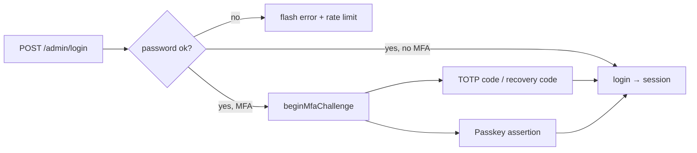

# Authentication and permissions

Admin users authenticate with e-mail + password (optionally followed by TOTP or a passkey), or entirely with a passkey; API clients authenticate with Bearer tokens (`grq_live_*` / `grq_test_*`) or the site-wide public key (`grq_pub_*`). Authorization is role-based: roles hold permissions, permissions are registered by core and modules, and routes declare the permission they need. This page covers `src/Auth`, `src/User`, `src/Security`, the auth-related middleware in `src/Http/Middleware` and the API auth in `src/Api/Auth` + `src/Api/Http`.

## Users, roles, permissions

| Entity | File | Notes |
| --- | --- | --- |
| `User` | `src/User/Entity/User.php` | e-mail (lower-cased), password hash, `isActive()`, locale, avatar/banner, MFA fields (`hasMfa()`), roles (many-to-many) |
| `Role` | `src/User/Entity/Role.php` | `name`, `label`, `description`, permissions (many-to-many); `isPrivileged()` is true for `superadmin`, `admin`, and legacy `administrator` |
| `Permission` | `src/User/Entity/Permission.php` | `name` (`listings.manage`), `label` and `group` (translation keys) |

Authorization helpers on `User`:

- `isAdministrator()` — has any privileged role → bypasses all checks (`can()` returns true, `permissionNames()` returns `['*']`).
- `can(string $permission)` — any role has the permission.
- `hasRole()`, `assignRole()`, `removeRole()`, `roles()`.

Seeded roles (`Gereq\Database\Seeder::seedRoles()`, `src/Database/Seeder.php`):

| Role | Description | Permissions |
| --- | --- | --- |
| `superadmin` | full access | implicit (privileged) |
| `admin` | full access (developer) | implicit (privileged); seeder also assigns all permissions |
| `admin-client` | client system owner (realityV3) | everything except `modules.*` (can manage roles/users; cannot enable/disable modules) |
| `editor` | content edits | `*.view`, `*.edit`, `*.create` except `users.*`, `modules.*`, `roles.*`, `settings.*` |
| `view` | read-only | `*.view` |
| `broker` | Makléř — vlastní kalendář, prohlídky, nabídky, klienti, dokumenty (scoped) a média; bez CRM/automatizace | `calendar.view|manage`, `viewings.view|manage`, `listings.view|manage`, `customers.view`, `documents.view|manage`, `media.view|manage` |

The seeder renames legacy roles (`administrator` → `superadmin`, `manager` → `admin`, `viewer` → `view`). `README.md` still describes the roles as Administrator / Manager / Editor / Viewer.

### Broker ↔ User link

`Modules\Listings\Domain\Broker` has optional unique `user_id` pointing at an admin `User`. Assign the `broker` role to that user and link them on the broker form. `Modules\Listings\Application\BrokerIdentity` then scopes listings / viewings / CRM deals / calendar to that broker’s data (`created_by`, attendee `user_id`/email, or calendar link `entityType=broker`).

### Permission registry

`Gereq\User\PermissionRegistry` (`src/User/PermissionRegistry.php`) is an in-memory list: `register(name, label, group)`, `all()`, `has()`.

- Core permissions are registered in `CoreRegistrar::permissions()`: `users.view|create|edit|delete|manage`, `roles.view|manage`, `modules.manage`, `settings.manage`, `audit.view`, `developer.api.view`, `developer.tokens.manage`, `developer.events.view`.
- Modules register in two places: declaratively in `module.php` (`permissions` list) and imperatively in `register()`:

```php
$context->permissions()->register('viewings.view', 'perm.viewings.view', 'perm.group.viewings');
```

- Persisting to the `permissions` table happens on `ModuleManager::enable()` and `ModuleUpdater::update()` (`syncPermissions()` — inserts missing rows for every registered name), and during `Seeder::seed()`. Labels/groups are translation keys resolved in the Roles UI (`/admin/roles`).

`tools/gereq-permissions` indexes permission names for IDE completion.

## Session authentication

`Gereq\Auth\Authenticator` (`src/Auth/Authenticator.php`):

| Method | Behaviour |
| --- | --- |
| `attempt(email, password, remember)` | finds active user, verifies with `PasswordHasher` (rehashes when needed); if `hasMfa()` → `beginMfaChallenge()` and returns true without logging in; otherwise `login()` |
| `login(user, remember)` | `session->migrate(true)`, stores user id under `auth.user_id`; queues a remember cookie when requested |
| `logout()` | removes the key, regenerates the session id, revokes remember tokens |
| `check()`, `user()`, `id()` | current user (loaded lazily; also honours the remember cookie) |
| `beginMfaChallenge()` / `isMfaPending()` / `pendingMfaUser()` / `completeMfaLogin()` / `clearMfaChallenge()` | second step; challenge expires after `security.mfa_challenge_ttl` (600 s) |
| `applyCookies(response)` | called by `Kernel::handle()` — sets/clears the `gereq_remember` cookie (HttpOnly, SameSite=Lax) |
| `revokeRememberTokens(user)` | |

Remember-me tokens are `Gereq\Auth\Entity\RememberToken` rows (hashed, `+30 days`). Sessions use Symfony `Session` with `SessionHandlerFactory` (`src/Http/Session/SessionHandlerFactory.php`) — `file` (`storage/sessions`) or `redis` per `config/session.php`; the cookie is `gereq_session`, lifetime `SESSION_LIFETIME` minutes. `StartSessionMiddleware` starts it for every request.

Login throttling: `AuthController` (`src/Admin/Http/AuthController.php`) calls `RateLimiter::hit('login:<ip>', security.login_max_attempts, security.login_decay_seconds)` — 5 attempts / 60 s by default. `RateLimiter` (`src/Security/RateLimiter.php`) is file-based under `storage/cache/rate`.

Password reset: `PasswordResetToken` entity, routes `admin.password.forgot|email|reset|update`.

### MFA: TOTP and passkeys (WebAuthn)

- `Gereq\Auth\TotpService` (`src/Auth/TotpService.php`): `generateSecret()`, `provisioningUri()`, `qrDataUri()`, `verify()`, `generateRecoveryCodes(8)`, `hashRecoveryCodes()`. Enabled per user from the profile page (`admin.profile.mfa.totp.start|confirm|disable`, `admin.profile.mfa.recovery`); admins can reset a user's MFA (`admin.users.mfa.reset`).
- `Gereq\Auth\PasskeyService` (`src/Auth/PasskeyService.php`, entity `WebAuthnCredential`): `registrationOptions()`, `completeRegistration()`, `authenticationOptions()`, `completeAuthentication()`, `credentialsFor()`, `deleteCredential()`, `deleteAllFor()`. Relying party settings come from `config/security.php` (`webauthn.rp_name`, `rp_id`, `local_hostname`; RP id must be a hostname, not an IP — use `*.localhost` on LAN).
- Routes: passkey-only login `admin.login.passkey.options|verify`; passkey as second factor `admin.login.mfa.passkey.options|verify`; management `admin.profile.passkeys.options|register|delete`.



## Route-level authorization

Middleware aliases (resolved in `Gereq\Http\Kernel`):

| Alias / class | Effect |
| --- | --- |
| `auth` → `AuthMiddleware` | redirect to `admin.login` when `Authenticator::check()` is false |
| `guest` → `GuestMiddleware` | redirect logged-in users away from login pages |
| `PermissionMiddleware::withPermission()` | added automatically for non-API routes with `->permission()`; throws `AccessDeniedHttpException` (403) when `!$user->can()` |
| `ModuleCurrentMiddleware` | not auth, but gates module UIs until updated (see [module system](module-system.md#versioning-rules)) |

```php
$r->group('/admin/listings', function (Router $r): void {
    $r->get('', [ListingController::class, 'index'])->name('admin.listings.index')->permission('listings.view');
    $r->post('', [ListingController::class, 'store'])->name('admin.listings.store')->permission('listings.manage');
}, ['middleware' => ['auth']]);
```

`Route::permission()` stores a single permission name; `Router::group(..., ['permission' => ...])` applies it to every route in the group. Menu items (`MenuItem::permission`), palette commands and dashboard widgets carry their own permission and are filtered per user, so a user never sees links to routes they cannot open.

In Twig, `current_user()` returns the `User` (so `current_user().can('listings.manage')` works); see [admin UI](admin-ui.md#twig-extensions).

## CSRF

- `Gereq\Security\Csrf` (`src/Security/Csrf.php`): `token()` (per session), `isValid()`, `field()` (hidden `_csrf` input).
- `CsrfMiddleware` (`src/Http/Middleware/CsrfMiddleware.php`) runs for every request: skips `GET/HEAD/OPTIONS` and any path starting with `/api/`; otherwise expects `_csrf` in the body or the `X-CSRF-TOKEN` header and throws `CsrfTokenMismatchException` (rendered as 419 by `ExceptionHandler`).
- Twig: `{{ csrf_field() }}` / `csrf_token()`; the Alpine `fetch` helpers in `resources/js/ui/*` send `X-CSRF-TOKEN` from the meta tag.

## Security headers and CSP

`SecurityHeadersMiddleware` (`src/Http/Middleware/SecurityHeadersMiddleware.php`) generates a per-request nonce (`csp_nonce` request attribute, exposed to Twig for inline scripts) and sets:

| Header | Value |
| --- | --- |
| `Content-Security-Policy` | built by `Gereq\Security\ContentSecurityPolicy::header(nonce, allowFrame)` — nonce-based scripts, extra origins from `config/render.php`; a controller may override via the `ContentSecurityPolicy::HEADER_OVERRIDE` response header (e-mail preview) or allow same-origin framing via `HEADER_ALLOW_FRAME` |
| `X-Content-Type-Options` | `nosniff` |
| `X-Frame-Options` | `DENY` (or `SAMEORIGIN` when allowed) |
| `Referrer-Policy` | `strict-origin-when-cross-origin` |
| `Permissions-Policy` | `camera=(), microphone=(), geolocation=()` |
| `Strict-Transport-Security` | `max-age=31536000; includeSubDomains` on HTTPS |

Other helpers: `Gereq\Security\HtmlSanitizer` (`sanitize()`, `sanitizeNullable()` — DOM-based allow-list sanitizer for rich-text fields), `Gereq\Http\TrustedProxies` (`TRUSTED_PROXIES`), `Gereq\Http\PublicCors` (`FRONTEND_ORIGIN` for `/api/public/*`).

## API authentication

Detailed in [API](api.md#authentication); summary:

| Mechanism | Middleware | Identity |
| --- | --- | --- |
| `Authorization: Bearer grq_live_…` / `grq_test_…` | `ApiAuthMiddleware` (alias `api`) | `ApiToken` → owning `User`; scopes enforced with `hasAnyScope()` |
| admin session cookie | `ApiAuthMiddleware` | logged-in user; route scopes mapped to permissions (`sessionAllows()`: `x.read` → `x.view`/`x.manage`, `x.write` → `x.edit`/`x.create`/`x.manage`, also checked on the module prefix, e.g. `crm.deals.read` → `crm.view`) |
| `Authorization: Bearer grq_pub_…` / `X-Api-Key`, or first-party browser | `PublicApiAuthMiddleware` (auto for `/api/public/*`) | anonymous; site key from `API_PUBLIC_KEY`, or same-origin storefront without key |

API tokens (`Gereq\Api\Auth\ApiTokenService`, entity `Gereq\Api\Entity\ApiToken`):

- `create(name, user, scopes, test, expiresAt)` → plain token `prefix + 48 hex chars`; only `sha256(plain)` and a display prefix are stored. The plain value is shown once (Admin → Developer → API tokens, `admin.developer.tokens.*`, permission `developer.tokens.manage`).
- `findByPlain()`, `touch()` (updates `last_used_at`), `issueTesterToken()` (ephemeral full-access token for the API tester page).
- `ApiToken::isActive()` (not revoked / not expired), `hasScope()` — supports `*`/`full`, exact and `<module>.*` wildcards; `revoke()`, `setExpiresAt()`, `setScopes()`.
- Tokens inherit their owner's permissions: after token auth the user is soft-bound to `Authenticator` for the request, and `->permission()` on API routes is checked against a session user only (token routes rely on scopes).

## Audit trail

Security-relevant actions (`module.enabled`, `module.updated`, logins, role changes…) are written through `Gereq\Audit\Auditor::log()` with user id, IP and user agent; viewable at `/admin/audit` (`audit.view`). See [publishing-i18n-settings](publishing-i18n-settings.md#audit-log).
