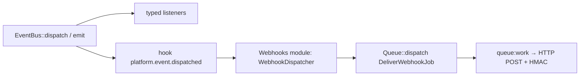

# Hooks, events, webhooks, queue and notifications

GEREQ has two extension mechanisms: **hooks** (`HookManager` — WordPress-style actions and filters keyed by string) for synchronous customisation, and **events** (`EventBus` — typed PHP event objects plus "platform events" described by `EventDefinition` and carried in an `EventEnvelope`). Every platform event ends up in the `platform.event.dispatched` hook, which is where the Webhooks module picks it up and schedules HTTP deliveries through the queue. This page documents those four pieces plus the notification service.

## Hooks (`src/Hook`)

`Gereq\Hook\HookManager` (`src/Hook/HookManager.php`):

| Method | Purpose |
| --- | --- |
| `addAction(hook, callable, priority = HookPriority::EARLY): string` (alias `action()`) | register a side-effect callback; returns an id for `remove()` |
| `addFilter(hook, callable, priority): string` | register a value transformer |
| `doAction(hook, ...payload): void` | run all actions in priority order |
| `filter(hook, value, ...context): mixed` | pass `value` through all filters and return the result |
| `remove(id)`, `hasAction()`, `hasFilter()` | management |
| `inventory()` | all registered hooks (shown on Admin → Developer → Events) |

Priorities (`src/Hook/HookPriority.php`): `EARLY = 10`, `NORMAL = 20`, `LATE = 50`, `LAST = 100` — lower runs first.

```php
// modules/Viewings/ViewingsModule.php (boot)
$context->hooks()->addFilter('admin.dashboard.listing_title_ids', static function (array $ids) use ($context): array {
    return array_merge($ids, $context->get(ViewingsProvider::class)->dashboardListingIds());
});

// core
$ids = $hooks->filter('admin.dashboard.listing_title_ids', []);
```

Twig exposes `do_action('hook', ...)` and `apply_filters('hook', value)` (`src/View/TwigFactory.php`) so templates can offer extension points.

Well-known core hooks: `module.enabled` (`ModuleManager::enable()`), `platform.event.dispatched` (see below). Modules define their own by convention `<module>.<thing>` — discover them with `HookManager::inventory()` or `rg "doAction\('|filter\('"`.

## Events (`src/Event`)

### Typed events and listeners

`Gereq\Event\EventBus` (`src/Event/EventBus.php`):

| Method | Purpose |
| --- | --- |
| `listen(eventClass, callable, priority = 0): string` (alias `subscribe()`) | register a listener for a PHP class |
| `dispatch(object $event): object` | call listeners sorted by priority; if the event implements `PlatformEvent`, fire `platform.event.dispatched` with its envelope; report to the tracer (debug bar) |
| `emit(type, resource, data, version = '1', actor = null): EventEnvelope` | build an envelope without an event class and fire `platform.event.dispatched` directly |
| `remove(id)`, `setTracer(callable)` | |

`PlatformEvent` (`src/Event/PlatformEvent.php`) is a one-method interface — `envelope(): EventEnvelope`. Modules usually have an abstract base (e.g. `modules/Customers/Domain/Events/AbstractCustomerPlatformEvent.php`, `modules/Media/Domain/Events/AbstractMediaEvent.php`) whose subclasses carry the entity and build the envelope.

### `EventEnvelope`

`src/Event/EventEnvelope.php` — immutable value object:

| Field | Meaning |
| --- | --- |
| `id` | `evt_<uuid7>` |
| `type` | dotted event type, `viewing.created` |
| `version` | schema version string (`'1'`) |
| `occurredAt` | `DateTimeImmutable` |
| `actor` | `{type: user|api_token|system, id}` — `emit()` takes it from the `_api_actor` request attribute set by `ApiAuthMiddleware` |
| `resource` | `{type, id}` of the affected entity |
| `data` | free-form payload |
| `correlationId` | from the `correlation_id` request attribute (`CorrelationIdMiddleware` reads/generates `X-Request-ID` and echoes it on the response) |
| `causationId` | optional |

`toArray()` is the internal shape; `webhookPayload()` is the reduced shape sent to endpoints (`id`, `type`, `version`, `created_at`, `data`).

### `EventDefinition` and `EventRegistry`

Modules **declare** the platform events they can emit so the admin can list them and webhook subscriptions can be validated:

```php
$context->platformEvents()->register(
    (new EventDefinition('viewing.created', $this->id()))
        ->description('Prohlídka vytvořena')
        ->webhookEnabled(true)
);
```

`EventDefinition` (`src/Event/EventDefinition.php`): `type`, `module`, `version = 1`, `description`, `webhookEnabled = true`; fluent `withModule()`, `version()`, `description()`, `webhookEnabled()`. `EventRegistry` (`src/Event/EventRegistry.php`): `register()`, `get(type)`, `all()`, `webhookEnabled()`, `groupedByModule()`.

Discovery of the event list: Admin → Developer → **Events** (`/admin/developer/events`, permission `developer.events.view`, `src/Admin/Http/Developer/DeveloperController.php::events`) shows registered definitions grouped by module together with the hook inventory; programmatically use `EventRegistry::all()`.

### Emitting

```php
// typed event (listeners + webhooks)
$this->events->dispatch(new CustomerCreated($customer));

// ad hoc platform event (webhooks only)
$this->events->emit('webplus.meta.created', ['type' => 'webplus_meta', 'id' => $meta->id()], $payload);
```



## Outbound webhooks (`modules/Webhooks`)

Core only provides the hook; delivery is implemented by the `webhooks` module (`modules/Webhooks/WebhooksModule.php`):

- `boot()` registers `platform.event.dispatched` → `WebhookDispatcher::dispatch($envelope)` (`modules/Webhooks/Application/WebhookDispatcher.php`).
- `dispatch()` loads enabled `Webhook` entities, keeps those whose subscription `matchesEvent(type)`, creates a `WebhookDelivery` row with the `webhookPayload()` body and pushes `DeliverWebhookJob` to the queue; it also calls `processDueRetries()` for deliveries in status `retrying`.
- `DeliverWebhookJob` (`modules/Webhooks/Application/DeliverWebhookJob.php`) POSTs JSON with headers `X-GEREQ-Event`, `X-GEREQ-Delivery`, `X-GEREQ-Timestamp`, `X-GEREQ-Signature`. Signature (`WebhookSigner`): `sha256=` + `hash_hmac('sha256', "<timestamp>.<rawBody>", secret)`; receivers should reject timestamps older than `api.webhooks.replay_tolerance_seconds` (300 s).
- `SsrfGuard` blocks private/loopback targets unless `WEBHOOKS_ALLOW_PRIVATE_URLS=true`; timeouts and the auto-disable threshold (`WEBHOOKS_MAX_FAILURES`) come from `config/api.php` → `webhooks.*`.
- Admin UI: endpoints, deliveries with manual retry (`webhooks.deliveries.retry` permission).
- Inbound webhooks from providers (payment gateways) register through `Gereq\Api\InboundWebhookProviderInterface` and the module's `InboundWebhookRegistry`; see `modules/Webhooks/README.md`.

## Queue (`src/Queue`)

`Gereq\Queue\Queue` (`src/Queue/Queue.php`) is deliberately small:

| Driver (`QUEUE_DRIVER`) | `dispatch(Job)` | `pop()` |
| --- | --- | --- |
| `sync` (default) | runs `$job->handle()` inline | always `null` |
| `redis` | `RPUSH gereq:queue <serialize($job)>` (uses `ext-redis`, `REDIS_*`) | `LPOP gereq:queue` |
| `file` | writes the serialized job as `storage/tmp/queue/*.job` | oldest `.job` file (sorted by name), deleted on pop |

`Gereq\Queue\Job` is a single-method interface (`handle(): void`); jobs are plain serializable objects and must resolve their services at run time (e.g. via `gereq()->make()`), not hold them as properties. Examples: `modules/Webhooks/Application/DeliverWebhookJob.php`, `modules/CRM/Application/Jobs/RunWorkflowJob.php`, `modules/Emailing/Application/Jobs/SendOutboxJob.php`, `modules/Ai/Application/Jobs/IngestSourceJob.php`.

Worker: `php gereq queue:work` (`src/Console/Command/QueueWorkCommand.php`) — infinite loop, `sleep(1)` when empty, prints `Hotovo: <class>` or the exception message. There is no automatic retry or dead-letter handling in core (`Gereq\Queue\FailedJob` entity exists but is not written by the worker); modules implement their own retry state (Webhooks `retrying` status). The Docker stack runs the worker as the `queue` service; `config/queue.php` `retry_after = 90` is currently unused by the core worker.

## Notifications (`src/Notification`)

`Gereq\Notification\Notification` interface (`src/Notification/Notification.php`):

```php
interface Notification
{
    public function via(): array;                       // ['database', 'email', 'websocket']
    public function toArray(User $user): array;         // payload for the in-app inbox
    public function toMail(User $user): ?MailMessage;   // subject + text body, or null to skip e-mail
}
```

`Gereq\Notification\Notifier::send(User, Notification)` (`src/Notification/Notifier.php`) iterates `via()`: `database` persists a `DatabaseNotification` row (`user_id`, class, payload); `email` sends a plain-text `Email` through Symfony Mailer (`MAIL_DSN`); `websocket` is accepted but a no-op. A generic implementation is `modules/Notifications/Application/SimpleNotification.php`; the `notifications` module provides the inbox UI.

## Related

- API correlation ids and actors: [API](api.md)
- Module registration entry points (`hooks()`, `events()`, `platformEvents()`): [module system](module-system.md#modulecontext-api)
