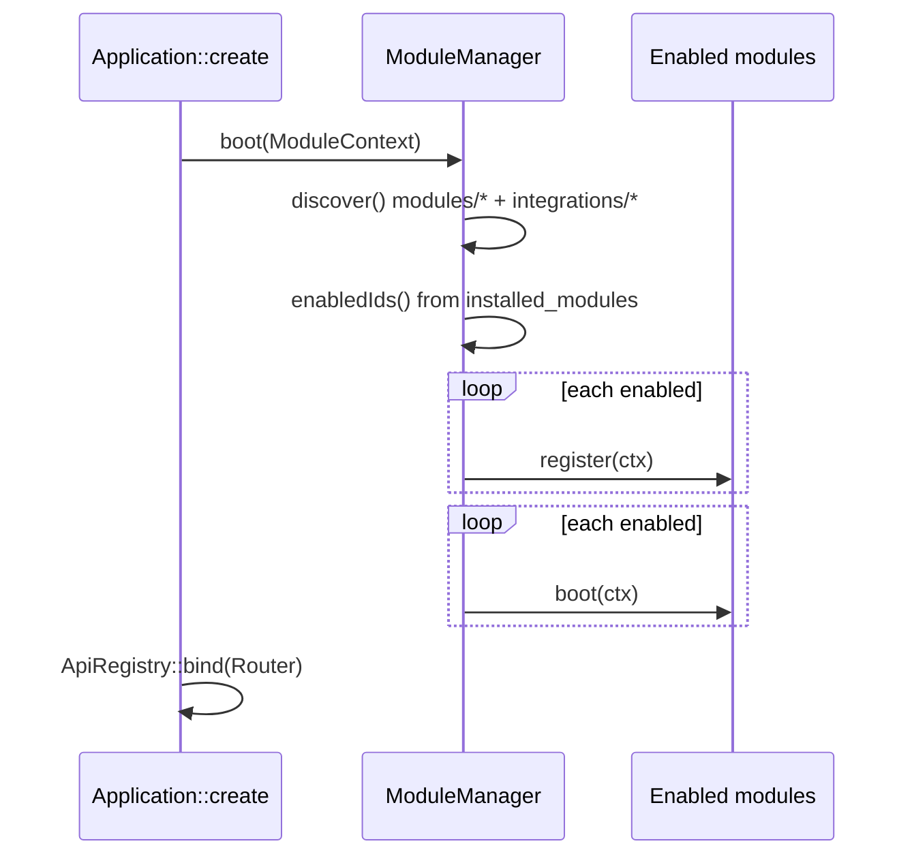
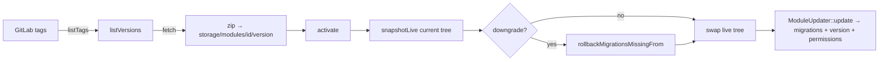

# Module system

Everything outside the core is a *package*: a directory under `modules/` (kind `module`) or `integrations/` (kind `integration`) containing a `module.php` manifest and a class implementing `Gereq\Module\ModuleInterface`. `Gereq\Module\ModuleManager` discovers manifests, tracks install state in the `installed_modules` table, checks dependencies, and boots enabled modules through a single `ModuleContext` facade. Versions are semver and must be kept in sync between manifest, class and git tag; the platform blocks a module's admin UI until a pending update is applied. This page documents the manifest, the lifecycle, the context API, dependency/capability rules, versioning, the GitLab install flow, migrations, groups and integrations.

## Manifest (`module.php`)

Parsed by `ModuleManifest::fromArray()` (`src/Module/ModuleManifest.php`). The file returns a plain array:

| Key | Type | Required | Notes |
| --- | --- | --- | --- |
| `id` | string | yes | lower-case identifier (`viewings`, `stripe`); duplicate ids across `modules/` + `integrations/` throw at discovery |
| `class` | class-string | yes | FQCN implementing `ModuleInterface` (`Modules\Viewings\ViewingsModule::class`) |
| `name` | string | no (default `id`) | display name |
| `version` | semver string | no (default `0.1.0`) | **must** equal `Module::version()` and the git tag |
| `description` | string | no | translation key (`module.listings.description`) or plain text |
| `icon` | string | no (default `modules`) | key from `src/Admin/Ui/Icons.php` |
| `author` | string | no (default `GEREQ`) | |
| `requires` | `array<id, constraint>` | no | hard dependencies, e.g. `['core' => '^1.0', 'currency' => '^1.1']`; `core` is ignored by the checker |
| `optional` | `array<id, constraint>` | no | soft dependencies; informational (module detail page); consumers probe capabilities at runtime |
| `provides` | `list<string>` | no | informational list of features |
| `capabilities` | `list<string>` | no | capability names the module registers at runtime (see [capabilities](#capabilities)) |
| `permissions` | `list<{name,label,group}>` | no | permissions synced into the DB on enable/update (labels are translation keys) |
| `groups` | `list<string>` | no | membership in `config/module_groups.php` groups (`realestates`, `plugin.payments`) |
| `settings_route` | route name | no | link target of the module's "Settings" button in admin |
| `kind` | `module` \| `integration` | no | anything under `integrations/` is forced to `integration` |
| `repository` | `group/project` | no | overrides the GitLab project path (default `<GITLAB_GROUP>/<MODULE_REPO_PREFIX><id>`) |

Constraint strings in `requires`/`optional` are stored but **not evaluated**: `ModuleManager::missingDependencies()` only checks that each required module is enabled.

Example (`modules/Listings/module.php`):

```php
return [
    'id' => 'listings',
    'name' => 'Listings',
    'icon' => 'home',
    'version' => '1.3.2',
    'description' => 'module.listings.description',
    'class' => Modules\Listings\ListingsModule::class,
    'author' => 'RealEstates',
    'requires' => ['core' => '^1.0', 'currency' => '^1.1'],
    'optional' => ['customers' => '^1.0', 'crm' => '^1.0', 'viewings' => '^1.0', /* … */],
    'groups' => ['realestates'],
    'provides' => ['listings', 'brokers', 'near_locations', 'cities'],
    'capabilities' => ['listings', 'brokers', 'near_locations', 'cities'],
    'permissions' => [
        ['name' => 'listings.view', 'label' => 'perm.listings.view', 'group' => 'perm.group.listings'],
        ['name' => 'listings.manage', 'label' => 'perm.listings.manage', 'group' => 'perm.group.listings'],
    ],
];
```

`ModuleManifest` also exposes `isIntegration()` and `phpNamespace()` (`Modules\<Dir>\` or `Integrations\<Dir>\`, derived from the directory name — PSR-4 roots are in `composer.json`).

## Bundled submodules

A module can bundle independently managed features in its own repository. These are
application submodules, not Git submodules: they have no separate repository or
release archive. Declare the same relative directory list in the parent's class
and `module.php`:

```php
final class WarehouseModule implements ModuleInterface
{
    public const SUBMODULES = ['Submodules/Reservations'];
    // id(), version(), register(), boot() use the normal module contract.
}
```

```php
// modules/Warehouse/module.php
return [
    'id' => 'warehouse',
    'class' => Modules\Warehouse\WarehouseModule::class,
    'version' => '1.1.0',
    'submodules' => ['Submodules/Reservations'],
];
```

`ModuleInterface::SUBMODULES` defaults to `[]`, so existing modules need no changes.
Discovery checks that the class and manifest declarations agree. Only explicitly
listed directories are discovered; paths must remain inside the parent. A bundled
submodule cannot declare further children or its own repository.

```text
modules/Warehouse/
  module.php
  WarehouseModule.php
  Submodules/Reservations/
    module.php
    ReservationsModule.php
    Domain/
    Database/Migrations/
    Resources/views/
    Resources/translations/
    Resources/assets/css/admin.css
    Tests/
```

```php
// modules/Warehouse/Submodules/Reservations/module.php
return [
    'id' => 'warehouse_reservations',
    'class' => Modules\Warehouse\Submodules\Reservations\ReservationsModule::class,
    'name' => 'Reservations',
    'version' => '0.1.0',
    'requires' => ['core' => '^1.0'],
    'permissions' => [
        ['name' => 'warehouse_reservations.manage', 'label' => 'perm.reservations.manage', 'group' => 'perm.group.warehouse'],
    ],
];
```

The child class implements the same `ModuleInterface`. Its namespace follows its
location inside the parent's PSR-4 tree. IDs are globally unique. Discovery sets
`parentId` and automatically adds the parent to `requires`; clients cannot omit or
remove this dependency. Children retain their own version, installation row,
permissions, migrations, routes, APIs, capabilities, hooks, settings and menu items.
Public content still follows the normal publishing rules.

- Enable the parent first, then enable a child separately. Enabling the parent
  does not automatically install its children. Boot registers dependencies first,
  then calls every enabled module's `boot()` after all registrations finish.
- A stored enabled child whose parent is absent or paused is never treated as
  active and never boots. Pausing a parent cascades through enabled dependents;
  pausing a child leaves its parent running.
- Uninstall rolls children back before the parent, including paused children that
  retain data. Entity ownership follows the deepest package directory: a parent's
  schema sync and rollback exclude its children's entities.
- Admin lists child rows immediately below their parent with the same lifecycle
  actions. Paused modules can also be uninstalled. Uninstall has the existing
  module meaning: rollback schema/data; bundled source files remain in the parent.
- Twig uses the child's ID as namespace (`@warehouse_reservations/...`);
  translations load from the child's own catalogs. The Bun build discovers its
  CSS as `module:warehouse_reservations`, loaded only while the child is enabled.
- The testing engine supports `php bin/gereq-test module:warehouse_reservations`
  and includes child `Tests/` directories in the aggregate module target.
- Code releases and GitLab activation belong to the parent bundle. Activating the
  parent updates installed children as well, including child migration rollback
  on downgrade. Separate child downloads/activation are rejected. A target bundle
  that omits an installed child is refused before rollback or file replacement,
  to preserve retained child data.
- Bump the child's manifest/class version when its code changes, and bump the
  parent bundle's manifest/class version before releasing the changed repository.
  For local deployments, run the normal admin Update for each changed module.

## Directory layout

`php gereq make:module <Name>` creates (`src/Console/Command/MakeModuleCommand.php`):

```
modules/<Name>/
  module.php
  <Name>Module.php
  Application/            services, providers, Widgets/
  Domain/                 Doctrine entities (scanned by EntityManagerFactory)
  Infrastructure/         external clients, repositories
  Http/                   controllers (Http/Api/* for API controllers)
  Admin/
  Database/Migrations/    YYYY_MM_DD_NNNNNN_name.php
  Resources/views/        Twig, namespace @<name>
  Resources/translations/ messages.cs.php, messages.en.php (created by hand)
  Tests/
```

Existing modules also use `Console/` (commands registered manually in `ConsoleKernel`), `Resources/assets/js|css` (imported from `resources/js/admin.ts`) and a `README.md`.

## Lifecycle

`ModuleInterface` (`src/Module/ModuleInterface.php`):

```php
interface ModuleInterface
{
    public function id(): string;
    public function version(): string;
    public function register(ModuleContext $context): void;
    public function boot(ModuleContext $context): void;
}
```

`ModuleManager::boot()` (`src/Module/ModuleManager.php`) instantiates the `class` of every enabled manifest (skipping missing classes), calls **`register()` on all modules first, then `boot()` on all modules**. Module objects have no constructor arguments — pull services with `$context->get()`.

| Phase | Put here | Why |
| --- | --- | --- |
| `register()` | permissions, capabilities, routes (`router()`, `api()`), platform event definitions, validation rulesets, form bindings, settings definitions, publishables, workflow variables | other modules may look these up during their own `boot()` |
| `boot()` | hooks/filters, event listeners, dashboard widgets, menu items, command palette entries, admin search sources — anything that consumes capabilities of other modules | all `register()` calls have already run, so `capabilities()->has('listings')` is reliable |



## `ModuleContext` API

`src/Module/ModuleContext.php` — one accessor per platform registry:

| Method | Returns | Used for |
| --- | --- | --- |
| `container()` | `Psr\Container\ContainerInterface` | raw PHP-DI container |
| `get(string $id)` | service | `$context->get(EntityManagerInterface::class)` |
| `config()` | `Gereq\Config\Repository` | static config |
| `router()` | `Gereq\Http\Router` | admin/public routes: `get/post/…`, `group()`; see [overview](overview.md#routing) |
| `api()` | `Gereq\Api\ApiRegistry` | `module('id', fn (ApiModule $api) …)`, `registerKnownScope()`; see [API](api.md) |
| `menu()` | `Gereq\Admin\Menu\Menu` | `add(new MenuItem(...))` |
| `admin()` | `ModuleContext` (self) | readability alias — `$context->admin()->menu()` |
| `dashboard()` | `Gereq\Admin\Dashboard\Dashboard` | `addWidget(DashboardWidget)`; see [dashboard widgets](dashboard-widgets.md) |
| `commandPalette()` | `Gereq\Admin\CommandPalette\CommandPalette` | `add(new PaletteCommand(...))` |
| `adminSearch()` | `Gereq\Admin\Search\AdminSearchRegistry` | register global admin search providers |
| `resources()` | `Gereq\Admin\Resource\ResourceRegistrar` | `#[AdminResource]` CRUD registration |
| `permissions()` | `Gereq\User\PermissionRegistry` | `register(name, label, group)` |
| `capabilities()` | `Gereq\Module\CapabilityRegistry` | `register(capability, providerId, object)`, `has()`, `get()`, `providers()` |
| `settings()` | `Gereq\Setting\Settings` | `define(key, type, label, default, module, options, global)` |
| `publishables()` | `Gereq\Publish\PublishableRegistry` | register staging → production categories |
| `validation()` | `Gereq\Validation\ValidationRegistry` | `ruleset('form.name', [...])` |
| `forms()` | `Gereq\Admin\Form\Forms` | `entity('ruleset', Entity::class)` binding for `#[FormField]` (see `docs/FORMS.md`) |
| `hooks()` | `Gereq\Hook\HookManager` | `addAction()`, `addFilter()`, `doAction()`, `applyFilters()` |
| `events()` | `Gereq\Event\EventBus` | `listen()`, `dispatch()`, `emit()` |
| `platformEvents()` | `Gereq\Event\EventRegistry` | `register(new EventDefinition(type, module))` |
| `workflowVariables()` | `Gereq\Automation\WorkflowVariableRegistry` | variables for the automation editor |

A compact real example is `modules/Viewings/ViewingsModule.php`: `register()` adds two permissions, a `viewings` capability backed by `ViewingsProvider`, an `/admin/viewings` route group, public `/api/public/viewings` routes, `/api/v1/viewings` via `api()->module()`, five platform events and three validation rulesets; `boot()` adds a dashboard filter hook, four widgets, two menu items and two palette commands.

## Enabling, pausing, disabling

State lives in the `modules` table (`Gereq\Module\InstalledModule`: `id`, `version`, `footprint`, `enabled`, `enabled_at`, `source` = `local` | `gitlab`).

| Operation | Entry points | What happens |
| --- | --- | --- |
| enable | `module:enable`, Admin → Modules, package "enable all" | `ModuleManager::enable()`: `assertDependencies()` (every `requires` id except `core` must already be enabled, otherwise `modules.error.missing_deps`), upsert row with manifest version, register + persist manifest permissions, audit `module.enabled`, hook `module.enabled`; then `Migrator::migrateModule($id)` |
| pause | `module:pause`, admin | `pauseMany()`: `expandWithDependents()` (transitively adds enabled modules that `require` the paused ones), `sortForDisable()`, `disable()` each — row `enabled=false`, **tables and data kept** |
| disable / uninstall | `module:disable [--purge-media]`, admin | `ModuleUninstaller::uninstallMany()`: like pause but also `Migrator::rollbackModule()` (runs migration `down()`s, drops the module's entity tables, deletes `schema_migrations` rows); `--purge-media` removes linked media |
| update | Admin → module → "Update" | `ModuleUpdater::update()`: pending migrations, DB version ← manifest version, permission sync, audit `module.updated` |

`ModuleManager::disable()` refuses when another enabled module lists the id in `requires` (unless that module is being disabled in the same batch). `sortForEnable()` / `sortForDisable()` and `expandWithDependents()` are topological operations over `requires` only (`optional` is informational).

Package groups (`ModuleGroupCatalog::enableOrder()`) enable a whole group in dependency order from the admin Modules page.

## Capabilities

`Gereq\Module\CapabilityRegistry` (`src/Module/CapabilityRegistry.php`) is a runtime service locator keyed by capability name:

```php
// provider (register phase)
$context->capabilities()->register('listings', $this->id(), $context->get(ListingsProvider::class));

// consumer (boot phase)
if ($context->capabilities()->has('listings')) {
    $listings = $context->capabilities()->get('listings');   // first provider
    $all = $context->capabilities()->providers('listings');  // providerId => object
}
```

Capabilities decouple optional dependencies: a module lists the provider in `optional` and probes `has()` instead of importing the class. Integrations should talk to hosts only through capabilities (`payment.gateway.stripe`, `shipping_carriers`…). The manifest `capabilities` list is descriptive; the registry is the truth.

## Versioning rules

From `.cursor/rules/module-updates.mdc` and the code:

1. Any change in `modules/<Id>/**` (code, migrations, Twig, JS) → bump `version` in `module.php` **and** in `<Id>Module::version()`. `tests/Unit/Modules/ModuleStructure/ModuleManifestConsistencyTest.php` fails when they differ.
2. Semver: patch = fix, minor = new feature or migration, major = breaking.
3. Schema/data changes only via `Database/Migrations/`, never ad hoc at request time.
4. Tag the module repo with the same version (`v1.1.2` or `1.1.2`; `GitLabModuleClient::normalizeVersion()` strips the `v`).
5. **Immutable footprints**: each module version has a SHA-256 content fingerprint (`Gereq\Module\ModuleFootprint`) of its tree (excluding `.gereq-version.json` and VCS dirs). Cached versions under `storage/modules/{id}/{version}/` refuse overwrite when the incoming tree fingerprint differs (`admin.modules.versions.error.immutable`). The live footprint is stored on `modules.footprint` on enable/update/activate; drift vs live files surfaces as an update + health warn.

`ModuleUpdater::isUpdateAvailable()` returns true when `installed_modules.version !== module.php version`, any migration file has not run, **or** the live footprint differs from the recorded one. `ModuleCurrentMiddleware` (`src/Http/Middleware/ModuleCurrentMiddleware.php`) is appended by `Kernel` to every route with `->module()` or a route name matching `admin.<id>.…`; when an update is pending it renders `admin/modules/update_required.html.twig` inside the normal admin shell (menu and palette still work) or returns `503 {"error":"module_update_required","update_url":…}` for JSON requests, instead of the module's UI, until the admin clicks **Update** on the module page.

## Install and upgrade from GitLab

Configuration: `config/modules.php` (`GITLAB_URL`, `GITLAB_TOKEN`, `GITLAB_GROUP`, `MODULE_REPO_PREFIX`, `MODULE_TAGS_CACHE_TTL`, `versions_path = storage/modules`).

| Class | Role |
| --- | --- |
| `GitLabModuleClient` (`src/Module/GitLabModuleClient.php`) | `configured()`, `projectPathFor(manifest)` (`gereq/module-<id>` or manifest `repository`), `listTags()` (semver tags, cached `tags_cache_ttl`), `downloadArchive(tag, zip)` |
| `ModuleVersionStore` (`src/Module/ModuleVersionStore.php`) | on-disk cache `storage/modules/{id}/{version}/` with immutable `.gereq-version.json` footprint; `installFromZip()` refuses a different tree under the same version; `snapshotLive()` never overwrites an existing cache entry |
| `ModuleVersionInstaller` (`src/Module/ModuleVersionInstaller.php`) | `listVersions(id)` merges remote tags and cached dirs with `is_upgrade` / `is_downgrade` flags; `fetch(id, version)`; `latestRemoteVersion()` |
| `ModuleVersionActivator` (`src/Module/ModuleVersionActivator.php`) | `activate(id, version)`: fetch if not cached → snapshot live tree → on downgrade `Migrator::rollbackMigrationsMissingFrom()` → swap `modules/<Dir>` with the cached tree → `ModuleManager::rediscover()` → `ModuleUpdater::update()` (upgrade) → mark `source = gitlab`; audit `module.version_activated` |
| `ModuleInspector` (`src/Module/ModuleInspector.php`) | data for the module detail page (versions, migrations, dependencies) |



The live tree under `modules/` is replaced on activation; a checked-out git submodule there will show as modified. Development machines normally use the submodule workflow (git pull + bump + admin "Update"); GitLab activation is intended for deployments.

## Migrations

- Files: `modules/<Id>/Database/Migrations/<YYYY_MM_DD_NNNNNN>_<name>.php`, each returning an anonymous object with `up(Schema $schema)`, `down(Schema $schema)` and optionally `afterUp(Connection $conn)` for data backfills.
- Runner: `Gereq\Database\Migrator::migrateModule()` (`src/Database/Migrator.php`) — sorts files, skips those in `schema_migrations` (version key `<id>:<basename>`), applies `up()` to a DBAL `Schema` copy, computes the diff with the comparator and executes it, then `afterUp()`, then records the row. Migrations are thus **declarative** on top of introspected schema rather than raw SQL.
- `Migrator::migrate()` runs `migrateModule()` for every **enabled** module only (never disabled packages, including on a fresh empty DB), then `syncSchema()` — Doctrine `SchemaTool::getUpdateSchemaSQL()` restricted to entity tables of core + enabled modules (so it never drops `schema_migrations` or foreign tables). After `Seeder::seedModules()` the seeder calls `migrate()` again so the default enabled set gets its schema before demo data.
- Core has no migration files; core tables come purely from `syncSchema()`.
- Because entities are synced automatically, many module migrations are empty placeholders (e.g. `modules/Viewings/Database/Migrations/2026_09_06_000001_viewings.php`); they still matter as version markers for `isUpdateAvailable()`.
- Rollbacks: `rollbackModule()` (disable) and `rollbackMigrationsMissingFrom(id, currentDir, targetDir)` (downgrade — runs `down()` for files present in the current tree but absent from the target).
- CLI: `php gereq migrate`, `migrate:status`; see [CLI](../getting-started/cli.md#database).

## Module groups and packages

`config/module_groups.php` + `Gereq\Module\ModuleGroupCatalog` (`src/Module/ModuleGroupCatalog.php`). A group has `surface` (`packages` for domain bundles such as `ecs`, `ebs`, `realestates`; `plugins` for third parties such as `plugin.payments`), an ordered `modules` list and a `required` subset. Manifest `groups` are merged in (`membershipFromManifests()`), so a module can join a group without editing core config. `forIndex()` builds the Admin → Modules cards (enabled count, missing required ids); `enableOrder()` returns the dependency-sorted list used by "enable package". Full table in [configuration](../getting-started/configuration.md#configmodule_groupsphp).

## Integrations

`integrations/README.md` defines the rules for `kind: integration` packages (Comgate, Stripe, GoPay, Packeta, AI provider markers):

- same lifecycle as modules (discover, enable, migrate, settings) — `ModuleManager::discover()` scans both directories;
- PSR-4 `Integrations\<Name>\`;
- talk to the host module only through a capability (`PaymentGatewayRegistry`, `ShippingCarrierRegistry`), never own domain tables — consistent with `EntityManagerFactory` scanning only `src/` and `modules/` for entities;
- appear under Admin → Modules → **Plug-ins**, grouped via `groups` + `surface: plugins`.

Example `integrations/Stripe/module.php`: `kind => 'integration'`, `requires => ['core' => '^1.0', 'payments' => '^1.1']`, `optional => ['webhooks' => '^1.0']`, `groups => ['plugin.payments']`, `capabilities => ['payment.gateway.stripe']`.

Related: [creating a module](../development/creating-a-module.md), [auth & permissions](auth-permissions.md), [hooks, events, webhooks](hooks-events-webhooks.md).
