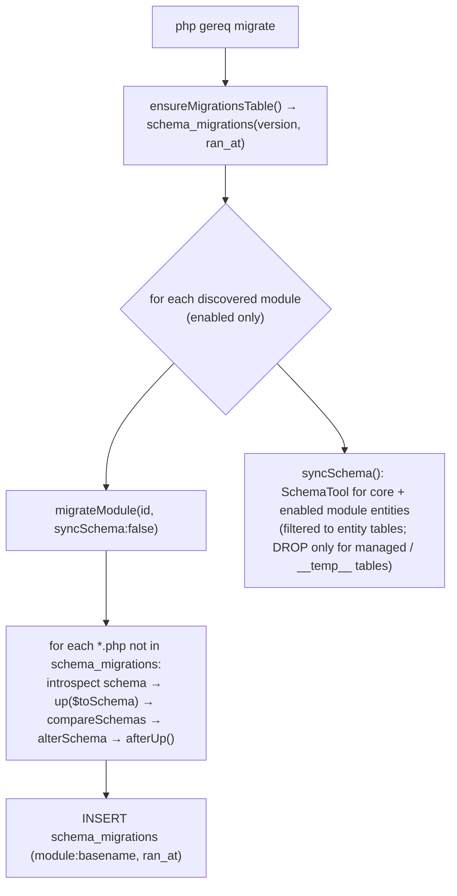

# Database

GEREQ uses Doctrine ORM (attribute mapping) over DBAL with three supported drivers — SQLite (default), MySQL/MariaDB and PostgreSQL — configured through `config/database.php`. Schema management combines two mechanisms: per-module file migrations in `modules/<Name>/Database/Migrations/` tracked in a `schema_migrations` table, followed by a Doctrine `SchemaTool` sync of all entity metadata. There is no separate migration directory for the core; core entities are synced by `SchemaTool`. Seeding is done by `src/Database/Seeder.php` (base data, sample listings) and `src/Database/DemoSeeder.php` (demo user + click-through data).

## Drivers and configuration

`config/database.php`:

| Key | Env var | Default | Notes |
| --- | --- | --- | --- |
| `connection` | `DB_CONNECTION` | `sqlite` | `sqlite`, `mysql`, `pgsql` (anything else falls back to `pdo_sqlite`) |
| `database` | `DB_DATABASE` | `storage/database.sqlite` | SQLite path; relative to project root (directory created on demand) |
| `host` | `DB_HOST` | `127.0.0.1` | |
| `port` | `DB_PORT` | `3306` | pgsql falls back to `5432` when empty |
| `name` | `DB_DATABASE_NAME` | `gereq` | |
| `username` | `DB_USERNAME` | `gereq` | |
| `password` | `DB_PASSWORD` | `` | |
| `charset` | – | `utf8mb4` | MySQL uses `utf8mb4`, PostgreSQL `utf8` (set in `EntityManagerFactory`) |

`src/Database/EntityManagerFactory::params()` maps these to DBAL params: `pdo_mysql`, `pdo_pgsql` or `pdo_sqlite`, each with `wrapperClass => Gereq\Database\CachingConnection`.

In the Docker stack the `php` and `queue` containers override the driver to PostgreSQL (`DB_CONNECTION=pgsql`, `DB_HOST=postgres`, `DB_PORT=5432`) regardless of `.env` — see [docker.md](docker.md). The PHP image ships `pdo_sqlite`, `pdo_mysql` and `pdo_pgsql`.

## Doctrine setup (`src/Database/`)

| File | Role |
| --- | --- |
| `EntityManagerFactory.php` | Builds the `EntityManager`. Mapping paths: `src/` plus **every directory under `modules/`** (the whole module directory, not only `Domain/`, is scanned for `#[ORM\Entity]` attributes). Uses `ORMSetup::createAttributeMetadataConfiguration($paths, $isDev)` with `enableNativeLazyObjects(true)` and a custom DQL function `REPLACE` (`src/Database/Dql/ReplaceFunction.php`). |
| `CachingConnection.php` | DBAL connection wrapper used by all drivers. |
| `Migrator.php` | Migration runner (see below). |
| `Seeder.php`, `DemoSeeder.php`, `RealEstateAutomationDemoSeeder.php` | Seeders (see below). |

Caching behaviour in `EntityManagerFactory`:

- `APP_DEBUG=true` → metadata is **not** cached on disk (avoids stale maps after entity changes).
- Otherwise metadata + query cache go to `storage/cache/doctrine` (`FilesystemAdapter('doctrine_meta')`).
- Result cache uses the application cache pool when `cache.doctrine_result` (`CACHE_DOCTRINE_RESULT`, default `true`) is on — see [cache-queue-session-files.md](cache-queue-session-files.md).
- A `QueryMiddleware` collects SQL timings for the Vitality module and the debug bar.

Naming: entities declare table names explicitly with `#[ORM\Table(name: '…')]` (e.g. `modules` for `Gereq\Module\InstalledModule`); no custom naming strategy is configured in the factory.

## Migrations

### Layout

```text
modules/<Name>/Database/Migrations/YYYY_MM_DD_NNNNNN_description.php
integrations/<Name>/Database/Migrations/…   (same mechanism; integrations must not own core tables)
```

Each file returns an anonymous object with `up(Schema $schema)` and `down(Schema $schema)` (DBAL `Schema` API), optionally `afterUp(Connection $conn)` for raw SQL backfills. Example: `modules/Customers/Database/Migrations/2026_09_08_000004_customer_avatar.php`.

### How `Migrator` runs them



Key points from `src/Database/Migrator.php`:

- Version key is `<module-id>:<file basename>`.
- File migrations run **before** `SchemaTool` so `DEFAULT`/backfill logic in migrations wins over generated DDL.
- `syncSchema()` restricts the comparison to tables owned by entity metadata so that non-entity tables (`schema_migrations`) are never dropped.
- Disabled modules are **never** migrated by `migrate()` / `syncSchema()` — including on a fresh empty DB. Their migrations run on enable (`migrateModule()`), or right after `Seeder::seedModules()` marks the default set enabled.
- `fresh()` drops the schema for all metadata, clears `schema_migrations`, then runs `migrate()`.
- `rollbackModule(id)` runs `down()` for the module's files and drops its entity tables; `rollbackMigrationsMissingFrom()` is used by module version switching (`src/Module/ModuleUpdater.php`, `ModuleVersionStore`).
- `status()` / `statusForModule()` back the `migrate:status` command.

### Commands

| Command | Source | Effect |
| --- | --- | --- |
| `php gereq migrate` | `src/Console/Command/MigrateCommand.php` | Run pending module migrations + schema sync. No seed. |
| `php gereq migrate --fresh` | same | Drop schema + rerun everything. |
| `php gereq migrate --seed` | same | After migrating, run `Seeder::seed($withDemo, $withSample)`. |
| `--no-demo` | same | With `--seed`: skip `DemoSeeder` (demo business data). |
| `--no-sample` | same | With `--seed`: skip sample customers (`seedCustomers()`). |
| `php gereq migrate:status` | `MigrateStatusCommand.php` | List migrations per module as ran / pending. |
| `php gereq seed:demo` | `SeedDemoCommand.php` | Run `DemoSeeder` on an existing DB. |
| `php gereq db:import-sqlite [path] [--migrate] [--dry-run]` | `ImportSqliteCommand.php` | Copy data from an SQLite file (default `storage/database.sqlite`) into the current DB, typically PostgreSQL. |
| `php gereq module:enable <id>` | `ModuleEnableCommand.php` | Enable a module and run `migrateModule(id)`. |

Clean client install (as used by `bin/grq install` and `make migrate-fresh`):

```bash
php gereq migrate --fresh --seed --no-demo --no-sample
```

Demo install (`bin/grq install demo`, `make demo`):

```bash
php gereq migrate --fresh --seed
```

## Seeders

`src/Database/Seeder::seed(bool $withDemo = true, bool $withSampleCustomers = true)` always runs, in order:

1. `seedPermissions()`, `seedRoles()`, `seedAdmin($admin)` — admin credentials come from CLI (`--admin-email` / `--admin-password` / interactive prompt / one-time generated password). **Never** from `.env`.
2. `seedModules()` — creates rows in the `modules` table for every discovered manifest and enables the RealEstates default set: `currency`, `customers`, `media`, `cms`, `listings`, `crm`, `calendar`, `viewings`, `documents`, `notifications`, `reviews`, `newsletter`, `portals`, `translate`, `webhooks`, `emailing`. Then `ModuleManager::rediscover()` + `Migrator::migrate()` so only those enabled packages get file migrations / schema sync before demo data.
3. `seedCustomers()` — **sample customers**, only when `--no-sample` is not given.
4. Brokers, cities, near locations and sample listings (`coreListingSamples()`, `moravianSilesianListingSamples()`), viewings, portal demo (`seedPortalsDemo()` via `Modules\Portals\Application\PortalDemoSeeder` when present). These run regardless of the flags.
5. `DemoSeeder::seed()` — **demo data**, only when `--no-demo` is not given. Creates the demo user `demo@gereq.cz` / `demo123` (`DemoSeeder::DEMO_EMAIL`, `DEMO_PASSWORD`) and click-through business data.

`RealEstateAutomationDemoSeeder` seeds CRM workflow / emailing demo content when those modules are present (guarded by `class_exists`).

Note: because sample listings/cities/viewings are seeded unconditionally, `--no-demo --no-sample` still produces a database with RealEstates sample listings; only demo users/business data and sample customers are skipped.

## Module enable / update and migrations

| Trigger | Code path |
| --- | --- |
| Admin → Modules → enable | `src/Admin/Http/ModuleController.php` calls `Migrator::migrateModule($id)` after enabling. |
| Admin → Modules → update / switch version | `src/Module/ModuleUpdater.php` reads `statusForModule()` and runs `migrateModule($id)`; `ModuleController` also runs `migrateModule` after version activation. |
| CLI | `php gereq module:enable <id>` (see above). |
| Full run | `php gereq migrate` iterates **enabled** modules only (never disabled / not-yet-enabled packages). |

The `.cursor/rules/module-updates.mdc` rule requires every module change to bump `module.php` version + `Module::version()` so that the admin "Update" path triggers migrations.

## Backups and Adminer access

The codebase contains no built-in backup command. Options that exist:

- **PostgreSQL in Docker** — the data lives in the named volume `gereq-postgres`; the port is not published. Use `docker compose exec postgres pg_dump -U <DB_USERNAME> <DB_DATABASE_NAME> > dump.sql` (recommendation; not scripted in the repo).
- **SQLite** — the database is the single file `storage/database.sqlite`; `bin/grq pack demo` explicitly excludes it from demo packages.
- **Migration from SQLite to PostgreSQL** — `php gereq db:import-sqlite storage/database.sqlite --migrate`.
- **Adminer** — opt-in `tools` profile (`docker compose --profile tools up -d adminer` or `make adminer`), default `http://127.0.0.1:8086`, auto-login via `docker/adminer/autologin.php` using `DB_USERNAME` / `DB_PASSWORD` / `DB_DATABASE_NAME`.

## Related

- [docker.md](docker.md) — where PostgreSQL/Redis run
- [cache-queue-session-files.md](cache-queue-session-files.md) — Doctrine result cache pool
- [../getting-started/installation.md](../getting-started/installation.md)
