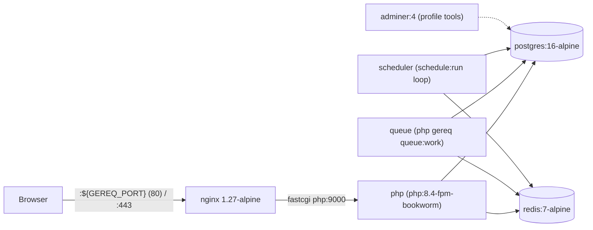

# Docker stack

GEREQ ships a Docker Compose stack (`docker-compose.yml` + optional `docker-compose.https.yml`) that mirrors a production-like topology: nginx in front of PHP-FPM, PostgreSQL, Redis, a dedicated queue worker, and an opt-in Adminer. The stack can be driven either from the host with `php gereq serve-docker` (PHP required on host, adds a log TUI, Bun asset watch and certificate handling) or with the `Makefile` (Docker-only, nothing but Docker on the host). This page documents the services, the images in `docker/`, both entry points, and what they write into `.env`.

## Topology



All services share the bridge network `gereq`. Only nginx (and Adminer when its profile is on) publish host ports; PostgreSQL and Redis are reachable only inside the network.

## Services (`docker-compose.yml`)

Compose project name is `gereq`, so containers are named `gereq-nginx-1`, `gereq-php-1`, `gereq-postgres-1`, `gereq-redis-1`, `gereq-queue-1`, `gereq-adminer-1`.

| Service | Image / build | Ports (host:container) | Volumes | Notable env | Depends on / health |
| --- | --- | --- | --- | --- | --- |
| `nginx` | `nginx:1.27-alpine` | `${GEREQ_PORT:-8080}:80` | bind `.:/var/www/html` (ro, `consistency: consistent`), `docker/nginx/nginx.conf`, `docker/nginx/default.conf` | – (`extra_hosts: host.docker.internal:host-gateway`) | `php` |
| `php` | build `docker/php/Dockerfile` | none (FPM on `php:9000` internally) | bind `.:/var/www/html` (`consistency: consistent`), `docker/php/zz-www.conf`, `docker/php/php.ini` | `env_file: .env` plus overrides: `APP_URL`, `TRUSTED_PROXIES` (default `*`), `FRONTEND_ORIGIN`, `REDIS_HOST=redis`, `REDIS_PORT=6379`, `SESSION_DRIVER=redis`, `QUEUE_DRIVER=redis`, `DB_CONNECTION=pgsql`, `DB_HOST=postgres`, `DB_PORT=5432`, `DB_DATABASE_NAME`, `DB_USERNAME`, `DB_PASSWORD` (required), `PHP_FPM_*` | `redis` started, `postgres` healthy |
| `postgres` | `postgres:16-alpine` | not published | named volume `gereq-postgres:/var/lib/postgresql/data` | `POSTGRES_DB/USER/PASSWORD` from `DB_*` | healthcheck `pg_isready -U $DB_USERNAME -d $DB_DATABASE_NAME`, interval 3s, timeout 5s, retries 20 |
| `redis` | `redis:7-alpine`, `redis-server --appendonly yes` | not published | named volume `gereq-redis:/data` | – | – |
| `queue` | same build as `php`, command `php gereq queue:work` | none | bind `.:/var/www/html` (`consistency: consistent`) | `env_file: .env` + `REDIS_HOST=redis`, `QUEUE_DRIVER=redis`, `DB_*` pgsql overrides | `redis`, `postgres` healthy, `php`; `restart: unless-stopped` |
| `scheduler` | same build as `php`, `schedule:run` every 60 s | none | same bind | same Redis/DB overrides as `queue` | `redis`, `postgres`, `php`, `queue`; `restart: unless-stopped` |
| `adminer` | `adminer:4`, **profile `tools`** | `${GEREQ_ADMINER_PORT:-8086}:8080` | `docker/adminer/autologin.php:/var/www/html/plugins-enabled/autologin.php:ro,z` | `ADMINER_DEFAULT_SERVER=postgres`, `ADMINER_DESIGN=pepa-linha`, `ADMINER_SERVER`, `ADMINER_USERNAME`, `ADMINER_PASSWORD`, `ADMINER_DB` | `postgres` healthy |

Notes derived from the compose file:

- `DB_PASSWORD` uses `${DB_PASSWORD:?…}` — compose refuses to start without it in `.env`.
- The `php` and `queue` services force `pgsql` + Redis regardless of what `.env` says; the SQLite default from `config/env.schema.toml` is never used inside Docker.
- PHP-FPM pool size is tunable via `PHP_FPM_MAX_CHILDREN` (32), `PHP_FPM_START_SERVERS` (8), `PHP_FPM_MIN_SPARE_SERVERS` (4), `PHP_FPM_MAX_SPARE_SERVERS` (16), `PHP_FPM_MAX_REQUESTS` (500).
- The queue worker is **always** part of the stack (no profile). The `--queue` flag of `serve-docker` is reported by the command itself as legacy.
- Project bind mounts use Compose long syntax with `consistency: consistent` (and SELinux `:z`). On **Docker Desktop** the host tree is exposed through a virtualized FS (`fakeowner` / VirtioFS); the short form `.:/var/www/html:z` can lag after atomic renames (editor save, `perl -pi`). `consistent` keeps host writes visible immediately. Dev `php.ini` sets `opcache.revalidate_freq=0` so PHP also re-stats every request.

### HTTPS override (`docker-compose.https.yml`)

Applied only when `serve-docker --https` or `make … HTTPS=1` is used. It adds to `nginx`:

| Addition | Value |
| --- | --- |
| Port | `443:443` |
| Volume | `./docker/nginx/certs:/etc/nginx/certs:ro,z` |
| Volume | `./docker/nginx/https.conf:/etc/nginx/conf.d/https.conf:ro,z` |

HTTP on `${GEREQ_PORT}` stays mapped alongside HTTPS.

## `docker/php`

| File | Purpose |
| --- | --- |
| `docker/php/Dockerfile` | `FROM php:8.4-fpm-bookworm`; apt: git, unzip, python3 (+pip/venv), libsqlite3/libpq/libzip, freetype/jpeg/png/webp/avif dev libs; PHP extensions `gd` (freetype, jpeg, webp, avif), `pdo_sqlite`, `pdo_mysql`, `pdo_pgsql`, `opcache`, `zip`, PECL `redis`; `pip3 install curl_cffi`; Composer 2 copied from `composer:2`; installs `php.ini`, `zz-www.conf`, `entrypoint.sh` (as `/usr/local/bin/gereq-entrypoint`); `WORKDIR /var/www/html`; `ENTRYPOINT gereq-entrypoint`, `CMD php-fpm`. |
| `docker/php/php.ini` | Installed as `conf.d/gereq.ini`: `memory_limit=256M`, `upload_max_filesize=64M`, `post_max_size=64M`, `max_execution_time=120`, `display_errors=Off`, `log_errors=On`, `error_log=/proc/self/fd/2` (container stderr), `opcache.enable=1`, `opcache.validate_timestamps=1`, `opcache.revalidate_freq=0`. |
| `docker/php/zz-www.conf` | `[www]` pool: `pm=dynamic`, `max_children=32`, `start_servers=8`, `min_spare_servers=4`, `max_spare_servers=16`, `max_spawn_rate=32`, `max_requests=500`, `process_idle_timeout=10s` (replaces the image default `max_children=5`). |
| `docker/php/entrypoint.sh` | Creates `storage/{cache,logs,sessions,tmp,tmp/queue,uploads}`, `chmod -R a+rwX storage`, and — when the command is `php-fpm` — writes `/usr/local/etc/php-fpm.d/zz-gereq-pm.conf` from the `PHP_FPM_*` env vars (clamping start/spare values to `max_children`), then `exec "$@"`. |

## `docker/nginx`

| File | Purpose |
| --- | --- |
| `docker/nginx/nginx.conf` | `worker_processes auto`, `worker_connections 4096`, `upstream php_fpm { server php:9000; keepalive 32; }`, includes `conf.d/*.conf`. Access/error logs to `/var/log/nginx/*.log` inside the container. |
| `docker/nginx/default.conf` | HTTP vhost on `:80`, `root /var/www/html/public`, `client_max_body_size 64M`. `/build/manifest.json` and `/build/.dev` are `no-store`; `/build/` uses long cache for hashed files. Everything else → `try_files … /index.php?$query_string`; `.php` → `fastcgi_pass php_fpm`. Dotfiles except `.well-known` are denied. |
| `docker/nginx/https.conf` | HTTPS vhost on `:443` (`http2 on`), `ssl_certificate /etc/nginx/certs/dev.crt`, `ssl_certificate_key /etc/nginx/certs/dev.key`, TLS 1.2/1.3. Same `/build/` caching, plus `fastcgi_param HTTPS on` and `HTTP_X_FORWARDED_PROTO https`. Extra endpoint `GET /dev-ca.crt` serves `/etc/nginx/certs/rootCA.pem` as a downloadable `gereq-dev-rootCA.crt` (mkcert root CA for client trust). |
| `docker/nginx/certs/` | `dev.crt`, `dev.key`, `rootCA.pem` — generated by `serve-docker --https` (mkcert preferred, openssl fallback) or by `make certs`. Not meant for production. |

## `docker/adminer`

`docker/adminer/autologin.php` is an Adminer plugin mounted into `plugins-enabled/`. It reads `ADMINER_SERVER`, `ADMINER_USERNAME`, `ADMINER_PASSWORD`, `ADMINER_DB` from the container environment and logs into PostgreSQL automatically. Adminer runs only with the `tools` profile:

```bash
docker compose --profile tools up -d adminer   # http://127.0.0.1:8086
make adminer                                   # same via Makefile
```

## `php gereq serve-docker`

Implemented in `src/Console/Command/ServeDockerCommand.php` (helpers in `src/Console/Docker/`: `ServeLogTui`, `AssetWatchProcess`, `AccessLogEntry`, …). Requires Docker + `docker compose` on the host and PHP to run the command itself.

### Flags

| Flag | Effect |
| --- | --- |
| `--port=N` (default `8080`) | Host HTTP port for nginx `:80`. If busy, the command probes up to 20 following ports and reports the one used. |
| `--https` | Adds `docker-compose.https.yml` (HTTPS on host `443`). Fails if 443 is not free. Ensures certificates in `docker/nginx/certs/` — uses `mkcert` when available (`mkcert -install`, SANs include localhost, 127.0.0.1, LAN IP, `realestates.local`, `realestates.dev`, `gereq.local`, `gereq.dev`), otherwise self-signed `openssl req -x509 … -days 825`; regenerates when SANs are missing. |
| `--hot` | Starts `bun run dev` on the host (`AssetWatchProcess`, pid `storage/tmp/bun-assets.pid`, log `storage/logs/bun-assets.log`). |
| `--queue` | Legacy; prints a notice that the worker is already part of the default stack. |
| `--build` | Passes `--build` to `docker compose up`. |
| `-d`, `--detach` | `docker compose up -d` and exit; Bun watch (if `--hot`) keeps running until `--down`. |
| `--down` | `docker compose down` (with the HTTPS override file when present) and stops Bun watch from the pid file. |
| `--reuse` | Runs the `--down` sequence first, then starts again (useful when changing port or toggling `--https`). |
| `--raw` | Plain `docker compose up` log output instead of the TUI. |
| `--dashboard` | Fullscreen TUI dashboard instead of the scrolling log stream. |
| `--keep` | When the log TUI exits, do not run `compose down`. |

### What it exports / writes

Before invoking compose the command sets process env (`putenv` + `$_ENV`) that compose interpolates:

| Variable | Value |
| --- | --- |
| `GEREQ_PORT` | chosen host port |
| `APP_URL` | `https://127.0.0.1` with `--https`, otherwise `http://127.0.0.1:<port>` |
| `TRUSTED_PROXIES` | `*` |
| `FRONTEND_ORIGIN` | `http://127.0.0.1:5173`, `http://localhost:5173`, same for 5174/5175, LAN IP variants, and with `--https` also `https://127.0.0.1`, `https://localhost`, `https://realestates.local`, `https://realestates.dev`, `https://gereq.local`, `https://gereq.dev`; any existing `FRONTEND_ORIGIN` entries are merged in |
| `API_PUBLIC_KEY` | read from `.env`; if missing, generated and **written to `.env`**, and mirrored to `FE2/.env` as `VITE_API_PUBLIC_KEY` (`ensurePublicApiKey`) |

`SESSION_DRIVER=redis`, `QUEUE_DRIVER=redis`, `REDIS_HOST=redis`, `DB_CONNECTION=pgsql`, `DB_HOST=postgres` are not written to `.env` by the command — they are hard-coded overrides in `docker-compose.yml` for the `php` and `queue` services (see [cache-queue-session-files.md](cache-queue-session-files.md)).

### Log stream keys

When not using `-d`/`--raw`, `ServeLogTui` tails compose logs in a compact HTTP-oriented view. Keys printed by the command:

| Key | Action |
| --- | --- |
| `q` | quit (runs `compose down` unless `--keep`) |
| `a` | toggle asset requests |
| `p` | toggle PHP container noise |
| `n` | toggle nginx noise |
| `rb` (sequence) | rebuild |
| `h` | toggle Vite/hot log (only with `--hot`) |
| `space` | pause |

The TUI also wires the N+1 query log to `storage/logs/nplusone.log`, tails exceptions from `storage/logs/gereq.log`, and (with `--hot`) reads the Bun asset watch log from `storage/logs/bun-assets.log`.

### Typical invocations

```bash
php gereq serve-docker --build            # first start / after Dockerfile change
php gereq serve-docker --port=8083 --https --hot
php gereq serve-docker -d                 # background
php gereq serve-docker --reuse --port=8090
php gereq serve-docker --down
```

## `Makefile` (Docker-only workflow)

The `Makefile` needs only Docker on the host; PHP, Composer and Bun run in containers (`oven/bun:1.2` for assets). It exports `GEREQ_PORT=$(PORT)`, `APP_URL` (`https://127.0.0.1` if `HTTPS=1`, else `http://127.0.0.1:$(PORT)`) and `TRUSTED_PROXIES=*`, and adds `docker-compose.https.yml` when `HTTPS=1`.

| Target | What it does |
| --- | --- |
| `help` (default) | prints the cheat-sheet |
| `env` | runs `bin/grq env init --docker` if `.env` is missing; generates `APP_KEY` and `DB_PASSWORD` from `config/env.schema.toml`; sets `APP_URL`, `APP_DEBUG=true`, `DB_CONNECTION=pgsql`, `DB_HOST=postgres`, `REDIS_HOST=redis`, `SESSION_DRIVER=redis`, `QUEUE_DRIVER=redis`, `CACHE_DRIVER=redis`; creates `storage/*` dirs |
| `certs` | self-signed `dev.crt`/`dev.key` in `docker/nginx/certs/` (openssl on host or `alpine/openssl` container) |
| `build` | `docker compose build` |
| `up` | (`certs` if `HTTPS=1`) then `docker compose up -d` (`--build` when `BUILD=1`), prints URLs |
| `down` | `docker compose down`, removes `storage/tmp/bun-assets.pid` |
| `restart` | `down` + `up` |
| `logs` | `docker compose logs -f --tail=200` |
| `ps` / `status` | container status |
| `shell` / `bash` | `docker compose exec php bash` |
| `composer` | `docker compose run --rm --no-deps php composer install --no-interaction --prefer-dist` |
| `assets` | `bun install` + `bun run build` inside `oven/bun:1.2` |
| `migrate` | starts postgres+redis, `php gereq migrate --no-interaction` in a one-off `php` container |
| `migrate-fresh` | `php gereq migrate --fresh --seed --no-demo --no-sample --no-interaction` (`SEED_FLAGS`) |
| `seed` | `php gereq seed:demo --no-interaction` |
| `install` | `env build composer assets migrate-fresh up` |
| `demo` | like `install` but `migrate --fresh --seed --no-interaction` (`DEMO_FLAGS`), i.e. with demo data |
| `gereq ARGS="…"` | run any `php gereq …` command in a one-off container |
| `adminer` / `adminer-down` | start/stop Adminer (`tools` profile) on `:8086` |
| `hot` | Vite HMR via `oven/bun:1.2` container publishing `5173:5173` |
| `urls` | print access URLs |

Variables: `PORT=8080`, `HTTPS=0`, `BUILD=0`, `SEED_FLAGS`, `DEMO_FLAGS`.

```bash
make install
make up PORT=8090 HTTPS=1 BUILD=1
make gereq ARGS="cache:clear"
make down
```

## Related

- Database drivers and migrations inside the stack: [database.md](database.md)
- Redis-backed session/queue/cache in Docker: [cache-queue-session-files.md](cache-queue-session-files.md)
- Production considerations: [deployment.md](deployment.md)
- Host-side install scripts (`bin/grq install`, `bin/grq install demo`): [tooling.md](tooling.md)
