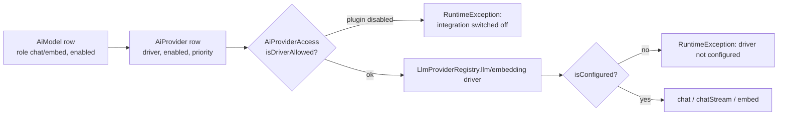

# AI provider integrations

The seven `plugin.ai` packages under `integrations/` (`Ollama`, `OpenAiCompat`, `Zai`, `DeepSeek`, `Gemini`, `Anthropic`, `OpenAi`) are **on/off switches, not drivers**: each `*Module.php` has empty `register()`/`boot()` methods and its translation says "drivers ship in the Ai module". The actual driver classes live in `modules/Ai/Application/Providers/` and are registered unconditionally by `AiModule::registerBuiltinProviders()`. `Modules\Ai\Application\AiProviderAccess` then checks whether the integration module for a driver is enabled (`ModuleAiIntegrationGate` → `ModuleManager::isEnabled()`) before a model can be selected or a settings field shown. Groq and Cerebras drivers have no integration package and are always allowed. This page covers the driver contract, per-driver settings and how to add a driver; the platform itself (agents, RAG, tools, UI) is documented in [`../AI_PLATFORM.md`](../AI_PLATFORM.md) and [`../modules/ai.md`](../modules/ai.md).

## Contracts (`modules/Ai/Application/Contracts/`)

| Interface | Methods | Notes |
| --- | --- | --- |
| `LlmProvider` | `driver(): string`, `isConfigured(): bool`, `chat(ChatRequest): ChatResponse`, `ping(): array{ok, message, details?}` | required for chat drivers |
| `StreamableLlm` | `chatStream(ChatRequest, callable(string $delta): void): ChatResponse` | optional; tool-call rounds may return a full response without deltas |
| `EmbeddingProvider` | `driver()`, `isConfigured()`, `embed(list<string> $texts, string $modelId): list<list<float>>`, `dimensions(string $modelId): ?int` | required for `role = embed` models |

DTOs: `modules/Ai/Application/Dto/ChatRequest`, `ChatResponse`, `ChatMessage`.

Registry: `modules/Ai/Application/LlmProviderRegistry.php` — `registerLlm()`, `registerEmbedding()`, `llm($driver)`, `embedding($driver)`, `allLlm()`, `allEmbedding()`; keyed by `driver()`.

## Registered drivers

All registered in `modules/Ai/AiModule::registerBuiltinProviders()`. `OpenAiCompatLlmProvider($driverName, $settings, $apiKeySetting, $defaultBaseUrl, $baseUrlSetting = null)` is reused for every OpenAI-compatible API.

| Driver key | Class | Default base URL | Credential / URL setting | LLM | Embed | Stream | Gate (integration id) |
| --- | --- | --- | --- | --- | --- | --- | --- |
| `ollama` | `OpenAiCompatLlmProvider` | `http://127.0.0.1:11434` (override: `ai.ollama_base_url`) | `ai.ollama_base_url` (string) | yes | yes (`/api/embed`) | yes | `ollama` |
| `openai_compat` | `OpenAiCompatLlmProvider` | `https://openrouter.ai/api/v1` | `ai.openrouter_api_key` | yes | no | yes | `openai_compat` |
| `openai` | `OpenAiCompatLlmProvider` | `https://api.openai.com/v1` | `ai.openai_api_key` | yes | yes (`/embeddings`) | yes | `openai` |
| `groq` | `OpenAiCompatLlmProvider` | `https://api.groq.com/openai/v1` | `ai.groq_api_key` | yes | no | yes | none (always allowed) |
| `cerebras` | `OpenAiCompatLlmProvider` | `https://api.cerebras.ai/v1` | `ai.cerebras_api_key` | yes | no | yes | none (always allowed) |
| `zai` | `OpenAiCompatLlmProvider` | `https://api.z.ai/api/paas/v4` | `ai.zai_api_key` | yes | no | yes | `zai` |
| `deepseek` | `OpenAiCompatLlmProvider` | `https://api.deepseek.com` | `ai.deepseek_api_key` | yes | no | yes | `deepseek` |
| `anthropic` | `AnthropicLlmProvider` | `https://api.anthropic.com/v1/messages` (`anthropic-version: 2023-06-01`) | `ai.anthropic_api_key` | yes | no | **no** (`LlmProvider` only) | `anthropic` |
| `gemini` | `GeminiLlmProvider` | `https://generativelanguage.googleapis.com/v1beta/models/{model}:generateContent` / `:streamGenerateContent?alt=sse` / `:embedContent` | `ai.gemini_api_key` | yes | yes | yes | `gemini` |

Notes derived from the code:

- The `OpenAiCompat` package is labelled "OpenRouter" in the model catalog (`DefaultModelCatalog`) and in the settings form (`keys_flag: openrouter`); the default base URL is OpenRouter's.
- `isConfigured()`: API-key drivers require a non-empty key setting; `ollama` instead probes the base URL (`ollamaReachable()`).
- `OpenAiCompatClient` (`modules/Ai/Application/Providers/OpenAiCompatClient.php`) uses cURL with a 90 s timeout, `Authorization: Bearer`, and parses SSE `data:` lines for `chatCompletionsStream()`. If a provider ignores `stream: true` and emits no deltas, `OpenAiCompatLlmProvider::chatStream()` falls back to a non-streamed `chat()` and replays the text through `fakeStream()`.
- Gemini streaming falls back to `generateContent` on error; tool rounds always use the non-stream path.
- Anthropic sends `max_tokens: 4096`; Groq/Cerebras get a default `max_tokens` of 800 (`defaultMaxTokens()`).
- `ping()` uses a fixed model per driver (`pingModel()`: `llama3.2`, `glm-4.5-flash`, `deepseek-chat`, `openai/gpt-oss-20b`, `qwen-3.8-27b`, `openrouter/free`, `gpt-4.1-mini`; Anthropic `claude-haiku-4-5-20251001`; Gemini `gemini-3.6-flash`).
- Gemini `dimensions()` returns 3072 for `gemini-embedding*` models.

## Settings and env keys

All credentials are **settings**, not `.env` variables — there are no `AI_*`/`OPENAI_*` keys in `config/env.schema.toml` or `config/`. They are defined in `AiModule::defineSettings()` (module id `ai`) and edited at **Admin → AI → Settings** (`/admin/ai/settings`, permission `ai.manage`, `modules/Ai/Http/SettingsController.php`).

| Setting | Type | Default |
| --- | --- | --- |
| `ai.openai_api_key` | encrypted | `` |
| `ai.anthropic_api_key` | encrypted | `` |
| `ai.gemini_api_key` | encrypted | `` |
| `ai.groq_api_key` | encrypted | `` |
| `ai.openrouter_api_key` | encrypted | `` |
| `ai.cerebras_api_key` | encrypted | `` |
| `ai.zai_api_key` | encrypted | `` |
| `ai.deepseek_api_key` | encrypted | `` |
| `ai.ollama_base_url` | string | `http://127.0.0.1:11434` |

`AiProviderAccess::settingsFieldDefinitions()` hides the field of any driver whose integration package is disabled (Groq/Cerebras are always shown). The settings page also offers `POST /admin/ai/settings/ping` (`LlmProvider::ping()`) and `POST /admin/ai/settings/seed-catalog`.

In Docker the default Ollama URL `127.0.0.1` points at the PHP container itself; set `ai.ollama_base_url` to `http://host.docker.internal:11434` (the compose file maps `host.docker.internal` via `extra_hosts`, see [`../infrastructure/docker.md`](../infrastructure/docker.md)).

## Model selection



- Entities: `modules/Ai/Domain/AiProvider` (`driver`, `name`, `baseUrl`, `apiKeySetting`, `enabled`, `priority`) and `AiModel` (`providerId`, `modelId`, `role` `chat|embed|…`, `supportsTools/Vision/Thinking`, `contextWindow`, `embeddingDimensions`, `isFreeTier`, `enabled`).
- `DefaultModelCatalog` (`modules/Ai/Application/Catalog/`) seeds one `AiProvider` per driver (Ollama prio 5, OpenRouter 10, Groq 15, Cerebras 18, Gemini 20, Z.ai 25, DeepSeek 30, OpenAI 40, Anthropic 50) plus model rows; run it from the settings page ("seed catalog").
- `ModelRouter::resolveLlm($modelEntityId, $role)` / `resolveEmbedding()` load the chosen model or, when none is given, the first enabled model of that role whose provider is allowed **and** configured (`firstConfigured()`; candidates are ordered with free-tier models first, see `resolveModel()`). `chatStreamWithModel()` uses `StreamableLlm::chatStream()` when the driver implements it and otherwise falls back to `chat()`.
- `AiProviderAccess::modelSelectOptions()` builds the model pickers in the admin (agents, widgets) and lists only models whose provider is enabled, allowed and configured; the option icon comes from the integration's `module.php` `icon`.
- Z.ai models with `supportsThinking` get thinking-mode parameters in `ModelRouter::prepareRequest()`.

## Enabling providers

```bash
php gereq module:enable ai
php gereq module:enable ollama       # one id per call
php gereq module:enable openai_compat
php gereq module:enable gemini
# also: zai, deepseek, anthropic, openai
```

or Admin → Modules → Plug-ins → AI (group `plugin.ai` from `config/module_groups.php`). Each package `module.php` requires `core ^1.0` and `ai ^1.0`, has `groups: ['plugin.ai']`, `provides: ['<id>']`, no capabilities, no settings and no migrations.

## Adding a new provider

1. Implement `LlmProvider` (and `StreamableLlm` / `EmbeddingProvider` as applicable) in `modules/Ai/Application/Providers/`. For an OpenAI-compatible API you can instead instantiate `OpenAiCompatLlmProvider('<driver>', $settings, 'ai.<driver>_api_key', 'https://…')` in `AiModule::registerBuiltinProviders()`.
2. Define the credential setting in `AiModule::defineSettings()` and add a row to `AiProviderAccess::settingsFieldDefinitions()` plus translation keys `ai.settings.<driver>_api_key` in `modules/Ai/Resources/translations/`.
3. Add the driver to `AiProviderAccess::INTEGRATION_BY_DRIVER` — either `null` (always allowed) or the id of a new marker package under `integrations/<Name>/` (`module.php` with `kind: integration`, `groups: ['plugin.ai']`, empty `*Module.php`, translations) so it can be toggled in Admin → Modules.
4. Add a provider entry and model rows to `DefaultModelCatalog`, and optionally a `pingModel()` mapping.
5. Bump `modules/Ai/module.php` version per `.cursor/rules/module-updates.mdc` (see [`../infrastructure/tooling.md`](../infrastructure/tooling.md)).

## Related

- [`../AI_PLATFORM.md`](../AI_PLATFORM.md) — platform overview (Czech)
- [`../modules/ai.md`](../modules/ai.md) — Ai module reference
- [index.md](index.md) — integration lifecycle
