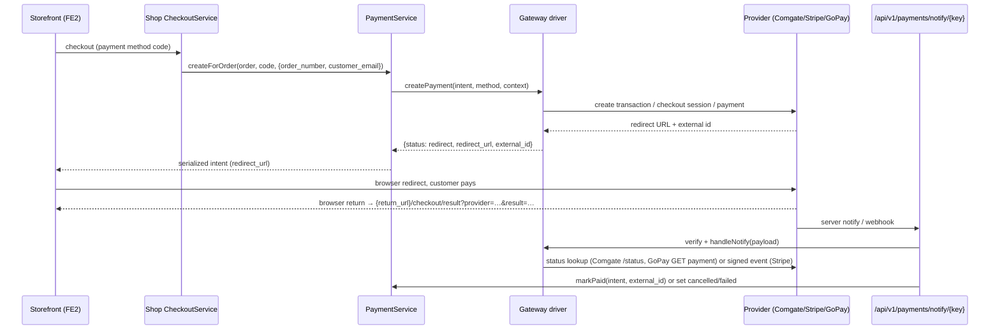

# Payment integrations: Comgate, Stripe, GoPay

Three packages in `integrations/` implement `Modules\Payments\Application\PaymentGatewayInterface` and register themselves in `PaymentGatewayRegistry`: Comgate (`integrations/Comgate`), Stripe Checkout (`integrations/Stripe`) and GoPay (`integrations/GoPay`). The host module `modules/Payments` owns the `PaymentIntent`/`PaymentMethod` entities and the `PaymentService` that picks a gateway by the payment method's `provider` field; the storefront checkout (`modules/Shop/Application/CheckoutService.php`) creates the intent, redirects the customer to the gateway URL, and the final status is applied only from the provider's server-to-server notification handled by each package's `*InboundProvider`. General integration mechanics are in [index.md](index.md).

## Host contract (`modules/Payments`)

| Piece | File | Notes |
| --- | --- | --- |
| Driver interface | `modules/Payments/Application/PaymentGatewayInterface.php` | `key()`, `createPayment(PaymentIntent $intent, PaymentMethod $method, array $context): array{status, redirect_url, external_id, payment_reference, spayd_payload, meta}`, `handleNotify(array $payload): array{ok, status, external_id, message}` |
| Registry | `modules/Payments/Application/PaymentGatewayRegistry.php` | `register()`, `get(key)`, `getOrManual(key)`, `all()`; Payments registers `ManualBankGateway` (`modules/Payments/Application/Gateways/`) itself |
| Orchestration | `modules/Payments/Application/PaymentService.php` | `createForOrder(Order, methodCode, context)`: resolves `PaymentMethod` by code, gateway by `strtolower($method->provider() ?: 'manual')`, creates `PaymentIntent`, calls `createPayment()`, stores `status` (`redirect`/`pending`/`failed`), `redirect_url`, `external_id`, `payment_reference`, `spayd_payload`, `meta`, emits event `payment.intent_created`. `markPaid(intent, externalId)` finalises. |
| Payment methods admin | `/admin/payments/methods` (`modules/Payments/Http/PaymentMethodController.php`) | the **provider** field of a method must equal the gateway key (`comgate`, `stripe`, `gopay`, or empty → manual) |
| REST | `/api/v1/payments/methods`, `/api/v1/payments/intents/{id}`, `/api/v1/payments/intents/{id}/mark-paid`, `/api/v1/payments/orders/{orderId}/intents` (scopes `payments.read` / `payments.write`) | `modules/Payments/Http/Api/*` |
| Inbound webhooks (optional) | `src/Webhooks` — `InboundWebhookRegistry`, `POST /api/v1/webhooks/inbound/{provider}` | each package registers a `Gereq\Api\InboundWebhookProviderInterface` implementation when the Webhooks module class exists |

## Gateway flow

Browser returns never change the intent status — all three packages apply status only from the verified server notification (`ComgateGateway`: "status is applied only via Comgate server notify (with secret)"; `StripeGateway`: "status is applied only via Stripe-Signature"). `return_url` in `$context` (falls back to `APP_URL`) is the base for the storefront result page `/checkout/result?provider=<key>&result=<paid|pending|cancelled|success|cancel>`.

Status mapping used by the inbound providers: `paid` → `PaymentService::markPaid()`; `cancelled` / `failed` → `PaymentIntent::setStatus()`; `pending` → no change. The intent is looked up by `external_id` first, then by the order number (`ref_id`).

## Comgate (`integrations/Comgate`)

| File | Role |
| --- | --- |
| `module.php` | id `comgate`, requires `payments ^1.1`, optional `webhooks ^1.0`, group `plugin.payments`, capability `payment.gateway.comgate`, icon `credit-card` |
| `ComgateModule.php` | registers `ComgateGateway`, defines settings, adds route, registers `ComgateInboundProvider` |
| `Application/ComgateGateway.php` | REST client for `https://payments.comgate.cz/v1.0` (`/create`, `/status`) |
| `Application/ComgateInboundProvider.php` | `name() = 'comgate'`; `verify()` compares the `secret` field of the notify payload with `payments.comgate_secret` (`hash_equals`); `handle()` runs `handleNotify` and updates the intent |
| `Http/ComgateNotifyController.php` | delegates to the inbound provider |
| `Resources/translations/messages.{cs,en}.php` | `module.comgate.description`, `comgate.settings.merchant`, `comgate.settings.secret`, `comgate.settings.test` (+ `.help` variants) |

Settings (module id `comgate`):

| Key | Type | Default | Meaning |
| --- | --- | --- | --- |
| `payments.comgate_merchant` | string | `` | Merchant ID |
| `payments.comgate_secret` | encrypted | `` | Secret for create/status and notify verification |
| `payments.comgate_test` | boolean | `true` | **Test mode** — sent as `test=true` to `/create`; on by default |

Route: `GET|POST /api/v1/payments/notify/comgate` (`api.payments.notify.comgate`).

`createPayment()` posts form data to `/create` with `prepareOnly=true`, `price` in cents, `curr`, `label` (order number, 16 chars), `refId` = order number, `method` (`comgate_method` context or `ALL`), `email`, `fullName`, `lang` (`cs`), `country` (`CZ`), `delivery` (`HOME_DELIVERY`), `category=PHYSICAL_GOODS_ONLY`, `embedded`, and the three `url_paid|pending|cancelled` return URLs. Response `code=0` → `status: redirect`, `redirect_url` = `redirect`, `external_id` = `transId`; otherwise `status: failed` with the error in `meta`. Unconfigured merchant/secret → `status: pending` with `meta.error`.

`handleNotify()` requires `transId`, calls `/status` and maps `PAID → paid`, `CANCELLED|CANCEL → cancelled`, `PENDING → pending` (anything else lower-cased, default `pending`).

## Stripe (`integrations/Stripe`)

| File | Role |
| --- | --- |
| `module.php` | id `stripe`, version `1.0.1`, requires `payments ^1.1`, optional `webhooks ^1.0`, group `plugin.payments`, capability `payment.gateway.stripe` |
| `StripeModule.php` | registers `StripeGateway`, settings, `POST /api/v1/payments/notify/stripe` (`api.payments.notify.stripe`), `StripeInboundProvider` |
| `Application/StripeGateway.php` | Stripe REST (`https://api.stripe.com/v1`), Checkout Sessions; `parseWebhook(payload, signatureHeader)` verifies `Stripe-Signature` with the webhook secret |
| `Application/StripeInboundProvider.php` | `name() = 'stripe'`; `verify()` accepts requests without `Stripe-Signature` (browser return, no status change) and validates signed ones via `parseWebhook`; `handle()` maps the event and updates the intent (unknown intent → `{ok: true, ignored: true}`) |
| `Http/StripeNotifyController.php` | delegates to the inbound provider |
| `Resources/translations/` | `stripe.settings.secret`, `stripe.settings.webhook_secret`, `module.stripe.description` |

Settings (module id `stripe`):

| Key | Type | Default | Meaning |
| --- | --- | --- | --- |
| `payments.stripe_secret` | encrypted | `` | Secret API key (`sk_live_…` / `sk_test_…`) |
| `payments.stripe_webhook_secret` | encrypted | `` | Webhook signing secret (`whsec_…`); without it webhooks are rejected as invalid |

Test mode: there is no separate flag — use a `sk_test_` key and the matching test webhook secret.

`createPayment()` creates a Checkout Session (`mode`, `success_url` / `cancel_url` = `{return_url}/checkout/result?provider=stripe&result=success|cancel&session_id={CHECKOUT_SESSION_ID}`, `client_reference_id` = order number, `line_items`, `metadata[order_number|order_id|intent_hint]`, `payment_intent_data[metadata][order_number]`, `customer_email`). Returns `redirect_url` = session `url`, `external_id` = session id, `meta.payment_intent`.

`handleNotify()` maps event types: `checkout.session.completed` / `checkout.session.async_payment_succeeded` → `paid` when `payment_status=paid` or `status=complete`, else `pending`; `checkout.session.expired` / `checkout.session.async_payment_failed` → `cancelled`; `payment_intent.succeeded` → `paid`; `payment_intent.payment_failed` / `payment_intent.canceled` → `failed`. Order reference from `client_reference_id` or `metadata.order_number`.

Configure the webhook endpoint in Stripe to `https://<APP_URL>/api/v1/payments/notify/stripe` (or `/api/v1/webhooks/inbound/stripe` when the Webhooks module is enabled).

## GoPay (`integrations/GoPay`)

| File | Role |
| --- | --- |
| `module.php` | id `gopay`, requires `payments`, group `plugin.payments`, capability `payment.gateway.gopay` |
| `GoPayModule.php` | registers `GoPayGateway`, settings, `GET|POST /api/v1/payments/notify/gopay` (`api.payments.notify.gopay`), `GoPayInboundProvider` |
| `Application/GoPayGateway.php` | OAuth2 client-credentials token (`/oauth2/token`) then `POST /payments/payment`; status via `GET /payments/payment/{id}` |
| `Application/GoPayInboundProvider.php` | inbound notify handling analogous to Comgate |
| `Http/GoPayNotifyController.php` | delegates to the inbound provider |
| `Resources/translations/` | `gopay.settings.goid`, `gopay.settings.client_id`, `gopay.settings.client_secret`, `gopay.settings.sandbox`, `module.gopay.description` |

Settings (module id `gopay`):

| Key | Type | Default | Meaning |
| --- | --- | --- | --- |
| `payments.gopay_goid` | string | `` | GoID (target account) |
| `payments.gopay_client_id` | string | `` | OAuth client id |
| `payments.gopay_client_secret` | encrypted | `` | OAuth client secret |
| `payments.gopay_sandbox` | boolean | `true` | **Sandbox** → `https://gw.sandbox.gopay.com/api`; `false` → `https://gate.gopay.cz/api` |

`createPayment()` builds `payer` (default/allowed payment instrument from the method, contact from `customer_*` context), `target {type: ACCOUNT, goid}`, `amount` in cents, `currency`, `order_number` (128 chars), `order_description`, `lang`, and `callback.return_url` = `{return_url}/api/v1/payments/notify/gopay?return=1`, `callback.notification_url` = `{return_url}/api/v1/payments/notify/gopay`. Returns `redirect_url` = `gw_url`, `external_id` = payment id, `meta.state`. OAuth failure → `status: failed`.

`handleNotify()` fetches the payment and maps `PAID → paid`, `CANCELED|CANCELLED|TIMEOUTED → cancelled`, `CREATED|PAYMENT_METHOD_CHOSEN|AUTHORIZED → pending`, `REFUNDED|PARTIALLY_REFUNDED → paid`, default `pending`.

Note: unlike Comgate/Stripe, GoPay's browser `return_url` points at the notify endpoint (`?return=1`); the endpoint still only applies status after querying GoPay.

## Admin settings screens

- Gateway credentials: Admin → Settings (`/admin/settings`, `src/Admin/Http/SettingsController.php`). Definitions are grouped by the owning module id; since `comgate`/`stripe`/`gopay` are not in the controller's known list, their keys appear in the **"other"** tab (`settings.group.other`), not under "payments". Encrypted keys are masked (`isSecretKey`).
- Payment methods: Admin → Payments → Methods (`/admin/payments/methods`) — set `provider` to the gateway key, fees, instructions, active flag.
- Enable/disable the plug-in: Admin → Modules → Plug-ins → Platby, or `php gereq module:enable comgate|stripe|gopay` (requires `payments` enabled).
- Payment intents are visible through the Orders module and the REST API; there is no dedicated intent admin page in `modules/Payments`.

## Translations

Each package ships `Resources/translations/messages.cs.php` and `messages.en.php` containing the module description (`module.<id>.description`) and setting labels/help texts (`<id>.settings.<field>`, `<id>.settings.<field>.help`). Keys are indexed by GEREQ_TOOLS `gereq-i18n` together with core and module catalogs.

## Related

- [index.md](index.md) — integration lifecycle and registries
- [shipping.md](shipping.md) — the Shop/Orders checkout counterpart for shipments
- [../modules/index.md](../modules/index.md)
