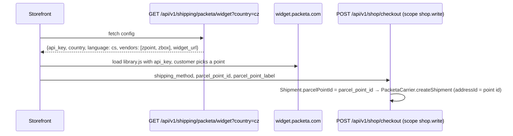

# Shipping integration: Packeta

`integrations/Packeta` is the only external shipping carrier. It implements `Modules\Shop\Application\ShippingCarrierInterface`, registers into `ShippingCarrierRegistry` under the key `packeta` (alias `zasilkovna`), stores its credentials as `shop.packeta_*` settings, exposes `GET /api/v1/shipping/packeta/widget` so a storefront can load the Packeta pickup-point widget, and talks to the Packeta REST/XML API (`https://www.zasilkovna.cz/api/rest`) to create packets, fetch PDF labels and track status. Shipments are created by the Shop checkout and managed from the Orders admin. Integration mechanics in general: [index.md](index.md).

## Host contract (`modules/Shop`)

| Piece | File | Notes |
| --- | --- | --- |
| Driver interface | `modules/Shop/Application/ShippingCarrierInterface.php` | `key()`, `createShipment(Shipment $shipment, array $context): array{status, tracking_number, external_id, label_url, meta}`, `syncStatus(Shipment $shipment): array{status, tracking_number, meta}` |
| Registry | `modules/Shop/Application/ShippingCarrierRegistry.php` | `register()`, `registerAlias(alias, carrier)`, `get(key)`, `getOrManual(key)`, `all()`; Shop registers `ManualCarrier` and `PplCarrier` (scaffold, `modules/Shop/Application/Carriers/`) and publishes the registry as capability `shipping_carriers` |
| Shipping method | `modules/Shop/Domain/ShippingMethod.php` | admin-defined method with `carrier` (must equal a carrier key, e.g. `packeta`), `type`, price; managed at `/admin/shop/…` (`ShippingMethodController`) and `/api/v1/shop/shipping-methods` (`ShippingMethodApiController`, filterable by `carrier`) |
| Shipment entity | `modules/Shop/Domain/Shipment.php` | `orderId`, `carrier`, `shippingMethodCode`, `parcelPointId`, `status`, `trackingNumber`, `externalId`, `labelUrl`, `meta` |
| Checkout | `modules/Shop/Application/CheckoutService::createShipmentDraft()` | after order creation: `new Shipment(orderId, carrier)` with `parcel_point_id` from checkout data, then `registry->getOrManual(carrier)->createShipment($shipment, $shipping)`; result copied to the shipment and the order's tracking number |
| Orders admin | `modules/Orders/Http/OrderShipmentController.php` | `POST /admin/orders/{id}/shipment/create` (re-create via carrier, stores tracking number + label URL), `POST /admin/orders/{id}/shipment/sync` (`syncStatus`) |
| Checkout input | `modules/Shop/Http/Api/CheckoutApiController.php` (`POST /api/v1/shop/checkout`, scope `shop.write`) | accepts `shipping_method`, `parcel_point_id`, `parcel_point_label` and passes them to `CheckoutService::checkout()`. The public store endpoint `POST /api/public/store/checkout` (`modules/Shop/Http/Public/PublicStoreCartController.php`) does not read `parcel_point_*` |

## Package files

| File | Role |
| --- | --- |
| `integrations/Packeta/module.php` | id `packeta`, `kind: integration`, requires `shop ^1.4`, group `plugin.shipping` |
| `integrations/Packeta/PacketaModule.php` | `register()`: registers `PacketaCarrier` + alias `zasilkovna`, capability `shipping.carrier.packeta`, four settings, widget route |
| `integrations/Packeta/Application/PacketaCarrier.php` | the driver (XML API client, label download, tracking, widget config) |
| `integrations/Packeta/Http/PacketaApiController.php` | `widget(Request)` → `ApiResponse::data($carrier->widgetConfig($country))` |
| `integrations/Packeta/Resources/translations/messages.{cs,en}.php` | `packeta.settings.api_password`, `packeta.settings.api_key`, `packeta.settings.eshop`, `packeta.settings.address_carrier_id`, `module.packeta.description` |

## Settings (module id `packeta`)

| Key | Type | Default | Meaning |
| --- | --- | --- | --- |
| `shop.packeta_api_password` | string | `` | API password for the REST API (`createPacket`, `packetLabelPdf`, `packetTracking`); without it `createShipment` returns `status: draft` with `meta.error` |
| `shop.packeta_api_key` | string | `` | public widget API key returned by the widget endpoint |
| `shop.packeta_eshop` | string | `` (falls back to `shop.store_name`, then `GEREQ`) | `eshop` attribute of the packet |
| `shop.packeta_address_carrier_id` | string | `106` | Packeta `addressId` used for home delivery when no pickup point is chosen |

Note: both credentials are defined as `TYPE_STRING`, not `TYPE_ENCRYPTED` (unlike payment secrets). Edit them in Admin → Settings; because grouping in `SettingsController::groupDefinitions()` is by module id, they appear in the "other" tab.

## Registration into the Shop capability

```php
$carriers = $context->get(ShippingCarrierRegistry::class);
$packeta  = $context->get(PacketaCarrier::class);
$carriers->register($packeta);                 // key 'packeta'
$carriers->registerAlias('zasilkovna', $packeta);
$context->capabilities()->register('shipping.carrier.packeta', $this->id(), $packeta);
```

A `ShippingMethod` with `carrier = packeta` (or `zasilkovna`) then routes `createShipment`/`syncStatus` to this driver. Enable with `php gereq module:enable shop` then `php gereq module:enable packeta`.

## Pickup points (widget)



- `PacketaCarrier::widgetConfig($country)` returns `api_key` (`shop.packeta_api_key`), `country` (lower-cased query param, default `cz`), `language: cs`, `vendors: ['zpoint', 'zbox']`, `widget_url: https://widget.packeta.com/v6/www/js/library.js`.
- The endpoint is registered in `PacketaModule` as `api.shipping.packeta.widget`; see `src/Http/PublicCors.php` / `FRONTEND_ORIGIN` for cross-origin access from a separate storefront.
- The RealEstates storefronts (`FE2/`, `frontend/`) do not use the widget — it is intended for the Shop storefront.

## Packet creation, label and tracking

`createShipment()`:

1. Builds `packetAttributes` (`buildPacketAttributes`): `number` (order number), `name`/`surname` (split from `name`/`customer_name`), `email`, `phone`, `value` (`order_total`), `currency` (`CZK`), `weight` (`1`), `eshop`, `addressId` = `Shipment::parcelPointId()` or `parcel_point_id` from context, otherwise the home-delivery carrier id (`carrier_id` context or `shop.packeta_address_carrier_id`) plus street/house number fields; optional `cod`.
2. Calls `createPacket` (XML over HTTP POST to `https://www.zasilkovna.cz/api/rest`).
3. On `<fault>` returns `status: draft` with `meta.error` and `meta.stringId`.
4. Otherwise reads `result/id` (packet id → `external_id`) and `result/barcode` (→ `tracking_number`), then downloads the label via `packetLabelPdf` (`format: A6 on A6`) and stores it as a `data:application/pdf;base64,…` URL in `label_url`.
5. Returns `status: label_ready` (label fetched) or `created`; `meta.tracking_url` = `https://www.zasilkovna.cz/cs/sledovani-zasilky?number=<barcode>`, `meta.packet {id, barcode}`.

`syncStatus()` calls `packetTracking` with the packet id, keeps the list of records (`status_code`, `code_text`, `status_text`) in `meta` and maps the last `status_code`: `>= 7 → delivered`, `>= 4 → in_transit`, `>= 1 → created`, otherwise the current status is kept. Triggered from Orders admin (`shipment/sync`).

## Related

- [payments.md](payments.md) — the payment side of the same checkout
- [index.md](index.md) — plugin groups and lifecycle
- [../modules/index.md](../modules/index.md)
