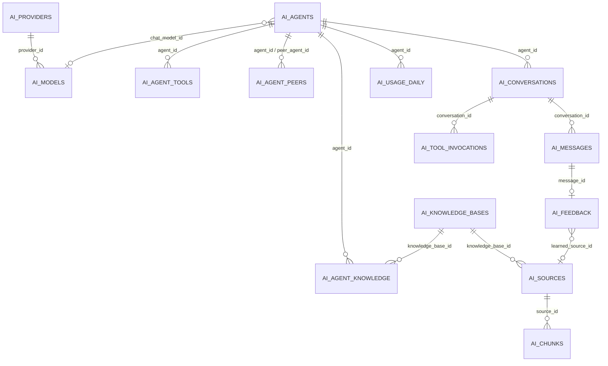

# AI (`ai`)

The AI module turns GEREQ into an **agent platform**: administrators define AI agents (system prompt, playbook, model, allowed tools, knowledge bases, peers), connect LLM/embedding providers (OpenAI, Anthropic, Gemini, Groq, OpenRouter, Cerebras, Z.ai, DeepSeek, Ollama), build RAG knowledge bases from documents/CMS pages/manual text/URLs, and chat with the agents from the admin UI (page, SSE stream, floating assistant) or from external front-ends via `/api/v1/ai/agents/{slug}/chat`. Agents act on the system through a permission-gated **tool registry** (customers, CRM, media, CMS, e-mail, listings, documents, agent-to-agent delegation and user-defined HTTP/static tools), with confirm/draft write modes and per-agent rate limits. Used by admins (`ai.manage`) to configure and by any staff with `ai.use` to chat.

Provider protocols, model catalog and platform design are documented in [`docs/AI_PLATFORM.md`](../AI_PLATFORM.md) and [`docs/integrations/ai-providers.md`](../integrations/ai-providers.md) — this page covers the module surface (entities, routes, API, permissions, widgets). Related: [Customers](customers.md), [CRM](crm.md), [Cms](cms.md), [Documents](documents.md), [Media](media.md), [Emailing](emailing.md), [Listings](listings.md), [module system](../architecture/module-system.md), [dashboard widgets](../architecture/dashboard-widgets.md), [REST API](../architecture/api.md).

## At a glance

| Item | Value |
| --- | --- |
| Module id | `ai` |
| Version | `1.99.0` (`modules/Ai/module.php`, `AiModule::version()`) |
| Directory | `modules/Ai/` |
| Class | `Modules\Ai\AiModule` |
| Requires | `core ^1.0`; optional `documents`, `customers`, `crm`, `listings`, `emailing`, `media`, `cms` (all `^1.0`) |
| Provides / capabilities | `ai` → `Application\AiFacade` (`capabilities()->register('ai', …)`) |
| Capabilities consumed | None formally; uses `Modules\Media\Application\MediaImporter` and `Modules\Emailing\Application\SmtpSender` behind `class_exists`, reads other modules' entities directly in tools |
| Groups / packages | `module.php` `groups: ['comms']`; not listed in any package of `config/module_groups.php` (the `plugin.ai` group there lists the provider plug-in modules `ollama`, `openai_compat`, `zai`, `deepseek`, `gemini`, `anthropic`, `openai`, whose enablement is checked by `ModuleAiIntegrationGate`) |
| Permissions | `ai.use` (`perm.ai.use`), `ai.manage` (`perm.ai.manage`), group `perm.group.ai` |
| API scopes | `ai.admin`, `ai.agent.*` (registered via `registerKnownScope`; per-agent scope `ai.agent.{slug}`) |
| Icon | `zap` |

## Domain model

15 entities in `modules/Ai/Domain/` (all `string(36)` UUID ids, no Doctrine associations).

| Entity | Table | Key fields | Enum values | Relations |
| --- | --- | --- | --- | --- |
| `AiProvider` | `ai_providers` | `driver`: string(40); `name`: string(190); `base_url`; `api_key_setting`: string(120) (settings key holding the API key); `enabled`; `priority` int default 100; timestamps | `DRIVERS = ollama, openai_compat, openai, anthropic, gemini, groq, zai, deepseek` (`cerebras` is seeded by `DefaultModelCatalog` but absent from the constant) | 1‑N `AiModel` |
| `AiModel` | `ai_models` (idx `provider_id`; idx `role, enabled`) | `provider_id`; `model_id`: string(190) (vendor model name); `family`; `role`: string(20); `supports_tools`, `supports_vision`, `supports_thinking`: bool; `context_window`, `embedding_dimensions` nullable int; `is_free_tier`, `is_open_weights`, `enabled`; `metadata` json; timestamps | `ROLES = chat, fast, heavy, embed, vision` | → `AiProvider`; referenced by `AiAgent.chat_model_id/embed_model_id`, `AiChunk.embedding_model_id`, `AiMessage.model_id`, `AiUsageDaily.model_id` |
| `AiAgent` | `ai_agents` (unique `slug`) | `slug`: string(80); `name`; `description`; `system_prompt` text; `playbook` text; `chat_model_id`, `embed_model_id` nullable; `write_mode`: string(20) default `none`; `surfaces` json default `['admin']`; `published` bool; `show_reasoning`, `show_wire` bool default true; `floating_admin` bool default false; `rate_limit_rpm` int default 30; `max_tool_rounds` int default 8; `temperature` float default 0.3; timestamps | `WRITE_MODES = none, draft, confirm`; surfaces `admin`, `api`, `public` (`allowsSurface()`) | 1‑N `AiAgentTool`, `AiAgentKnowledge`, `AiAgentPeer`, `AiConversation`, `AiFeedback` |
| `AiAgentTool` | `ai_agent_tools` (unique `agent_id, tool_name`) | `agent_id`; `tool_name`: string(120) | — | allow-list of tools per agent |
| `AiAgentKnowledge` | `ai_agent_knowledge` (unique `agent_id, knowledge_base_id`) | `agent_id`; `knowledge_base_id` | — | N‑N agent ↔ knowledge base |
| `AiAgentPeer` | `ai_agent_peers` (unique `agent_id, peer_agent_id`) | `agent_id`; `peer_agent_id` | — | agent → agent delegation (`agents.ask`) |
| `AiKnowledgeBase` | `ai_knowledge_bases` (unique `slug`) | `slug`: string(80); `name`; `visibility`: string(20) default `internal`; `description`; timestamps | `VISIBILITIES = internal, public` | 1‑N `AiSource`, `AiChunk` |
| `AiSource` | `ai_sources` (idx `knowledge_base_id, status`; idx `source_type, source_ref`) | `knowledge_base_id`; `source_type`: string(40); `source_ref`: string(80) (document id, URL, …); `title`; `mime`; `checksum`: string(64); `status` default `pending`; `error_message`; `acl` json; `indexed_at`; timestamps | `TYPES = document, email_message, listing, cms_page, manual_text, url`; `STATUSES = pending, ready, failed, stale` (`markStale()`, `markPending()`) | → `AiKnowledgeBase`; 1‑N `AiChunk` |
| `AiChunk` | `ai_chunks` (idx `knowledge_base_id`; idx `source_id, ordinal`) | `source_id`; `knowledge_base_id`; `ordinal` int; `content` text; `token_estimate` int; `metadata` json; `embedding` blob nullable (packed floats via `EmbeddingCodec`); `embedding_model_id`; `embedding_dim`; `content_hash`: string(64); `created_at` | — | → `AiSource`, `AiKnowledgeBase`, `AiModel` |
| `AiConversation` | `ai_conversations` (idx `agent_id, created_at`) | `agent_id`; `surface`: string(20); `actor_type`: string(20) (`user` / `api_token`); `actor_id` nullable; `entity_type`, `entity_id` nullable (context binding); `status` default `open`; timestamps | — | → `AiAgent`; 1‑N `AiMessage`, `AiToolInvocation`, `AiFeedback` |
| `AiMessage` | `ai_messages` (idx `conversation_id, created_at`) | `conversation_id`; `role`: string(20); `content` text; `tool_name`, `tool_call_id` nullable; `token_in`, `token_out` int; `model_id` nullable; `tool_calls_json` json nullable; `created_at` | roles as used by the orchestrator (`system/user/assistant/tool`) | → `AiConversation` |
| `AiToolInvocation` | `ai_tool_invocations` (idx `conversation_id, created_at`) | `conversation_id`; `message_id` nullable; `tool_name`; `args_json` json; `result_json` json nullable; `ok` bool; `status`: string(32) default `executed`; `duration_ms` int; `created_at` | `STATUS_EXECUTED = executed`, `STATUS_PENDING = pending_confirmation`, `STATUS_REJECTED = rejected` | → `AiConversation`, `AiMessage` |
| `AiFeedback` | `ai_feedback` (idx `conversation_id, created_at`; unique `message_id`) | `conversation_id`; `message_id`; `agent_id`; `rating`: string(20); `note` text; `actor_type`, `actor_id`; `learned_source_id` nullable (→ `AiSource` created by `FeedbackLearningService`); `created_at` | `RATINGS = positive, negative` | → `AiConversation`, `AiMessage`, `AiAgent`, `AiSource` |
| `AiCustomTool` | `ai_custom_tools` (unique `name`) | `name`: string(120); `label`: string(255); `description` text; `parameters_schema` json (JSON schema, default `{type: object, properties: {}}`); `handler_type`: string(20) default `static`; `config` json; `surfaces` json default `['admin']`; `permission` string(120) nullable; `enabled`; timestamps | `HANDLERS = http, static` | wrapped at runtime by `Application\Tools\CustomToolRuntime` |
| `AiUsageDaily` | `ai_usage_daily` (unique `day, provider_id, model_id, surface, agent_id`) | `day`: date; `provider_id`; `model_id`; `surface`; `agent_id` nullable; `requests`, `tokens_in`, `tokens_out`, `cost_millis` int | — | aggregated by `UsageTracker`; source for widgets |

## Admin UI

### Menu items (`AiModule::boot()`)

| Menu id | Label key | Icon | Route | Permission | Order / group |
| --- | --- | --- | --- | --- | --- |
| `ai` | `nav.ai` | `zap` | `admin.ai.agents.index` | `ai.use` | 72, group `Integrace` |
| `ai.agents` | `nav.ai.agents` | — | `admin.ai.agents.index` | `ai.use` | 73 (child) |
| `ai.knowledge` | `nav.ai.knowledge` | — | `admin.ai.knowledge.index` | `ai.manage` | 74 |
| `ai.tools` | `nav.ai.tools` | — | `admin.ai.tools.index` | `ai.manage` | 75 |
| `ai.settings` | `nav.ai.settings` | — | `admin.ai.settings` | `ai.manage` | 76 |

Command palette: `ai.agents` (`palette.ai.agents`, `/admin/ai/agents`, keywords `ai, agent, llm, rag, glm`, permission `ai.use`).

### Admin routes (group `/admin/ai`, middleware `auth`)

| Method | Path | Route name | Controller::action | Permission |
| --- | --- | --- | --- | --- |
| GET | `/settings` | `admin.ai.settings` | `SettingsController::edit` | `ai.manage` |
| POST | `/settings` | `admin.ai.settings.update` | `SettingsController::update` | `ai.manage` |
| POST | `/settings/ping` | `admin.ai.settings.ping` | `SettingsController::ping` (provider connectivity test) | `ai.manage` |
| POST | `/settings/seed-catalog` | `admin.ai.settings.seed` | `SettingsController::seedCatalog` (`DefaultModelCatalog::seed()`) | `ai.manage` |
| GET | `/agents` | `admin.ai.agents.index` | `AgentController::index` | `ai.use` |
| GET | `/agents/create` | `admin.ai.agents.create` | `AgentController::create` | `ai.manage` |
| POST | `/agents` | `admin.ai.agents.store` | `AgentController::store` | `ai.manage` |
| GET | `/agents/{id}` | `admin.ai.agents.edit` | `AgentController::edit` | `ai.manage` |
| POST | `/agents/{id}` | `admin.ai.agents.update` | `AgentController::update` | `ai.manage` |
| POST | `/agents/{id}/delete` | `admin.ai.agents.destroy` | `AgentController::destroy` | `ai.manage` |
| GET | `/knowledge` | `admin.ai.knowledge.index` | `KnowledgeController::index` | `ai.manage` |
| POST | `/knowledge` | `admin.ai.knowledge.store` | `KnowledgeController::store` | `ai.manage` |
| POST | `/knowledge/{id}/source` | `admin.ai.knowledge.source` | `KnowledgeController::addSource` (`source_type` default `manual_text`; dispatches `IngestSourceJob`) | `ai.manage` |
| POST | `/knowledge/{id}/reindex` | `admin.ai.knowledge.reindex` | `KnowledgeController::reindex` (dispatches `ReembedKnowledgeBaseJob`) | `ai.manage` |
| GET | `/knowledge/sources/{id}` | `admin.ai.knowledge.source.edit` | `KnowledgeController::editSource` | `ai.manage` |
| POST | `/knowledge/sources/{id}` | `admin.ai.knowledge.source.update` | `KnowledgeController::updateSource` | `ai.manage` |
| POST | `/knowledge/sources/{id}/reingest` | `admin.ai.knowledge.source.reingest` | `KnowledgeController::reingestSource` | `ai.manage` |
| POST | `/knowledge/sources/{id}/delete` | `admin.ai.knowledge.source.destroy` | `KnowledgeController::destroySource` | `ai.manage` |
| GET | `/tools` | `admin.ai.tools.index` | `CustomToolController::index` | `ai.manage` |
| GET | `/tools/create` | `admin.ai.tools.create` | `CustomToolController::create` | `ai.manage` |
| POST | `/tools` | `admin.ai.tools.store` | `CustomToolController::store` | `ai.manage` |
| GET | `/tools/{id}` | `admin.ai.tools.edit` | `CustomToolController::edit` | `ai.manage` |
| POST | `/tools/{id}` | `admin.ai.tools.update` | `CustomToolController::update` | `ai.manage` |
| POST | `/tools/{id}/delete` | `admin.ai.tools.destroy` | `CustomToolController::destroy` | `ai.manage` |
| GET | `/chat/{id}` | `admin.ai.chat` | `AiChatController::show` | `ai.use` |
| POST | `/chat/{id}` | `admin.ai.chat.send` | `AiChatController::send` (non-streaming turn) | `ai.use` |
| POST | `/chat/{id}/stream` | `admin.ai.chat.stream` | `AiChatController::stream` (`text/event-stream` SSE) | `ai.use` |
| POST | `/chat/{id}/confirm` | `admin.ai.chat.confirm` | `AiChatController::confirm` (approve/reject `pending_confirmation` tool call) | `ai.use` |
| POST | `/chat/{id}/feedback` | `admin.ai.chat.feedback` | `AiChatController::feedback` (thumbs up/down → `AiFeedback`) | `ai.use` |
| POST | `/chat/{id}/upload` | `admin.ai.chat.upload` | `AiChatController::upload` (stores a Media asset, dispatches `MediaUploaded`) | `ai.use` |

### Screens

- **Agents** list + form (`@ai/agents/*`): slug, name, description, system prompt, playbook, chat/embed model select (filtered by `AiProviderAccess::modelSelectOptions`), write mode, surfaces, published, show reasoning/wire, floating admin, rate limit, max tool rounds, temperature, tool allow-list, knowledge bases, peers. Validation ruleset `ai.agent.save` (`slug`, `name`, `system_prompt` required; `write_mode in none,draft,confirm`).
- **Knowledge bases** (`@ai/knowledge/*`): create KB (`ai.knowledge.save`: `slug`, `name`, `visibility in internal,public`), add sources (manual text / URL / document…), per-source edit, reingest, delete, KB re-embed.
- **Custom tools** (`@ai/tools/*`): name, label, description, JSON parameters schema, handler `http` or `static`, config, surfaces, required permission, enabled (`ai.custom_tool.save`).
- **Chat** (`@ai/chat/*`): conversation view with streaming, tool-call trace ("wire"), reasoning, confirmations, uploads, feedback. **Floating assistant**: `admin.layout.end` filter appends `@ai/chat/float.html.twig` for agents with `floating_admin = true` and surface `admin` (skipped when `?embed=1` or user lacks `ai.use`).
- **Settings** (`@ai/settings`): API keys and Ollama URL (see Configuration), provider ping, model catalog seeding.

## Public / REST API

`$context->api()->module('ai', …)`:

| Method | Path | Scope | Controller |
| --- | --- | --- | --- |
| POST | `/api/v1/ai/agents/{slug}/chat` | checked in code: token scope `ai.agent.{slug}` or `ai.admin` (`AgentService::assertAccessible`); agent must be `published` and allow surface `api`/`public` | `Http/Api/AiAgentApiController::chat` |

Request body: `message` (required), optional `conversation_id`, `entity_type`, `entity_id`, `surface` (`api`/`public`). The actor gets permissions derived from the authenticated user (`ai.use`, `ai.manage`, `listings.view`, `customers.view`, `crm.view`, `documents.view`) and the token scopes. Response: orchestrator result (conversation id, reply, tool calls, usage); errors `agent_not_found` (404), `validation_error` (422), `ai_error` (400/403/404). No `/api/public/*` routes.

## Events, hooks & webhooks

- Platform events registered: **None** (`EventDefinition` not used). The chat upload dispatches the Media module's `MediaUploaded` event.
- Hooks added: filter `admin.layout.end` (`HookPriority::LATE`, floating assistant); action `platform.event.dispatched` (`HookPriority::LATE`) — on `document.uploaded` envelopes it upserts an `AiSource(type=document)` in the auto-created knowledge base `documents-internal` and dispatches `IngestSourceJob` (auto-RAG for [Documents](documents.md)).
- Queue jobs: `Application\Jobs\IngestSourceJob(sourceId)` → `IngestPipeline::ingestSource()`; `Application\Jobs\ReembedKnowledgeBaseJob(knowledgeBaseId)` → re-ingests all sources of a KB. `CrmRunWorkflowTool` dispatches CRM's `RunWorkflowJob` through the queue.
- Scheduled tasks / publishables: none. `DefaultModelCatalog::seed()` runs on every `boot()` (wrapped in try/catch).

## Dashboard widgets

| Widget id | Type | Class | Shows | Permission | Order |
| --- | --- | --- | --- | --- | --- |
| `ai.shortcut` | shortcut | `Application\Widgets\AiShortcutWidget` | Link to agents (`nav.ai.agents`, hint `admin.dashboard.hint.ai`) | `ai.use` | 72 |
| `ai.usage.stats` | metric | `Application\Widgets\AiUsageStatsWidget` | Requests/tokens from `ai_usage_daily` (`ai.widget.stats.*`) | `ai.manage` | 66 |
| `ai.usage.chart` | panel | `Application\Widgets\AiUsageChartWidget` | Requests per day over N days, totals for requests, tokens, cost (`ai.widget.usage.*`) | `ai.manage` | 27 |

## Services & extension points

| Class (`modules/Ai/Application/`) | Responsibility |
| --- | --- |
| `AiFacade` | Capability `ai`: `orchestrator()`, `agents()`, `tools()`, `providers()`, `chatBySlug(slug, actor, message, conversationId)`. |
| `AiOrchestrator` | Runs a chat turn: `chat()`, `chatStream()`, `resolveConfirmation()`; builds prompt (system + playbook + RAG citations + peers block), tool-calling loop up to `max_tool_rounds`, write-mode handling (`none`/`draft`/`confirm` → `AiToolInvocation` statuses), rate limit, usage tracking. |
| `AgentService` | Agent CRUD lookups, `assertAccessible(agent, actor, requirePublished)` (surface, scope `ai.agent.{slug}`/`ai.admin`, `ai.use`). |
| `AgentDelegationService` | Peer agents: `listPeers()`, `ask()`, `promptBlock()` (used by `agents.list` / `agents.ask` tools). |
| `ToolRegistry` | `register(AiTool)`, `registerContext(AiContextProvider)`, `forActor(actor, allowlist)` (permission + surface filtering), `resolveContext(surface, entityId, actor)`, `setCustomCatalog()`. |
| `CustomToolCatalog` / `Tools\CustomToolRuntime` | Loads enabled `AiCustomTool` rows as runtime tools (`http` or `static` handler). |
| `ToolArgNormalizer`, `ToolInvocationContext` | Argument coercion; per-request invocation context (current agent/actor for delegation). |
| `LlmProviderRegistry`, `ModelRouter` | Provider registry (`registerLlm`, `registerEmbedding`); `resolveLlm(modelId, role)`, `resolveEmbedding()`, `chatWithModel()`, `chatStreamWithModel()`. |
| `AiProviderAccess`, `AiIntegrationGate` / `ModuleAiIntegrationGate` | Which drivers are allowed/configured/usable given enabled integration modules; settings field definitions; driver icons. |
| `Providers\OpenAiCompatLlmProvider` (+`OpenAiCompatClient`), `AnthropicLlmProvider`, `GeminiLlmProvider` | Built-in drivers (details in [ai-providers](../integrations/ai-providers.md)). |
| `Rag\IngestPipeline`, `Rag\TextChunker`, `Rag\RagRetriever`, `Extractors\TextExtractor` | Extract → chunk → embed → store; `retrieve(query, kbIds, embedModelId, topK)` and `formatCitations()`. |
| `Vector\SqlVectorStore` (default), `Vector\PgVectorStore` (pgvector when available), `Vector\EmbeddingCodec` | `VectorStore` implementations. |
| `UsageTracker`, `FeedbackLearningService` | Aggregates `AiUsageDaily`; turns feedback into learned `AiSource` entries. |
| `Catalog\DefaultModelCatalog`, `Catalog\DemoAgentSeeder` | Seeds providers/models; demo agents + knowledge. |

Contracts other modules can implement (`Application/Contracts/`): `AiTool` (`name`, `description`, `parametersSchema`, `permission`, `surfaces`, `invoke`), `MutatingAiTool` (`mutation()`, `confirmSummary()` — participates in draft/confirm write modes), `AiContextProvider` (`supports(surface)`, `snapshot(entityId, actor)`), `LlmProvider`, `StreamableLlm`, `EmbeddingProvider`, `VectorStore`.

Built-in tools registered in `AiModule::registerTools()` (tool name → required permission): `customers.search/get` (`customers.view`), `customers.create` (`customers.create`), `customers.update` (`customers.edit`); `crm.get_deal`, `crm.search_deals`, `crm.list_activities` (`crm.view`), `crm.create_deal`, `crm.update_deal` (`crm.deals.manage`), `crm.create_activity` (`crm.activities.manage`), `crm.list_workflows`, `crm.get_workflow`, `crm.create_workflow`, `crm.set_workflow_active`, `crm.run_workflow` (`crm.workflows.manage`); `media.search`, `media.get` (`media.view`), `media.update`, `media.import_url` (`media.manage`); `cms.search_pages`, `cms.get_page` (`cms.view`), `cms.create_page`, `cms.update_page` (`cms.manage`); `emailing.list_accounts`, `emailing.search_messages` (`emailing.view`), `emailing.send` (`emailing.send`); `listings.get`, `listings.search` (`listings.view`); `documents.search`, `documents.read_text` (`documents.view`); `agents.list`, `agents.ask` (`ai.use`). Tools are constructed unconditionally; `MediaImporter` and `SmtpSender` are resolved behind `class_exists`.

## CLI commands

None.

## Configuration & translations

Settings (`AiModule::defineSettings()`, group `ai`, not public):

| Key | Type | Default |
| --- | --- | --- |
| `ai.openai_api_key`, `ai.anthropic_api_key`, `ai.gemini_api_key`, `ai.groq_api_key`, `ai.openrouter_api_key`, `ai.cerebras_api_key`, `ai.zai_api_key`, `ai.deepseek_api_key` | `TYPE_ENCRYPTED` | `''` |
| `ai.ollama_base_url` | `TYPE_STRING` | `http://127.0.0.1:11434` |

No environment variables are read directly. Provider endpoints are hard-coded in `registerBuiltinProviders()` / `DefaultModelCatalog` (OpenRouter `https://openrouter.ai/api/v1`, OpenAI, Groq, Cerebras, Z.ai `https://api.z.ai/api/paas/v4`, DeepSeek, Anthropic, Gemini).

Translations: `modules/Ai/Resources/translations/messages.cs.php`, `messages.en.php`. Prefixes: `module.ai.description`, `nav.ai*`, `palette.ai.*`, `perm.ai.*`, `perm.group.ai`, `ai.field.*`, `ai.chat.*`, `ai.settings.*`, `ai.agents.*`, `ai.knowledge.*`, `ai.tools.*`, `ai.flash.*`, `ai.widget.*`, `ai.section.*`, `ai.action.*`, `ai.float.*`, `ai.status.*`, `ai.write_mode.*`, `ai.surface.*`, `ai.error.*`, `ai.provider.*`, `ai.model.*`, `ai.peers.*`, `admin.dashboard.hint.ai`.

## Database migrations

| File | Purpose |
| --- | --- |
| `Database/Migrations/2026_09_09_000001_ai_init.php` | Tables via SchemaTool; on PostgreSQL tries `CREATE EXTENSION IF NOT EXISTS vector` and a vector column/index for pgvector (failure tolerated, `SqlVectorStore` stays default). |
| `2026_09_09_000002_ai_peers_feedback.php` | Placeholder for `ai_agent_peers`, `ai_feedback` (SchemaTool). |
| `2026_09_09_000003_ai_custom_tools.php` | Placeholder for `ai_custom_tools`. |
| `2026_09_09_000004_ai_tool_confirmation.php` | Placeholder for `ai_tool_invocations.status`. |
| `2026_09_09_000005_ai_agent_chat_debug_flags.php` | Placeholder for `ai_agents.show_reasoning`, `show_wire`. |
| `2026_09_09_000006_ai_agent_debug_flags_backfill.php` | `afterUp` adds the two bool columns with `DEFAULT TRUE NOT NULL` per platform (PostgreSQL/SQLite/MySQL) because SchemaTool adds NOT NULL without default. |
| `2026_09_09_000007_ai_tool_invocation_status_backfill.php` | Same pattern for `ai_tool_invocations.status DEFAULT 'executed'`. |
| `2026_09_09_000008_ai_agent_floating_admin.php` | Adds `ai_agents.floating_admin DEFAULT FALSE` with per-platform DDL. |
| `2026_09_09_000009_ai_message_tool_calls.php` | Placeholder for `ai_messages.tool_calls_json`. |

## Notes

- `AiProvider::DRIVERS` lacks `cerebras` although `registerBuiltinProviders()` and `DefaultModelCatalog` register a `cerebras` provider.
- API route `/api/v1/ai/agents/{slug}/chat` has no route-level scope; authorisation happens in `AgentService::assertAccessible()` (per-agent scope `ai.agent.{slug}` or `ai.admin`). Exception messages there are Czech literals (`'Agent není publikovaný.'`, `'Chybí API scope …'`) returned to API clients.
- Most migrations are SchemaTool placeholders; three migrations carry hand-written per-platform `ALTER TABLE` statements to work around missing defaults.
- `DefaultModelCatalog::seed()` runs on every request in `boot()` (guarded by try/catch), i.e. a DB read on each boot.
- Embeddings are stored as a `blob` in `ai_chunks.embedding` and compared in PHP (`SqlVectorStore`) unless pgvector is available — linear-scan retrieval.
- Auto-ingest of uploaded documents hooks the generic `platform.event.dispatched` action and swallows all exceptions.
- `IngestPipeline` reads `Modules\Documents\Domain\Document` behind `class_exists`; extraction of other `AiSource::TYPES` (`email_message`, `listing`, `cms_page`) depends on `Extractors\TextExtractor` — see that file for supported types.
- Agent access for `public` surface relies on `published` + token scopes; the actor's permission list in the API controller is a fixed set of six permissions.
