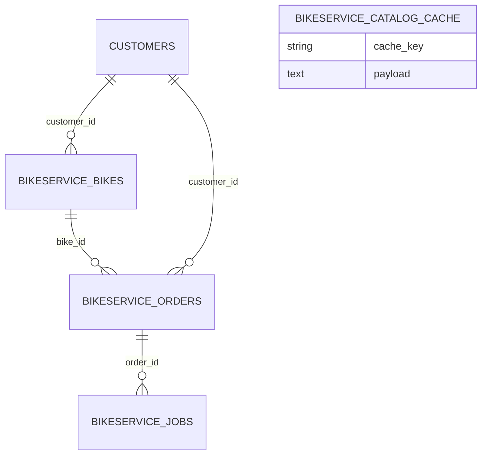

# BikeService (`bikeservice`)

BikeService is the **bicycle / e-bike workshop module** of the EBS package. It keeps a registry of customers' bikes (brand, model, serial, e-bike battery/motor data, Bike Index id), manages service orders with two teams (mechanics / electric), per-job time tracking, phase photos, PDF documents (intake, worksheet, handover with manual or ESign signatures), and integrates public bicycle data sources: the Bike Index API (serial lookup, stolen bikes), the `bikeindex/bike_data` CSV catalog (manufacturers, component types), a parts/price catalog backed by the SearchEngines module (Heureka, Seznam, Hledejceny, Mojekolo…), CityBikes networks and OpenStreetMap bike POIs. Used by workshop staff (`bikeservice.manage`) and read-only viewers (`bikeservice.view`).

Related: [Customers](customers.md), [Currency](currency.md), [SearchEngines](searchengines.md), [Media](media.md), [Documents](documents.md), [Calendar](calendar.md), [ESign](esign.md), [CarService](carservice.md) (sibling module for cars), [module system](../architecture/module-system.md), [dashboard widgets](../architecture/dashboard-widgets.md), [REST API](../architecture/api.md).

## At a glance

| Item | Value |
| --- | --- |
| Module id | `bikeservice` |
| Version | `1.99.0` (`modules/BikeService/module.php`, `BikeServiceModule::version()`) |
| Directory | `modules/BikeService/` |
| Class | `Modules\BikeService\BikeServiceModule` |
| Requires | `core ^1.0`, `customers ^1.0`, `searchengines ^1.0`, `currency ^1.3`; optional `media`, `documents`, `calendar`, `esign` (`^1.0`) |
| Capabilities provided | `bikeservice` → `Application\BikeServiceProvider` |
| Capabilities consumed | `searchengines` (`SearchEnginesProvider`), `media` (`MediaProvider`), `documents` (`DocumentsProvider`, PDF generator), `esign` — via `CapabilityRegistry::has()/get()` + `class_exists` |
| Groups / packages | `module.php` `groups: ['ebs']`; `config/module_groups.php`: **required** in `ebs` |
| Permissions | `bikeservice.view`, `bikeservice.manage` (labels `perm.bikeservice.*`, group `perm.group.bikeservice`) |
| API scopes | `bikeservice.read`, `bikeservice.write` (`registerKnownScope`) |
| Icon | `bike` |

## Domain model

Entities in `modules/BikeService/Domain/` (string(36) UUID ids, no Doctrine associations).

| Entity | Table | Key fields | Enum values | Relations |
| --- | --- | --- | --- | --- |
| `Bike` | `bikeservice_bikes` (idx `customer_id`, `serial_number`, `status`, `kind`) | `kind`: string(32) default `bike`; `status`: string(32) default `active`; `brand`: string(120); `model`; `serial_number`: string(120); `color`: string(64); `frame_size`: string(32); `battery_wh`, `motor_w`, `odometer_km`: int nullable; `customer_id` nullable; `bike_index_id`: int nullable; `note` text; timestamps | `KINDS = bike, ebike, cargo, scooter`; `STATUSES = active, in_service, sold, archived` | → `Customer`; 1‑N `BikeOrder` |
| `BikeOrder` | `bikeservice_orders` (idx `bike_id`, `customer_id`, `status`, `team`; unique `tracker_token`) | `status`: string(32) default `intake`; `team`: string(32) default `mechanics`; `bike_id`: string(36); `customer_id` nullable; `tracker_token`: string(64) unique; `service_info` text; `payment_type`: string(16); `labor_cost`, `parts_cost`: decimal(12,2) nullable; `intake_odometer_km`, `intake_battery_pct`: int; `note` text; `finished_at`; `intake_at`, `handover_at`: date; timestamps | `STATUSES = intake, in_progress, waiting, ready, done, cancelled` (`isOpen()` = not done/cancelled); `TEAMS = mechanics, electric`; `PAYMENT_TYPES = online, cash` | → `Bike`, → `Customer`; 1‑N `BikeJob` |
| `BikeJob` | `bikeservice_jobs` (idx `order_id`) | `order_id`; `type`: string(64) default `work`; `employee_user_id` nullable; `note` text; `started_at`; `finished_at` nullable | — | → `BikeOrder`, → users |
| `CatalogCache` | `bikeservice_catalog_cache` (unique `cache_key`) | `cache_key`: string(120); `payload` text (JSON/CSV); `fetched_at` | — | key/value cache for external catalog and market responses (`CatalogCacheStore`) |

`Bike` and `BikeOrder` carry `#[AdminField]` metadata and are bound to rulesets `bikeservice.bike` and `bikeservice.save` via `forms()->entity()`.

## Admin UI

### Menu items (`BikeServiceModule::boot()`)

| Menu id | Label key | Icon | Route | Permission | Order / group |
| --- | --- | --- | --- | --- | --- |
| `bikeservice` | `nav.bikeservice` | `bike` | `admin.bikeservice.orders` | `bikeservice.view` | 38, group `Provoz` |
| `bikeservice.bikes` | `nav.bikeservice.bikes` | — | `admin.bikeservice.bikes` | `bikeservice.view` | 10 (child) |
| `bikeservice.manufacturers` | `nav.bikeservice.manufacturers` | — | `admin.bikeservice.manufacturers` | `bikeservice.view` | 12 |
| `bikeservice.catalog` | `nav.bikeservice.catalog` | — | `admin.bikeservice.catalog` | `bikeservice.view` | 15 |
| `bikeservice.orders` | `nav.bikeservice.orders` | — | `admin.bikeservice.orders` | `bikeservice.view` | 20 |
| `bikeservice.explore` | `nav.bikeservice.explore` | — | `admin.bikeservice.explore` | `bikeservice.view` | 30 |
| `bikeservice.settings` | `nav.bikeservice.settings` | — | `admin.bikeservice.settings` | `bikeservice.view` | 21, parent `settings` |

Command palette: `bikeservice.orders`, `bikeservice.bikes`, `bikeservice.manufacturers` (icon `book`), `bikeservice.catalog`, `bikeservice.explore` (icon `search`) with Czech keywords. Admin search providers: `bikeservice.orders` (id, note, service_info) and `bikeservice.bikes` (brand, model, serial).

### Admin routes (`/admin/bikeservice`, middleware `auth`)

| Method | Path | Route name | Controller::action | Permission |
| --- | --- | --- | --- | --- |
| GET | `` / `/orders` | `admin.bikeservice.orders` / `admin.bikeservice.orders.index` | `BikeOrderController::index` | `bikeservice.view` |
| GET | `/orders/create` | `admin.bikeservice.orders.create` | `create` | `bikeservice.manage` |
| POST | `/orders` | `admin.bikeservice.orders.store` | `store` (`bikeservice.save`) | `bikeservice.manage` |
| POST | `/orders/bulk` | `admin.bikeservice.orders.bulk` | `bulk` (`bikeservice.bulk`: `action=delete`) | `bikeservice.manage` |
| GET | `/orders/{id}` | `admin.bikeservice.orders.show` | `show` | `bikeservice.view` |
| GET | `/orders/{id}/edit` | `admin.bikeservice.orders.edit` | `edit` | `bikeservice.manage` |
| POST | `/orders/{id}` | `admin.bikeservice.orders.update` | `update` | `bikeservice.manage` |
| POST | `/orders/{id}/status` | `admin.bikeservice.orders.status` | `updateStatus` | `bikeservice.manage` |
| POST | `/orders/{id}/team` | `admin.bikeservice.orders.team` | `switchTeam` | `bikeservice.manage` |
| POST | `/orders/{id}/jobs` | `admin.bikeservice.orders.jobs.store` | `storeJob` (`bikeservice.job`) | `bikeservice.manage` |
| POST | `/orders/{id}/jobs/{jobId}/complete` | `admin.bikeservice.orders.jobs.complete` | `completeJob` | `bikeservice.manage` |
| POST | `/orders/{id}/finish` | `admin.bikeservice.orders.finish` | `finish` (`bikeservice.finish`) | `bikeservice.manage` |
| POST | `/orders/{id}/media` | `admin.bikeservice.orders.media` | `uploadMedia` | `bikeservice.manage` |
| POST | `/orders/{id}/documents` | `admin.bikeservice.orders.documents.generate` | `generateDocument` (`bikeservice.document`) | `bikeservice.manage` |
| POST | `/orders/{id}/delete` | `admin.bikeservice.orders.destroy` | `destroy` | `bikeservice.manage` |
| GET | `/bikes` | `admin.bikeservice.bikes` | `BikeController::index` | `bikeservice.view` |
| GET | `/bikes/create` | `admin.bikeservice.bikes.create` | `create` | `bikeservice.manage` |
| POST | `/bikes` | `admin.bikeservice.bikes.store` | `store` (`bikeservice.bike`) | `bikeservice.manage` |
| POST | `/bikes/lookup-serial` | `admin.bikeservice.bikes.lookup_serial` | `lookupSerial` (Bike Index) | `bikeservice.view` |
| GET | `/bikes/{id}` | `admin.bikeservice.bikes.show` | `show` | `bikeservice.view` |
| GET | `/bikes/{id}/edit` | `admin.bikeservice.bikes.edit` | `edit` | `bikeservice.manage` |
| POST | `/bikes/{id}` | `admin.bikeservice.bikes.update` | `update` | `bikeservice.manage` |
| POST | `/bikes/{id}/delete` | `admin.bikeservice.bikes.destroy` | `destroy` | `bikeservice.manage` |
| GET | `/manufacturers` | `admin.bikeservice.manufacturers` | `CatalogController::manufacturers` | `bikeservice.view` |
| GET | `/manufacturers/{id}` | `admin.bikeservice.manufacturers.show` | `CatalogController::show` | `bikeservice.view` |
| GET | `/catalog` | `admin.bikeservice.catalog` | `CatalogController::index` | `bikeservice.view` |
| GET | `/catalog/search` | `admin.bikeservice.catalog.search` | `CatalogController::search` (JSON, `PartsSearchService`) | `bikeservice.view` |
| GET | `/catalog/market-source` | `admin.bikeservice.catalog.market_source` | `CatalogController::marketSource` (per-source async market fetch) | `bikeservice.view` |
| GET | `/catalog/{id}` | `admin.bikeservice.catalog.show` | `CatalogController::show` | `bikeservice.view` |
| GET | `/explore` | `admin.bikeservice.explore` | `ExploreController::index` | `bikeservice.view` |
| GET | `/settings` | `admin.bikeservice.settings` | `SettingsController::edit` | `bikeservice.view` |
| POST | `/settings` | `admin.bikeservice.settings.update` | `SettingsController::update` (`bikeservice.settings`) | `bikeservice.manage` |

### Screens

- **Orders** (`Resources/views/orders/index|form|show.html.twig`): list with bulk delete; form (bike, customer, status, team, note, service info, payment, labor/parts cost, intake odometer/battery, intake/handover dates); detail with status/team switching, jobs timer, phase photos (`OrderMediaService`, phases from `bikeservice.media_phases`), document generation (`PdfTemplateCatalog`: `worksheet`, `intake`, `handover`), finish with signatures (`OrderEsignService`, `sign_mode manual|digital`, `esign_email`), QR code linking to the order (`QrCodeService::orderUrl`). Orders with `done`/`cancelled` are closed (`isOpen()`).
- **Bikes** (`bikes/*`): registry CRUD, serial lookup against Bike Index (`lookupSerial`), detail with order history.
- **Manufacturers & Catalog** (`manufacturers/index.html.twig`, `catalog/index|show.html.twig`, `assets/js/bsMarket.ts`): browse `bike_data` manufacturers (frames/e-bike filters) and component types; **parts search** with taxonomy (`PartsTaxonomy`, `ComponentTranslations`, `PartsSearchTokens`) and market offers from SearchEngines providers (`BikePartsMarketScope` filters bike-relevant categories, e.g. Seznam category roots 461/471), cached 30 days in `CatalogCache`.
- **Explore** (`explore/index.html.twig`): Bike Index stolen bikes near a location, CityBikes network status (`bikeservice.default_citybikes_network`), OSM bike POIs around `bikeservice.default_lat/lon`.
- **Settings** (`settings.html.twig`): keys below.
- Customer detail section `bikeservice.orders` (order 47, `partials/customer_orders.html.twig`) via `customers.show.sections`.

## Public / REST API

`$context->api()->module('bikeservice', …)` — `Http/Api/BikeServiceApiController.php`:

| Method | Path | Scope | Action |
| --- | --- | --- | --- |
| GET | `/api/v1/bikeservice/bikes` | `bikeservice.read` | `bikes` |
| POST | `/api/v1/bikeservice/bikes` | `bikeservice.write` | `storeBike` (`bikeservice.bike`) |
| GET | `/api/v1/bikeservice/bikes/{id}` | `bikeservice.read` | `showBike` |
| GET | `/api/v1/bikeservice/orders` | `bikeservice.read` | `orders` |
| POST | `/api/v1/bikeservice/orders` | `bikeservice.write` | `storeOrder` (`bikeservice.save`) |
| GET | `/api/v1/bikeservice/orders/{id}` | `bikeservice.read` | `showOrder` |
| POST | `/api/v1/bikeservice/orders/{id}/finish` | `bikeservice.write` | `finishOrder` |
| POST | `/api/v1/bikeservice/orders/{id}/jobs` | `bikeservice.write` | `addJob` |
| POST | `/api/v1/bikeservice/orders/{id}/jobs/{jobId}/complete` | `bikeservice.write` | `completeJob` |
| GET | `/api/v1/bikeservice/public/bikeindex` | `bikeservice.read` | `bikeIndexSearch` (proxy to Bike Index) |
| GET | `/api/v1/bikeservice/public/citybikes/{id}` | `bikeservice.read` | `cityBikesNetwork` |
| GET | `/api/v1/bikeservice/public/osm-nearby` | `bikeservice.read` | `osmNearby` |

Serializers (`BikeServiceProvider`): order → `id`, `status`, `team`, `bike_id`, `customer_id`, `tracker_token`, `service_info`, `payment_type`, `labor_cost`, `parts_cost`, `intake_odometer_km`, `intake_battery_pct`, `note`, `intake_at`, `handover_at`, `finished_at`, `created_at`, `updated_at`; bike → `id`, `kind`, `status`, `brand`, `model`, `serial_number`, `color`, `frame_size`, `battery_wh`, `motor_w`, `odometer_km`, `customer_id`, `bike_index_id`, `note`, `label`, `created_at`, `updated_at`. The `/public/*` routes are under `/api/v1` and still require an API token with `bikeservice.read`; there are no unauthenticated `/api/public/*` endpoints.

## Events, hooks & webhooks

Platform events (all `webhookEnabled(true)`, Czech descriptions): `bikeservice.bike_created`, `bikeservice.bike_updated`, `bikeservice.order_created`, `bikeservice.order_updated`, `bikeservice.team_switched`, `bikeservice.order_finished`, `bikeservice.job_started`, `bikeservice.job_finished` — emitted via `EventBus::emit()` from `BikeServiceProvider`.

Hooks added: filter `customers.show.sections` (`HookPriority::NORMAL`). Hooks exposed, queue jobs, scheduled tasks, publishables: none. Market lookups are cached asynchronously per source (`market_async`, `market_pending_sources` in `PartsSearchService::search()` result) and fetched by the browser via `catalog/market-source`.

## Dashboard widgets

| Widget id | Type | Class | Shows | Permission | Order |
| --- | --- | --- | --- | --- | --- |
| `bikeservice.shortcut` | shortcut | `Application\Widgets\BikeServiceShortcutWidget` | Link to orders | `bikeservice.view` | 37 |
| `bikeservice.stats` | metric | `Application\Widgets\BikeServiceStatsWidget` | Order/bike counts (`bikeservice.widget.*`) | `bikeservice.view` | 62 |
| `bikeservice.open_orders` | panel | `Application\Widgets\BikeServiceOpenOrdersWidget` | Open orders list | `bikeservice.view` | 29 |
| `bikeservice.trend.chart` | panel | `Application\Widgets\BikeServiceTrendChartWidget` | Orders per day trend | `bikeservice.view` | 31 |

## Services & extension points

| Class (`modules/BikeService/Application/`) | Responsibility |
| --- | --- |
| `BikeServiceProvider` | Capability `bikeservice`: `getBike`, `getOrder`, `createBike`, `updateBike`, `createOrder`, `updateOrder`, `finishOrder`, `startJob`, `completeJob`, `listForCustomer`, `listForBike`, `searchOrders`, `searchBikes`, `mediaPhases`, `serializeOrder`, `serializeBike`. |
| `FinishOrderService` | Finish flow: closes order, generates documents when `documents` capability is available. |
| `ServiceDocumentService`, `PdfTemplateCatalog` | PDF generation via Documents (`Resources/views/pdf/intake|worksheet|handover.html.twig`). |
| `OrderEsignService` | Manual vs. digital signature resolution via `esign`. |
| `OrderMediaService` | Phase photos via `media`. |
| `QrCodeService` | `orderUrl`, `dataUriForOrder`. |
| `BikeIndexClient` | `https://bikeindex.org/api/v3`: `searchBySerial`, `searchStolenNearby`, `manufacturers`, `manufacturer`, `find`. |
| `Catalog\BikeDataCatalogClient` | CSVs from `github.com/bikeindex/bike_data`: manufacturers, component types, brake types, wheel sizes, handlebar types. |
| `Catalog\PartsSearchService`, `BikePartsMarketScope`, `PartsTaxonomy`, `PartsSearchTokens`, `ComponentTranslations` | Parts search + market offers through `SearchEnginesProvider` (preferred sources `heureka`, `seznam`, `hledejceny`, `mojekolo`; TTL 30 days). |
| `Catalog\CatalogCacheStore` | TTL/stale cache over `CatalogCache` (`get`, `getStale`, `getJson*`, `put*`, `delete*`, `prefetch`). |
| `CityBikesClient` | `https://api.citybik.es/v2` networks / network detail. |
| `OsmBikePoisClient` | Overpass API (`https://overpass-api.de/api/interpreter`) bike POIs nearby. |

## CLI commands

None.

## Configuration & translations

| Setting key | Type | Default |
| --- | --- | --- |
| `bikeservice.default_team` | string | `mechanics` |
| `bikeservice.media_phases` | string | `before,progress,after` |
| `bikeservice.default_city` | string | `Praha` |
| `bikeservice.default_citybikes_network` | string | `nextbike-praha` |
| `bikeservice.default_lat` | string | `50.087` |
| `bikeservice.default_lon` | string | `14.421` |

No env vars; external endpoints are hard-coded constants in the client classes (User-Agent `GEREQ-BikeService/1.4`).

Translations: `modules/BikeService/Resources/translations/messages.cs.php`, `messages.en.php`. Prefixes: `module.bikeservice.description`, `nav.bikeservice*`, `palette.bikeservice.*`, `perm.bikeservice.*`, `perm.group.bikeservice`, `bikeservice.catalog.*` (largest), `bikeservice.field.*`, `bikeservice.error.*`, `bikeservice.explore.*`, `bikeservice.orders.*`, `bikeservice.flash.*`, `bikeservice.widget.*`, `bikeservice.bikes.*`, `bikeservice.bulk.*`, `bikeservice.media.*`, `bikeservice.documents.*`, `bikeservice.settings.*`, `bikeservice.status.*`, `bikeservice.poi.*`, `bikeservice.kind.*`, `bikeservice.finish.*`, `bikeservice.bike_status.*`, `bikeservice.team.*`, `bikeservice.payment.*`, `bikeservice.partial.*`, `bikeservice.manufacturers.*`, `bikeservice.esign.*`.

## Database migrations

| File | Purpose |
| --- | --- |
| `Database/Migrations/2026_09_06_000001_bikeservice.php` | Placeholder — `bikeservice_*` tables created by SchemaTool. |
| `Database/Migrations/2026_09_06_000002_bikeservice_catalog_cache.php` | Placeholder for `bikeservice_catalog_cache`; `down()` drops it if present. |

## Notes

- Both migrations are SchemaTool placeholders.
- `BikeOrder.tracker_token` is generated, unique and matched by `searchOrders()`, but unlike CarService there is no tracker UI/API (`/tracker/*`) that resolves orders by it.
- `BikeServiceProvider` is instantiated twice (register + boot) rather than reused from the capability registry.
- Settings route/menu are visible with `bikeservice.view`; only the update requires `bikeservice.manage`.
- `searchengines` is a hard requirement in `module.php`, yet the code still guards `capabilities()->has('searchengines')`.
- Money fields (`labor_cost`, `parts_cost`) are `decimal(12,2)` strings; no currency column (the module requires `currency ^1.3` for formatting).
- Event descriptions, palette keywords and a code comment (`// 1 měsíc`) are in Czech.
- External catalog calls (GitHub raw CSV, Bike Index, CityBikes, Overpass) run synchronously in requests, mitigated by `CatalogCacheStore` with stale fallbacks.
