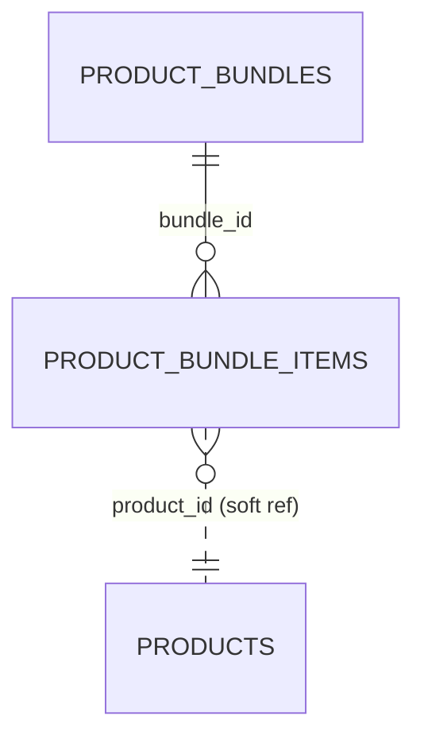

# Bundles (`bundles`)

The Bundles module manages **product bundles / sets**: a named, coded group of product references (by `product_id`) with an optional bundle-level discount (`percent`, `fixed` or `none`) and item-count constraints. It is used by shop administrators (menu group *Obchod*) to define sets, and by other modules (e.g. Shop checkout) through the `bundles` capability to resolve an active bundle into its items and discount definition. The module does not reference the Products entity directly; product ids and titles are stored as plain strings.

See also: [Coupons](coupons.md), [Products](products.md), [Shop](shop.md), [module system](../architecture/module-system.md), [dashboard widgets](../architecture/dashboard-widgets.md), [REST API](../architecture/api.md).

## At a glance

| Item | Value |
| --- | --- |
| Module id | `bundles` |
| Version | `1.99.0` (`modules/Bundles/module.php`, `BundlesModule::version()`) |
| Directory | `modules/Bundles/` |
| Class | `Modules\Bundles\BundlesModule` |
| Requires | `core ^1.0` (no optional deps) |
| Capabilities provided | `bundles` → `Modules\Bundles\Application\BundlesProvider` |
| Capabilities consumed | None |
| Groups / packages | Not listed in any `groups` entry of `config/module_groups.php`; `module.php` has no `groups` key (standalone module) |
| Permissions | `bundles.view` (`perm.bundles.view`), `bundles.manage` (`perm.bundles.manage`) — group `perm.group.bundles` |
| API scopes | `bundles.read`, `bundles.write` |
| Icon | `layers` |

## Domain model

Two anemic-ish entities in `modules/Bundles/Domain/`. There is no Doctrine association between them; the link is the plain `bundle_id` column.

| Entity | Table | Key fields | Enum / status values | Relations |
| --- | --- | --- | --- | --- |
| `ProductBundle` | `product_bundles` (unique `uniq_product_bundles_code` on `code`) | `id`: string(36) UUIDv7 PK; `code`: string(64), upper-cased & trimmed; `name`: string(190); `description`: text nullable; `discount_type`: string(16) default `none`; `discount_value`: decimal(14,2) default `0.00`; `currency`: string(3) nullable, upper-cased; `min_items`: int default 1 (min 1); `max_items`: int nullable (>0 or null); `max_same_product`: int nullable; `is_active`: bool default true; `created_at`, `updated_at` | `DISCOUNT_TYPES = ['percent', 'fixed', 'none']` (unknown value normalises to `none`) | 1‑N `ProductBundleItem` via `bundle_id` |
| `ProductBundleItem` | `product_bundle_items` (index `idx_product_bundle_items_bundle` on `bundle_id`) | `id`: string(36) UUIDv7 PK; `bundle_id`: string(36); `product_id`: string(36) (opaque reference to a product); `title`: string(190) snapshot; `qty`: int default 1 (min 1); `sort_order`: int default 0 | — | `bundle_id` → `ProductBundle.id`; `product_id` → Products module (not enforced) |

`ProductBundle` is annotated with `#[FormEntity('bundles.save')]` and `#[FormGenerator(exclude: ['id','createdAt','updatedAt'], cols: 2)]`, so the admin form is generated from `#[FormField]` attributes (labels `bundles.field.*`, select choices from `DISCOUNT_TYPES` with label prefix `bundles.discount.`).

## Admin UI

### Menu items (registered in `BundlesModule::boot()`)

| Menu id | Label key | Icon | Route | Permission | Order / group |
| --- | --- | --- | --- | --- | --- |
| `bundles` | `nav.bundles` | `layers` | `admin.bundles.index` | `bundles.view` | 36, group `Obchod` |
| `bundles.create` | `nav.bundles.create` | — | `admin.bundles.create` | `bundles.manage` | 37, parent `bundles`, hidden |

Command palette: `bundles.index` (`palette.bundles.index`, url `/admin/bundles`, permission `bundles.view`, keywords `sestava`, `bundle`, `balíček`, `set`).

### Admin routes (`/admin/bundles`, middleware `auth`)

| Method | Path | Route name | Controller::action | Permission |
| --- | --- | --- | --- | --- |
| GET | `/admin/bundles` | `admin.bundles.index` | `BundleController::index` | `bundles.view` |
| GET | `/admin/bundles/create` | `admin.bundles.create` | `BundleController::create` | `bundles.manage` |
| POST | `/admin/bundles` | `admin.bundles.store` | `BundleController::store` | `bundles.manage` |
| GET | `/admin/bundles/{id}/edit` | `admin.bundles.edit` | `BundleController::edit` | `bundles.manage` |
| POST | `/admin/bundles/{id}` | `admin.bundles.update` | `BundleController::update` | `bundles.manage` |
| POST | `/admin/bundles/{id}/delete` | `admin.bundles.destroy` | `BundleController::destroy` | `bundles.manage` |

Controller: `modules/Bundles/Http/BundleController.php`.

### Screens

- **List** (`Resources/views/index.html.twig`): all bundles ordered by `code`, search `q` over `code`/`name` (`self_repair_search`), active/inactive badge, delete with confirm (`bundles.confirm_delete`).
- **Form** (`Resources/views/form.html.twig`): create/edit; generated fields + an `items_json` textarea (`bundles.field.items_json`, hint `[{"product_id":"…","title":"…","qty":1}]`). On save the controller validates ruleset `bundles.save`, checks code uniqueness (422 `bundles.error.code_taken`), replaces all items (`syncItems` deletes and re-inserts with `sort_order` = array index), emits platform event, writes audit log (`bundles.created` / `bundles.updated` / `bundles.deleted`, entity type `product_bundle`) and flashes `bundles.flash.*`.
- No settings page. The module defines no settings keys.

Validation ruleset `bundles.save` (from `registerValidation()`): `code required|min:1|max:64`, `name required|min:2|max:190`, `description nullable|max:20000`, `discount_type required|max:16`, `discount_value nullable`, `currency nullable|max:3`, `min_items`, `max_items`, `max_same_product`, `items_json nullable|max:100000`, `active nullable`. `forms()->entity('bundles.save', ProductBundle::class)` binds it to the entity form generator.

## Public / REST API

Registered via `$context->api()->module('bundles', …)` → base path `/api/v1/bundles`. Controller `modules/Bundles/Http/Api/BundleApiController.php`.

| Method | Path | Scope | Action |
| --- | --- | --- | --- |
| GET | `/api/v1/bundles/` | `bundles.read` | `index` — paginated collection (`ApiQuery`: sortable `code`, `name`, `createdAt`; filterable `active`; free-text `search` over `code`/`name`) |
| POST | `/api/v1/bundles/` | `bundles.write` | `store` — validates `bundles.save`; accepts `items` array or `items_json`; 201 |
| GET | `/api/v1/bundles/{id}` | `bundles.read` | `show` |
| PATCH | `/api/v1/bundles/{id}` | `bundles.write` | `update` (full replace of items) |
| DELETE | `/api/v1/bundles/{id}` | `bundles.write` | `destroy` → `{id, deleted: true}` |
| GET | `/api/v1/bundles/{id}/resolve` | `bundles.read` | `resolve` — `BundlesProvider::resolve()`; 404 when bundle missing **or inactive** |

Serializer fields: `id`, `code`, `name`, `description`, `discount_type`, `discount_value` (string decimal), `currency`, `min_items`, `max_items`, `max_same_product`, `active`, `items[]` (`id`, `product_id`, `title`, `qty`, `sort_order`), `created_at`, `updated_at` (ATOM). Duplicate code → `422 validation_error` with `{code: "taken"}`.

No `/api/public/*` endpoints.

## Events, hooks & webhooks

Platform events (`registerPlatformEvents()`, all `webhookEnabled(true)`, source module `bundles`):

| Event | Description (as registered) | Emitted from |
| --- | --- | --- |
| `bundle.created` | Sestava vytvořena | `BundleController::store`, `BundleApiController::store` |
| `bundle.updated` | Sestava upravena | `BundleController::update`, `BundleApiController::update` |
| `bundle.deleted` | Sestava smazána | `BundleController::destroy`, `BundleApiController::destroy` |

Emission is `EventBus::emit($type, ['type' => 'product_bundle', 'id' => …], $payload)` where payload is the public serialisation of the bundle (including items).

Hooks (actions/filters): none. Queue jobs: none. Scheduled tasks: none. Publishables (staging): none. Audit log entries: `bundles.created`, `bundles.updated`, `bundles.deleted` (admin controller only).

## Dashboard widgets

Registered in `boot()` (`modules/Bundles/Application/Widgets/`):

| Widget id | Type | Class | Shows | Permission | Order |
| --- | --- | --- | --- | --- | --- |
| `bundles.shortcut` | shortcut | `BundlesShortcutWidget` | Link to `admin.bundles.index`, icon `layers`, hint `admin.dashboard.hint.bundles` | `bundles.view` | 36 |
| `bundles.stats` | metric | `BundleStatsWidget` | Count of active bundles; hint with inactive count and number of items in active bundles (`bundles.widget.stats.hint`) | `bundles.view` | 50 |

Templates: `admin/dashboard/widgets/shortcut.html.twig`, `admin/dashboard/widgets/metric.html.twig`.

## Services & extension points

| Class | Responsibility |
| --- | --- |
| `Modules\Bundles\Application\BundlesProvider` | Capability implementation for `bundles`: `find(id)`, `findByCode(code)` (upper-cased), `activeBundles()`, `resolve(id)` → array (id, code, name, description, discount_*, currency, min/max constraints, ordered `items[]`) or `null` when missing/inactive. |

Extension points:

- Capability `bundles` is registered in `register()` with `$context->capabilities()->register('bundles', 'bundles', new BundlesProvider(...))`; consumers resolve it through the capability registry rather than depending on the class.
- No interfaces/contracts are exposed; no `class_exists` guards toward other modules. The module never loads Products — item titles are stored snapshots.

## CLI commands

None.

## Configuration & translations

- Settings keys: none defined or read.
- Environment variables: none.
- Translations: `modules/Bundles/Resources/translations/messages.cs.php`, `messages.en.php`. Key prefixes: `module.bundles.*`, `nav.bundles*`, `palette.bundles.*`, `perm.bundles.*`, `perm.group.bundles`, `bundles.*` (titles, `bundles.field.*`, `bundles.discount.*`, `bundles.error.*`, `bundles.flash.*`, `bundles.widget.stats.*`). The widget hint key `admin.dashboard.hint.bundles` is expected from core translations.

## Database migrations

| File | Purpose |
| --- | --- |
| `Database/Migrations/2026_01_01_000001_bundles.php` | Creates `product_bundles` (PK `id`, unique `uniq_product_bundles_code`, index `idx_product_bundles_active` on `is_active`) and `product_bundle_items` (PK `id`, index `idx_product_bundle_items_bundle`). `down()` drops both. |

## Notes

- `README.md` in the module still says `v1.0.2` while `module.php`/`version()` are `1.1.0`.
- Money is stored as `decimal(14,2)` strings but normalised through `number_format((float) …)` — float round-trip on input.
- Items are hard-deleted and re-created on every save (`syncItems`), so `ProductBundleItem.id` values are not stable across edits.
- `product_id` is not validated against the Products module; bundles can reference non-existent products.
- `min_items`/`max_items`/`max_same_product` are stored but not enforced anywhere in this module (enforcement is left to consumers of `resolve()`).
- The index on `is_active` exists only in the migration, not as an `#[ORM\Index]` attribute on the entity.
