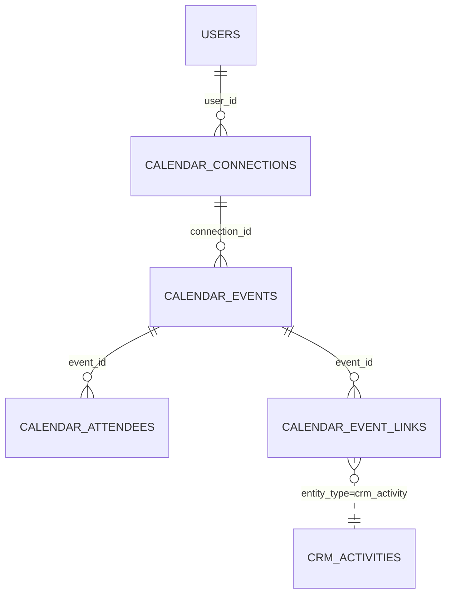

# Calendar (`calendar`)

The Calendar module provides a shared **team calendar** inside the admin: events with type/colour/status, all-day flag, timezone, optional RFC 5545 `RRULE`, attendees, and *links* to other entities (e.g. `crm_activity`, service orders). It renders a month/week/day/agenda board (`calendarBoard.ts`) fed by a JSON feed with drag-and-drop move/save endpoints, exports ICS, and stores **external calendar connections** (Google OAuth, Seznam/generic CalDAV, Outlook, ICS) as a foundation for two-way sync. CRM activities are mirrored into the calendar automatically. Used by every team member with `calendar.view`; part of the ECS package.

See also: [CRM](crm.md) (activities → events), [CarService](carservice.md) / [Fleet](fleet.md) (consume the `calendar` capability), [Viewings](viewings.md) (optional dependency on `calendar`), [module system](../architecture/module-system.md), [dashboard widgets](../architecture/dashboard-widgets.md), [REST API](../architecture/api.md).

## At a glance

| Item | Value |
| --- | --- |
| Module id | `calendar` |
| Version | `1.99.0` (`modules/Calendar/module.php`, `CalendarModule::version()`) |
| Directory | `modules/Calendar/` |
| Class | `Modules\Calendar\CalendarModule` |
| Requires | `core ^1.0`, `crm ^1.0`; optional `projects ^1.0`, `notifications ^1.0` |
| Capabilities provided | `calendar` → `Modules\Calendar\Application\CalendarProvider` |
| Capabilities consumed | None directly (listens to platform event `activity.created` from CRM) |
| Groups / packages | `module.php` `groups: ['ecs']`; `config/module_groups.php` lists it in `ecs`, `ebs`, `realestates` (not required in any) |
| Permissions | `calendar.view` (`perm.calendar.view`), `calendar.manage` (`perm.calendar.manage`) — group `perm.group.calendar` |
| API scopes | `calendar.read`, `calendar.write` |
| Icon | `calendar` |

## Domain model

Entities in `modules/Calendar/Domain/`. No Doctrine associations — relations are string id columns.

| Entity | Table | Key fields | Enum / status values | Relations |
| --- | --- | --- | --- | --- |
| `CalendarEvent` | `calendar_events` (indexes `idx_calendar_starts` on `starts_at`, `idx_calendar_external` on `external_provider,external_id`) | `id`: string(36) UUIDv7; `title`: string(190); `starts_at`, `ends_at`: datetime (stored as wall-clock civil time); `all_day`: bool; `type`: string(32) default `other`; `color`: string(16) default `blue`; `status`: string(16) default `confirmed`; `timezone`: string(64) nullable default `Europe/Prague`; `location`: string(255) nullable; `description`: text; `rrule`: string(255) nullable; `external_provider`: string(32), `external_id`: string(190), `external_etag`: string(190) nullable; `connection_id`: string(36) nullable; `created_by`: string(36) nullable; `created_at`, `updated_at` | `TYPES = meeting, deadline, call, task, other` (invalid → `InvalidArgumentException`); `COLORS = blue, green, amber, red, violet, slate` (invalid → `blue`); `STATUSES = confirmed, tentative, cancelled` (invalid → `confirmed`) | `connection_id` → `CalendarConnection.id`; `created_by` → users |
| `CalendarAttendee` | `calendar_attendees` | `id`; `event_id`: string(36); `user_id`: string(36) nullable; `email`: string(190) nullable | — | `event_id` → `CalendarEvent`; `user_id` → users |
| `CalendarEventLink` | `calendar_event_links` (index `idx_cal_link_entity` on `entity_type,entity_id`) | `id`; `event_id`; `entity_type`: string(64); `entity_id`: string(36) | `entity_type` values seen in code: `crm_activity` (auto-link); free-form from the form (`link_entity_type`) | `event_id` → `CalendarEvent`; polymorphic target |
| `CalendarConnection` | `calendar_connections` (unique `uniq_calendar_conn_provider_account` on `provider,account_email`) | `id`; `provider`: string(32); `account_email`: string(190) lower-cased; `display_name` nullable; `status`: string(16) default `pending`; `token_cipher`: text (JSON token blob); `caldav_url`: string(500); `calendar_id`: string(255); `sync_token`: string(255); `last_synced_at` nullable; `last_error`: text; `user_id`: string(36) nullable (null = shared); `color`: string(16) default `blue`; `sync_enabled`: bool default true; `created_at`, `updated_at` | `PROVIDERS = google, seznam, outlook, caldav, ics`; `STATUSES = pending, connected, error, revoked`; `markSynced()` → `connected`, `markError()` → `error` | `user_id` → users |

`CalendarEvent` uses `#[FormEntity('calendar.event.save')]` / `#[FormGenerator(exclude: [id, external*, connectionId, createdBy, timestamps], cols: 2)]` with field groups `basic`, `schedule`, `details`.

## Admin UI

### Menu items (`CalendarModule::boot()`)

| Menu id | Label key | Icon | Route | Permission | Order / group |
| --- | --- | --- | --- | --- | --- |
| `calendar` | `nav.calendar` | `calendar` | `admin.calendar.index` | `calendar.view` | 42, group `Práce` |
| `calendar.create` | `nav.calendar.create` | — | `admin.calendar.create` | `calendar.manage` | 43, parent `calendar`, hidden |
| `calendar.connections` | `nav.calendar.connections` | — | `admin.calendar.connections` | `calendar.manage` | 44, parent `calendar` |

Command palette: `calendar.index` (`palette.calendar.index`, `/admin/calendar`, `calendar.view`, keywords `kalendář`, `calendar`, `schůzka`, `meeting`, `google`).

### Admin routes (`/admin/calendar`, middleware `auth`, module `calendar`) — `modules/Calendar/Http/CalendarController.php`

| Method | Path | Route name | Action | Permission |
| --- | --- | --- | --- | --- |
| GET | `/admin/calendar` | `admin.calendar.index` | `index` (`?view=month|week|day|agenda`, `?date=`) | `calendar.view` |
| GET | `/admin/calendar/feed` | `admin.calendar.feed` | `feed` (JSON `{data[], meta{from,to,total}}`, `?from&to`) | `calendar.view` |
| POST | `/admin/calendar/move` | `admin.calendar.move` | `move` (JSON `{id, starts_at, ends_at, all_day?}`) | `calendar.manage` |
| POST | `/admin/calendar/save` | `admin.calendar.save` | `save` (JSON inline edit of title/dates/type/color/status/all_day/timezone/location/description/rrule) | `calendar.manage` |
| GET | `/admin/calendar/export.ics` | `admin.calendar.ics` | `ics` (`?from` default −1 month, `?to` default +6 months; `gereq-calendar.ics`) | `calendar.view` |
| GET | `/admin/calendar/connections` | `admin.calendar.connections` | `connections` | `calendar.manage` |
| POST | `/admin/calendar/connections` | `admin.calendar.connections.store` | `storeConnection` | `calendar.manage` |
| POST | `/admin/calendar/connections/{id}/delete` | `admin.calendar.connections.destroy` | `destroyConnection` | `calendar.manage` |
| GET | `/admin/calendar/oauth/google` | `admin.calendar.oauth.google` | `connectGoogle` (sets session `calendar.oauth.state`, redirects to Google) | `calendar.manage` |
| GET | `/admin/calendar/oauth/google/callback` | `admin.calendar.oauth.google.callback` | `googleCallback` (state check, token exchange) | `calendar.manage` |
| GET | `/admin/calendar/create` | `admin.calendar.create` | `create` (`?starts=` prefill) | `calendar.manage` |
| POST | `/admin/calendar` | `admin.calendar.store` | `store` | `calendar.manage` |
| GET | `/admin/calendar/{id}` | `admin.calendar.show` | `show` | `calendar.view` |
| GET | `/admin/calendar/{id}/edit` | `admin.calendar.edit` | `edit` | `calendar.manage` |
| POST | `/admin/calendar/{id}` | `admin.calendar.update` | `update` | `calendar.manage` |
| POST | `/admin/calendar/{id}/delete` | `admin.calendar.destroy` | `destroy` (also removes links & attendees) | `calendar.manage` |

### Screens

- **Board** (`Resources/views/events/index.html.twig` + `Resources/assets/js/calendarBoard.ts`, `assets/css/admin.css`): month/week/day/agenda views, loads `feedUrl`, drag/resize → `moveUrl`, quick edit → `saveUrl`; shows the user's connections (own + shared) as legend.
- **Event form** (`events/form.html.twig`): generated fields plus `link_entity_type` / `link_entity_id` (one link per event — `syncExtras()` replaces existing links) and `attendee_email` (adds a `CalendarAttendee` if not present). `store` sets `created_by`, audits `calendar.created`; `update` audits `calendar.updated`.
- **Event detail** (`events/show.html.twig`): event, its links and attendees.
- **Connections** (`connections.html.twig`): list of `CalendarConnection`s for the user, provider catalog (`CalendarConnectionService::catalog()`), manual create (provider, `account_email`, `caldav_url` — Seznam defaults to `https://caldav.seznam.cz/`, `display_name`, `color`), Google OAuth button (enabled when `googleConfigured()`), link to `admin.settings.index?tab=calendar`.

### Settings (defined in `register()`, module `calendar`)

| Key | Type | Label key | Default |
| --- | --- | --- | --- |
| `calendar.google.client_id` | string | `calendar.settings.google_client_id` | `''` |
| `calendar.google.client_secret` | encrypted | `calendar.settings.google_client_secret` | `''` |
| `calendar.outlook.client_id` | string | `calendar.settings.outlook_client_id` | `''` |
| `calendar.outlook.client_secret` | encrypted | `calendar.settings.outlook_client_secret` | `''` |

Validation ruleset `calendar.event.save`: `title required|min:2|max:190`, `starts_at required`, `ends_at required`, `type in:meeting,deadline,call,task,other`, `all_day`, `description max:20000`, `location max:255`, `color in:blue,green,amber,red,violet,slate`, `timezone max:64`, `rrule max:255`, `status in:confirmed,tentative,cancelled`, `link_entity_type max:64`, `link_entity_id max:36`, `attendee_email email|max:190` (all but the first three `nullable`).

## Public / REST API

Registered as `$context->api()->module('events', …)` → **`/api/v1/events`** (note: not `/calendar`). Controller `modules/Calendar/Http/Api/CalendarApiController.php`.

| Method | Path | Scope | Action |
| --- | --- | --- | --- |
| GET | `/api/v1/events/` | `calendar.read` | `index` — `?from`, `?to` (defaults: first day of this month, +1 month); returns events overlapping the range; meta `{from, to, total}` (no pagination) |
| POST | `/api/v1/events/` | `calendar.write` | `store` (ruleset `calendar.event.save`; 201) |
| GET | `/api/v1/events/{id}` | `calendar.read` | `show` |
| PATCH | `/api/v1/events/{id}` | `calendar.write` | `update` |
| DELETE | `/api/v1/events/{id}` | `calendar.write` | `destroy` (removes links and attendees) → `{id, deleted: true}` |

Serializer (`CalendarProvider::serialize()`): `id`, `title`, `starts_at`, `ends_at` (`Y-m-d\TH:i:s` wall-clock, no offset), `all_day`, `type`, `color`, `status`, `timezone`, `location`, `description`, `rrule`, `external_provider`, `external_id`, `is_external`, `created_at`, `updated_at` (ATOM), `url`, `edit_url`. Attendees and links are not serialised. No `/api/public/*` endpoints.

## Events, hooks & webhooks

Platform events (all `webhookEnabled(true)`, module `calendar`):

| Event | Description (as registered) | Emitted from |
| --- | --- | --- |
| `calendar.event_created` | Událost kalendáře vytvořena | admin `store`, API `store` |
| `calendar.event_updated` | Událost kalendáře upravena | admin `move`, `save`, `update`; API `update` |
| `calendar.event_deleted` | Událost kalendáře smazána | admin `destroy` (payload `{id, title}`), API `destroy` (`{id}`) |

Hooks consumed (`boot()`): action `platform.event.dispatched` at `HookPriority::LATE` — when the envelope type is `activity.created` (from [CRM](crm.md)) and no `CalendarEventLink(crm_activity, id)` exists, creates a `CalendarEvent` (title from `subject`/`title`, start = `due_at` or now, +1 hour, type `meeting` if the activity type is `meeting` else `other`, description from `body`) and the link. Errors are swallowed ("best effort — never break CRM activity flow").

Hooks exposed: none. Queue jobs / scheduled tasks: none (no background sync of external calendars is implemented). Publishables: none. Audit log: `calendar.created`, `calendar.updated`.

## Dashboard widgets

Registered in `boot()` (`modules/Calendar/Application/Widgets/`):

| Widget id | Type | Class | Shows | Permission | Order |
| --- | --- | --- | --- | --- | --- |
| `calendar.shortcut` | shortcut | `CalendarShortcutWidget` | Link to `admin.calendar.index`, icon `calendar` | `calendar.view` | 42 |
| `calendar.stats` | metric | `CalendarStatsWidget` | Non-cancelled events today (`calendar.widget.stats.title`), hint = count in the next 7 days | `calendar.view` | 48 |
| `calendar.upcoming` | panel (list) | `UpcomingEventsWidget` | Next non-cancelled events (`ends_at >= now`, limited), with Today/Tomorrow labels, all-day marker and type label; links to detail | `calendar.view` | 14 |

## Services & extension points

| Class | Responsibility |
| --- | --- |
| `Application\CalendarProvider` | Capability `calendar`: `between(from, to)` (overlap query ordered by start), `find(id)`, `connections(?userId)` (own + shared), `serialize(event)`. |
| `Application\CalendarConnectionService` | Provider `catalog()` (OAuth/CalDAV metadata for google/seznam/outlook/caldav/ics), `googleConfigured()`, `createManual()` (CalDAV/ICS connections are marked `connected` immediately, OAuth ones `pending`), `googleAuthUrl()`, `completeGoogleOAuth()` / `exchangeGoogleCode()` (code → tokens via cURL/streams, userinfo e-mail lookup, stores token JSON in `token_cipher`, `calendar_id = primary`), `serialize(connection)`. |
| `Application\IcsExporter` | `export(events[], calendarName)` → VCALENDAR text. |

Integration with other modules:

- [CarService](carservice.md) `OrderCalendarService` and [Fleet](fleet.md) `VehicleCalendarService` check `$capabilities->has('calendar') && class_exists(CalendarEvent::class)` before creating linked events.
- [Viewings](viewings.md) declares `calendar` as an optional dependency.
- CRM integration is event-driven (see hooks above); the module hard-requires `crm ^1.0` in its manifest.

## CLI commands

None.

## Configuration & translations

- Settings: `calendar.google.client_id`, `calendar.google.client_secret` (encrypted), `calendar.outlook.client_id`, `calendar.outlook.client_secret` (encrypted) — all default `''`. Only the Google pair is read by code (`CalendarConnectionService`).
- Session key: `calendar.oauth.state`.
- Environment variables: none.
- Translations: `modules/Calendar/Resources/translations/messages.cs.php`, `messages.en.php`. Prefixes: `module.calendar.*`, `nav.calendar*`, `palette.calendar.*`, `perm.calendar.*`, `perm.group.calendar`, `calendar.*` (`calendar.field.*`, `calendar.type.*`, `calendar.color.*`, `calendar.status.*`, `calendar.provider.*`, `calendar.connection.status.*`, `calendar.connections.*`, `calendar.settings.*`, `calendar.flash.*`, `calendar.error.*`, `calendar.widget.*`).

## Database migrations

| File | Purpose |
| --- | --- |
| `Database/Migrations/2026_01_01_000001_calendar.php` | Empty `up()`/`down()` — base tables (`calendar_events`, `calendar_attendees`, `calendar_event_links`) come from Doctrine SchemaTool. |
| `Database/Migrations/2026_09_05_000010_calendar_board.php` | Adds to `calendar_events` (if missing): `color`, `status`, `timezone`, `location`, `rrule`, `external_provider`, `external_id`, `external_etag`, `connection_id`, `created_by`, index `idx_calendar_external`; creates `calendar_connections` with unique `uniq_calendar_conn_provider_account`. `down()` drops `calendar_connections`. |

## Notes

- External calendar **sync is not implemented**: connections and tokens are stored, `sync_token`/`last_synced_at`/`external_*` columns exist, but no code reads Google/CalDAV events or pushes local ones. `completeGoogleOAuth()` calls `markSynced()` right after the token exchange, so status `connected` does not imply data sync. No refresh-token handling exists.
- `token_cipher` is documented as "encrypted via Settings crypto when available", but `CalendarConnectionService` stores plain `json_encode` output.
- Outlook settings are defined but unused; there is no Outlook OAuth route.
- `rrule` is stored and validated for length only — recurrence is not expanded by `between()`, the feed, the ICS export or the widgets.
- Attendees can only be added (one e-mail per save) — there is no removal UI/endpoint; the API ignores attendees and links entirely.
- Times are stored as naive wall-clock values with a separate `timezone` string; the API emits them without offset.
- Deleting an event does not notify or clean up the linked CRM activity; deleting a connection does not touch events with that `connection_id`.
- The `notifications` and `projects` optional dependencies are declared but not referenced in module code.
