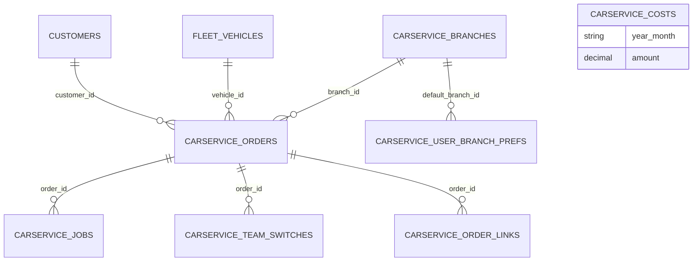

# CarService (`carservice`)

CarService is the **car body-shop / paint-shop workshop module** of the ECS package. It manages service orders for fleet vehicles or external customers' cars, tracks work time per job and employee, switches orders between the body-shop and paint-shop teams, stores phase photos (before/progress/paint/after), records an intake protocol, generates PDF documents (quote, worksheet, cost sheet, intake, handover) through the Documents module, offers a multi-step **finish wizard** with manual or digital (ESign) signatures and optional iDoklad invoicing, supports multiple **branches** with a global branch context switcher, monthly overhead costs, and a QR/plate-based **workshop tracker** for mechanics. Used by dispatchers (`carservice.manage`), managers (`carservice.view`) and shop-floor workers (`carservice.tracker`).

Related: [Fleet](fleet.md), [Customers](customers.md), [Currency](currency.md), [Media](media.md), [Documents](documents.md), [Calendar](calendar.md), [iDoklad](idoklad.md), [ESign](esign.md), [BikeService](bikeservice.md) (sibling module), [module system](../architecture/module-system.md), [dashboard widgets](../architecture/dashboard-widgets.md), [REST API](../architecture/api.md).

## At a glance

| Item | Value |
| --- | --- |
| Module id | `carservice` |
| Version | `1.99.0` (`modules/CarService/module.php`, `CarServiceModule::version()`) |
| Directory | `modules/CarService/` |
| Class | `Modules\CarService\CarServiceModule` |
| Requires | `core ^1.0`, `fleet ^1.0`, `customers ^1.0`, `currency ^1.1`; optional `media`, `documents`, `calendar`, `idoklad`, `moneys3`, `partscatalog`, `esign` (`^1.0`) |
| Capabilities provided | `carservice` → `Application\CarServiceProvider`; `carservice.branch_context` → `Application\BranchContext` |
| Capabilities consumed | `fleet` (`FleetProvider`), `media` (`MediaProvider`), `calendar`, `esign` (`ESignProvider`), `idoklad` (`iDokladService`) — all via `capabilities()->has()/get()` + `class_exists` |
| Groups / packages | `module.php` `groups: ['ecs']`; `config/module_groups.php`: **required** in `ecs` |
| Permissions | `carservice.view`, `carservice.manage`, `carservice.tracker` (labels `perm.carservice.*`, group `perm.group.carservice`) |
| API scopes | `carservice.read`, `carservice.write`, `carservice.tracker` (`registerKnownScope`) |
| Icon | `build` |

## Domain model

Entities in `modules/CarService/Domain/` (string(36) UUID ids, no Doctrine associations).

| Entity | Table | Key fields | Enum values | Relations |
| --- | --- | --- | --- | --- |
| `ServiceOrder` | `carservice_orders` (idx `vehicle_id`, `customer_id`, `status`, `team`; unique `tracker_token`) | `type`: string(32) default `external_customer`; `status`: string(32) default `intake`; `team`: string(32) default `body_shop`; `vehicle_id`: string(36); `customer_id` nullable; `branch_id` nullable; `tracker_token`: string(64) unique (QR); `service_info` text; `payment_type`: string(16) nullable; `internal_cost`, `external_cost`: decimal(12,2) nullable; `intake_mileage` int; `intake_fuel_level`: string(16); `intake_protocol_json` json; `note` text; `finished_at`; `intake_at`, `handover_at`: date; timestamps | `TYPES = internal_fleet, external_customer, linked`; `STATUSES = intake, in_progress, waiting, ready, done, cancelled` (`isOpen()` = not done/cancelled); `TEAMS = body_shop, paint_shop`; `PAYMENT_TYPES = online, cash` | → Fleet `Vehicle`, → `Customer`, → `ServiceBranch`; 1‑N `ServiceJob`, `ServiceTeamSwitch`, `ServiceOrderLink` |
| `ServiceJob` | `carservice_jobs` (idx `order_id`) | `order_id`; `type`: string(64) default `work`; `note` text; `employee_user_id` nullable; `started_at`; `ended_at` nullable; timestamps | — | → `ServiceOrder`, → users |
| `ServiceTeamSwitch` | `carservice_team_switches` (idx `order_id`) | `order_id`; `from_team` nullable; `to_team`: string(32); `user_id` nullable; `note` text; `created_at` | teams as above | → `ServiceOrder` |
| `ServiceOrderLink` | `carservice_order_links` (idx `order_id`; idx `link_type, link_id`) | `order_id`; `link_type`: string(64); `link_id`: string(36); `created_at` | polymorphic link (documents, media, calendar events…) | → `ServiceOrder`, → any |
| `ServiceBranch` | `carservice_branches` (idx `is_active`) | `name`: string(120); `street`, `city`, `zip`; `country`: string(2) default `CZ`; `phone`; `email`; `employee_count` int; `logo_file_id` nullable (→ `StoredFile`); `note` text; `is_active` bool; timestamps | — | referenced by `ServiceOrder.branch_id`, `UserBranchPreference.default_branch_id` |
| `ServiceCost` | `carservice_costs` (idx `year_month`) | `year_month`: string(7) (`YYYY-MM`); `category`: string(64) default `general`; `amount`: decimal(14,2); `note` text; timestamps | — | standalone monthly overhead |
| `UserBranchPreference` | `carservice_user_branch_prefs` | `user_id`: string(36) (PK); `default_branch_id` nullable; `updated_at` | — | → users, → `ServiceBranch` |

`ServiceOrder` and `ServiceBranch` carry `#[AdminField]` metadata and are bound to form rulesets (`forms()->entity('carservice.save', ServiceOrder::class)`, `forms()->entity('carservice.branch', ServiceBranch::class)`).

## Admin UI

### Menu items (`CarServiceModule::boot()`)

| Menu id | Label key | Icon | Route | Permission | Order / group |
| --- | --- | --- | --- | --- | --- |
| `carservice` | `nav.carservice` | `build` | `admin.carservice.index` | `carservice.view` | 35, group `Provoz` |
| `carservice.tracker` | `nav.carservice.tracker` | — | `admin.carservice.tracker` | `carservice.tracker` | 36 (child) |
| `carservice.branches` | `nav.carservice.branches` | — | `admin.carservice.branches` | `carservice.view` | 37 (child) |
| `carservice.costs` | `nav.carservice.costs` | — | `admin.carservice.costs` | `carservice.view` | 38 (child) |
| `carservice.settings` | `nav.carservice.settings` | — | `admin.carservice.settings` | `carservice.view` | 20, parent `settings` |

Command palette: `carservice.index` (keywords `servis, dílna, zakázka, carservice, lakovna`), `carservice.tracker` (`tracker, qr, spz, dílna`), `carservice.branches` (`pobočka, pobočky, branch, servis`). Admin search providers `carservice.orders` (id, note, service_info, vehicle plate via `CarServiceProvider::searchOrders`) and `carservice.branches` (name, city, street).

### Admin routes (`/admin/carservice`, middleware `auth`)

| Method | Path | Route name | Controller::action | Permission |
| --- | --- | --- | --- | --- |
| GET | `` | `admin.carservice.index` | `ServiceOrderController::index` | `carservice.view` |
| GET | `/create` | `admin.carservice.create` | `create` | `carservice.manage` |
| POST | `` | `admin.carservice.store` | `store` | `carservice.manage` |
| POST | `/bulk` | `admin.carservice.bulk` | `bulk` (ruleset `carservice.bulk`: `action=delete`, `confirmed`) | `carservice.manage` |
| GET | `/costs` | `admin.carservice.costs` | `CostController::index` | `carservice.view` |
| POST | `/costs` | `admin.carservice.costs.store` | `CostController::store` (`carservice.cost`) | `carservice.manage` |
| POST | `/costs/{id}/delete` | `admin.carservice.costs.destroy` | `CostController::destroy` | `carservice.manage` |
| GET | `/branches` | `admin.carservice.branches` | `BranchController::index` | `carservice.view` |
| GET | `/branches/create` | `admin.carservice.branches.create` | `BranchController::create` | `carservice.manage` |
| POST | `/branches` | `admin.carservice.branches.store` | `BranchController::store` (`carservice.branch`) | `carservice.manage` |
| GET | `/branches/{id}/edit` | `admin.carservice.branches.edit` | `BranchController::edit` | `carservice.manage` |
| GET | `/branches/{id}/logo` | `admin.carservice.branches.logo` | `BranchController::logo` | `carservice.view` |
| POST | `/branches/{id}` | `admin.carservice.branches.update` | `BranchController::update` | `carservice.manage` |
| POST | `/branches/{id}/delete` | `admin.carservice.branches.destroy` | `BranchController::destroy` | `carservice.manage` |
| POST | `/branch-context` | `admin.carservice.branch_context` | `BranchController::select` (session branch switch) | `carservice.view` |
| GET | `/settings` | `admin.carservice.settings` | `SettingsController::edit` | `carservice.view` |
| POST | `/settings` | `admin.carservice.settings.update` | `SettingsController::update` (`carservice.settings`) | `carservice.manage` |
| GET | `/tracker` | `admin.carservice.tracker` | `TrackerController::index` (`?token=` from QR) | `carservice.tracker` |
| POST | `/tracker/resolve` | `admin.carservice.tracker.resolve` | `TrackerController::resolve` (token or licence plate) | `carservice.tracker` |
| GET | `/tracker/{id}` | `admin.carservice.tracker.show` | `TrackerController::show` | `carservice.tracker` |
| POST | `/tracker/{id}/job-start` | `admin.carservice.tracker.job_start` | `TrackerController::startJob` | `carservice.tracker` |
| POST | `/tracker/{id}/job-stop/{jobId}` | `admin.carservice.tracker.job_stop` | `TrackerController::stopJob` | `carservice.tracker` |
| POST | `/tracker/{id}/media` | `admin.carservice.tracker.media` | `TrackerController::uploadMedia` | `carservice.tracker` |
| GET | `/{id}` | `admin.carservice.show` | `ServiceOrderController::show` | `carservice.view` |
| GET | `/{id}/edit` | `admin.carservice.edit` | `edit` | `carservice.manage` |
| POST | `/{id}` | `admin.carservice.update` | `update` (`carservice.save`) | `carservice.manage` |
| POST | `/{id}/status` | `admin.carservice.status` | `updateStatus` | `carservice.manage` |
| POST | `/{id}/unlock` | `admin.carservice.unlock` | `unlock` (done/cancelled → `in_progress`; audit `carservice.unlocked`) | `carservice.manage` |
| POST | `/{id}/team` | `admin.carservice.team` | `switchTeam` | `carservice.manage` |
| POST | `/{id}/jobs` | `admin.carservice.jobs.store` | `storeJob` (`carservice.job`) | `carservice.manage` |
| POST | `/{id}/jobs/{jobId}/complete` | `admin.carservice.jobs.complete` | `completeJob` | `carservice.manage` |
| POST | `/{id}/media` | `admin.carservice.media` | `uploadMedia` (phase photos) | `carservice.manage` |
| POST | `/{id}/finish` | `admin.carservice.finish` | `finish` | `carservice.manage` |
| POST | `/{id}/finish/step` | `admin.carservice.finish.step` | `finishStep` (`carservice.finish`, `step in quote,worksheet,cost_sheet,handover,idoklad`) | `carservice.manage` |
| POST | `/{id}/documents` | `admin.carservice.documents.generate` | `generateDocument` (`carservice.document`, `type` ∈ `PdfTemplateCatalog::types()`) | `carservice.manage` |
| POST | `/{id}/intake-protocol` | `admin.carservice.intake_protocol` | `updateIntakeProtocol` | `carservice.manage` |
| POST | `/{id}/delete` | `admin.carservice.destroy` | `destroy` | `carservice.manage` |

### Screens

- **Orders list** (`Resources/views/orders/index.html.twig`, `partials/orders_table.html.twig`): filters by status/team/branch (branch context applied), bulk delete.
- **Order form** (`orders/form.html.twig`): vehicle (Fleet), customer, type, status, team, branch, note, service info, payment type, internal/external cost, intake mileage/fuel, intake and handover dates (synced to Calendar via `OrderCalendarService::syncIntakeHandover()` when the `calendar` capability exists).
- **Order detail** (`orders/show.html.twig`): status/team switching with `ServiceTeamSwitch` history, jobs timer (soft limit `carservice.job_soft_limit_hours`), phase media gallery (`OrderMediaService`, phases from `carservice.media_phases`), intake protocol form (`partials/intake_protocol_form.html.twig`, `IntakeProtocolCatalog::AXLE_KEYS = brakes, pins, shocks, boots, tires`), generated documents list, QR code for the tracker (`QrCodeService`), hook sections `carservice.order.show.sections`. Orders with status `done`/`cancelled` are **locked** (`carservice.error.order_locked`) until `unlock`.
- **Finish wizard** (`partials/finish_wizard.html.twig`, `assets/js/finishWizard.ts`, `FinishWizardService`/`FinishWizardCatalog`): steps `quote` → `worksheet` → `cost_sheet` → `handover` (manual signatures or ESign digital with `esign_email`, defects + deadline) → `idoklad` (shown when `includeIdoklad()`; invoice created by `IdokladFinishHandler`). Finishing sets status `done`, `finished_at`, emits `carservice.order_finished`.
- **PDF documents** (`Resources/views/pdf/*.html.twig`, `ServiceDocumentService`): types `worksheet`, `intake`, `handover`, `quote`, `cost_sheet` (`PdfTemplateCatalog`), rendered through Documents' `PdfDocumentGenerator` and linked to the order (`DOCUMENT_ENTITY = carservice_order`); VAT rate constant 21 %.
- **Tracker** (`tracker/index|show.html.twig`): mobile-first screen for mechanics — scan QR / type plate, start/stop jobs, upload phase photos.
- **Branches** (`branches/*`): CRUD with logo upload; **topbar branch switcher** (`partials/topbar_branch.html.twig`) injected via `admin.topbar.context`; default branch per user in profile and user forms.
- **Costs** (`costs/index.html.twig`): monthly overhead entries per category.
- **Settings** (`settings.html.twig`): all `carservice.*` settings listed below plus PDF template hints (`carservice.settings.pdf.type.*`).

## Public / REST API

`$context->api()->module('carservice', …)`:

| Method | Path | Scope | Controller::action |
| --- | --- | --- | --- |
| GET | `/api/v1/carservice/` | `carservice.read` | `ServiceOrderApiController::index` — sortable `status`, `team`, `createdAt`, `updatedAt`; filterable `status`, `team`, `vehicle_id`, `customer_id` |
| POST | `/api/v1/carservice/` | `carservice.write` | `store` (ruleset `carservice.save`) |
| GET | `/api/v1/carservice/{id}` | `carservice.read` | `show` |
| PATCH | `/api/v1/carservice/{id}` | `carservice.write` | `update` |
| POST | `/api/v1/carservice/{id}/team` | `carservice.write` | `switchTeam` |
| POST | `/api/v1/carservice/{id}/jobs` | `carservice.write` | `addJob` |
| POST | `/api/v1/carservice/{id}/jobs/{jobId}/complete` | `carservice.write` | `completeJob` |
| POST | `/api/v1/carservice/{id}/finish` | `carservice.write` | `finish` |
| POST | `/api/v1/carservice/tracker/resolve` | `carservice.tracker` | `TrackerApiController::resolve` (token or plate) |
| POST | `/api/v1/carservice/tracker/{id}/jobs` | `carservice.tracker` | `startJob` |
| POST | `/api/v1/carservice/tracker/{id}/jobs/{jobId}/complete` | `carservice.tracker` | `completeJob` |
| POST | `/api/v1/carservice/tracker/{id}/media` | `carservice.tracker` | `uploadMedia` |

Serializer (`CarServiceProvider::serialize()`): `id`, `type`, `status`, `team`, `vehicle_id`, `customer_id`, `branch_id`, `tracker_token`, `service_info`, `payment_type`, `internal_cost`, `external_cost`, `intake_mileage`, `intake_fuel_level`, `intake_protocol`, `note`, `intake_at`, `handover_at`, `finished_at`, `job_seconds`, `created_at`, `updated_at`, `jobs[]` (`serializeJob`). No `/api/public/*` endpoints.

## Events, hooks & webhooks

Platform events (all `webhookEnabled(true)`, Czech descriptions): `carservice.order_created`, `carservice.order_updated`, `carservice.team_switched`, `carservice.order_finished`, `carservice.job_started`, `carservice.job_finished` — emitted with `EventBus::emit()` from `CarServiceProvider` and controllers.

Hooks added (`boot()`): filter `admin.topbar.context` (branch switcher), filter `admin.profile.form_fields` + action `admin.profile.saving` (user default branch, field `carservice_default_branch_id`), filter `admin.users.form_fields` + action `admin.users.saving` (same for user admin, requires `users.edit`), filter `customers.show.sections` (section `carservice.orders`, order 46, `partials/customer_orders.html.twig`), filter `fleet.vehicle.show.sections` (section `carservice.orders`, order 20, `partials/vehicle_orders.html.twig`).

Hook exposed: filter `carservice.order.show.sections(array, ServiceOrder)` in `ServiceOrderController::show`.

Queue jobs, scheduled tasks, publishables: none. iDoklad invoicing is triggered explicitly in the finish wizard, not from events (comment in `boot()`). Diagnostic logging via `FullServiceLogger::log('carservice.*')`.

## Dashboard widgets

| Widget id | Type | Class | Shows | Permission | Order |
| --- | --- | --- | --- | --- | --- |
| `carservice.shortcut` | shortcut | `Application\Widgets\CarServiceShortcutWidget` | Link to orders | `carservice.view` | 36 |
| `carservice.stats` | metric | `Application\Widgets\CarServiceStatsWidget` | Order counts (`carservice.widget.*`) | `carservice.view` | 64 |
| `carservice.open_orders` | panel | `Application\Widgets\CarServiceOpenOrdersWidget` | List of open orders | `carservice.view` | 23 |
| `carservice.status.chart` | panel | `Application\Widgets\CarServiceStatusChartWidget` | Orders by status chart | `carservice.view` | 28 |

## Services & extension points

| Class (`modules/CarService/Application/`) | Responsibility |
| --- | --- |
| `CarServiceProvider` | Capability `carservice`: `getOrder`, `createOrder(vehicleId, customerId, meta)`, `listForVehicle/Customer`, `searchOrders`, `listOpen(filters)`, `teamQueue`, `switchTeam`, `addJob`, `completeJob`, `jobExceededSoftLimit`, `mediaPhases`, `finishOrder`, `cancelOrder`, `resolveByTrackerToken`, `resolveByPlate` (Fleet), `jobsForOrder`, `totalJobSeconds`, `jobSoftLimitHours`, `serialize`, `serializeJob`, `updateOrderMeta`. |
| `BranchContext` | Capability `carservice.branch_context`: session-selected branch (`SESSION_KEY = carservice.selected_branch_id`), `branchId()`, `branch()`, `setBranchId()`, `defaultBranchId(user)`, `setDefaultBranchId()`, `hasBranches()`, `selectOptions()`. |
| `FinishWizardCatalog`, `FinishWizardService`, `FinishOrderService` | Wizard steps, `stepsForOrder`, `processStep`, `includeIdoklad`, `hasParts`; `finish()` + `generateWorksheet()`. |
| `IdokladFinishHandler` | `runForOrder()` — creates the iDoklad invoice when capability `idoklad` exists. |
| `ServiceDocumentService`, `PdfTemplateCatalog` | PDF generation/preview/context building via Documents module; `orderHasDocumentType`, `renderHandoverHtmlForEsign`, `sampleContext`. |
| `OrderEsignService` | Digital handover signatures via `esign` capability (`MODE_MANUAL`/`MODE_DIGITAL`), `resolveHandoverSignatures`, `previewSignedHandoverHtml`. |
| `OrderMediaService` | Phase photos via `media` capability (`forOrder`, `forOrderByPhases`, `upload`). |
| `OrderCalendarService` | `syncIntakeHandover()` creates/updates `CalendarEvent`s when `calendar` is available. |
| `QrCodeService` | `trackerUrl`, `svgForOrder`, `dataUriForOrder` — QR for the tracker token. |
| `LaborRateCatalog`, `IntakeProtocolCatalog` | Labor-rate settings definitions; intake protocol axle checklist keys. |

## CLI commands

None.

## Configuration & translations

| Setting key | Type | Default |
| --- | --- | --- |
| `carservice.job_soft_limit_hours` | string | `8` |
| `carservice.default_team` | string | `body_shop` |
| `carservice.media_phases` | string | `before,progress,paint,after` |
| `carservice.margin_percent` | string | `30` |
| `carservice.labor_rate_default` | string | `650` |
| `carservice.labor_rate_body_shop` | string | `650` |
| `carservice.labor_rate_paint_shop` | string | `750` |
| `carservice.auto_idoklad` | boolean | `false` |
| `carservice.market_sources` | string | `heureka,seznam,hledejceny,jama,autodilypro,autokelly` |

All defined with `public = false` (`SettingsController` handles editing). No env vars.

Translations: `modules/CarService/Resources/translations/messages.cs.php`, `messages.en.php`. Prefixes: `module.carservice.description`, `nav.carservice*`, `palette.carservice.*`, `perm.carservice.*`, `perm.group.carservice`, `carservice.title`, `carservice.flash.*`, `carservice.settings.*` (incl. `pdf.type.*`), `carservice.error.*`, `carservice.field.*`, `carservice.finish.*`, `carservice.branches.*`, `carservice.tracker.*`, `carservice.widget.*`, `carservice.intake_protocol.*`, `carservice.media.*`, `carservice.bulk.*`, `carservice.form.*`, `carservice.status.*`, `carservice.partial.*`, `carservice.jobs.*`, `carservice.costs.*`, `carservice.user.*`, `carservice.type.*`, `carservice.documents.*`, `carservice.team.*`, `carservice.payment.*`, `carservice.locked.*`, `carservice.branch_switch.*`, `carservice.esign.*`.

## Database migrations

| File | Purpose |
| --- | --- |
| `Database/Migrations/2026_09_05_000001_carservice.php` | Placeholder — `carservice_*` tables created by SchemaTool. |
| `Database/Migrations/2026_09_05_000002_carservice_branches.php` | Placeholder for `carservice_branches`; `down()` drops it if present. |
| `Database/Migrations/2026_09_06_000003_carservice_intake_protocol.php` | Placeholder for `carservice_orders.intake_protocol_json`. |
| `Database/Migrations/2026_09_06_000004_carservice_user_branch_prefs.php` | Placeholder for `carservice_user_branch_prefs`; `down()` drops it. |

## Notes

- All four migrations are SchemaTool placeholders.
- `CarServiceProvider` is instantiated twice (in `register()` with `FleetProvider` from the container, and again in `boot()` with the `fleet` capability) instead of resolving the registered capability.
- Settings menu item `carservice.settings` and the settings GET route require only `carservice.view` (update requires `carservice.manage`).
- Event descriptions, palette keywords and several exception texts are Czech literals.
- Money fields are `decimal` strings (`internal_cost`, `external_cost` 12,2; `ServiceCost.amount` 14,2); VAT is a hard-coded `21.0` in `ServiceDocumentService`.
- `ServiceOrder.tracker_token` (unique) is the only credential for tracker access; the tracker API scope `carservice.tracker` grants job/media writes without `carservice.write`.
- `carservice.auto_idoklad` and `carservice.market_sources` / optional `partscatalog`, `moneys3` dependencies are defined but the finish flow states iDoklad is only created inside the wizard; `market_sources` is normalised in `SettingsController` and consumed by the parts price lookup outside this module.
- `ServiceOrderLink` is a generic link table; consumers are `ServiceDocumentService` (documents) and media/calendar services.
