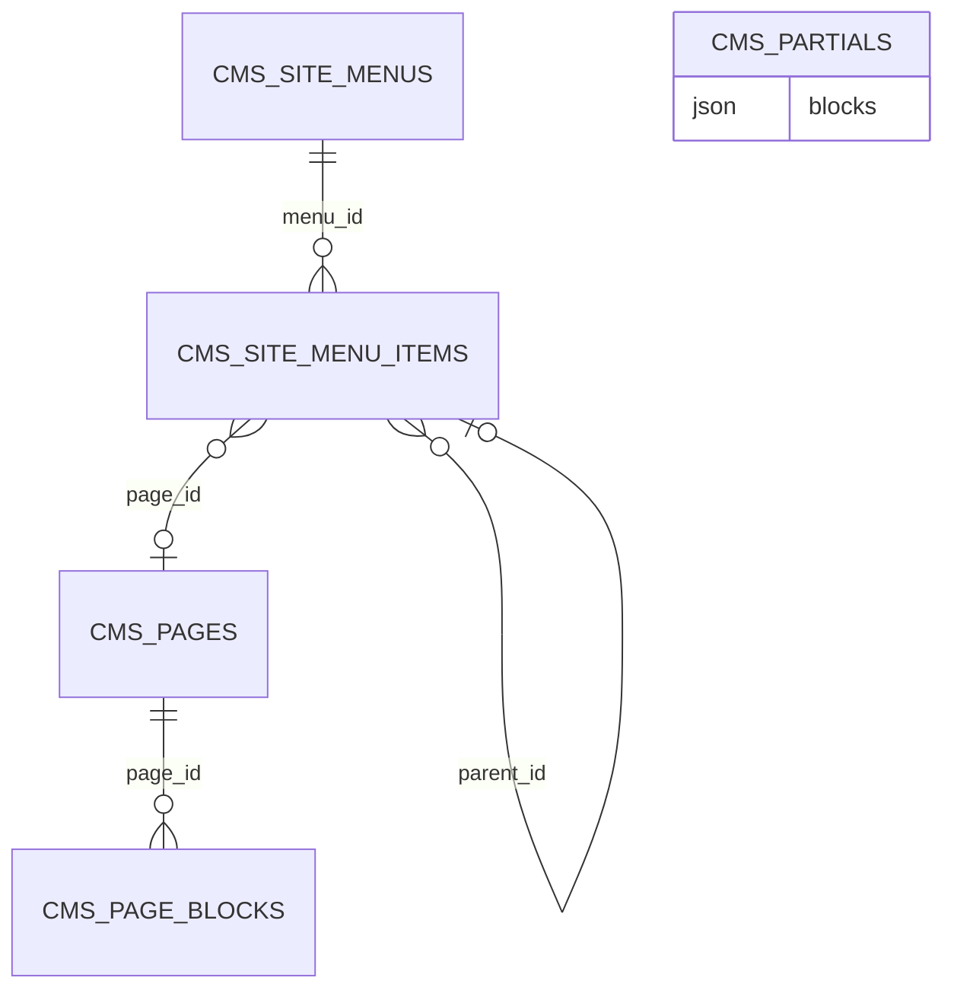

# CMS (`cms`)

The CMS module manages the **public website content**: pages (block-based or raw HTML), a drag-and-drop page builder with reusable partials, page blocks with design tokens, and site menus (header/footer). Content is delivered to the React storefront exclusively as JSON through `/api/public/*`; the CMS never renders public HTML. Pages and menus are integrated in the production-freeze/staging publish flow, so edits to published content are staged until a publish run. Used by content editors (`cms.view` / `cms.manage`) and by the storefront front-end. Required module of the `realestates` package.

Related: [Media](media.md) (images in blocks), [Products](products.md) (`products` block), [Ai](ai.md) (CMS tools `cms.*`), [module system](../architecture/module-system.md), [dashboard widgets](../architecture/dashboard-widgets.md), [REST API](../architecture/api.md).

## At a glance

| Item | Value |
| --- | --- |
| Module id | `cms` |
| Version | `2.16.0` (`modules/Cms/module.php`, `CmsModule::version()`) |
| Directory | `modules/Cms/` |
| Class | `Modules\Cms\CmsModule` |
| Requires | `core ^1.0`; optional `documents`, `media`, `products` (`^1.0`) |
| Provides / capabilities | `cms` → `Application\CmsProvider` (`capabilities()->register('cms', …)`) |
| Capabilities consumed | None; reads `Gereq\Media\Domain\MediaAsset` behind `class_exists` for media URLs |
| Groups / packages | `module.php` has no `groups`; `config/module_groups.php`: **required** in `realestates` |
| Permissions | `cms.view` (`perm.cms.view`), `cms.manage` (`perm.cms.manage`), group `perm.group.cms` |
| API scopes | `cms.read`, `cms.write` (`registerKnownScope`) |
| Publishables | `cms.pages` (`Gereq\Publish\Adapter\CmsPagePublishAdapter`, order 20), `cms.menus` (`CmsMenuPublishAdapter`, order 30) |
| Icon | `layout` |

## Domain model

Entities in `modules/Cms/Domain/` (string(36) UUID ids, no Doctrine associations).

| Entity | Table | Key fields | Enum values | Relations |
| --- | --- | --- | --- | --- |
| `Page` | `cms_pages` (unique `uniq_cms_pages_slug` on `slug`; idx `status`) | `slug`: string(180); `title`: string(190); `status`: string(32) default `draft`; `template`: string(32) default `default`; `content_mode`: string(16) default `blocks`; `body`: text nullable (raw mode); `meta_description`: text; `ssg`: bool default false (opt-in static HTML shell in storefront first response); `published_at` nullable; `created_at`, `updated_at` | `STATUSES = draft, published, archived`; `TEMPLATES = default, landing`; `CONTENT_MODES = blocks, raw` | 1‑N `PageBlock`; referenced by `SiteMenuItem.page_id`, setting `cms.home_page_id` |
| `PageBlock` | `cms_page_blocks` (idx `page_id, sort_order`) | `page_id`; `type`: string(32); `sort_order` int; `payload` json (content + design tokens, see `Application\BlockDesignNormalizer`) | `TYPES = heading, text, image, html, cta, columns, divider, products, gallery, quote, video, spacer` | → `Page` |
| `CmsPartial` | `cms_partials` (idx `name`) | `name`: string(120); `description` text nullable (≤500 chars); `blocks` json (list of normalised blocks); timestamps | — | reusable block groups for the builder |
| `SiteMenu` | `cms_site_menus` | `name`: string(120); `location`: string(32) default `header`; timestamps | `LOCATIONS = header, footer` | 1‑N `SiteMenuItem` |
| `SiteMenuItem` | `cms_site_menu_items` (idx `menu_id, sort_order`) | `menu_id`; `label`: string(190); `url`: string(2048) nullable; `page_id` nullable; `sort_order` int; `parent_id` nullable (nesting) | — | → `SiteMenu`, → `Page`, → `SiteMenuItem` (parent) |

`Page` and `SiteMenu` carry `#[AdminField]` / `#[FormEntity]` metadata for form generation (`forms()->entity('cms.page.save', Page::class)`, `forms()->entity('cms.menu.save', SiteMenu::class)`).

Domain events (`Domain/Events/`, all extend `AbstractCmsEvent implements PlatformEvent`): `PagePublished` (`page.published`, resource `cms_page`), `PageUpdated` (`page.updated`), `BlockCreated` / `BlockUpdated` / `BlockDeleted` (`block.*`, resource `cms_page_block`).



## Admin UI

### Menu items (`CmsModule::boot()`)

| Menu id | Label key | Icon | Route | Permission | Order / group |
| --- | --- | --- | --- | --- | --- |
| `cms` | `nav.cms` | `layout` | `admin.cms.pages.index` | `cms.view` | 52, group `Obsah` |
| `cms.pages` | `nav.cms.pages` | — | `admin.cms.pages.index` | `cms.view` | 53 (child) |
| `cms.menus` | `nav.cms.menus` | — | `admin.cms.menus.index` | `cms.view` | 54 (child) |

Command palette: `cms.pages` (`palette.cms.pages`, keywords `cms, stránky, pages, obsah, content`), `cms.menus` (`palette.cms.menus`), `cms.page.create` (`palette.cms.page.create`, group `Akce`, `cms.manage`).

### Admin routes — pages & blocks (`/admin/cms/pages`, middleware `auth`; `Http/PageController.php`, `Http/BlockController.php`)

| Method | Path | Route name | Action | Permission |
| --- | --- | --- | --- | --- |
| GET | `` | `admin.cms.pages.index` | `PageController::index` (hides staged deletes) | `cms.view` |
| GET | `/create` | `admin.cms.pages.create` | `create` | `cms.manage` |
| GET | `/builder` | `admin.cms.pages.builder.sandbox` | `sandboxBuilder` (builder without a page) | `cms.manage` |
| POST | `` | `admin.cms.pages.store` | `store` (stages create when published; `PageUpdated` ± `PagePublished`) | `cms.manage` |
| GET | `/{id}/edit` | `admin.cms.pages.edit` | `edit` | `cms.manage` |
| POST | `/{id}` | `admin.cms.pages.update` | `update` (freezes published page snapshot) | `cms.manage` |
| POST | `/{id}/publish` | `admin.cms.pages.publish` | `publish` (toggle publish/unpublish; audit `page.published` / `page.unpublished`) | `cms.manage` |
| GET | `/{id}/builder` | `admin.cms.pages.builder` | `builder` | `cms.manage` |
| POST | `/{id}/builder` | `admin.cms.pages.builder.save` | `builderSave` (JSON; replaces blocks; audit `page.builder_saved`) | `cms.manage` |
| GET | `/{id}/preview` | `admin.cms.pages.preview` | `preview` (HTML preview) | `cms.view` |
| GET | `/{id}/preview.json` | `admin.cms.pages.preview_json` | `previewJson` (serialised page for FE preview) | `cms.view` |
| POST | `/{id}/delete` | `admin.cms.pages.destroy` | `destroy` (staged delete) | `cms.manage` |
| GET | `/{id}` | `admin.cms.pages.show` | `show` | `cms.view` |
| POST | `/{id}/blocks` | `admin.cms.blocks.store` | `BlockController::store` | `cms.manage` |
| GET | `/{id}/blocks/{blockId}/edit` | `admin.cms.blocks.edit` | `edit` | `cms.manage` |
| POST | `/{id}/blocks/{blockId}` | `admin.cms.blocks.update` | `update` | `cms.manage` |
| POST | `/{id}/blocks/{blockId}/up` | `admin.cms.blocks.up` | `moveUp` | `cms.manage` |
| POST | `/{id}/blocks/{blockId}/down` | `admin.cms.blocks.down` | `moveDown` | `cms.manage` |
| POST | `/{id}/blocks/{blockId}/delete` | `admin.cms.blocks.destroy` | `destroy` | `cms.manage` |

### Admin routes — partials (`/admin/cms/partials`, JSON endpoints used by the builder; `Http/PartialController.php`)

| Method | Path | Route name | Action | Permission |
| --- | --- | --- | --- | --- |
| GET | `` | `admin.cms.partials.index` | `index` | `cms.view` |
| POST | `` | `admin.cms.partials.store` | `store` (JSON body `{name, description, blocks[]}`) | `cms.manage` |
| POST | `/{id}/delete` | `admin.cms.partials.destroy` | `destroy` | `cms.manage` |

### Admin routes — menus (`/admin/cms/menus`; `Http/MenuController.php`)

| Method | Path | Route name | Action | Permission |
| --- | --- | --- | --- | --- |
| GET | `` | `admin.cms.menus.index` | `index` | `cms.view` |
| GET | `/create` | `admin.cms.menus.create` | `create` | `cms.manage` |
| POST | `` | `admin.cms.menus.store` | `store` (staged create) | `cms.manage` |
| GET | `/{id}` | `admin.cms.menus.show` | `show` → redirects to `edit` | `cms.view` |
| GET | `/{id}/edit` | `admin.cms.menus.edit` | `edit` (settings + items on one page) | `cms.view` |
| POST | `/{id}` | `admin.cms.menus.update` | `update` | `cms.manage` |
| POST | `/{id}/delete` | `admin.cms.menus.destroy` | `destroy` (staged delete) | `cms.manage` |
| POST | `/{id}/items` | `admin.cms.menus.items.store` | `storeItem` | `cms.manage` |
| POST | `/{id}/items/{itemId}` | `admin.cms.menus.items.update` | `updateItem` | `cms.manage` |
| POST | `/{id}/items/{itemId}/move/{dir}` | `admin.cms.menus.items.move` | `moveItem` | `cms.manage` |
| POST | `/{id}/items/{itemId}/delete` | `admin.cms.menus.items.destroy` | `destroyItem` | `cms.manage` |

### Screens

- **Pages list / form / detail** (`Resources/views/pages/index|form|show.html.twig`, `assets/js/cmsPageForm.ts`): slug, title, status, template, content mode, raw body, meta description; detail shows blocks with up/down/delete and staging state (`staged`, `stagedCreate`).
- **Builder** (`pages/builder.html.twig`, `assets/js/cmsBuilder.ts`, ~2k lines): visual block editor with flow/free positioning (`positioning`, `pos_x/pos_y`, `box_w`, `z_index`), design tokens (`bg_color`, `text_color`, borders, shadow, radius, padding, fonts — normalised by `BlockDesignNormalizer` to tokens `paper/surface/ink/brand/...` or hex), image options (`img_w/h/fit/shape/shadow`), partials library, `{{ variable }}` placeholders (`page.title`, `page.slug`, `page.url`, `site.title`, `brand.name`, `brand.logo`, `brand.*` colours, `layout.gap`), sandbox mode.
- **Block edit** (`blocks/edit.html.twig`, `cmsBlockForm.ts`): per-type form validated by ruleset `cms.block.save`.
- **Preview** (`pages/preview.html.twig`, `assets/js/cmsPagePreview.ts`): Elementor-like GEREQ top bar (content version, status, staged/working-copy, devices). Opens saved working copy with `{{ variables }}` expanded (`serializePage(..., expandVariables: true)`). When `FRONTEND_ORIGIN` is set, embeds storefront iframe with cms-lib `?preview=1` + `boot`/`state` protocol; otherwise Twig fallback. Builder header has Preview (save-first if dirty). Secured by admin session + `cms.view`. Also `preview.json`.
- **Menus** (`menus/index|form.html.twig`): create saves metadata then opens the unified editor (settings + items, reorder ↑↓, URL or CMS page link). Index links straight to edit.
- Validation rulesets: `cms.page.save` (custom rule `cms_slug_available`), `cms.block.save`, `cms.menu.save`, `cms.menu_item.save`.
- Settings (defined here, edited in core settings UI): `cms.site_title`, `cms.home_page_id`, `cms.custom_css_public`. `CmsProvider::variableMap()` also reads `brand.name`, `brand.logo_url`, `brand.color_signal`, `brand.color_ink`, `brand.color_cream`, `brand.site_primary`.

Audit log actions: `page.created`, `page.updated`, `page.published`, `page.unpublished`, `page.builder_saved` (see `PageController`), plus block/menu actions in their controllers.

## Public / REST API

### `/api/v1/pages` (`$context->api()->module('pages', …)`)

| Method | Path | Scope | Controller |
| --- | --- | --- | --- |
| GET | `/api/v1/pages/` | `cms.read` | `PageApiController::index` — sortable `title`, `slug`, `status`, `updatedAt`, `createdAt`; filterable `status`, `template` |
| POST | `/api/v1/pages/` | `cms.write` | `store` (ruleset `cms.page.save`) |
| GET | `/api/v1/pages/{id}` | `cms.read` | `show` |
| PATCH | `/api/v1/pages/{id}` | `cms.write` | `update` |
| POST | `/api/v1/pages/{id}/publish` | `cms.write` | `publish` |
| DELETE | `/api/v1/pages/{id}` | `cms.write` | `destroy` |
| GET | `/api/v1/pages/{id}/blocks` | `cms.read` | `BlockApiController::index` |
| POST | `/api/v1/pages/{id}/blocks` | `cms.write` | `store` (ruleset `cms.block.save`) |
| PATCH | `/api/v1/pages/{id}/blocks/{blockId}` | `cms.write` | `update` |
| DELETE | `/api/v1/pages/{id}/blocks/{blockId}` | `cms.write` | `destroy` |

### Public storefront JSON (`Http/Public/PublicCmsController.php`, no auth, CORS via `PublicCors::apply(..., 'GET, OPTIONS')`)

| Method | Path | Route name | Returns |
| --- | --- | --- | --- |
| GET | `/api/public/pages?limit=` | `api.public.cms.pages.index` | Published pages (max 100, without blocks) |
| GET | `/api/public/pages/{slug}` | `api.public.cms.pages.show` | Published page with blocks and expanded variables; 404 `page_not_found` |
| GET | `/api/public/menus?location=` | `api.public.cms.menus.index` | Menus with items |
| GET | `/api/public/menus/{location}` | `api.public.cms.menus.show` | First menu for `header`/`footer`; 404 `menu_not_found` |
| OPTIONS | same four paths | `api.public.cms.*.options` | 204 CORS preflight |

In production read context (`ReadContext::isProduction()`), `CmsProvider` serves **frozen snapshots** (`FrozenPublicReader`) instead of live rows and hides pending creates.

Serializers (`CmsProvider`): page → `id`, `slug`, `title`, `status`, `template`, `content_mode`, `meta_description`, `ssg`, `published_at`, `updated_at`, optional `body` / `blocks[]`; block → `id`, `type`, `sort_order`, `payload` (media ids resolved to URLs when the Media module is present); menu → `id`, `name`, `location`, `items[]`; item → `id`, `label`, `url`, `page_id`, `page_slug`, `parent_id`, `sort_order`. When `ssg` is true on the **published** snapshot, `CmsSsgBodyInjector` (hook `storefront.spa_html`, LATE) injects a semantic HTML snapshot into the SPA `#app` for that path.

## Events, hooks & webhooks

Platform events (`registerPlatformEvents()`, all `webhookEnabled(true)`, Czech descriptions): `page.published`, `page.updated`, `block.created`, `block.updated`, `block.deleted`. Dispatched from `PageController`, `BlockController`, `PageApiController`, `BlockApiController` (block changes also emit `page.updated` with `touched` marker).

Hooks: none added or exposed. Queue jobs / scheduled tasks: none. Publishables: `cms.pages`, `cms.menus` (adapters live in core `src/Publish/Adapter/`).

## Dashboard widgets

| Widget id | Type | Class | Shows | Permission | Order |
| --- | --- | --- | --- | --- | --- |
| `cms.shortcut` | shortcut | `Application\Widgets\CmsShortcutWidget` | Link to pages (`nav.cms`, hint `admin.dashboard.hint.cms`) | `cms.view` | 52 |
| `cms.stats` | metric | `Application\Widgets\CmsStatsWidget` | Page counts, hint with draft count (`cms.widget.stats.*`) | `cms.view` | 50 |
| `cms.recent` | panel | `Application\Widgets\RecentPagesWidget` | Recently updated pages with links (`cms.widget.recent.*`) | `cms.view` | 25 |

## Services & extension points

| Class | Responsibility |
| --- | --- |
| `Application\CmsProvider` | Capability `cms`: `findPage`, `findPageBySlug`, `findPublishedBySlug` (freeze-aware), `blocksForPage`, `findMenu`, `menusByLocation`, `menuItems`, `publishedPages`, `warmPages`, `warmMenusForSerialization`, `serializePage/Menu/Block/MenuItem`, variable expansion (`{{ page.title }}` etc.). |
| `Application\BlockDesignNormalizer` | `merge(payload, raw)` normalises design fields to allowed tokens/hex (`BG_TOKENS`, `TEXT_TOKENS`, `BORDER_COLOR_TOKENS`, `FONT_*`). |
| `Gereq\Publish\Adapter\CmsPagePublishAdapter`, `CmsMenuPublishAdapter` (core) | Snapshot/apply/describe for staging. |

Integration: Media (`MediaAsset` behind `class_exists` for image URLs); Products (`products` block references `product_ids`, resolved by the FE); [Ai](ai.md) exposes `cms.search_pages`, `cms.get_page`, `cms.create_page`, `cms.update_page` tools.

## CLI commands

None.

## Configuration & translations

| Setting key | Type | Default |
| --- | --- | --- |
| `cms.site_title` | `TYPE_STRING` | `GEREQ Site` |
| `cms.home_page_id` | `TYPE_STRING` | `''` |
| `cms.custom_css_public` | `TYPE_STRING` | CSS comment stub (`:root { /* --color-brand-700 */ }`) |

Reads (not owned): `brand.name`, `brand.logo_url`, `brand.color_signal`, `brand.color_ink`, `brand.color_cream`, `brand.site_primary`. No env vars.

Translations: `modules/Cms/Resources/translations/messages.cs.php`, `messages.en.php`. Prefixes: `module.cms.description`, `nav.cms*`, `palette.cms.*`, `perm.cms.*`, `perm.group.cms`, `cms.builder.*` (largest group), `cms.block.*`, `cms.blocks.*`, `cms.pages.*`, `cms.page.*`, `cms.field.*`, `cms.flash.*`, `cms.error.*`, `cms.preview.*`, `cms.widget.*`, `cms.settings.*`, `cms.menus.*`, `cms.menu.*`, `cms.menu_items.*`, `cms.body.*`, `cms.staging.*`, `cms.filter.*`, `admin.dashboard.hint.cms`, `publish.category.cms_pages|cms_menus`.

## Database migrations

| File | Purpose |
| --- | --- |
| `Database/Migrations/2026_01_01_000001_init.php` | Empty `up()`/`down()` — all CMS tables created by Doctrine SchemaTool. |
| `Database/Migrations/2026_09_09_000001_cms_partials.php` | Placeholder for `cms_partials` (SchemaTool); `down()` drops the table if present. |

## Notes

- `module.php` declares no `groups`; the module is placed in the `realestates` package only via `config/module_groups.php`.
- Both migrations are placeholders; schema changes rely entirely on SchemaTool sync.
- Public JSON error messages and event descriptions are Czech literals (`'Stránka neexistuje.'`, `'Menu neexistuje.'`, `'Stránka s tímto slugem už existuje.'`).
- `PartialController` validates its JSON payload by hand (no validation ruleset).
- `SiteMenuItem` nesting (`parent_id`) has no depth limit or cycle check at entity level.
- `cms.custom_css_public` is defined as `TYPE_STRING` although it holds multi-line CSS.
- `Page.body` is limited by validation to 200 000 characters; block payload sub-fields to 20 000–50 000.

## Configurable public forms

A `form` block owns `form_field` children (optionally grouped in `layout` blocks).
It stores `schema_version: 1`, `action`, `columns` (1 or 2), `submit_label`,
`success_message`, and `children`. The builder's action selector seeds the required
action fields for empty forms. For existing forms, **Add required fields** inserts
missing fields and corrects types/required flags for matching names, preserving
labels, design and unrelated fields. A checklist shows readiness and duplicate
names requiring manual correction. Editors can add/reorder fields, set required/options/full width, and
edit labels without changing storefront code. Supported controls are text, email,
tel, date, textarea, and select. Select options are newline-separated values.

Fields have unique names within each form, starting with a letter and containing
only letters, digits, `_` and `-` (maximum 80 characters). Security/prototype names
are reserved. Forms support up to 50 fields and cannot contain nested forms,
dynamic sources, widgets or raw HTML controls. Form content uses the normal page
save/staging/partial workflow. Draft saves and partials may have incomplete fields or an empty/unavailable action.
Only unsafe structure (such as nested forms) blocks saving; strict action/field
readiness checks run at submission.

Modules register actions in `boot()`, using the optional shared CMS facade, and
register their named validation ruleset in `register()`:

```php
$context->validation()->ruleset('example.contact', [
    'email' => 'required|email|max:190',
    'message' => 'required|max:5000',
]);

$context->cms()->registerFormAction(
    'example.contact',
    'example.form_action',
    'example.contact',
    ['email' => 'email', 'message' => 'textarea'],
    static fn (array $values): array => $context->get(ContactIntake::class)->handle($values),
);
```

The fourth argument maps required names to control types. Submission requires these fields with matching types and required flags; drafts
may remain incomplete. The handler receives only the declared
form values, after CMS schema validation and action-specific ruleset validation.
It must perform business authorization/validation, use module contracts for other
modules' data, and keep credentials and destinations in server configuration.
Its return value is private; the public response exposes only receipt status.

`SiteInquiries` registers `site_inquiries.create`, requiring `name`, `email`,
`phone`, and `details`. Additional fields are retained in inquiry details. Configure
contact/notification settings for the installation; there are no client-specific
contact defaults in the reusable intake path.

Public page JSON adds `payload.submit_path` to each published form:
`POST /api/public/pages/{slug}/forms/{formId}`. Request JSON contains `values` plus
top-level GEREQ Security/honeypot fields; `Idempotency-Key` is required. OPTIONS
allows this header. The endpoint resolves the published schema, including frozen
snapshots, rather than trusting browser-supplied fields or action names. Submissions
are immediate intake operations. It bounds request size to 64 KiB, validates real
calendar dates and select membership, rate-limits by IP, and invokes the existing
GEREQ form guard when available.

Responses use `{data: {status: "received"}}` (201) or
`{error: {code, message, fields?}}`. Missing/unpublished forms return 404; disabled
actions 503; invalid fields 422; rate limits 429; conflicting retry values 409.
Retries of accepted values replay the saved receipt without rerunning the handler.
A database unique-key claim precedes the handler; intake and replay storage commit
in one transaction, including across workers sharing that database. External side
effects use the optional after-commit callback. This is not an exactly-once mail
delivery guarantee.

`cms-lib` renders forms and maintains controlled values, accessible field errors,
submission state, responsive columns and retry keys. The fluent client configures
its transport automatically, so other storefronts only need the same CMS renderer
and client configuration. Editor forms remain disabled. Preview forms validate locally and simulate success
without contacting the submission API; a visible notice identifies simulation and
"Try again" resets the preview. Backend action rules and security are not tested
by this local simulation. GEREQ Security tokens
injected into the form are forwarded by the runtime; live external security and
mail delivery must be verified with installation-specific configuration.

### Form authoring and operations (2.37.0)

Drafts remain saveable while incomplete. The CMS page publish adapter validates all form blocks before releasing a working copy; invalid configuration leaves the staged changes pending. Required action inputs may map to existing fields with matching control types and required flags. Canonical-name collisions and reused mappings are rejected. Values are validated under their page field names, then mapped to action inputs.

The form inspector includes an ordered field list with drag and keyboard button controls, per-row select option editing, and optional field help. Backend test validates the current draft and the security guard through an authenticated, CSRF-protected `cms.manage` endpoint without calling action handlers. Preview submission remains a local simulation.

The Form submissions screen (`/admin/cms/forms/attempts`, `cms.manage`) shows the most recent 100 public endpoint outcomes within 30 days. Its reversible migration creates `cms_form_attempts`; module admin update applies it. Only page/form identifiers, UTC time, HTTP status and outcome codes are retained. No submitted values, IPs or security tokens are stored there. Records older than 30 days are pruned on submission; the screen always excludes them. Received confirms successful action execution (or idempotent replay), not external mail or webhook delivery.

Public validation includes a focused error summary with links to invalid controls; help and errors are connected to controls through `aria-describedby`. All new interface copy is in Czech and English catalogs.

Actions may return a whitelisted `delivery_status` (`sent`, `failed`, `not_configured`, `queued`) for private submission diagnostics. Unknown/custom results are never exposed or persisted. SiteInquiries reports queued status on intake and updates diagnostics after background delivery; mail failure never changes intake success. A second reversible migration adds the delivery status column. Retries are marked already processed; they never resend the notification. `sent` means the mailer accepted the message, not confirmed arrival in the recipient inbox.

### CMS submissions navigation (2.38.0)

Form submissions appears under Content & pages with Pages, Media and Links, and is searchable in the command palette. The authenticated list retains `cms.manage` permission and supports exact page slug/form ID, outcome, notification status and inclusive UTC date filters, applied before the 100-row limit. Date filters remain bounded by the 30-day diagnostics window. The form inspector links to the list scoped to its saved page and form; unsaved forms have no submissions link.

### Form controls and record operations (2.39.0)

Forms support checkbox, radio and private file attachments alongside the original
controls. Checked values use `1`; unchecked values are empty. Legacy consent
controls remain compatible with checkboxes. Radio values must match configured options.
The inspector diagnoses unavailable actions, invalid or duplicate field names,
missing options and required-action mismatches beside the relevant controls.
Draft saving remains permissive; publishing and submission enforce the schema.

A file field accepts one PDF, JPEG or PNG up to 5 MiB. All attachments together
are limited to 10 MiB per request; PHP and the reverse proxy must allow an 11 MiB
multipart request (`post_max_size`, `upload_max_filesize`, request-body limits).
Both extension and server-detected MIME type are checked. File bytes are stored
in the private `cms_form_uploads` table, transactionally with the action. Downloads
require the owning action's record-view permission (or `cms.manage` for actions
without record operations), and use attachment disposition, no sniffing, and no caching.
They never enter public media. Linked attachments remain available on the inquiry
after its 30-day technical history expires; deleting the inquiry removes them
in the same transaction. Unlinked temporary attachments expire after 30 days. JSON filenames cannot satisfy upload fields.
Idempotency hashes include file contents. Preview and inspector tests never save
attachments or invoke action handlers.

Actions can opt into `Gereq\Cms\FormActionOperations` as the final registration
argument. Their private `id` result then links the attempt to the created record;
record lookup and notification retry remain inside the owning module. Record
links require its view permission. The list batches record and attachment lookups.
SiteInquiries provides an inquiry detail route and retry implementation.

Failed, unconfigured or not-yet-attempted notifications with an existing linked
record can be retried. The CSRF-protected POST requires `cms.manage` plus the action's view and
retry permissions. An atomic claim prevents concurrent retries; each attempt is
limited to five retries and records retry count, time and audit events. A retry
calls only the existing record's notification operation, never the intake handler.
An interrupted retry stays in progress to avoid an automatic duplicate send.
Existing attempts without a private record reference cannot be retried. Recipient
and webhook configuration changes and a broader E2E suite remain deferred.

### Choice field settings (2.40.0)

Checkbox is the single boolean control in the builder. Legacy `consent` fields
continue to render and validate as checkboxes and normalize to `checkbox` when
edited. Checkbox, radio and file fields hide placeholder settings and placeholder
text-overflow targets. Radio fields persist `options_layout` as `vertical`
(default) or `horizontal`; horizontal groups wrap within the available width.

### Forms safety audit (2.41.0)

Admin form operations live in `FormController`. Attachments require `cms.manage`
and the action-specific record view permission; deleted records or disabled actions
cannot expose their attachments. Public receipts omit customer and notification
metadata, including on the legacy inquiry endpoint. Both paths validate through
the registered action ruleset. Lead creation uses the shared Customers intake;
matching an existing email never changes that customer from anonymous input.

CMS actions claim the unique database idempotency key inside the intake transaction
before invoking the handler. This prevents duplicate mutations across workers;
local file locks are not the correctness mechanism. Actions must keep external
side effects outside the handler. The optional final `afterCommit` registration
callback receives the private handler result after the transaction commits and
returns notification status. SiteInquiries uses it for creation events; email work
is already persisted by intake. Notification failure never changes committed
receipt success. Generic actions retain their own retry semantics. Site inquiries
persist pending staff-email work with the inquiry and process
it through the `site_inquiries.notifications` schedule every minute. Other
actions retain their own delivery behavior. Mail transport acceptance does not
confirm inbox delivery.

Public form rate limits run before page lookup, include malformed/missing-form
requests, serialize the local limiter update and fail closed on storage errors.
Repeated rate-limit denials are not appended to the submissions table. Enabled
GEREQ protection also fails closed when its verifier raises an exception; disabled
protection remains optional.

Attachment retention timestamps are explicitly UTC. The reversible fifth
migration indexes upload expiry. Cleanup runs outside intake transactions and is
also registered as `cms.forms.retention` daily at 03:40 UTC. Deployments must run
the standard `schedule:run` scheduler for physical cleanup without incoming form
traffic. Expired temporary downloads are always denied. The retained-attachment migration
backfills action and record references from existing technical logs without
copying file bytes. Its rollback removes the new references but preserves file bytes. Inquiry attachment cleanup requires the CMS storage provider to be enabled. Rolling back the upload-table
migration removes its stored attachments. Files have extension/MIME/size checks
and forced private downloads; no malware-scanning service is configured here.


### Inquiry notification outbox

Site inquiries store notification status and lease metadata on their own inquiry
record, in the same transaction as intake. CMS forms and the original public
inquiry endpoint both enqueue mail; requests no longer wait for SMTP. No message
body, recipient, token or exception text is copied into a queue payload. Creation
events still run after commit and are not replayed by email retries.

The `site_inquiries.notifications` scheduled task processes up to 25 due inquiries
per run. Run the standard `php gereq schedule:run` every minute. Atomic database
claims exclude overlapping workers; leases expire after ten minutes to recover
interrupted work. Failed sends retry after 1, 5, 15 and 60 minutes, at most five
attempts per cycle. A missing or invalid notification address stops with
`not_configured`; after correcting settings, a manager can explicitly retry from
the inquiry detail. The detail shows current status, attempts and UTC timestamps.
CMS technical history receives status updates through the optional core CMS
facade, without either module accessing the other's tables.

Manual retry requires `site_inquiries.manage`, session CSRF and an audit entry;
it resets the attempt budget only for failed, unconfigured or unscheduled work.
Queued/sending and transport-accepted notifications are never deliberately sent
again by that action. Deleting an inquiry also deletes its pending work. Migration
leaves historical inquiries unscheduled; it does not replay old notifications.
Rollback removes delivery state and pending work while preserving inquiries.

SMTP cannot guarantee exactly-once delivery: interruption after transport
acceptance but before the status commit may cause a duplicate when the lease is
recovered. `sent` means accepted by the configured mail transport, not confirmed
inbox delivery. Keep mail transport timeouts below the ten-minute lease. Delivery
pauses while the Site inquiries module is disabled or the scheduler is stopped.

Form submit buttons have an independent inspector accordion for variant, alignment,
full width, background/text colors, corner radius and padding. Existing forms keep
their storefront defaults until these settings are changed. Colors use the shared
design-token/hex allowlist; radius and padding are bounded to 0–100 px.

The Input appearance accordion configures all form controls: background, text,
border and focus colors, radius, padding and font size. Input radius is independent of the form block radius and uses
pixels, including zero for square corners. A positive form block radius clips
the form contents at its rounded corners without changing individual inputs. Native controls and Ant Design date/
select controls share the same scoped CSS variables. Validation borders retain
their error color. Numeric settings and colors are normalized before persistence.

Form attachments are scanned asynchronously. Inquiry creation never waits for
ClamAV; unscanned files require an authorized, CSRF-protected acknowledgement
before download, and detected threats are blocked. See
[malware scanning](../development/malware-scanning.md) for setup, retries, retained
file backfill and the separate future mailbox integration.
