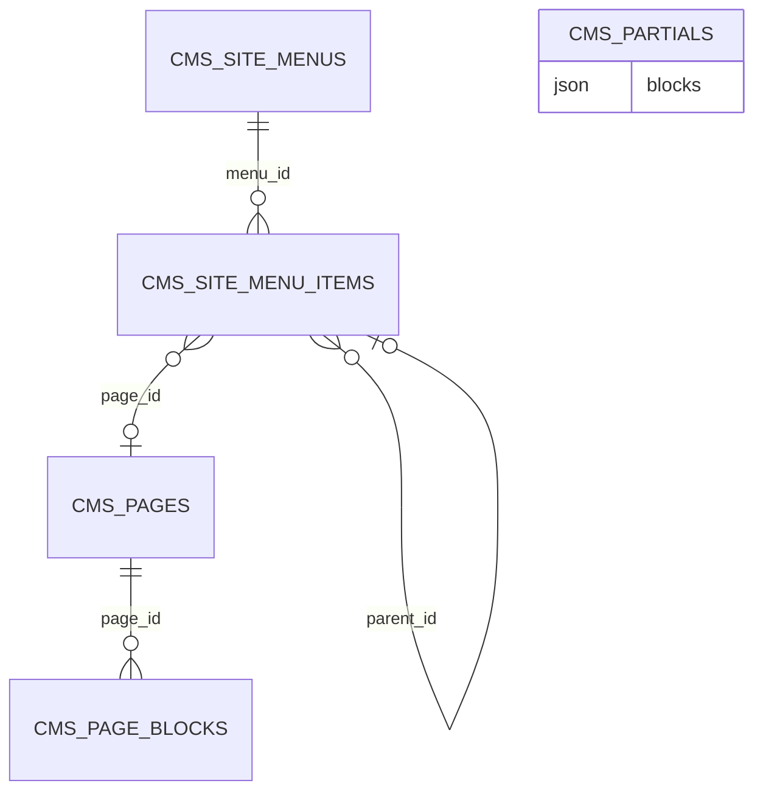

# CMS (`cms`)

The CMS module manages the **public website content**: pages (block-based or raw HTML), a drag-and-drop page builder with reusable partials, page blocks with design tokens, and site menus (header/footer). Content is delivered to the React storefront exclusively as JSON through `/api/public/*`; the CMS never renders public HTML. Pages and menus are integrated in the production-freeze/staging publish flow, so edits to published content are staged until a publish run. Used by content editors (`cms.view` / `cms.manage`) and by the storefront front-end. Required module of the `realestates` package.

Related: [Media](media.md) (images in blocks), [Products](products.md) (`products` block), [Ai](ai.md) (CMS tools `cms.*`), [module system](../architecture/module-system.md), [dashboard widgets](../architecture/dashboard-widgets.md), [REST API](../architecture/api.md).

## At a glance

| Item | Value |
| --- | --- |
| Module id | `cms` |
| Version | `1.99.0` (`modules/Cms/module.php`, `CmsModule::version()`) |
| Directory | `modules/Cms/` |
| Class | `Modules\Cms\CmsModule` |
| Requires | `core ^1.0`; optional `documents`, `media`, `products` (`^1.0`) |
| Provides / capabilities | `cms` → `Application\CmsProvider` (`capabilities()->register('cms', …)`) |
| Capabilities consumed | None; reads `Modules\Media\Domain\MediaAsset` behind `class_exists` for media URLs |
| Groups / packages | `module.php` has no `groups`; `config/module_groups.php`: **required** in `realestates` |
| Permissions | `cms.view` (`perm.cms.view`), `cms.manage` (`perm.cms.manage`), group `perm.group.cms` |
| API scopes | `cms.read`, `cms.write` (`registerKnownScope`) |
| Publishables | `cms.pages` (`Gereq\Publish\Adapter\CmsPagePublishAdapter`, order 20), `cms.menus` (`CmsMenuPublishAdapter`, order 30) |
| Icon | `layout` |

## Domain model

Entities in `modules/Cms/Domain/` (string(36) UUID ids, no Doctrine associations).

| Entity | Table | Key fields | Enum values | Relations |
| --- | --- | --- | --- | --- |
| `Page` | `cms_pages` (unique `uniq_cms_pages_slug` on `slug`; idx `status`) | `slug`: string(180); `title`: string(190); `status`: string(32) default `draft`; `template`: string(32) default `default`; `content_mode`: string(16) default `blocks`; `body`: text nullable (raw mode); `meta_description`: text; `published_at` nullable; `created_at`, `updated_at` | `STATUSES = draft, published, archived`; `TEMPLATES = default, landing`; `CONTENT_MODES = blocks, raw` | 1‑N `PageBlock`; referenced by `SiteMenuItem.page_id`, setting `cms.home_page_id` |
| `PageBlock` | `cms_page_blocks` (idx `page_id, sort_order`) | `page_id`; `type`: string(32); `sort_order` int; `payload` json (content + design tokens, see `Application\BlockDesignNormalizer`) | `TYPES = heading, text, image, html, cta, columns, divider, products, gallery, quote, video, spacer` | → `Page` |
| `CmsPartial` | `cms_partials` (idx `name`) | `name`: string(120); `description` text nullable (≤500 chars); `blocks` json (list of normalised blocks); timestamps | — | reusable block groups for the builder |
| `SiteMenu` | `cms_site_menus` | `name`: string(120); `location`: string(32) default `header`; timestamps | `LOCATIONS = header, footer` | 1‑N `SiteMenuItem` |
| `SiteMenuItem` | `cms_site_menu_items` (idx `menu_id, sort_order`) | `menu_id`; `label`: string(190); `url`: string(2048) nullable; `page_id` nullable; `sort_order` int; `parent_id` nullable (nesting) | — | → `SiteMenu`, → `Page`, → `SiteMenuItem` (parent) |

`Page` and `SiteMenu` carry `#[AdminField]` / `#[FormEntity]` metadata for form generation (`forms()->entity('cms.page.save', Page::class)`, `forms()->entity('cms.menu.save', SiteMenu::class)`).

Domain events (`Domain/Events/`, all extend `AbstractCmsEvent implements PlatformEvent`): `PagePublished` (`page.published`, resource `cms_page`), `PageUpdated` (`page.updated`), `BlockCreated` / `BlockUpdated` / `BlockDeleted` (`block.*`, resource `cms_page_block`).

## Admin UI

### Menu items (`CmsModule::boot()`)

| Menu id | Label key | Icon | Route | Permission | Order / group |
| --- | --- | --- | --- | --- | --- |
| `cms` | `nav.cms` | `layout` | `admin.cms.pages.index` | `cms.view` | 52, group `Obsah` |
| `cms.pages` | `nav.cms.pages` | — | `admin.cms.pages.index` | `cms.view` | 53 (child) |
| `cms.menus` | `nav.cms.menus` | — | `admin.cms.menus.index` | `cms.view` | 54 (child) |

Command palette: `cms.pages` (`palette.cms.pages`, keywords `cms, stránky, pages, obsah, content`), `cms.menus` (`palette.cms.menus`), `cms.page.create` (`palette.cms.page.create`, group `Akce`, `cms.manage`).

### Admin routes — pages & blocks (`/admin/cms/pages`, middleware `auth`; `Http/PageController.php`, `Http/BlockController.php`)

| Method | Path | Route name | Action | Permission |
| --- | --- | --- | --- | --- |
| GET | `` | `admin.cms.pages.index` | `PageController::index` (hides staged deletes) | `cms.view` |
| GET | `/create` | `admin.cms.pages.create` | `create` | `cms.manage` |
| GET | `/builder` | `admin.cms.pages.builder.sandbox` | `sandboxBuilder` (builder without a page) | `cms.manage` |
| POST | `` | `admin.cms.pages.store` | `store` (stages create when published; `PageUpdated` ± `PagePublished`) | `cms.manage` |
| GET | `/{id}/edit` | `admin.cms.pages.edit` | `edit` | `cms.manage` |
| POST | `/{id}` | `admin.cms.pages.update` | `update` (freezes published page snapshot) | `cms.manage` |
| POST | `/{id}/publish` | `admin.cms.pages.publish` | `publish` (toggle publish/unpublish; audit `page.published` / `page.unpublished`) | `cms.manage` |
| GET | `/{id}/builder` | `admin.cms.pages.builder` | `builder` | `cms.manage` |
| POST | `/{id}/builder` | `admin.cms.pages.builder.save` | `builderSave` (JSON; replaces blocks; audit `page.builder_saved`) | `cms.manage` |
| GET | `/{id}/preview` | `admin.cms.pages.preview` | `preview` (HTML preview) | `cms.view` |
| GET | `/{id}/preview.json` | `admin.cms.pages.preview_json` | `previewJson` (serialised page for FE preview) | `cms.view` |
| POST | `/{id}/delete` | `admin.cms.pages.destroy` | `destroy` (staged delete) | `cms.manage` |
| GET | `/{id}` | `admin.cms.pages.show` | `show` | `cms.view` |
| POST | `/{id}/blocks` | `admin.cms.blocks.store` | `BlockController::store` | `cms.manage` |
| GET | `/{id}/blocks/{blockId}/edit` | `admin.cms.blocks.edit` | `edit` | `cms.manage` |
| POST | `/{id}/blocks/{blockId}` | `admin.cms.blocks.update` | `update` | `cms.manage` |
| POST | `/{id}/blocks/{blockId}/up` | `admin.cms.blocks.up` | `moveUp` | `cms.manage` |
| POST | `/{id}/blocks/{blockId}/down` | `admin.cms.blocks.down` | `moveDown` | `cms.manage` |
| POST | `/{id}/blocks/{blockId}/delete` | `admin.cms.blocks.destroy` | `destroy` | `cms.manage` |

### Admin routes — partials (`/admin/cms/partials`, JSON endpoints used by the builder; `Http/PartialController.php`)

| Method | Path | Route name | Action | Permission |
| --- | --- | --- | --- | --- |
| GET | `` | `admin.cms.partials.index` | `index` | `cms.view` |
| POST | `` | `admin.cms.partials.store` | `store` (JSON body `{name, description, blocks[]}`) | `cms.manage` |
| POST | `/{id}/delete` | `admin.cms.partials.destroy` | `destroy` | `cms.manage` |

### Admin routes — menus (`/admin/cms/menus`; `Http/MenuController.php`)

| Method | Path | Route name | Action | Permission |
| --- | --- | --- | --- | --- |
| GET | `` | `admin.cms.menus.index` | `index` | `cms.view` |
| GET | `/create` | `admin.cms.menus.create` | `create` | `cms.manage` |
| POST | `` | `admin.cms.menus.store` | `store` (staged create) | `cms.manage` |
| GET | `/{id}` | `admin.cms.menus.show` | `show` → redirects to `edit` | `cms.view` |
| GET | `/{id}/edit` | `admin.cms.menus.edit` | `edit` (settings + items on one page) | `cms.view` |
| POST | `/{id}` | `admin.cms.menus.update` | `update` | `cms.manage` |
| POST | `/{id}/delete` | `admin.cms.menus.destroy` | `destroy` (staged delete) | `cms.manage` |
| POST | `/{id}/items` | `admin.cms.menus.items.store` | `storeItem` | `cms.manage` |
| POST | `/{id}/items/{itemId}` | `admin.cms.menus.items.update` | `updateItem` | `cms.manage` |
| POST | `/{id}/items/{itemId}/move/{dir}` | `admin.cms.menus.items.move` | `moveItem` | `cms.manage` |
| POST | `/{id}/items/{itemId}/delete` | `admin.cms.menus.items.destroy` | `destroyItem` | `cms.manage` |

### Screens

- **Pages list / form / detail** (`Resources/views/pages/index|form|show.html.twig`, `assets/js/cmsPageForm.ts`): slug, title, status, template, content mode, raw body, meta description; detail shows blocks with up/down/delete and staging state (`staged`, `stagedCreate`).
- **Builder** (`pages/builder.html.twig`, `assets/js/cmsBuilder.ts`, ~2k lines): visual block editor with flow/free positioning (`positioning`, `pos_x/pos_y`, `box_w`, `z_index`), design tokens (`bg_color`, `text_color`, borders, shadow, radius, padding, fonts — normalised by `BlockDesignNormalizer` to tokens `paper/surface/ink/brand/...` or hex), image options (`img_w/h/fit/shape/shadow`), partials library, `{{ variable }}` placeholders (`page.title`, `page.slug`, `page.url`, `site.title`, `brand.name`, `brand.logo`, `brand.*` colours, `layout.gap`), sandbox mode.
- **Block edit** (`blocks/edit.html.twig`, `cmsBlockForm.ts`): per-type form validated by ruleset `cms.block.save`.
- **Preview** (`pages/preview.html.twig`) and `preview.json`.
- **Menus** (`menus/index|form.html.twig`): create saves metadata then opens the unified editor (settings + items, reorder ↑↓, URL or CMS page link). Index links straight to edit.
- Validation rulesets: `cms.page.save` (custom rule `cms_slug_available`), `cms.block.save`, `cms.menu.save`, `cms.menu_item.save`.
- Settings (defined here, edited in core settings UI): `cms.site_title`, `cms.home_page_id`, `cms.custom_css_public`. `CmsProvider::variableMap()` also reads `brand.name`, `brand.logo_url`, `brand.color_signal`, `brand.color_ink`, `brand.color_cream`, `brand.site_primary`.

Audit log actions: `page.created`, `page.updated`, `page.published`, `page.unpublished`, `page.builder_saved` (see `PageController`), plus block/menu actions in their controllers.

## Public / REST API

### `/api/v1/pages` (`$context->api()->module('pages', …)`)

| Method | Path | Scope | Controller |
| --- | --- | --- | --- |
| GET | `/api/v1/pages/` | `cms.read` | `PageApiController::index` — sortable `title`, `slug`, `status`, `updatedAt`, `createdAt`; filterable `status`, `template` |
| POST | `/api/v1/pages/` | `cms.write` | `store` (ruleset `cms.page.save`) |
| GET | `/api/v1/pages/{id}` | `cms.read` | `show` |
| PATCH | `/api/v1/pages/{id}` | `cms.write` | `update` |
| POST | `/api/v1/pages/{id}/publish` | `cms.write` | `publish` |
| DELETE | `/api/v1/pages/{id}` | `cms.write` | `destroy` |
| GET | `/api/v1/pages/{id}/blocks` | `cms.read` | `BlockApiController::index` |
| POST | `/api/v1/pages/{id}/blocks` | `cms.write` | `store` (ruleset `cms.block.save`) |
| PATCH | `/api/v1/pages/{id}/blocks/{blockId}` | `cms.write` | `update` |
| DELETE | `/api/v1/pages/{id}/blocks/{blockId}` | `cms.write` | `destroy` |

### Public storefront JSON (`Http/Public/PublicCmsController.php`, no auth, CORS via `PublicCors::apply(..., 'GET, OPTIONS')`)

| Method | Path | Route name | Returns |
| --- | --- | --- | --- |
| GET | `/api/public/pages?limit=` | `api.public.cms.pages.index` | Published pages (max 100, without blocks) |
| GET | `/api/public/pages/{slug}` | `api.public.cms.pages.show` | Published page with blocks and expanded variables; 404 `page_not_found` |
| GET | `/api/public/menus?location=` | `api.public.cms.menus.index` | Menus with items |
| GET | `/api/public/menus/{location}` | `api.public.cms.menus.show` | First menu for `header`/`footer`; 404 `menu_not_found` |
| OPTIONS | same four paths | `api.public.cms.*.options` | 204 CORS preflight |

In production read context (`ReadContext::isProduction()`), `CmsProvider` serves **frozen snapshots** (`FrozenPublicReader`) instead of live rows and hides pending creates.

Serializers (`CmsProvider`): page → `id`, `slug`, `title`, `status`, `template`, `content_mode`, `meta_description`, `published_at`, `updated_at`, optional `body` / `blocks[]`; block → `id`, `type`, `sort_order`, `payload` (media ids resolved to URLs when the Media module is present); menu → `id`, `name`, `location`, `items[]`; item → `id`, `label`, `url`, `page_id`, `page_slug`, `parent_id`, `sort_order`.

## Events, hooks & webhooks

Platform events (`registerPlatformEvents()`, all `webhookEnabled(true)`, Czech descriptions): `page.published`, `page.updated`, `block.created`, `block.updated`, `block.deleted`. Dispatched from `PageController`, `BlockController`, `PageApiController`, `BlockApiController` (block changes also emit `page.updated` with `touched` marker).

Hooks: none added or exposed. Queue jobs / scheduled tasks: none. Publishables: `cms.pages`, `cms.menus` (adapters live in core `src/Publish/Adapter/`).

## Dashboard widgets

| Widget id | Type | Class | Shows | Permission | Order |
| --- | --- | --- | --- | --- | --- |
| `cms.shortcut` | shortcut | `Application\Widgets\CmsShortcutWidget` | Link to pages (`nav.cms`, hint `admin.dashboard.hint.cms`) | `cms.view` | 52 |
| `cms.stats` | metric | `Application\Widgets\CmsStatsWidget` | Page counts, hint with draft count (`cms.widget.stats.*`) | `cms.view` | 50 |
| `cms.recent` | panel | `Application\Widgets\RecentPagesWidget` | Recently updated pages with links (`cms.widget.recent.*`) | `cms.view` | 25 |

## Services & extension points

| Class | Responsibility |
| --- | --- |
| `Application\CmsProvider` | Capability `cms`: `findPage`, `findPageBySlug`, `findPublishedBySlug` (freeze-aware), `blocksForPage`, `findMenu`, `menusByLocation`, `menuItems`, `publishedPages`, `warmPages`, `warmMenusForSerialization`, `serializePage/Menu/Block/MenuItem`, variable expansion (`{{ page.title }}` etc.). |
| `Application\BlockDesignNormalizer` | `merge(payload, raw)` normalises design fields to allowed tokens/hex (`BG_TOKENS`, `TEXT_TOKENS`, `BORDER_COLOR_TOKENS`, `FONT_*`). |
| `Gereq\Publish\Adapter\CmsPagePublishAdapter`, `CmsMenuPublishAdapter` (core) | Snapshot/apply/describe for staging. |

Integration: Media (`MediaAsset` behind `class_exists` for image URLs); Products (`products` block references `product_ids`, resolved by the FE); [Ai](ai.md) exposes `cms.search_pages`, `cms.get_page`, `cms.create_page`, `cms.update_page` tools.

## CLI commands

None.

## Configuration & translations

| Setting key | Type | Default |
| --- | --- | --- |
| `cms.site_title` | `TYPE_STRING` | `GEREQ Site` |
| `cms.home_page_id` | `TYPE_STRING` | `''` |
| `cms.custom_css_public` | `TYPE_STRING` | CSS comment stub (`:root { /* --color-brand-700 */ }`) |

Reads (not owned): `brand.name`, `brand.logo_url`, `brand.color_signal`, `brand.color_ink`, `brand.color_cream`, `brand.site_primary`. No env vars.

Translations: `modules/Cms/Resources/translations/messages.cs.php`, `messages.en.php`. Prefixes: `module.cms.description`, `nav.cms*`, `palette.cms.*`, `perm.cms.*`, `perm.group.cms`, `cms.builder.*` (largest group), `cms.block.*`, `cms.blocks.*`, `cms.pages.*`, `cms.page.*`, `cms.field.*`, `cms.flash.*`, `cms.error.*`, `cms.preview.*`, `cms.widget.*`, `cms.settings.*`, `cms.menus.*`, `cms.menu.*`, `cms.menu_items.*`, `cms.body.*`, `cms.staging.*`, `cms.filter.*`, `admin.dashboard.hint.cms`, `publish.category.cms_pages|cms_menus`.

## Database migrations

| File | Purpose |
| --- | --- |
| `Database/Migrations/2026_01_01_000001_init.php` | Empty `up()`/`down()` — all CMS tables created by Doctrine SchemaTool. |
| `Database/Migrations/2026_09_09_000001_cms_partials.php` | Placeholder for `cms_partials` (SchemaTool); `down()` drops the table if present. |

## Notes

- `module.php` declares no `groups`; the module is placed in the `realestates` package only via `config/module_groups.php`.
- Both migrations are placeholders; schema changes rely entirely on SchemaTool sync.
- Public JSON error messages and event descriptions are Czech literals (`'Stránka neexistuje.'`, `'Menu neexistuje.'`, `'Stránka s tímto slugem už existuje.'`).
- `PartialController` validates its JSON payload by hand (no validation ruleset).
- `SiteMenuItem` nesting (`parent_id`) has no depth limit or cycle check at entity level.
- `cms.custom_css_public` is defined as `TYPE_STRING` although it holds multi-line CSS.
- `Page.body` is limited by validation to 200 000 characters; block payload sub-fields to 20 000–50 000.
