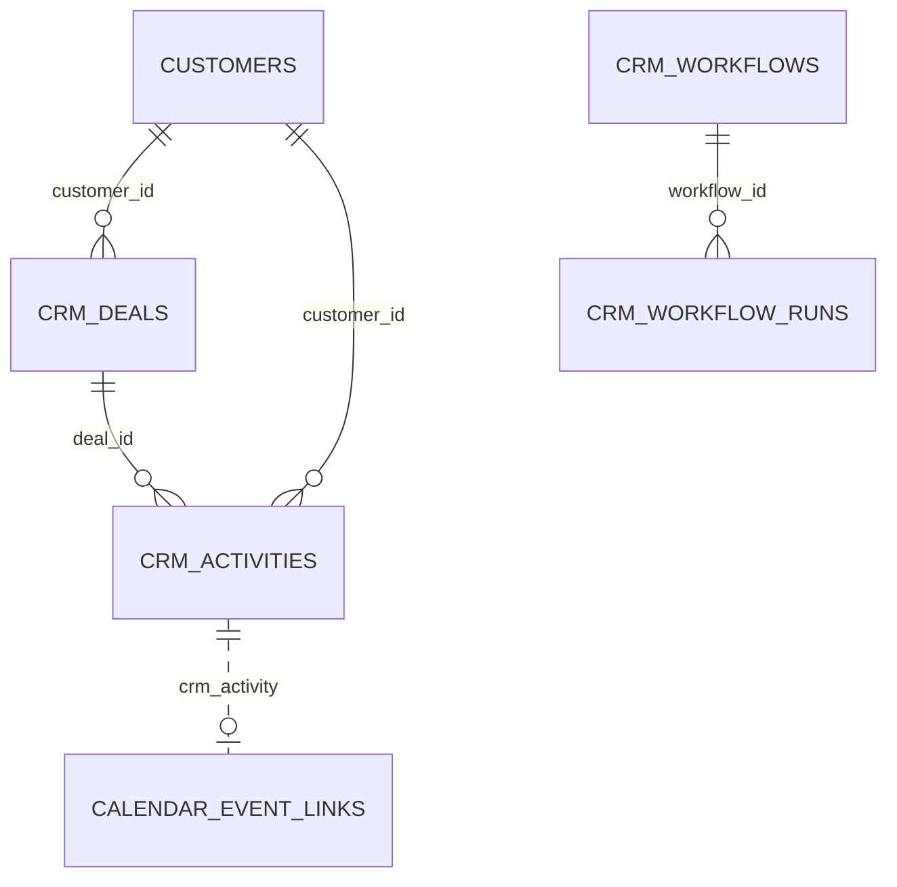

# CRM (`crm`)

The CRM module adds a **sales pipeline** (deals with stages `lead → qualified → proposal → won/lost`), **activities** (calls, e-mails, meetings, tasks, notes with due dates and completion) and a **visual automation engine** (workflows: an n8n-like node graph triggered by platform events that can send e-mail, create activities, change deal stages, branch and delay). Deals and activities always belong to a [Customer](customers.md); the module embeds itself into the customer detail page, mirrors activities into the [Calendar](calendar.md), and exposes everything over REST and to the [AI](ai.md) agent tools. Used by sales/back-office staff; part of the ECS package.

See also: [Customers](customers.md), [Calendar](calendar.md), [Emailing](emailing.md) (send-email action), [Listings](listings.md) (`listing.inquiry` trigger), [Ai](ai.md), [module system](../architecture/module-system.md), [dashboard widgets](../architecture/dashboard-widgets.md), [REST API](../architecture/api.md).

## At a glance

| Item | Value |
| --- | --- |
| Module id | `crm` |
| Version | 1.5.1 (`modules/CRM/module.php`, `CrmModule::version()`) |
| Directory | `modules/CRM/` (note the upper-case directory, namespace `Modules\CRM`) |
| Class | `Modules\CRM\CrmModule` |
| Requires | `core ^1.0`, `customers ^1.0`, `currency ^1.1`; optional `emailing ^1.0` |
| Capabilities provided | None (`provides: []`, `capabilities: []`) |
| Capabilities consumed | `emailing` (`action.send_email` in `WorkflowRunner`) |
| Groups / packages | `module.php` `groups: ['ecs']`; `config/module_groups.php` lists it in `ecs` and `realestates` (not required) |
| Permissions | `crm.view`, `crm.deals.manage`, `crm.activities.manage`, `crm.workflows.manage` (labels `perm.crm.*`, group `perm.group.crm`) |
| API scopes | `crm.deals.read`, `crm.deals.write`, `crm.activities.read`, `crm.activities.write` |
| Icon | `briefcase` |

## Domain model

Entities in `modules/CRM/Domain/`; no Doctrine associations (string id columns).

| Entity | Table | Key fields | Enum / status values | Relations |
| --- | --- | --- | --- | --- |
| `Deal` | `crm_deals` (indexes `idx_crm_deals_customer`, `idx_crm_deals_stage`) | `id`: string(36) UUIDv7; `customer_id`: string(36) required; `title`: string(190); `amount`: decimal(14,2) nullable (string); `currency`: string(3) default `CZK`, upper-cased; `stage`: string(32) default `lead`; `expected_close_at`: date nullable; `note`: text; `created_at`, `updated_at` | `STAGES = lead, qualified, proposal, won, lost` (invalid → `InvalidArgumentException`); labels `crm.stage.*` | `customer_id` → `customers.id`; 1‑N `Activity.deal_id` |
| `Activity` | `crm_activities` (indexes `idx_crm_activities_customer`, `_deal`, `_type`) | `id`; `customer_id` required; `deal_id` nullable; `type`: string(32) default `note`; `subject`: string(190); `due_at` nullable; `body`: text; `completed_at` nullable (`isCompleted()`); `created_at`, `updated_at` | `TYPES = call, email, meeting, task, note` (labels `crm.activity.type.*`); status derived: open / done | `customer_id` → customers; `deal_id` → `Deal` |
| `Workflow` | `crm_workflows` (index `idx_crm_workflows_active`) | `id`; `name`: string(190); `description`: text; `is_active`: bool default **false**; `graph`: json `{nodes[], edges[]}` (new workflows start with one `trigger.event` node for `deal.stage_changed`); `created_at`, `updated_at` | Node types: `trigger.event`, `action.send_email`, `action.create_activity`, `action.set_stage`, `logic.if`, `logic.delay` | 1‑N `WorkflowRun` |
| `WorkflowRun` | `crm_workflow_runs` (indexes `idx_crm_workflow_runs_workflow`, `_status`) | `id`; `workflow_id`; `trigger_event`: string(120); `trigger_payload`: json (event envelope); `status`: string(32); `log`: json list of step entries (`node`, `type`, `ok`, extra, `at`); `cursor_node_id`: string(64) nullable; `error_message`: text; `started_at`, `finished_at` nullable; `created_at` | `STATUS_PENDING`, `STATUS_RUNNING`, `STATUS_WAITING` (delay), `STATUS_COMPLETED`, `STATUS_FAILED` | `workflow_id` → `Workflow` |

`Deal` and `Activity` carry `#[FormEntity]`/`#[FormGenerator]` for rulesets `crm.deal.save` / `crm.activity.save` (labels `crm.field.*`, `customer_id` and `deal_id` rendered as selects filled by the controllers).

## Admin UI

### Menu items (`CrmModule::boot()`, group `Hlavní`)

| Menu id | Label key | Icon | Route | Permission | Order |
| --- | --- | --- | --- | --- | --- |
| `crm` | `nav.crm` | `briefcase` | `admin.crm.deals.index` | `crm.view` | 25 |
| `crm.deals` | `nav.crm.deals` | — | `admin.crm.deals.index` | `crm.view` | 26 (parent `crm`) |
| `crm.activities` | `nav.crm.activities` | — | `admin.crm.activities.index` | `crm.view` | 27 |
| `crm.workflows` | `nav.crm.workflows` | — | `admin.crm.workflows.index` | `crm.view` | 28 |
| `crm.deals.create` | `nav.crm.deals.create` | — | `admin.crm.deals.create` | `crm.deals.manage` | 29, hidden |
| `crm.activities.create` | `nav.crm.activities.create` | — | `admin.crm.activities.create` | `crm.activities.manage` | 30, hidden |

Command palette: `crm.deals.index` (`palette.crm.deals`), `crm.activities.index` (`palette.crm.activities`, icon `check`), `crm.deals.create` / `crm.activities.create` (group `Akce`, icon `plus`), `crm.workflows.index` (`palette.crm.workflows`, keywords `automation`, `workflow`, `automatizace`).

### Admin routes (all groups use middleware `auth`)

**Deals** — `/admin/crm/deals`, `modules/CRM/Http/DealController.php`

| Method | Path | Route name | Action | Permission |
| --- | --- | --- | --- | --- |
| GET | `/admin/crm/deals` | `admin.crm.deals.index` | `index` (`?view=board|list`, `?stage`, `?customer`, `?q`, sort) | `crm.view` |
| GET | `/admin/crm/deals/create` | `admin.crm.deals.create` | `create` (`?customer=` prefill) | `crm.deals.manage` |
| POST | `/admin/crm/deals` | `admin.crm.deals.store` | `store` | `crm.deals.manage` |
| GET | `/admin/crm/deals/{id}` | `admin.crm.deals.show` | `show` | `crm.view` |
| GET | `/admin/crm/deals/{id}/edit` | `admin.crm.deals.edit` | `edit` | `crm.deals.manage` |
| POST | `/admin/crm/deals/{id}` | `admin.crm.deals.update` | `update` | `crm.deals.manage` |
| POST | `/admin/crm/deals/{id}/stage` | `admin.crm.deals.stage` | `updateStage` (board drag & drop) | `crm.deals.manage` |
| POST | `/admin/crm/deals/{id}/delete` | `admin.crm.deals.destroy` | `destroy` (also deletes linked activities) | `crm.deals.manage` |

**Activities** — `/admin/crm/activities`, `modules/CRM/Http/ActivityController.php`

| Method | Path | Route name | Action | Permission |
| --- | --- | --- | --- | --- |
| GET | `/admin/crm/activities` | `admin.crm.activities.index` | `index` (`?q`, `?type`, `?status`, `?customer`, `?page`, `?per_page` ≤100) | `crm.view` |
| GET | `/admin/crm/activities/create` | `admin.crm.activities.create` | `create` (`?customer`, `?deal` prefill) | `crm.activities.manage` |
| POST | `/admin/crm/activities` | `admin.crm.activities.store` | `store` | `crm.activities.manage` |
| GET | `/admin/crm/activities/{id}/edit` | `admin.crm.activities.edit` | `edit` | `crm.activities.manage` |
| POST | `/admin/crm/activities/{id}` | `admin.crm.activities.update` | `update` | `crm.activities.manage` |
| POST | `/admin/crm/activities/{id}/complete` | `admin.crm.activities.complete` | `complete` (toggle complete/reopen) | `crm.activities.manage` |
| POST | `/admin/crm/activities/{id}/delete` | `admin.crm.activities.destroy` | `destroy` | `crm.activities.manage` |

**Workflows** — `/admin/crm/workflows`, `modules/CRM/Http/WorkflowController.php`

| Method | Path | Route name | Action | Permission |
| --- | --- | --- | --- | --- |
| GET | `/admin/crm/workflows` | `admin.crm.workflows.index` | `index` | `crm.view` |
| GET | `/admin/crm/workflows/create` | `admin.crm.workflows.create` | `create` | `crm.workflows.manage` |
| POST | `/admin/crm/workflows` | `admin.crm.workflows.store` | `store` | `crm.workflows.manage` |
| GET | `/admin/crm/workflows/{id}/edit` | `admin.crm.workflows.edit` | `edit` (canvas + recent runs) | `crm.workflows.manage` |
| POST | `/admin/crm/workflows/{id}` | `admin.crm.workflows.update` | `update` (name/description) | `crm.workflows.manage` |
| POST | `/admin/crm/workflows/{id}/graph` | `admin.crm.workflows.graph` | `saveGraph` (JSON nodes/edges) | `crm.workflows.manage` |
| POST | `/admin/crm/workflows/{id}/toggle` | `admin.crm.workflows.toggle` | `toggle` active flag | `crm.workflows.manage` |
| POST | `/admin/crm/workflows/{id}/delete` | `admin.crm.workflows.destroy` | `destroy` (deletes runs) | `crm.workflows.manage` |

### Screens

- **Deals board / list** (`Resources/views/deals/index.html.twig`, `assets/js/crmBoard.ts`): Kanban columns per stage with drag & drop (`crm.deals.board.hint`), or a sortable list (`ListQuery`: sortable `title`, `stage`, `amount`, `expectedCloseAt`, `updatedAt`, `createdAt`); shows customer names and open-activity counts.
- **Deal form / detail** (`deals/form.html.twig`, `deals/show.html.twig`): generated form; detail lists activities of the deal.
- **Activities list / form** (`activities/index.html.twig`, `activities/form.html.twig`): filters by type, status (open/done), customer; pagination.
- **Workflows** (`workflows/index.html.twig`, `workflows/form.html.twig`, `workflows/edit.html.twig` + `assets/js/crmWorkflowCanvas.ts`, `crmWorkflowEmailEditor.ts`, `crmWorkflowTplField.ts`, `workflowVars.ts`): node canvas with palette (Trigger, Send email, Create activity, Set stage, If, Delay — labels `crm.workflows.node.*`), template fields with `{{ var }}` autocompletion from the platform workflow-variable registry, and a table of recent `WorkflowRun`s with status and log.
- **Customer detail integration** (`partials/customer_deals.html.twig`, `partials/customer_activities.html.twig`): injected via hooks (below).
- No settings page; no settings keys.

Validation rulesets: `crm.deal.save` (`customer_id required`, `title required|min:2|max:190`, `amount nullable|max:40`, `currency nullable|max:3`, `stage required|in:lead,qualified,proposal,won,lost`, `expected_close_at`, `note max:20000`); `crm.activity.save` (`customer_id required`, `deal_id nullable`, `type required|in:call,email,meeting,task,note`, `subject required|min:2|max:190`, `body max:20000`, `due_at nullable`).

Audit log entries: `crm.deal.created/updated/stage/deleted` (type `crm_deal`), `crm.activity.created/updated/toggled/deleted` (`crm_activity`), `crm.workflow.created/updated/graph/deleted` (`crm_workflow`).

## Public / REST API

Registered as `$context->api()->module('crm', …)` → `/api/v1/crm`. Controllers in `modules/CRM/Http/Api/`.

| Method | Path | Scope | Controller::action |
| --- | --- | --- | --- |
| GET | `/api/v1/crm/deals` | `crm.deals.read` | `DealApiController::index` — sortable `title`, `stage`, `amount`, `createdAt`, `updatedAt`, `expectedCloseAt`; filterable `stage`, `customer_id`, `currency`; search on title |
| POST | `/api/v1/crm/deals` | `crm.deals.write` | `store` (ruleset `crm.deal.save`) |
| GET | `/api/v1/crm/deals/{id}` | `crm.deals.read` | `show` (includes `activities[]`) |
| PATCH | `/api/v1/crm/deals/{id}` | `crm.deals.write` | `update` (emits `deal.stage_changed` when stage differs) |
| DELETE | `/api/v1/crm/deals/{id}` | `crm.deals.write` | `destroy` |
| POST | `/api/v1/crm/deals/{id}/stage` | `crm.deals.write` | `updateStage` (`{stage}`; payload gets `previous_stage`) |
| GET | `/api/v1/crm/activities` | `crm.activities.read` | `ActivityApiController::index` — sortable `subject`, `type`, `dueAt`, `createdAt`, `updatedAt`, `completedAt`; filterable `type`, `customer_id`, `deal_id`, `status` (`open`/`done`) |
| POST | `/api/v1/crm/activities` | `crm.activities.write` | `store` (ruleset `crm.activity.save`) |
| GET | `/api/v1/crm/activities/{id}` | `crm.activities.read` | `show` |
| PATCH | `/api/v1/crm/activities/{id}` | `crm.activities.write` | `update` |
| DELETE | `/api/v1/crm/activities/{id}` | `crm.activities.write` | `destroy` |
| POST | `/api/v1/crm/activities/{id}/complete` | `crm.activities.write` | `complete` (toggle) |

Serializers — deal: `id`, `customer_id`, `title`, `amount`, `currency`, `stage`, `expected_close_at` (`Y-m-d`), `note`, `created_at`, `updated_at`; activity: `id`, `customer_id`, `deal_id`, `type`, `subject`, `body`, `due_at`, `completed_at`, `created_at`, `updated_at` (ATOM). Workflows have no REST endpoints (only admin routes and AI tools). No `/api/public/*` endpoints.

## Events, hooks & webhooks

### Platform events (all `webhookEnabled(true)`, module `crm`)

| Event | Description | Emitted from |
| --- | --- | --- |
| `deal.created` | Obchod vytvořen | `DealController::store`, API `store` |
| `deal.updated` | Obchod upraven | admin/API `update`, `updateStage` |
| `deal.deleted` | Obchod smazán | admin/API `destroy` |
| `deal.stage_changed` | Změněna fáze obchodu | `update` when stage changes, `updateStage`; payload includes `previous_stage` |
| `activity.created` | Aktivita vytvořena | admin/API `store`, `CustomerCreated` listener does **not** emit (persists directly) |
| `activity.updated` | Aktivita upravena | admin/API `update`, `complete` |
| `activity.deleted` | Aktivita smazána | admin/API `destroy`; `DealController::destroy` per linked activity |
| `activity.completed` / `activity.reopened` | Aktivita dokončena / znovu otevřena | `complete` toggle |

### Hooks the module adds

- Filter `customers.show.actions(array $actions, Customer)` — adds "new deal" / "new activity" buttons (permission-gated).
- Filter `customers.show.sections(array $sections, Customer)` — adds sections `crm.deals` (order 20) and `crm.activities` (order 30) with the last 10 records each.
- Action `customers.deleting(Customer)` at `HookPriority::EARLY` — removes the customer's deals, their activities and the customer's activities.
- Action `platform.event.dispatched(EventEnvelope)` at `HookPriority::NORMAL` → `AutomationEngine::onPlatformEvent()` (creates `WorkflowRun`s for every active workflow whose `trigger.event` node matches the event type and conditions, then dispatches `RunWorkflowJob`).
- Domain event listener: `Modules\Customers\Domain\CustomerCreated` → creates a completed `note` activity "Zákazník vytvořen".

### Workflow variables (`$context->workflowVariables()->registerMany(...)`)

`event`; `deal.id|title|stage|amount|currency|customer_id|note`; `activity.id|subject|type|customer_id|deal_id`; `message.id|from|from_name|subject|account_id` (Emailing `emailing.message.*` events); `listing.id|slug|title`; `inquiry.id|email|message` (`listing.inquiry`). `WorkflowRunner::buildContext()` additionally fills `customer.*` (`id`, `name`, `email`, `phone`, `company`, `ico`) and the raw `data.*`.

### Queue jobs

| Job | Purpose |
| --- | --- |
| `Application\Jobs\RunWorkflowJob(runId)` | Executes `WorkflowRunner::run()` for a pending run. |
| `Application\Jobs\DelayedWorkflowContinueJob(runId, nodeId, seconds)` | Sleeps `min(120, seconds)` inside the worker then resumes the run at `nodeId` (`logic.delay`). |

Scheduled tasks / publishables: none.

## Dashboard widgets

Registered in `boot()` (`modules/CRM/Application/Widgets/`):

| Widget id | Type | Class | Shows | Permission | Order |
| --- | --- | --- | --- | --- | --- |
| `crm.shortcut` | shortcut | `CrmShortcutWidget` | Link to deals board, icon `briefcase` | `crm.view` | 25 |
| `crm.pipeline.chart` | panel (chart) | `CrmPipelineChartWidget` | Deal counts per stage (labels `crm.stage.*`), total, link to CRM (`admin.dashboard.chart.crm*`) | `crm.view` | 19 |
| `crm.stats` | metric | `CrmStatsWidget` | Number of open deals (stage not won/lost), hint with summed amounts per currency (`crm.widget.stats.value` / `no_value`) | `crm.view` | 46 |
| `crm.activities.due` | panel (list) | `CrmActivitiesDueWidget` | Open activities with a due date, soonest first (limited); badges Overdue / Today / Open; overdue count | `crm.view` | 15 |

## Services & extension points

| Class | Responsibility |
| --- | --- |
| `Application\AutomationEngine` | Matches platform events against active workflows' trigger nodes; condition formats: list of `{field, op, value}` (ops `eq`, `neq`/`!=`, `gt`, `gte`, `lt`, `lte`, `contains`) or a `field => value` map; creates `WorkflowRun` and dispatches `RunWorkflowJob`. |
| `Application\WorkflowRunner` | Graph executor: starts at trigger nodes, follows edges by port (`out`, `true`/`false` for `logic.if`), max 200 steps, logs each node, handles `logic.delay` by parking the run (`waiting`) and queuing `DelayedWorkflowContinueJob`; actions `action.create_activity`, `action.set_stage`, `action.send_email` (via `emailing` capability `send(to, subject, html, null, accountId)`, HTML passed through `HtmlSanitizer`); `{{ path }}` interpolation via `resolvePath()`. |
| `Http\Api\*`, `Http\*` | Controllers described above; `publicDeal()`/`publicActivity()` build event payloads. |

Integration with other modules:

- [Customers](customers.md): hard dependency; hooks and the `CustomerCreated` listener above.
- [Calendar](calendar.md) listens to `activity.created` and mirrors activities as events.
- [Emailing](emailing.md): optional; `action.send_email` fails the run with "Modul Emailing není zapnutý." when the capability is absent.
- [Listings](listings.md) public inquiry flow creates deals/activities and emits `listing.inquiry`, which workflows can trigger on.
- [Ai](ai.md) ships tools `crm.search_deals`, `crm.get_deal`, `crm.create_deal`, `crm.update_deal`, `crm.list_activities`, `crm.create_activity`, and workflow tools (`CrmListWorkflowsTool`, `CrmGetWorkflowTool`, `CrmCreateWorkflowTool`, `CrmSetWorkflowActiveTool`, `CrmRunWorkflowTool`) that operate directly on these entities.
- [Documents](documents.md) references CRM classes when attaching documents.

## CLI commands

None.

## Configuration & translations

- Settings keys: none. Environment variables: none.
- Translations: `modules/CRM/Resources/translations/messages.cs.php`, `messages.en.php`. Prefixes: `module.crm.*`, `nav.crm*`, `palette.crm.*`, `perm.crm.*`, `perm.group.crm`, `crm.*` (`crm.field.*`, `crm.stage.*`, `crm.activity.type.*`, `crm.deals.*`, `crm.activities.*`, `crm.workflows.*` incl. `crm.workflows.node.*`, `crm.error.*`, `crm.widget.*`).
- Workflow variable labels/descriptions are hard-coded Czech strings in `CrmModule::registerWorkflowVariables()`.

## Database migrations

| File | Purpose |
| --- | --- |
| `Database/Migrations/2026_01_01_000001_crm.php` | `up()` empty — `crm_deals` and `crm_activities` created by Doctrine SchemaTool; `down()` drops both. |
| `Database/Migrations/2026_09_08_000002_crm_workflows.php` | `up()` empty — `crm_workflows` and `crm_workflow_runs` via SchemaTool; `down()` drops both. |

## Notes

- Both migrations are SchemaTool placeholders; no explicit DDL history.
- `Deal.amount` is a nullable decimal string; `amountFormatted()` and the stats widget cast to float. The `currency` field is a free 3-letter string, not validated against the [Currency](currency.md) module despite the `currency ^1.1` dependency.
- `DelayedWorkflowContinueJob` implements delay with `sleep()` inside the queue worker (capped at 120 s), so `logic.delay` values above two minutes are silently truncated and long delays block a worker.
- Exception messages, event descriptions and workflow-variable metadata are Czech literals rather than translation keys.
- `AutomationEngine` evaluates trigger conditions against the *envelope data* only, while `logic.if` evaluates against the richer runtime context (`deal.*`, `customer.*`, …).
- Loose comparison (`==`, `!=`) is used in condition evaluation.
- The `CustomerCreated` listener writes an activity without emitting `activity.created`, so it does not appear in the Calendar mirror or trigger workflows.
- Deleting a deal or customer hard-deletes activities; workflow runs referencing them keep stale ids in `trigger_payload`.
- `WorkflowRunner::startNodes()` falls back to running *all* nodes when a graph has no trigger node.
