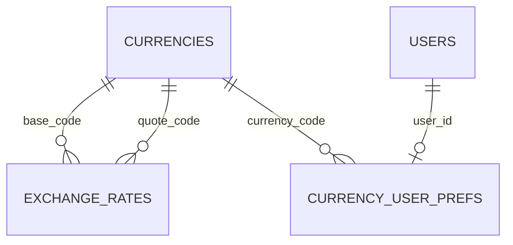

# Currency (`currency`)

The Currency module is the platform's **money layer**: it stores ISO currencies (code, symbol, decimal places, active/default flags, optional iDoklad id), keeps a history of **exchange rates** (daily ČNB rates via `currency:rates:sync`, or manual/API entries), exposes conversion, and provides the `CurrencyBuilder` facade plus Twig filters (`money`, `money_code`, …) that every other module uses to format and convert amounts into the user's display currency. It also stores a per-user preferred display currency and the company-wide VAT payer / VAT rate settings, editable from the admin profile page. It is a *required* module of the **RealEstates** package.

See also: [iDoklad](idoklad.md) (currency id mapping), [Shop](shop.md) (`shop.default_currency`), [module system](../architecture/module-system.md), [dashboard widgets](../architecture/dashboard-widgets.md), [REST API](../architecture/api.md).

## At a glance

| Item | Value |
| --- | --- |
| Module id | `currency` |
| Version | `1.4.2` (`modules/Currency/module.php`, `CurrencyModule::version()`) |
| Directory | `modules/Currency/` |
| Class | `Modules\Currency\CurrencyModule` |
| Requires | `core ^1.0`; optional `idoklad ^1.0` |
| Provides (manifest) | `currencies`, `currency` |
| Capabilities provided | `currency` → `Modules\Currency\Application\CurrencyBuilder` |
| Capabilities consumed | None (reads settings `shop.default_currency`, `idoklad.lists`) |
| Groups / packages | `realestates` package (listed and **required**) in `config/module_groups.php`; `module.php` has no `groups` key |
| Permissions | `currency.view` (`perm.currency.view`), `currency.manage` (`perm.currency.manage`) — group `perm.group.currency` |
| API scopes | `currency.read`, `currency.write` |
| Icon | `coins` |

## Domain model

Entities in `modules/Currency/Domain/`. There are no Doctrine associations; rates reference currencies by ISO code.

| Entity | Table | Key fields | Enum / status values | Relations |
| --- | --- | --- | --- | --- |
| `Currency` | `currencies` | `code`: string(3) **PK**, must match `/^[A-Z]{3}$/` (else `InvalidArgumentException`); `name`: string(120); `symbol`: string(16); `decimal_places`: int default 2, clamped 0–6; `is_active`: bool default true; `is_default`: bool default false; `idoklad_id`: int nullable (>0); `created_at`, `updated_at` | `markDefault(true)` forces `is_active = true`; `deactivate()` throws `LogicException` for the default currency | `code` referenced by `ExchangeRate.base_code/quote_code`, `UserCurrencyPreference.currency_code`, and by price fields across modules |
| `ExchangeRate` | `exchange_rates` (indexes `idx_exchange_rates_pair` on `base_code,quote_code`; `idx_exchange_rates_valid_at`) | `id`: string(36) UUIDv7 PK; `base_code`, `quote_code`: string(3) (must differ); `rate`: decimal(24,12) > 0 (meaning 1 base = rate quote); `provider`: string(64) default `manual`; `valid_at`: datetime; `created_at` | Provider values seen in code: `manual`, `cnb`; derived labels `identity`, `<provider>:inverse`, `cnb:cross` returned by the converter | `base_code`/`quote_code` → `Currency.code` (validated on sync, not by FK) |
| `UserCurrencyPreference` | `currency_user_prefs` | `user_id`: string(36) PK; `currency_code`: string(3) nullable (invalid codes become null); `updated_at` | — | `user_id` → core `users.id`; `currency_code` → `Currency.code` |

`Currency` has `#[FormEntity('currency.save')]` / `#[FormGenerator(exclude: ['iDokladId','createdAt','updatedAt'], cols: 1)]`; labels `currency.field.*`, hint `currency.hint.code_iso`.

## Admin UI

### Menu items (`CurrencyModule::boot()`)

| Menu id | Label key | Icon | Route | Permission | Order / group |
| --- | --- | --- | --- | --- | --- |
| `currencies` | `nav.currencies` | `coins` | `admin.currencies.index` | `currency.view` | 40, group `Hlavní` |
| `currencies.create` | `nav.currencies.create` | — | `admin.currencies.create` | `currency.manage` | 41, parent `currencies`, hidden |

Command palette: `currencies.index` (`palette.currency.index`, `/admin/currencies`, `currency.view`, keywords `currency`, `kurz`, `měna`, `czk`) and `currencies.create` (`palette.currency.create`, `/admin/currencies/create`, icon `plus`, `currency.manage`, group `Akce`).

### Admin routes (`/admin/currencies`, middleware `auth`) — `modules/Currency/Http/CurrencyAdminController.php`

| Method | Path | Route name | Controller::action | Permission |
| --- | --- | --- | --- | --- |
| GET | `/admin/currencies` | `admin.currencies.index` | `CurrencyAdminController::index` | `currency.view` |
| GET | `/admin/currencies/create` | `admin.currencies.create` | `CurrencyAdminController::create` | `currency.manage` |
| POST | `/admin/currencies` | `admin.currencies.store` | `CurrencyAdminController::store` | `currency.manage` |
| POST | `/admin/currencies/rates/sync` | `admin.currencies.rates.sync` | `CurrencyAdminController::syncRates` | `currency.manage` |
| GET | `/admin/currencies/{code}/edit` | `admin.currencies.edit` | `CurrencyAdminController::edit` | `currency.manage` |
| POST | `/admin/currencies/{code}` | `admin.currencies.update` | `CurrencyAdminController::update` | `currency.manage` |
| POST | `/admin/currencies/{code}/default` | `admin.currencies.default` | `CurrencyAdminController::setDefault` | `currency.manage` |

### Screens

- **List** (`Resources/views/index.html.twig`): currencies plus the latest ČNB rate per pair (`latestCnbRates()`, up to 50 newest rows collapsed by pair) and a "sync rates" button. Sync writes audit entry `currency.rates.synced` and flashes `currency.flash.rates_synced` / `currency.flash.rates_failed`.
- **Form** (`Resources/views/form.html.twig`): generated from `Currency`; ruleset `currency.save` (`code required|min:3|max:3`, `name required|min:2|max:120`, `symbol required|min:1|max:16`, `decimal_places`, `is_active`, `is_default` nullable). Create/update/set-default emit `currency.*` events.
- **Profile integration** (`Resources/views/partials/profile_currency.html.twig`): injected into the core profile form via hooks (see below): preferred display currency select (`_default` = shop default) and, for users with `currency.manage`, the VAT payer switch and VAT rate.
- **Seeding**: `boot()` → `seedDefaults()` inserts `CZK` (default), `EUR`, `USD` when the `currencies` table is empty.

### Settings

Defined in `register()` with `$context->settings()->define(...)`:

| Key | Type | Label key | Default |
| --- | --- | --- | --- |
| `currency.vat_payer` | boolean | `currency.settings.vat_payer` | `false` |
| `currency.vat_rate` | string | `currency.settings.vat_rate` | `'21'` (clamped 0–100 on save) |

Read (not defined here): `shop.default_currency` (overrides the `is_default` flag when it names an active currency), `idoklad.lists` (`currencies[]` with `Code`/`Id`) as fallback for iDoklad ids.

## Public / REST API

Three API modules are registered in `registerApi()`:

| Method | Path | Scope | Controller::action | Notes |
| --- | --- | --- | --- | --- |
| GET | `/api/v1/currencies/` | `currency.read` | `CurrencyApiController::index` | sortable `code`, `name`, `createdAt`, `updatedAt`; filterable `is_active`, `is_default` |
| POST | `/api/v1/currencies/` | `currency.write` | `CurrencyApiController::store` | ruleset `currency.api.save` (`symbol` optional) |
| GET | `/api/v1/currencies/{code}` | `currency.read` | `CurrencyApiController::show` | |
| PATCH | `/api/v1/currencies/{code}` | `currency.write` | `CurrencyApiController::update` | ruleset `currency.api.update` |
| GET | `/api/v1/exchange-rates/` | `currency.read` | `ExchangeRateApiController::index` | sortable `validAt`, `createdAt`, `rate`; filterable `base_code`, `quote_code`, `provider` |
| POST | `/api/v1/exchange-rates/` | `currency.write` | `ExchangeRateApiController::store` | ruleset `currency.exchange_rate.save`; when `id` is given and exists, updates that rate (emits `exchange_rate.updated`), otherwise creates |
| POST | `/api/v1/currency/convert` | `currency.read` | `ConvertApiController::convert` | ruleset `currency.convert` (`amount`, `currency`, `target_currency`) |

Serializers:

- Currency: `code`, `name`, `symbol`, `decimal_places`, `is_active`, `is_default`, `created_at`, `updated_at`.
- Exchange rate: `id`, `base_code`, `quote_code`, `rate`, `provider`, `valid_at`, `created_at`.
- Convert: `CurrencyConverter::convert()` result (`source{amount,currency}`, `target{amount,currency}`, `rate` (6 dp), `provider`, `rate_valid_at`) merged with `money` = `MoneyValue` JSON (`raw`, `raw_rounded`, `localized`, `code`, `symbol`, `source_code`, `source_amount`, `rate`). Errors: `422 validation_error` / `422 conversion_failed`.

No `/api/public/*` endpoints.

## Events, hooks & webhooks

Platform events (all `webhookEnabled(true)`, module `currency`):

| Event | Description (as registered) | Emitted from |
| --- | --- | --- |
| `currency.created` | Měna vytvořena | admin `store`, API `store` |
| `currency.updated` | Měna upravena | admin `update`/`setDefault`, API `update` |
| `currency.activated` | Měna aktivována | admin/API update when `is_active` flips to true |
| `currency.deactivated` | Měna deaktivována | admin/API update when `is_active` flips to false |
| `currency.default_changed` | Změněna výchozí měna | admin `store`/`update`/`setDefault`, API `store`/`update` |
| `exchange_rate.created` | Směnný kurz vytvořen | `SyncExchangeRates::sync()`, API `store` |
| `exchange_rate.updated` | Směnný kurz upraven | `SyncExchangeRates::sync()` (same-day rate changed), API `store` with `id` |

Hooks added by the module (`registerProfileHooks()`):

- Filter `admin.profile.form_fields` — appends the rendered `@currency/partials/profile_currency.html.twig` to the profile form HTML.
- Action `admin.profile.saving(User, Request)` — persists `preferred_currency` to `UserCurrencyPreferenceStore` (and remembers it in session), and for `currency.manage` users writes `currency.vat_payer` / `currency.vat_rate` settings; clears `CurrencyBuilder` caches.

Twig extensions registered in `registerTwig()`: filters `money`, `money_code`, `money_value`; functions `money`, `money_code`, `money_value`, `currency_code` (display code), `currency_symbol`, `currency_shop_code` (default code), `currencies` (active codes).

Queue jobs, scheduled tasks, publishables: none (rate sync is a CLI command / admin button, not a scheduler entry). Audit: `currency.rates.synced`.

## Dashboard widgets

Registered in `boot()` (`modules/Currency/Application/Widgets/`):

| Widget id | Type | Class | Shows | Permission | Order |
| --- | --- | --- | --- | --- | --- |
| `currency.shortcut` | shortcut | `CurrencyShortcutWidget` | Link to `admin.currencies.index`, icon `coins` | `currency.view` | 45 |
| `currency.stats` | metric | `CurrencyStatsWidget` | Count of active currencies; hint with date of the newest rate and the default code (`currency.widget.stats.rates_at` / `no_rates`) | `currency.view` | 58 |
| `currency.rates` | panel (list) | `ExchangeRatesWidget` | For each active non-default currency (limited), value of 1 unit in the default currency via `CurrencyConverter`; badge `Stale` when the rate is older than 3 days, `Missing rate` when conversion fails; links to edit | `currency.view` | 32 |

## Services & extension points

| Class | Responsibility |
| --- | --- |
| `Application\CurrencyBuilder` | Facade & capability `currency`. `defaultCode()` (shop default: `shop.default_currency` → `is_default` → `CZK`), `displayCode()` (forced → session `currency.display` → user preference → default), `setDisplayCode()`, `rememberDisplayCode()`, `code()` normalisation, `find()`, `symbol()`, `decimalPlaces()`, `isVatPayer()`, `vatRate()`, `withoutVat()`, `make()` / `makeMarket()` → `MoneyValue`, `format()`, `formatWithCode()`, `amount()`, tolerant `parse()` of human-formatted prices, `iDokladId()` / `syncIDokladIds()`, `activeCodes()`, `clearCache()`. Localisation via `NumberFormatter` using the user's locale, fallback per-currency locale. |
| `Application\MoneyValue` | Immutable result (`raw`, `rawRounded`, `localized`, `code`, `symbol`, `sourceCode`, `sourceAmount`, `rate`); `JsonSerializable`, `Stringable`. |
| `Application\CurrencyConverter` | `convert(amount, from, to)`; rate lookup order: direct latest → inverse (`:inverse`) → cross via CZK (`cnb:cross`); throws `RuntimeException` when no rate. `warmLatestAgainst(quote, bases[])` prefetch. |
| `Application\SyncExchangeRates` | Pulls quotes from `RateProviderInterface` for active currencies, upserts same-day rows per provider, emits `exchange_rate.*`, returns summary (`created`, `updated`, `skipped`, `pairs[]`). |
| `Application\RateProviderInterface` | Contract: `id()`, `label()`, `fetch(codes[], ?asOf): RateQuote[]`. Bound in `src/Foundation/Application.php` to `Infrastructure\CnbRateProvider`. |
| `Application\RateQuote` | DTO (`baseCode`, `quoteCode`, `rate`, `validAt`, `provider`, `sourceLabel`). |
| `Infrastructure\CnbRateProvider` | Downloads `denni_kurz.txt` from cnb.cz (cURL or `file_get_contents`, optional `?date=`), parses `X/CZK` per unit, `valid_at` = header date at 14:30 Europe/Prague. |
| `Application\UserCurrencyPreferenceStore` | `get(userId)` / `set(userId, code|null)` over `UserCurrencyPreference`. |

Integration with other modules:

- [iDoklad](idoklad.md) calls `CurrencyBuilder::iDokladId()` / `syncIDokladIds()` (`modules/iDoklad/*`), and [CarService](carservice.md) `IdokladFinishHandler` uses `iDokladId()`.
- Any module can swap the rate source by rebinding `RateProviderInterface` in the container.

## CLI commands

| Command | Class | Purpose |
| --- | --- | --- |
| `currency:rates:sync [--date=d.m.Y|Y-m-d]` | `Modules\Currency\Console\SyncRatesCommand` (registered in `src/Console/ConsoleKernel.php`) | Downloads daily ČNB rates into `exchange_rates`, prints created/updated/unchanged counts and each pair. |

## Configuration & translations

- Settings: `currency.vat_payer` (bool, default `false`), `currency.vat_rate` (string, default `'21'`); reads `shop.default_currency`, `idoklad.lists`.
- Session key: `currency.display`.
- Environment variables: none (ČNB URL is a constructor default `CnbRateProvider::DEFAULT_URL`).
- Translations: `modules/Currency/Resources/translations/messages.cs.php`, `messages.en.php`. Prefixes: `module.currency.*`, `nav.currencies*`, `palette.currency.*`, `perm.currency.*`, `perm.group.currency`, `currency.*` (`currency.field.*`, `currency.hint.*`, `currency.settings.*`, `currency.flash.*`, `currency.widget.stats.*`, `currency.widget.rates.*`).

## Database migrations

| File | Purpose |
| --- | --- |
| `Database/Migrations/2026_01_01_000001_currency.php` | `up()` is empty (tables `currencies`, `exchange_rates` are created by Doctrine SchemaTool from entities); `down()` drops both. |
| `Database/Migrations/2026_09_06_000002_currency_idoklad_id.php` | Placeholder for `currencies.idoklad_id` (SchemaTool); empty `up()`/`down()`. |
| `Database/Migrations/2026_09_06_000003_user_preferred_currency.php` | Placeholder for `currency_user_prefs` (SchemaTool); `down()` drops the table. |

## Notes

- All three migrations rely on SchemaTool rather than explicit DDL, so the module's schema history is not reproducible from migrations alone.
- Exception and CLI messages inside the module are Czech literals (`'Kód měny musí mít 3 písmena.'`, `'Směnný kurz pro daný pár nebyl nalezen…'`), not translation keys; the event descriptions are Czech as well.
- Conversion and formatting work with PHP floats (`(float)` casts, `round()`); rates are stored as `decimal(24,12)` strings.
- `CurrencyBuilder::make()` swallows conversion failures and silently falls back to showing the amount in the **source** currency (documented in code as intentional to avoid misstating amounts).
- `shopDefaultCode()` ends with two identical `CZK` fallbacks (dead branch).
- There is no delete route for currencies (admin or API); currencies can only be deactivated, and the default one cannot be deactivated.
- The rate sync has no scheduler registration; a cron entry for `php gereq currency:rates:sync` must be set up externally.
