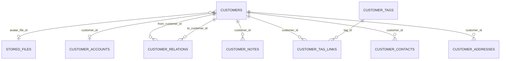

# Customers (`customers`)

The Customers module is the central **contact / customer registry** of GEREQ: persons and companies (with IČO/DIČ and ARES-assisted company data), their addresses, contact persons, notes, tags, inter-customer relations and an optional **storefront account** (e-mail + password) used by the public shop front-end. It provides the `contacts` capability that every other business module (CRM, CarService, BikeService, Orders, Documents, iDoklad…) uses to reference a customer, exposes a rich REST API, integrates with the production-freeze/staging publish flow, and hosts extension hooks so other modules can inject actions and sections into the customer detail page. Required module of the ECS and EBS packages.

See also: [CRM](crm.md), [Calendar](calendar.md), [CarService](carservice.md), [BikeService](bikeservice.md), [Documents](documents.md), [iDoklad](idoklad.md), [Shop](shop.md), [module system](../architecture/module-system.md), [dashboard widgets](../architecture/dashboard-widgets.md), [REST API](../architecture/api.md).

## At a glance

| Item | Value |
| --- | --- |
| Module id | `customers` |
| Version | `1.99.0` (`modules/Customers/module.php`, `CustomersModule::version()`) |
| Directory | `modules/Customers/` |
| Class | `Modules\Customers\CustomersModule` |
| Requires | `core ^1.0`; optional `notifications ^1.0` |
| Provides (manifest) | `contacts` |
| Capabilities provided | `contacts` → `Application\CustomersProvider` (implements `Application\ContactsProvider`); `store_auth` → `Application\StoreAuthService` |
| Capabilities consumed | None (reads `Modules\CRM\Domain\Activity` via `class_exists` for the activity feed) |
| Groups / packages | `module.php` `groups: ['ecs']`; `config/module_groups.php`: **required** in `ecs` and `ebs`, listed in `realestates` |
| Permissions | `customers.view`, `customers.create`, `customers.edit`, `customers.delete` (labels `perm.customers.*`, group `perm.group.customers`) |
| API scopes | `customers.read`, `customers.write` (used on routes; not registered via `registerKnownScope`) |
| Resources / publishables | `resources()->register(Customer::class)`; publishable category `customers` (`Gereq\Publish\Adapter\CustomerPublishAdapter`, order 60) |
| Icon | `users` |

## Domain model

Entities in `modules/Customers/Domain/`. No Doctrine associations; children reference `customer_id`.

| Entity | Table | Key fields | Enum / status values | Relations |
| --- | --- | --- | --- | --- |
| `Customer` | `customers` | `id`: string(36) UUIDv7; `avatar_file_id`: string(36) nullable (→ `StoredFile`); `name`: string(180); `email`: string(180) lower-cased; `phone`: string(40) nullable; `is_company`: bool default false; `company`: string(180) nullable; `ico`: string(12), `dic`: string(20) (whitespace stripped, cleared when `is_company=false`); `company_address`: string(255); `note`: text (rich editor); `status`: string(32) default `active`; `created_at`, `updated_at` | `STATUSES = active, lead, inactive, archived`; `archive()`, `restore(status)` (only `active/inactive/lead`), `isArchived()`, labels `customers.status.*` | Parent of all child entities; referenced by CRM deals/activities, service orders, orders, documents… |
| `CustomerAddress` | `customer_addresses` (index on `customer_id`) | `id`; `customer_id`; `type`: string(32) default `other`; `line1`: string(190); `line2` nullable; `city`: string(120); `zip`: string(32); `country`: string(2); `is_primary`: bool; timestamps | `TYPES = billing, shipping, other` (invalid → `InvalidArgumentException`) | → `Customer` |
| `CustomerContact` | `customer_contacts` (index on `customer_id`) | `id`; `customer_id`; `name`: string(180); `email`: string(180) nullable; `phone`: string(40) nullable; `role`: string(120) nullable; `is_primary`: bool; timestamps | — | → `Customer` |
| `CustomerNote` | `customer_notes` (index on `customer_id`) | `id`; `customer_id`; `body`: text (HTML, sanitised on display); `created_by_user_id`: string(36) nullable; timestamps | — | → `Customer`, → users |
| `CustomerTag` | `customer_tags` | `id`; `name`: string(120); `slug`: string(120) **unique**; `color`: string(32) nullable; timestamps | — | N‑N with `Customer` via `CustomerTagLink` |
| `CustomerTagLink` | `customer_tag_links` (unique `uniq_customer_tag_link` on `customer_id,tag_id`; indexes on both) | `id`; `customer_id`; `tag_id`; `created_at` | — | → `Customer`, → `CustomerTag` |
| `CustomerRelation` | `customer_relations` (indexes `idx_customer_relations_from`, `_to`) | `id`; `from_customer_id`; `to_customer_id`; `type`: string(32) default `other`; `created_at` | `TYPES = parent, child, partner, other` | `Customer` ↔ `Customer` |
| `CustomerAccount` | `customer_accounts` (unique on `customer_id`, unique on `email`) | `id`; `customer_id`; `email`: string(190); `password_hash`: string(255) nullable (null = soft account); `is_active`: bool default false; `email_verified_at` nullable; `token_version`: int default 1; timestamps | soft (no password, inactive) vs. completed/active | 1‑1 → `Customer` |

Domain events (`Domain/CustomerCreated.php`, `Domain/Events/*`): `CustomerCreated` (kept for BC — CRM listens to the class) plus `AbstractCustomerPlatformEvent` subclasses `CustomerUpdated`, `CustomerArchived`, `CustomerRestored`, `CustomerDeleted`, `CustomerAddressCreated/Updated/Deleted`, `CustomerContactCreated/Updated/Deleted`, `CustomerNoteCreated/Updated/Deleted`, `CustomerTagAttached/Detached`, `CustomerRelationCreated/Deleted`. Each builds an `EventEnvelope` with `resource {type: customer, id}` and the public payload.

`Customer` also carries `#[AdminResource(name: 'customers', permission: 'customers', controller: CustomerController)]` with `#[AdminField]` metadata (Czech labels) and `#[FormEntity('customers.save')]` / `#[FormGenerator(exclude: [id, avatarFileId, company fields, timestamps], cols: 2)]` — company fields and status are rendered by hand-written Twig (ARES widget, status picker).

## Admin UI

### Menu items (`CustomersModule::boot()`)

| Menu id | Label key | Icon | Route | Permission | Order / group |
| --- | --- | --- | --- | --- | --- |
| `customers` | `nav.customers` | `users` | `admin.customers.index` | `customers.view` | 20, group `Hlavní` |
| `customers.create` | `nav.customers.create` | — | `admin.customers.create` | `customers.create` | 21, parent `customers`, hidden |

Command palette: `customers.index` (`palette.customers.index`, keywords `kontakty`, `firmy`, `customers`), `customers.create` (`palette.customers.create`, group `Akce`). Admin global search provider `customers` (searches id/name/email/company through `CustomersProvider::search()`, permission `customers.view`).

### Admin routes (`/admin/customers`, middleware `auth`) — `modules/Customers/Http/CustomerController.php`

| Method | Path | Route name | Action | Permission |
| --- | --- | --- | --- | --- |
| GET | `/admin/customers` | `admin.customers.index` | `index` (`ListQuery`: sortable `name`, `email`, `company`, `status`, `createdAt`; filter `status`; search over name/email/company/phone; hides staged deletes) | `customers.view` |
| GET | `/admin/customers/create` | `admin.customers.create` | `create` | `customers.create` |
| POST | `/admin/customers` | `admin.customers.store` | `store` (stages create in publish flow, dispatches `CustomerCreated`) | `customers.create` |
| POST | `/admin/customers/bulk` | `admin.customers.bulk` | `bulk` (`action` ∈ `activate, lead, deactivate, archive, delete` + `ids[]`, `confirmed` for delete; permission checked in code: `customers.edit` / `customers.delete`) | — (route has no permission; enforced in action) |
| GET | `/admin/customers/{id}` | `admin.customers.show` | `show` | `customers.view` |
| GET | `/admin/customers/{id}/edit` | `admin.customers.edit` | `edit` | `customers.edit` |
| GET | `/admin/customers/{id}/avatar` | `admin.customers.avatar` | `avatar` (streams `StoredFile`) | `customers.view` |
| POST | `/admin/customers/{id}` | `admin.customers.update` | `update` (freezes snapshot, dispatches `CustomerUpdated` ± `CustomerArchived`/`CustomerRestored`) | `customers.edit` |
| POST | `/admin/customers/{id}/delete` | `admin.customers.destroy` | `destroy` (stages delete — not immediate) | `customers.delete` |
| POST | `/admin/customers/{id}/addresses` | `admin.customers.addresses.store` | `storeAddress` | `customers.edit` |
| POST | `/admin/customers/{id}/addresses/{addressId}/delete` | `admin.customers.addresses.destroy` | `destroyAddress` | `customers.edit` |
| POST | `/admin/customers/{id}/contacts` | `admin.customers.contacts.store` | `storeContact` | `customers.edit` |
| POST | `/admin/customers/{id}/contacts/{contactId}/delete` | `admin.customers.contacts.destroy` | `destroyContact` | `customers.edit` |
| POST | `/admin/customers/{id}/notes` | `admin.customers.notes.store` | `storeNote` | `customers.edit` |
| POST | `/admin/customers/{id}/notes/{noteId}/delete` | `admin.customers.notes.destroy` | `destroyNote` | `customers.edit` |

### Screens

- **List** (`Resources/views/index.html.twig`): paginated table with status filter, search, bulk action bar (`customerEdit.ts`), avatar/initials.
- **Form** (`form.html.twig`, `assets/js/customerEdit.ts`): generated profile fields (name, e-mail, phone), manual person/company switch with ARES lookup (company, IČO, DIČ, address), status picker, rich-text note, avatar upload (`storeAvatar()` → Media `StoredFile`). Validation ruleset `customers.save` with custom rule `customer_email_available` (unique e-mail, ignoring the edited id) and an `after` hook requiring `company` + 8-digit `ico` when `is_company`.
- **Detail** (`show.html.twig`, `customerContactForm.ts`, `customerNotes.ts`): header with hook **actions** (`customers.show.actions`), addresses (primary first), contacts, notes timeline (sanitised HTML, author names), and hook **sections** (`customers.show.sections`, sorted by `order`) — e.g. CRM deals/activities, CarService/BikeService orders, Documents, iDoklad links.
- **Publish / staging**: create, update and delete go through `ProductionFreeze` (`stageCreate`, `freezeIfNeeded`, `stageDelete`) and are applied by `CustomerPublishAdapter` on publish; the list hides `pendingDeleteKeys`, flashes use `publish.flash.staged`.
- No settings page; no settings keys defined.

Audit log: `customer.created`, `customer.updated`, `customer.delete_staged`.

## Public / REST API

### `/api/v1/customers` (`$context->api()->module('customers', …)`, `Http/Api/CustomerApiController.php`, `CustomerTagApiController.php`, `CustomerActivityApiController.php`)

| Method | Path | Scope | Action |
| --- | --- | --- | --- |
| GET | `/api/v1/customers/` | `customers.read` | `index` — sortable `name`, `email`, `company`, `status`, `createdAt`, `updatedAt`; filterable `status`; search |
| POST | `/api/v1/customers/` | `customers.write` | `store` (ruleset `customers.save`; staged create; dispatches `CustomerCreated`) |
| GET | `/api/v1/customers/{id}` | `customers.read` | `show` |
| PATCH | `/api/v1/customers/{id}` | `customers.write` | `update` (ruleset `customers.save`) |
| DELETE | `/api/v1/customers/{id}` | `customers.write` | `destroy` (staged delete) |
| POST | `/api/v1/customers/{id}/archive` / `/restore` | `customers.write` | `archive`, `restore` |
| GET/POST | `/api/v1/customers/{id}/addresses` | read / write | `addressesIndex`, `addressesStore` (ruleset `customers.address.save`) |
| GET/PATCH/DELETE | `/api/v1/customers/{id}/addresses/{addressId}` | read / write | `addressesShow`, `addressesUpdate`, `addressesDestroy` |
| GET/POST | `/api/v1/customers/{id}/contacts` | read / write | `contactsIndex`, `contactsStore` (ruleset `customers.contact.save`) |
| GET/PATCH/DELETE | `/api/v1/customers/{id}/contacts/{contactId}` | read / write | `contactsShow`, `contactsUpdate`, `contactsDestroy` |
| GET/POST | `/api/v1/customers/{id}/notes` | read / write | `notesIndex`, `notesStore` (ruleset `customers.note.save`) |
| GET/PATCH/DELETE | `/api/v1/customers/{id}/notes/{noteId}` | read / write | `notesShow`, `notesUpdate`, `notesDestroy` |
| GET/POST | `/api/v1/customers/{id}/relations` | read / write | `relationsIndex`, `relationsStore` (ruleset `customers.relation.save`) |
| DELETE | `/api/v1/customers/{id}/relations/{relationId}` | `customers.write` | `relationsDestroy` |
| POST | `/api/v1/customers/{id}/tags` | `customers.write` | `CustomerTagApiController::attach` (ruleset `customers.tag.attach`: `tag_id` or `slug`) |
| DELETE | `/api/v1/customers/{id}/tags/{tagId}` | `customers.write` | `detach` |
| GET | `/api/v1/customers/{id}/activity` | `customers.read` | `CustomerActivityApiController::index` — merged feed of notes (`source: note`) and, when the CRM module class exists, CRM activities (`source: crm_activity`) |

### `/api/v1/customer-tags`

| Method | Path | Scope | Action |
| --- | --- | --- | --- |
| GET | `/api/v1/customer-tags/` | `customers.read` | `index` (sortable `name`, `slug`, `createdAt`) |
| POST | `/api/v1/customer-tags/` | `customers.write` | `store` (ruleset `customers.tag.save`) |

Customer serializer: `id`, `name`, `email`, `phone`, `is_company`, `company`, `ico`, `dic`, `company_address`, `note`, `status`, `avatar_file_id`, `created_at`, `updated_at`.

### Storefront auth (public, `/api/v1/store/auth`, registered with the plain router — no API token)

| Method | Path | Route name | Action |
| --- | --- | --- | --- |
| POST | `/api/v1/store/auth/register` | `api.store.auth.register` | `StoreAuthApiController::register` (ruleset `customers.store.register`) → account + token, 201 |
| POST | `/api/v1/store/auth/soft-register` | `api.store.auth.soft_register` | `softRegister` (`customers.store.soft_register`) — creates customer + inactive account without password |
| POST | `/api/v1/store/auth/complete` | `api.store.auth.complete` | `complete` (`customers.store.complete`) — sets password, activates |
| POST | `/api/v1/store/auth/login` | `api.store.auth.login` | `login` (`customers.store.login`) |
| POST | `/api/v1/store/auth/logout` | `api.store.auth.logout` | `logout` (clears cookie) |
| GET | `/api/v1/store/auth/me` | `api.store.auth.me` | `me` (Bearer or cookie) |

Tokens are HMAC-SHA256 signed JWT-like strings (`StoreTokenService`, key = `app.key` config, fallback literal `gereq-store-token`, default TTL 7 days, claims `sub`, `cid`, `email`, `ver`, `exp`) delivered both in JSON and as HttpOnly cookie `gereq_store_token` (`StoreCookieBridge`). No `/api/public/*` endpoints.

## Events, hooks & webhooks

### Platform events (all `webhookEnabled(true)`, module `customers`)

`customer.created`, `customer.updated`, `customer.deleted`, `customer.archived`, `customer.restored`, `customer.address.created|updated|deleted`, `customer.contact.created|updated|deleted`, `customer.note.created|updated|deleted`, `customer.tag.attached|detached`, `customer.relation.created|deleted` (descriptions in Czech, e.g. "Zákazník vytvořen"), plus storefront `customer.soft_registered`, `customer.registered`, `customer.registration_completed` (emitted by `StoreAuthService` with resource type `customer_account`).

Events are dispatched as typed `PlatformEvent` objects (`$this->events->dispatch(CustomerUpdated::make(...))`) from `CustomerController`, `CustomerApiController`, and the publish adapter; `CustomerCreated` is also listened to as a class by [CRM](crm.md).

### Hooks

Exposed (called by `CustomerController::show`): filter `customers.show.actions(array, Customer)` and filter `customers.show.sections(array, Customer)` (`{id, label, order, html}`).

Registered by the module: action `customers.deleting(Customer)` at `HookPriority::EARLY` — removes addresses, contacts, notes, tag links and relations of the customer. Other modules (CRM, Documents, iDoklad) also subscribe to `customers.deleting`; **no call site invoking this hook was found** — `CustomerPublishAdapter::apply()` deletes child rows itself.

Workflow variables (`workflowVariables()->registerMany`): `customer.id`, `customer.name`, `customer.email`, `customer.phone`, `customer.company`, `customer.ico` (Czech labels).

Queue jobs / scheduled tasks: none. Publishables: category `customers` via `CustomerPublishAdapter` (snapshot/apply/describe, `capture()` of the full customer).

## Dashboard widgets

Registered in `boot()` (`modules/Customers/Application/Widgets/`):

| Widget id | Type | Class | Shows | Permission | Order |
| --- | --- | --- | --- | --- | --- |
| `customers.stats` | metric | `CustomerStatsWidget` | Total customers (`CustomerCounters::total()`), hint `%count% active` | `customers.view` | 40 |
| `customers.growth.chart` | panel (chart) | `CustomerGrowthChartWidget` | New customers per day over the last N days (`ChartSeries::dayLabels`), `admin.dashboard.chart.customers*` | `customers.view` | 18 |
| `customers.create.hero` | hero | `CustomerCreateHeroWidget` | Call-to-action linking to `admin.customers.create` | `customers.create` | 30 |
| `customers.shortcut` | shortcut | `CustomersShortcutWidget` | Link to `admin.customers.index`, icon `users` | `customers.view` | 30 |

## Services & extension points

| Class | Responsibility |
| --- | --- |
| `Application\ContactsProvider` (interface) | `find(id): ?ContactReference`, `search(query, limit): ContactReference[]` — the contract behind capability `contacts`. |
| `Application\CustomersProvider` | Default `ContactsProvider` over `Customer`; used by admin search and other modules. |
| `Application\ContactReference` | Immutable DTO (`id`, `name`, `email`, `company`, …). |
| `Application\CustomerCounters` | `total()`, `active()` counts for widgets. |
| `Application\StoreAuthService` | Capability `store_auth`: `register`, `softRegister`, `completeRegistration`, `attempt(email, password)`, `findAccountByEmail/CustomerId`, `issueOrderAccessToken()` / `verifyOrderAccessToken()` (guest order access, SHA-256 hash), `serialize(account)`. |
| `Application\StoreTokenService` | HMAC token `issue()` / `parse()`. |
| `Application\StoreCookieBridge` | `attach()` / `clear()` / `tokenFromRequest()` for cookie `gereq_store_token`. |
| `Gereq\Publish\Adapter\CustomerPublishAdapter` (core) | Staging adapter: snapshot, apply (create/update/delete incl. children and account), describe change card. |

Integration: CRM (`customers.show.*` hooks, `CustomerCreated` listener, `customers.deleting`), CarService/BikeService/Documents/iDoklad (detail sections via hooks), Shop/Orders (`store_auth`, `contacts`), [Ai](ai.md) tools `CustomersSearchTool`, `CustomersGetTool`, `CustomersCreateTool`, `CustomersUpdateTool`.

## CLI commands

None.

## Configuration & translations

- Settings keys: none defined. Reads config `app.key` (HMAC secret for storefront tokens).
- Environment variables: none directly (via `app.key`).
- Cookie: `gereq_store_token` (HttpOnly, 7 days).
- Translations: `modules/Customers/Resources/translations/messages.cs.php`, `messages.en.php`. Prefixes: `module.customers.*`, `nav.customers*`, `palette.customers.*`, `perm.customers.*`, `perm.group.customers`, `customers.*` (`customers.field.*`, `customers.status.*`, `customers.address.*`, `customers.contact.*`, `customers.note.*`, `customers.bulk.*`, `customers.error.*`, `customers.validation.*`, `customers.widget.*`), plus core keys `publish.*`, `validation.required`.

## Database migrations

| File | Purpose |
| --- | --- |
| `Database/Migrations/2026_01_01_000001_customers.php` | Placeholder — `customers` created by Doctrine SchemaTool; `down()` drops it. |
| `Database/Migrations/2026_09_03_000002_customer_children.php` | Placeholder — child tables (`customer_addresses`, `customer_contacts`, `customer_notes`, `customer_tags`, `customer_tag_links`, `customer_relations`, `customer_accounts`) via SchemaTool; `down()` drops them if present. |
| `Database/Migrations/2026_09_08_000003_customer_company.php` | Adds `is_company` (default false), `ico`, `dic`, `company_address` to `customers` when missing; `down()` removes them. |
| `Database/Migrations/2026_09_08_000004_customer_avatar.php` | Adds `avatar_file_id` to `customers`; `down()` removes it. |

## Notes

- `admin.customers.bulk` has no route-level permission; authorisation is done inside `bulk()` (`customers.edit` / `customers.delete`).
- The `customers.deleting` hook has subscribers in four modules but no dispatcher was found in `src/` or `modules/`; child-row cleanup on publish relies on `CustomerPublishAdapter::apply()`, and CRM/Documents/iDoklad cleanup is therefore not executed.
- API scopes `customers.read` / `customers.write` are used on routes but never passed to `registerKnownScope()` (other modules do register theirs).
- `StoreTokenService` falls back to the hard-coded key `gereq-store-token` when `app.key` is empty.
- `#[AdminField]` labels on `Customer` are Czech literals (not translation keys); validation message "Zákazník s tímto e-mailem už existuje." is also a literal.
- `Customer.email` is not unique at the DB level; uniqueness is enforced only by the `customer_email_available` validation rule (and `CustomerAccount.email` unique constraint for storefront accounts).
- `CustomerCreated` bypasses `AbstractCustomerPlatformEvent` for backward compatibility with the CRM listener.
- Deletion is always staged (publish flow); there is no immediate hard delete from admin or API.
