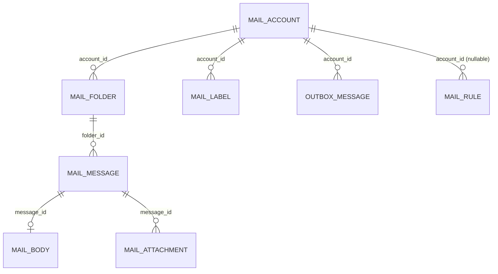

# Emailing (`emailing`)

Emailing is a self‑hosted webmail client inside the GEREQ admin: it stores IMAP/POP3/SMTP account credentials (encrypted), synchronises remote folders and message headers into local tables, fetches bodies/attachments on demand, offers a three‑pane mailbox UI (folders, threaded list, preview) with labels, pins, drag‑and‑drop moves, bulk actions and a compose dialog, and sends mail through an **outbox** processed by a queue job. Server‑side **rules** can automatically mark/flag/label/move new messages or start a [CRM](crm.md) workflow. Other modules send mail through the `emailing` capability (`EmailingProvider::send()`), e.g. [CRM](crm.md) workflow actions and the [Ai](ai.md) tools.

## At a glance

| Item | Value |
| --- | --- |
| Module id | `emailing` |
| Version | `1.6.1` (`modules/Emailing/module.php`, `EmailingModule::version()`; `README.md` says v1.5.3) |
| Directory | `modules/Emailing/` |
| Class | `Modules\Emailing\EmailingModule` |
| Requires | `core ^1.0` |
| Optional | none declared; runtime `class_exists` integration with `Modules\CRM\Domain\Workflow` |
| Capabilities provided | `emailing` → `Application/EmailingProvider` |
| Capabilities consumed | none (CRM and Ai declare `emailing ^1.0` as optional dependency and consume it) |
| Groups / packages | `comms` (`module.php`); not listed in `config/module_groups.php` |
| Permissions | `emailing.view`, `emailing.accounts.manage`, `emailing.send`, `emailing.rules.manage` (group `perm.group.emailing`) |

## Domain model

| Entity | Table | Key fields | Relations |
| --- | --- | --- | --- |
| `Domain/MailAccount.php` | `emailing_accounts` | `id: string(36)` UUID v7 · `name: string(190)` · `email: string(190)` · `smtp_host: string(190)`, `smtp_port: int` (587), `smtp_encryption: string(16)` (`tls`), `smtp_username`, `smtp_password_enc: text` · `incoming_protocol: string(16)` (`imap`), `incoming_host`, `incoming_port: int` (993), `incoming_encryption` (`ssl`), `incoming_username`, `incoming_password_enc: text` · `is_default: bool` · `is_active: bool` · `signature_html: ?text` · `last_synced_at` · `created_at`, `updated_at`. Passwords only overwritten when a non‑empty value is supplied. | root of all other entities (`account_id`) |
| `Domain/MailFolder.php` | `emailing_folders` (unique `uniq_emailing_folder_remote` on `account_id, remote_path`; index on `account_id`) | `id` · `account_id` · `name: string(190)` · `remote_path: string(255)` · `role: string(32)` (`other`) · `uid_validity: ?int` · `last_uid: ?int` · `unread_count`, `total_count: int` · `color: ?string(32)` · `is_favorite: bool` · `sort_order: int` · timestamps | `account_id` → `MailAccount` |
| `Domain/MailMessage.php` | `emailing_messages` (unique `uniq_emailing_msg_uid` on `folder_id, uid`; indexes on `folder_id`, `account_id`, `date_at`, `(account_id, thread_id)`, `(account_id, message_id)`) | `id` · `account_id` · `folder_id` · `uid: int` · `message_id: ?string(255)` · `in_reply_to: ?string(255)` · `references_raw: ?text` · `thread_id: ?string(120)` · `thread_subject: ?string(500)` · `from_address: ?string(255)`, `from_name: ?string(190)` · `to_addresses: ?text` · `subject: ?string(500)` · `snippet: ?text` · `date_at` · `is_seen`, `is_flagged`, `has_attachments`, `has_body`, `is_pinned: bool` · `keywords: ?json` (IMAP keywords/labels) · `size_bytes: ?int` · timestamps | `account_id` → `MailAccount`, `folder_id` → `MailFolder`; `thread_id` groups messages |
| `Domain/MailBody.php` | `emailing_bodies` (unique `uniq_emailing_body_message` on `message_id`) | `id` · `message_id` · `text_plain: ?text` · `text_html: ?text` · `created_at` | 1:1 cache for `MailMessage` |
| `Domain/MailAttachment.php` | `emailing_attachments` (index on `message_id`) | `id` · `message_id` · `filename: string(255)` · `mime: string(120)` · `size: int` · `path: string(500)` (relative to `storage/uploads`, `emailing/Y/m/...`) · `content_id: ?string(190)` · `is_inline: bool` · `created_at` | `message_id` → `MailMessage` |
| `Domain/MailLabel.php` | `emailing_labels` (unique `uniq_emailing_label_keyword` on `account_id, keyword`; index on `account_id`) | `id` · `account_id` · `name: string(120)` · `keyword: string(80)` (IMAP keyword) · `color: ?string(32)` · timestamps | `account_id` → `MailAccount`; matched against `MailMessage.keywords` |
| `Domain/MailRule.php` | `emailing_rules` (indexes on `account_id`, `(is_active, priority)`) | `id` · `account_id: ?string(36)` (null = all accounts) · `name: string(190)` · `is_active: bool` · `priority: int` (100, ascending) · `stop_processing: bool` · `conditions: json` (`[{field, op, value}]`) · `actions: json` (`[{type, ...}]`) · timestamps | optional `account_id` → `MailAccount` |
| `Domain/OutboxMessage.php` | `emailing_outbox` (index on `status`) | `id` · `account_id` · `to_addresses: text` · `cc_addresses: ?text` · `subject: string(500)` · `body_html`, `body_text: ?text` · `in_reply_to: ?string(255)` · `references_raw: ?text` · `status: string(32)` · `error_message: ?text` · `sent_at` · timestamps | `account_id` → `MailAccount` |

Enums / constants:

- `MailAccount::PROTOCOLS` = `imap`, `pop3`; `MailAccount::ENCRYPTIONS` = `tls`, `ssl`, `none` (used for both SMTP and incoming).
- `MailFolder::ROLES` = `inbox`, `sent`, `drafts`, `trash`, `junk`, `other` – assigned heuristically by `MailboxSyncService::guessRole()` from path/name substrings.
- `OutboxMessage::STATUS_*` = `queued`, `sending`, `sent`, `failed`.
- Rule condition fields: `from`, `from_name`, `subject`, `to`, `folder_id`, `folder_role`, `has_attachments`, `keyword`; operators `eq` (default), `neq`/`!=`, `contains`, `not_contains`, `starts_with` (case‑insensitive). Rule action types: `mark_read`, `mark_unread`, `flag`, `unflag`, `pin`, `unpin`, `apply_label` (`keyword`), `move` (`folder_id` or `folder_role`), `start_workflow` (`workflow_id`, CRM), `emit_automation` (no‑op). The admin form only exposes `mark_read`, `flag`, `pin`, `apply_label`, `move` (`Http/RuleController::formPage()`).
- `ImapKeyword::PINNED` = `$Pinned` (pin state is mirrored as an IMAP keyword); system flags `seen, answered, flagged, deleted, draft, recent` are excluded from labels.

## Admin UI

Menu (`boot()`, group `Hlavní`):

| Id | Label | Icon | Route | Permission | Order |
| --- | --- | --- | --- | --- | --- |
| `emailing` | `nav.emailing` | `mail` | `admin.emailing.mailbox` | `emailing.view` | 32 |
| `emailing.mailbox` | `nav.emailing.mailbox` | – | `admin.emailing.mailbox` | `emailing.view` | 33 |
| `emailing.accounts` | `nav.emailing.accounts` | – | `admin.emailing.accounts.index` | `emailing.accounts.manage` | 34 |
| `emailing.rules` | `nav.emailing.rules` | – | `admin.emailing.rules.index` | `emailing.rules.manage` | 35 |
| `emailing.compose` | `nav.emailing.compose` | – | `admin.emailing.compose` | `emailing.send` | 36 (hidden) |

Command palette: `emailing.mailbox` (`/admin/emailing`, icon `mail`), `emailing.rules` (`/admin/emailing/rules`, icon `filter`), `emailing.compose` (`/admin/emailing/compose`, icon `plus`, group `Akce`).

Routes (`register()`, middleware `auth`):

| Method | Path | Route name | Controller::action | Permission |
| --- | --- | --- | --- | --- |
| GET | `/admin/emailing` | `admin.emailing.mailbox` | `MailboxController::index` | `emailing.view` |
| GET | `/admin/emailing/compose` | `admin.emailing.compose` | `MailboxController::compose` | `emailing.send` |
| POST | `/admin/emailing/send` | `admin.emailing.send` | `MailboxController::send` | `emailing.send` |
| POST | `/admin/emailing/sync` | `admin.emailing.sync` | `MailboxController::sync` | `emailing.view` |
| GET | `/admin/emailing/poll` | `admin.emailing.poll` | `MailboxController::poll` (JSON) | `emailing.view` |
| GET | `/admin/emailing/prefetch` | `admin.emailing.prefetch` | `MailboxController::prefetch` (JSON) | `emailing.view` |
| POST | `/admin/emailing/action` | `admin.emailing.action` | `MailboxController::action` (JSON) | `emailing.view` |
| GET | `/admin/emailing/attachments/{id}` | `admin.emailing.attachments.download` | `MailboxController::downloadAttachment` | `emailing.view` |
| GET | `/admin/emailing/messages/{id}/html` | `admin.emailing.messages.html` | `MailboxController::messageHtml` | `emailing.view` |
| GET | `/admin/emailing/accounts` | `admin.emailing.accounts.index` | `AccountController::index` | `emailing.accounts.manage` |
| GET | `/admin/emailing/accounts/create` | `admin.emailing.accounts.create` | `AccountController::create` | `emailing.accounts.manage` |
| POST | `/admin/emailing/accounts` | `admin.emailing.accounts.store` | `AccountController::store` | `emailing.accounts.manage` |
| GET | `/admin/emailing/accounts/{id}/edit` | `admin.emailing.accounts.edit` | `AccountController::edit` | `emailing.accounts.manage` |
| POST | `/admin/emailing/accounts/{id}` | `admin.emailing.accounts.update` | `AccountController::update` | `emailing.accounts.manage` |
| POST | `/admin/emailing/accounts/{id}/delete` | `admin.emailing.accounts.destroy` | `AccountController::destroy` | `emailing.accounts.manage` |
| POST | `/admin/emailing/accounts/{id}/sync` | `admin.emailing.accounts.sync` | `AccountController::sync` (queues `SyncAccountJob`) | `emailing.accounts.manage` |
| POST | `/admin/emailing/accounts/{id}/test` | `admin.emailing.accounts.test` | `AccountController::test` (`SmtpSender::testConnection`) | `emailing.accounts.manage` |
| GET | `/admin/emailing/rules` | `admin.emailing.rules.index` | `RuleController::index` | `emailing.rules.manage` |
| GET | `/admin/emailing/rules/create` | `admin.emailing.rules.create` | `RuleController::create` | `emailing.rules.manage` |
| POST | `/admin/emailing/rules` | `admin.emailing.rules.store` | `RuleController::store` | `emailing.rules.manage` |
| GET | `/admin/emailing/rules/{id}/edit` | `admin.emailing.rules.edit` | `RuleController::edit` | `emailing.rules.manage` |
| POST | `/admin/emailing/rules/{id}` | `admin.emailing.rules.update` | `RuleController::update` | `emailing.rules.manage` |
| POST | `/admin/emailing/rules/{id}/delete` | `admin.emailing.rules.destroy` | `RuleController::destroy` | `emailing.rules.manage` |

Screens:

- **Mailbox** (`Resources/views/mailbox/index.html.twig`, Alpine component `Resources/assets/js/emailingMailbox.ts`, styles `Resources/assets/css/admin.css`): query params `account`, `folder`, `message`, `q`, `from`, `unread`, `has_attachment`; folder tree with colours/favourites/order, date groups (`emailing.mailbox.group_*`), thread grouping, BIMI avatars (`_avatar.html.twig`), context menu (`_context_menu.html.twig`), compose dialog (`_compose_dialog.html.twig`), attachment badges. The JS polls `admin.emailing.poll` (IMAP STATUS diff → reconcile), prefetches snippets via `admin.emailing.prefetch`, and posts JSON to `admin.emailing.action` with `action` values: `message.seen|flag|pin|keyword|delete|archive|move|copy`, `message.bulk` (`op`: `seen|unseen|flag|unflag|delete|archive|move`, `message_ids[]`), `label.create`, `folder.mark_all_read|empty|create|rename|delete|color|favorite|order`. Message HTML is rendered in a sandboxed iframe from `admin.emailing.messages.html` (CSP override header, CID images rewritten by `HtmlCidRewriter`).
- **Compose** (`mailbox/compose.html.twig`): prefill from query `account`, `to`, `cc`, `subject`, `body`; POST `admin.emailing.send` validates `account_id`, `to` (≤2000), `cc`, `subject` (≤500), `body_html`/`body_text` (≤200000), `in_reply_to`, `references`; queues an `OutboxMessage`; audit `emailing.message.queued`.
- **Accounts** (`accounts/index.html.twig`, `accounts/form.html.twig`): fields `name`, `email`, SMTP host/port/encryption/username/password, incoming protocol/host/port/encryption/username/password, `is_default`, `is_active`, `signature_html` (≤50000). Audit `emailing.account.created|updated|deleted`.
- **Rules** (`rules/index.html.twig`, `rules/form.html.twig`): builder with condition fields/ops and action types listed above, per‑account folder and label pickers. Audit `emailing.rule.created|updated|deleted`.

No settings page; the module defines no `settings()` keys.

## Public / REST API

Registered in `EmailingModule::registerApi()` via `$context->api()->module('emailing', ...)` under `/api/v1/emailing` (see `../architecture/api.md`). Known scopes: `emailing.accounts.read`, `emailing.accounts.write`, `emailing.mailbox.read`, `emailing.mailbox.write`.

| Method | Path | Scope | Controller::action | Notes |
| --- | --- | --- | --- | --- |
| GET | `/accounts` | `emailing.accounts.read` | `Http/Api/AccountApiController::index` | collection |
| POST | `/accounts` | `emailing.accounts.write` | `AccountApiController::store` | JSON body; `name`, `email` required; `smtp_password` / `incoming_password` encrypted via `CredentialVault` |
| GET | `/accounts/{id}` | `emailing.accounts.read` | `AccountApiController::show` | |
| PATCH | `/accounts/{id}` | `emailing.accounts.write` | `AccountApiController::update` | partial update |
| DELETE | `/accounts/{id}` | `emailing.accounts.write` | `AccountApiController::destroy` | |
| POST | `/accounts/{id}/sync` | `emailing.accounts.write` | `AccountApiController::sync` | dispatches `SyncAccountJob`, returns `{id, sync_queued: true}` |
| GET | `/folders?account_id=` | `emailing.mailbox.read` | `Http/Api/MailboxApiController::folders` | |
| GET | `/messages?folder_id=&limit=` | `emailing.mailbox.read` | `MailboxApiController::messages` | `folder_id` required (422), `limit` 1–200 (default 50), newest first |
| GET | `/messages/{id}` | `emailing.mailbox.read` | `MailboxApiController::show` | fetches body from IMAP (`sync_error` 502 on failure), includes attachments |
| POST | `/send` | `emailing.mailbox.write` | `MailboxApiController::send` | body `to`, `subject` (required), `html`/`body_html`, `text`/`body_text`, `account_id`, `cc`; 201 with `{id, status, account_id}` |

Serializers: account → `id, name, email, smtp_host, smtp_port, smtp_encryption, smtp_username, incoming_protocol, incoming_host, incoming_port, incoming_encryption, incoming_username, is_default, is_active, last_synced_at, created_at, updated_at` (passwords never returned). Folder → `id, account_id, name, remote_path, role, unread_count, total_count`. Message → `id, account_id, folder_id, uid, message_id, from_address, from_name, to_addresses, subject, snippet, date_at, is_seen, is_flagged, has_attachments, has_body` (+ `body_html`, `body_text`, `attachments[{id, filename, mime, size}]` on show). No `/api/public/*` endpoints.

## Events, hooks & webhooks

Platform events (`registerEvents()`, all `webhookEnabled(false)`, classes in `Domain/Events/`, base `AbstractEmailingEvent`):

| Event | Class | Subject | Emitted from |
| --- | --- | --- | --- |
| `emailing.mailbox.polled` | `MailboxPolled` | `{type: emailing_account, id}` with `folders[]`, `changed_folder_ids`, `changed_count` | `MailboxSyncService::pollAndReconcile()` |
| `emailing.mailbox.folder_reconciled` | `MailboxFolderReconciled` | `{type: emailing_folder, id}` with delta (added/removed/flag changes) | `pollAndReconcile()`, `MailboxActionService::moveMessage()` |
| `emailing.message.received` | `MessageReceived` | `{type: emailing_message, id}` with account/from/subject | `MailRuleEngine::processNewMessages()` after sync/reconcile |

[CRM](crm.md) `WorkflowRunner` listens for `emailing.message.*` envelopes and the `start_workflow` rule action creates a `WorkflowRun` + `RunWorkflowJob` directly.

Queue jobs (`Gereq\Queue\Job`): `Application/Jobs/SendOutboxJob` (sends one `OutboxMessage`, skips already sent) and `Application/Jobs/SyncAccountJob` (full `syncAccount()` for active accounts, errors to `error_log`). No scheduled tasks are registered by the module itself – syncing is triggered by the UI poll, manual sync buttons or the API. No hooks/filters, no publishables.

## Dashboard widgets

| Widget id | Type | Class | Shows | Permission | Order |
| --- | --- | --- | --- | --- | --- |
| `emailing.shortcut` | shortcut | `Application/Widgets/EmailingShortcutWidget.php` | Link to mailbox (hint `admin.dashboard.hint.emailing`) | `emailing.view` | 32 |
| `emailing.unread.stats` | metric | `Application/Widgets/EmailingUnreadStatsWidget.php` | Unread count across folders; hint with failed outbox count (`emailing.widget.stats.hint`) | `emailing.view` | 42 |
| `emailing.unread.recent` | panel (`list_panel.html.twig`) | `Application/Widgets/EmailingUnreadMessagesWidget.php` | Recent unread messages (flagged badge) plus failed‑outbox badge | `emailing.view` | 17 |

See `../architecture/dashboard-widgets.md`.

## Services & extension points

| Class | Responsibility |
| --- | --- |
| `Application/EmailingProvider.php` | Capability facade: `send(to, subject, html?, text?, accountId?, cc?, attachments[] – ignored)` → queued `OutboxMessage` (throws when no active account); `defaultAccount()` (default active account, else oldest active); `failedOutboxCount()` (memoised). |
| `Application/SmtpSender.php` | Outbox: `queue()` persists `OutboxMessage`, normalises `In-Reply-To`/`References` via `MailThreadResolver`, dispatches `SendOutboxJob`; `sendNow()` builds a Symfony Mailer `Email` (HTML + text fallback `strip_tags`), marks `sending → sent|failed`; `dsnFor()` builds `smtp://` / `smtps://` DSN (`?encryption=tls|null`), empty or `null` host falls back to env `MAIL_DSN` (default `null://null`); `testConnection()`. |
| `Application/MailboxSyncService.php` | IMAP/POP3 client via `webklex/php-imap` (`connect()`, `validate_cert: true`); `syncAccount()` (folders → `syncFolder()` per folder, batch 100, then `relinkThreads()`), `pollAndReconcile()` (IMAP STATUS vs local counts, UID‑based reconcile of changed folders), `indexRemoteMessage()`/`upsertMessageIndex()` (headers, flags, keywords, snippet), `prefetchMissingBodies()` (PEEK, no seen flag), `fetchBody()` (caches `MailBody`, stores attachments under `storage/uploads/emailing/Y/m/`, inline CID parts), `refreshFolderCounts()`, `purgeLocalMessage()`, `relinkThreads()`. New messages are passed to `MailRuleEngine` (`processNewMessageRules()`, failures logged). |
| `Application/MailboxActionService.php` | Server‑side mailbox mutations mirrored to IMAP: seen/flagged/pinned (`$Pinned` keyword), `toggleKeyword()`/`setKeywords()`, `createLabel()`, `moveMessage()`, `copyMessage()`, `deleteMessage()`, `archiveMessage()`, `markAllRead()`, `emptyFolder()`, `createSubfolder()`, `renameFolder()`, `deleteFolder()`, `setFolderColor()`, `setFolderFavorite()`, `moveFolderOrder()`. |
| `Application/MailRuleEngine.php` | Loads active rules (global or per account, by `priority`), evaluates conditions, runs actions (see enums), `stop_processing` support; `start_workflow` guarded by `class_exists(\Modules\CRM\Domain\Workflow::class)`. |
| `Application/MailThreadResolver.php` | Message‑ID normalisation, `References` parsing, subject normalisation (Re/Fwd stripping), `resolveThreadId()`, `clampThreadId()` (≤120 chars), `buildReferencesHeader()`. |
| `Application/CredentialVault.php` | AES‑256‑GCM encryption of SMTP/IMAP passwords (`gcm:` + base64(iv‖tag‖cipher)), key = `sha256(app.key)`; throws when `APP_KEY` missing. |
| `Application/BimiLogoResolver.php` | Sender avatars from DNS BIMI TXT records (`default._bimi.<domain>`), cached in `AppCache` for 6 h under `emailing.bimi.<domain>`; `preload()` for lists. |
| `Application/HtmlCidRewriter.php` | Rewrites `cid:` image references in HTML bodies to attachment download URLs; `containsCid()`. |
| `Application/ImapKeyword.php` | Normalises IMAP keywords (system flag filter, label name → keyword). |
| `Application/MailHostNormalizer.php` | Host aliases (e.g. `smtp.vas-hosting.cz` → `mail.vas-hosting.cz`). |
| `Application/MimeHeaderDecoder.php` | RFC 2047 header decoding. |

Extension points: the `emailing` capability (used by [CRM](crm.md) `WorkflowRunner` send action and [Ai](ai.md) tools `EmailingSendTool`, `EmailingSearchMessagesTool`, `EmailingListAccountsTool`); rule `start_workflow` bridge into CRM workflows; platform events for automation. No interfaces are declared for custom transports or rule actions.

## CLI commands

None.

## Configuration & translations

- No `settings()->define()` keys.
- Env/config: `APP_KEY` (`app.key`) required for `CredentialVault`; `MAIL_DSN` (default `null://null`) used only for accounts with empty/`null` SMTP host; attachments written to `storage/uploads/emailing/Y/m/` via `base_path()`.
- Composer dependencies used: `webklex/php-imap`, `symfony/mailer`.
- Translations: `Resources/translations/messages.{cs,en}.php` (186 keys in EN) – prefixes `emailing.mailbox.*`, `emailing.rules.*` (`field`, `op`, `action`), `emailing.ctx.*` (context menu), `emailing.field.*`, `emailing.accounts.*`, `emailing.flash.*`, `emailing.widget.*`, `emailing.compose.*`, `emailing.badge.*`, `emailing.section.*`, `emailing.bulk.*`, `emailing.error.*`, `nav.emailing*`, `palette.emailing.*`, `perm.emailing.*`, `perm.group.emailing`, `module.emailing.description`, `admin.dashboard.hint.emailing`.

## Database migrations

| File | Purpose |
| --- | --- |
| `2026_09_08_000001_emailing.php` | No‑op; base `emailing_*` tables created by SchemaTool. |
| `2026_09_09_000002_emailing_attachment_cid.php` | No‑op marker for `emailing_attachments.content_id` / `is_inline` (SchemaTool). |
| `2026_09_09_000003_emailing_attachment_inline.php` | Adds `content_id` and `is_inline` to `emailing_attachments` if missing. |
| `2026_09_09_000004_emailing_rules_signatures.php` | Adds `emailing_accounts.signature_html`; creates `emailing_rules` table. |
| `2026_09_09_000004_emailing_threads.php` | Adds `in_reply_to`, `references_raw`, `thread_id`(80), `thread_subject` to `emailing_messages`; `in_reply_to`, `references_raw` to `emailing_outbox`. |
| `2026_09_09_000005_emailing_thread_id_len.php` | Widens `emailing_messages.thread_id` to VARCHAR(120) (PostgreSQL `ALTER COLUMN`), resets existing `thread_id` values to NULL for re‑linking. |

## Notes

- Attachments in `EmailingProvider::send()` are accepted but ignored (`unset($attachments)`, documented as "ignored in v1"); the outbox supports HTML/text and CC only – no BCC, no attachments.
- No scheduler registration: mailboxes are synced only while the UI polls, on manual sync or through the API; `SendOutboxJob` requires a running queue worker.
- Two migrations share the `2026_09_09_000004` prefix (`_emailing_rules_signatures`, `_emailing_threads`).
- `MailboxSyncService` (1275 lines) resolves `MailRuleEngine` via `gereq()->make()` to avoid a circular dependency; rule failures are only `error_log`ged.
- Failed outbox messages are not retried automatically and there is no admin outbox screen – failures surface only as counts in dashboard widgets.
- API error messages and several runtime exceptions are Czech literals (e.g. `Žádný aktivní e-mailový účet.`).
- `README.md` version (1.5.3) lags `module.php` (1.6.1).
