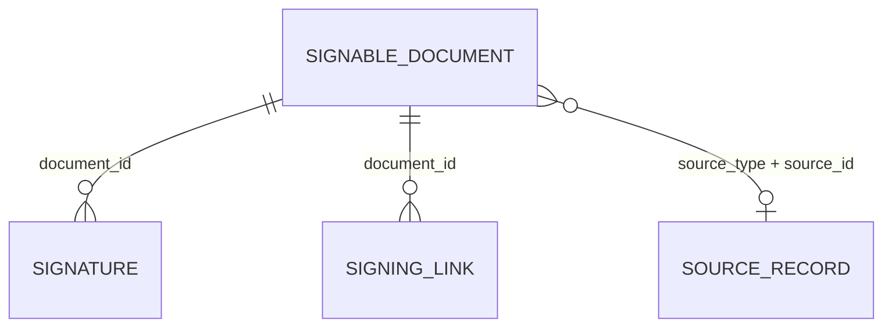

# eSign (`esign`)

eSign implements simple electronic signatures (eIDAS "SES") for HTML documents: an administrator authors a document (HTML body with `{{ token }}` placeholders), applies the **provider** signature (drawn on a SignaturePad, or a stored default image), then either lets the **counterparty** sign in person on the same device or sends a one‑time, expiring signing link by e‑mail. On send the document HTML is frozen and hashed (SHA‑256); the counterparty's drawn PNG, consents, IP and user agent are recorded, and the executed HTML with an audit "protocol" block is stored. Primarily used through the `esign` capability by [CarService](carservice.md) and [BikeService](bikeservice.md) handover protocols, but also as a standalone admin tool.

## At a glance

| Item | Value |
| --- | --- |
| Module id | `esign` |
| Version | `1.99.0` (`modules/ESign/module.php`, `ESignModule::version()`; `README.md` says v1.1.5) |
| Directory | `modules/ESign/` |
| Class | `Modules\ESign\ESignModule` |
| Requires | `core ^1.0` |
| Optional | none declared; optional runtime integration with `Modules\CarService\Application\OrderEsignService` (guarded `class_exists`) |
| Capabilities provided | `esign` → `Application/ESignProvider` (from container) |
| Capabilities consumed | none |
| Groups / packages | none in `module.php`; not listed in `config/module_groups.php` |
| Permissions | `esign.view` (`perm.esign.view`), `esign.manage` (`perm.esign.manage`) – group `perm.group.esign` |

## Domain model

| Entity | Table | Key fields | Relations |
| --- | --- | --- | --- |
| `Domain/SignableDocument.php` | `esign_documents` (indexes `idx_esign_documents_status`, `_number`, `_source` on `source_type, source_id`) | `id: string(36)` UUID v7 · `number: string(64)` (auto `ES-YYYY-NNNN`) · `title: string(190)` · `body_html: text` · `status: string(32)` · `counterparty_name: string(190)` · `counterparty_email: ?string(190)` (lower‑cased) · `counterparty_company: ?string(190)` · `provider_signature_path: ?string(255)` · `signed_by: ?string(190)` · `signature_hash: ?string(64)` · `locked_at: ?datetime`, `locked_hash: ?string(64)`, `locked_html: ?text` · `executed_html: ?text` · `source_type: ?string(64)`, `source_id: ?string(36)` · `signed_at: ?datetime` · `created_at`, `updated_at`. Guards: `setTitle/BodyHtml/CounterpartyName/Company` throw `RuntimeException('esign.error.locked')` when locked or signed. | `(source_type, source_id)` → originating record: `carservice_order`, `bikeservice_order` (`ESignProvider::SOURCE_*`) |
| `Domain/Signature.php` | `esign_signatures` (unique `uniq_esign_signatures_document_party` on `document_id, party`, index on `document_id`) | `id` · `document_id: string(36)` · `party: string(32)` · `signer_name: string(190)` · `signer_email: ?string(190)` · `signer_role: ?string(64)` (`poskytovatel` / `protistrana`) · `method: string(32)` · `signature_path: ?string(255)` · `consent_version: ?string(32)` · `consents: ?json` · `ip_address: ?string(64)` · `user_agent: ?string(512)` · `document_hash: ?string(64)` · `signed_at` | `document_id` → `SignableDocument.id` (one row per party) |
| `Domain/SigningLink.php` | `esign_signing_links` (indexes on `document_id`, `token_hash`) | `id` · `document_id` · `token_hash: string(64)` (SHA‑256 of the raw 64‑hex token) · `token_encrypted: ?text` (AES‑256‑GCM, `gcm:` prefix) · `email: string(190)` · `expires_at` · `sent_at` · `used_at` · `revoked_at`. `isUsable()`, `markUsed()`, `revoke()`. | `document_id` → `SignableDocument.id` |

Enums:

- `SignableDocument::STATUSES`: `draft`, `sent`, `signed`, `cancelled` (labels `esign.status.*`). Transitions: `lock()` → `sent`; `markSigned()` → `signed`; `cancelSigning()` → `cancelled` (clears lock/executed data); `reopenDraft()` → `draft`.
- `Signature::PARTY_*`: `provider`, `counterparty`. `Signature::METHOD_*`: `drawn`, `image`, `seal`, `manual`.

Form metadata: `SignableDocument` `#[FormEntity('esign.document.save')]`, `#[FormGenerator(cols: 2, exclude: [id, status, providerSignaturePath, signedBy, signatureHash, locked*, executedHtml, source*, signedAt, createdAt, updatedAt])]`; fields `number` (hint `esign.hint.number_auto`), `title`, `counterparty_name`, `counterparty_email` (email), `counterparty_company` (full width), `body_html` (`editor`, hint `esign.hint.body_tokens`).

## Admin UI

Menu (`boot()`):

| Id | Label | Icon | Route | Permission | Order | Notes |
| --- | --- | --- | --- | --- | --- | --- |
| `esign` | `nav.esign` | `edit` | `admin.esign.documents.index` | `esign.view` | 48 | group `Provoz` |
| `esign.documents` | `nav.esign.documents` | – | `admin.esign.documents.index` | `esign.view` | 49 | parent `esign` |
| `esign.settings` | `nav.esign.settings` | – | `admin.esign.settings` | `esign.manage` | 50 | parent `esign` |

Command palette: `esign.documents` (`palette.esign.documents`, `/admin/esign/documents`, keywords `esign, podpis, signature, e-podpis, dokument`), `esign.settings` (`palette.esign.settings`, `/admin/esign/settings`, icon `settings`, `esign.manage`).

Routes (`register()`, middleware `auth`, controller `Http/DocumentController.php`):

| Method | Path | Route name | Action | Permission |
| --- | --- | --- | --- | --- |
| GET | `/admin/esign/documents` | `admin.esign.documents.index` | `index` | `esign.view` |
| GET | `/admin/esign/documents/create` | `admin.esign.documents.create` | `create` | `esign.manage` |
| POST | `/admin/esign/documents` | `admin.esign.documents.store` | `store` | `esign.manage` |
| GET | `/admin/esign/documents/{id}` | `admin.esign.documents.show` | `show` | `esign.view` |
| GET | `/admin/esign/documents/{id}/edit` | `admin.esign.documents.edit` | `edit` (refused when locked/signed) | `esign.manage` |
| POST | `/admin/esign/documents/{id}` | `admin.esign.documents.update` | `update` | `esign.manage` |
| POST | `/admin/esign/documents/{id}/sign-provider` | `admin.esign.documents.sign_provider` | `signProvider` (`signature` PNG data URI, optional) | `esign.manage` |
| POST | `/admin/esign/documents/{id}/send` | `admin.esign.documents.send` | `send` (`email`, defaults to counterparty email) | `esign.manage` |
| POST | `/admin/esign/documents/{id}/cancel` | `admin.esign.documents.cancel` | `cancel` | `esign.manage` |
| POST | `/admin/esign/documents/{id}/delete` | `admin.esign.documents.destroy` | `destroy` (refused when signed) | `esign.manage` |
| GET | `/admin/esign/settings` | `admin.esign.settings` | `settings` | `esign.manage` |
| POST | `/admin/esign/settings` | `admin.esign.settings.save` | `saveSettings` | `esign.manage` |

Public (no auth), controller `Http/PublicSignController.php`:

| Method | Path | Route name | Action |
| --- | --- | --- | --- |
| GET | `/esign/podpis/{token}` | `esign.sign` | `show` – renders `public/sign.html.twig` (locked HTML, consents, pad) for status `ok`; `public/complete.html.twig` for `signed`; `public/unavailable.html.twig` with 410 (`expired`/`revoked`) or 404 (`missing`). Headers `Cache-Control: no-store, private`, `X-Robots-Tag: noindex, nofollow`. |
| POST | `/esign/podpis/{token}` | `esign.sign.store` | `store` – ruleset `esign.public.sign` (`consent_read`, `consent_authority`, `consent_eidas` accepted; `signature` PNG data URI 80–400000 chars); honeypot field `website_url` → 422; emits `esign.document_signed`; redirects back to `esign.sign`. |

Screens (`Resources/views/`): `documents/index.html.twig` (`ListQuery`: sortable `number|title|status|createdAt|signedAt`, search over number/title/counterparty name/email, `?status=` filter), `documents/form.html.twig` (create/edit with default body template containing all tokens), `documents/show.html.twig` (preview via `DocumentRenderer::wrapDocument(documentBody())` – or CarService's `OrderEsignService::previewSignedHandoverHtml()` for `carservice_order` sources – signature records, signing links, last signing URL from session key `esign.last_signing_url.{id}`, provider pad, send form), `settings.html.twig` (provider name/email, link TTL, consent version, default signature pad with current preview), `partials/sign_mode.html.twig` (shared "manual vs digital" chooser embedded by CarService/BikeService finish forms; keys `esign.finish.*`), `public/layout.html.twig`.

Settings page (`admin.esign.settings`) writes: `esign.provider_name`, `esign.provider_email`, `esign.link_ttl_days`, `esign.consent_version`, and (via `saveDefaultProviderSignature()`) `esign.provider_signature_path` = `esign/provider/default.png`.

## Public / REST API

No `/api/v1` endpoints are registered (`$context->api()` is not used). The only public surface is the token‑based signing page described above. See `../architecture/api.md`.

## Events, hooks & webhooks

Platform events (`webhookEnabled(true)`, Czech descriptions), emitted via `EventBus::emit()`:

| Event | Emitted from | Subject |
| --- | --- | --- |
| `esign.document_created` | `DocumentController::store` | `{type: esign_document, id}` |
| `esign.document_sent` | `DocumentController::send` | `{type: esign_document, id, email}` |
| `esign.document_signed` | `PublicSignController::store` | `{type: esign_document, id}` |

Documents created/sent/signed through `ESignProvider::signHandover()` (CarService/BikeService) do **not** emit these events (the provider calls the service directly).

Audit log: `esign.document.created|updated|provider_signed|sent|cancelled|deleted`. Validation rulesets: `esign.document.save`, `esign.settings`, `esign.public.sign`. Hooks, queue jobs, scheduled tasks, publishables: none. No e‑mail is sent by this module – `sendForSignature()` only returns the URL (shown in the flash `esign.flash.sent` and stored in session); delivery is the caller's responsibility.

## Dashboard widgets

| Widget id | Type | Class | Shows | Permission | Order |
| --- | --- | --- | --- | --- | --- |
| `esign.shortcut` | shortcut | `Application/Widgets/ESignShortcutWidget.php` | Link to documents (hint `admin.dashboard.hint.esign`) | `esign.view` | 48 |
| `esign.stats` | metric | `Application/Widgets/ESignStatsWidget.php` | Count of `sent` documents; hint = signed in last 30 days + drafts | `esign.view` | 50 |
| `esign.pending` | panel (`list_panel.html.twig`) | `Application/Widgets/PendingSignaturesWidget.php` | Up to 8 `sent` documents (oldest lock first) padded with recent drafts; badge with status, icon `send`/`draft` | `esign.view` | 28 |

See `../architecture/dashboard-widgets.md`.

## Services & extension points

| Class | Responsibility |
| --- | --- |
| `Application/ESignProvider.php` | Capability facade. Constants `SOURCE_CARSERVICE_ORDER = 'carservice_order'`, `SOURCE_BIKESERVICE_ORDER = 'bikeservice_order'`. `createDocument(...)`, `documentsForSource()`, `latestForSource()`, `signHandover(sourceType, sourceId, title, bodyHtml, counterpartyName, email?, company?, providerPng?, counterpartyPng?, request?)` → `{mode: in_person|remote, document, signing_url?, provider_image?, counterparty_image?}`; throws `InvalidArgumentException('esign.error.digital_needs_pad_or_email')` when neither pad nor e‑mail is supplied. `signing()` exposes the service. Consumers: `CarService\Application\OrderEsignService`, `BikeService\Application\OrderEsignService` (and their order controllers). |
| `Application/DocumentSigningService.php` | Core workflow: `nextNumber()` (`ES-YYYY-NNNN`), `create()`, `forSource()`, `applyProviderSignature(document, png?)` (drawn PNG → `METHOD_DRAWN`; else copies `provider_signature_path`/default → `METHOD_IMAGE`; else `METHOD_SEAL` without image; hash = SHA‑256 of number/title/body/time/signer), `providerSignerName()` (logged‑in user name/email, fallback setting), `sendForSignature(document, email, request)` (requires provider signature; locks document, revokes open links, creates `SigningLink` with raw token `bin2hex(random_bytes(32))`, returns absolute URL `esign.sign`), `resolve(token)` → status `missing|signed|revoked|expired|ok`, `signAsCounterparty(token, request, png)` (integrity check `sha256(locked_html) == locked_hash`, records consents/IP/UA, marks link used, builds executed HTML), `completeInPerson(document, counterpartyPng, providerPng?, request?)`, `cancel()`, `saveDefaultProviderSignature()`, `consentTexts()` (three Czech consent sentences), `unavailableMessage()`. |
| `Application/DocumentRenderer.php` | Token substitution `{{ provider_signature }}`, `{{ counterparty_signature }}`, `{{ number }}`, `{{ title }}`, `{{ counterparty_name }}`, `{{ counterparty_company }}`; signature markup (`` data URI or SVG initials fallback); counterparty placeholder wrapped in `<!--esign:counterparty-signature-->…<!--/esign:counterparty-signature-->`; `affixCounterpartySignature()` replaces the placeholder and appends `protocolMarkup()` (skipped when the HTML already contains `pdf-footer__lbl`, i.e. CarService PDF); `wrapDocument()` adds a minimal HTML shell unless a full document is supplied. |
| `Application/SignatureStorage.php` | PNG persistence via `FileManager::filesystem()` under `esign/signatures/{documentId}/provider.png|counterparty.png` and `esign/provider/default.png`; `decodePngDataUri()` validates `data:image/png;base64,` + PNG magic bytes (`esign.error.invalid_signature`); `dataUri()`. |
| `Application/TokenCipher.php` | AES‑256‑GCM encrypt/decrypt of the raw link token (`gcm:` + base64(iv‖tag‖cipher)); key = `sha256(app.key)`; throws when `APP_KEY` is empty. |

Extension points: the `esign` capability and the `SOURCE_*` conventions; templates may embed `partials/sign_mode.html.twig`. No interfaces are declared.

## CLI commands

None.

## Configuration & translations

Settings (`register()`, group `esign`, all non‑public):

| Key | Type | Default | Label |
| --- | --- | --- | --- |
| `esign.provider_name` | string | `GEREQ` | `esign.settings.provider_name` |
| `esign.provider_email` | string | `` | `esign.settings.provider_email` |
| `esign.provider_signature_path` | string | `` | `esign.settings.provider_signature_path` |
| `esign.link_ttl_days` | integer | `14` | `esign.settings.link_ttl_days` |
| `esign.consent_version` | string | `2026-09-06` | `esign.settings.consent_version` |
| `esign.display_timezone` | string | `Europe/Prague` | `esign.settings.display_timezone` (defined, not read in PHP) |

Env/config: `app.key` (`APP_KEY`) is mandatory for `TokenCipher`. Files go through core `files.*` config.

Translations: `Resources/translations/messages.{cs,en}.php` – prefixes `esign.*` (`documents`, `status`, `field`, `action`, `hint`, `section`, `notice`, `flash`, `error`, `finish`, `public`, `settings`, `widget`), `nav.esign*`, `palette.esign.*`, `perm.esign.*`, `perm.group.esign`, `module.esign.description`. Consent texts, the protocol block, the default body template and placeholder text are hard‑coded Czech strings in PHP, not translation keys.

## Database migrations

| File | Purpose |
| --- | --- |
| `Database/Migrations/2026_09_06_000001_esign.php` | Empty `up()`/`down()` – tables `esign_documents`, `esign_signatures`, `esign_signing_links` are created by SchemaTool from the entities. |

## Notes

- No REST API and no e‑mail dispatch; the signing URL must be delivered manually or by the consuming module.
- `token_encrypted` is stored but never decrypted anywhere in the module (`TokenCipher::decrypt()` has no callers), so the raw link cannot be re‑displayed from the DB; the admin only sees the last URL from the session.
- `cancel()` sets status `cancelled` and clears lock data, but the provider `Signature` row stays; `destroy()` removes the document without removing its `Signature`/`SigningLink` rows or PNG files.
- `esign.display_timezone` is defined but unused in PHP code.
- Public signing page has no rate limiting beyond the honeypot; the token space (256‑bit) is the security boundary.
- Event descriptions, consent wording, protocol markup and `TokenCipher` error (`APP_KEY není nastavený.`) are Czech literals.
- `README.md` version (1.1.5) is out of sync with `module.php` (1.2.1).
