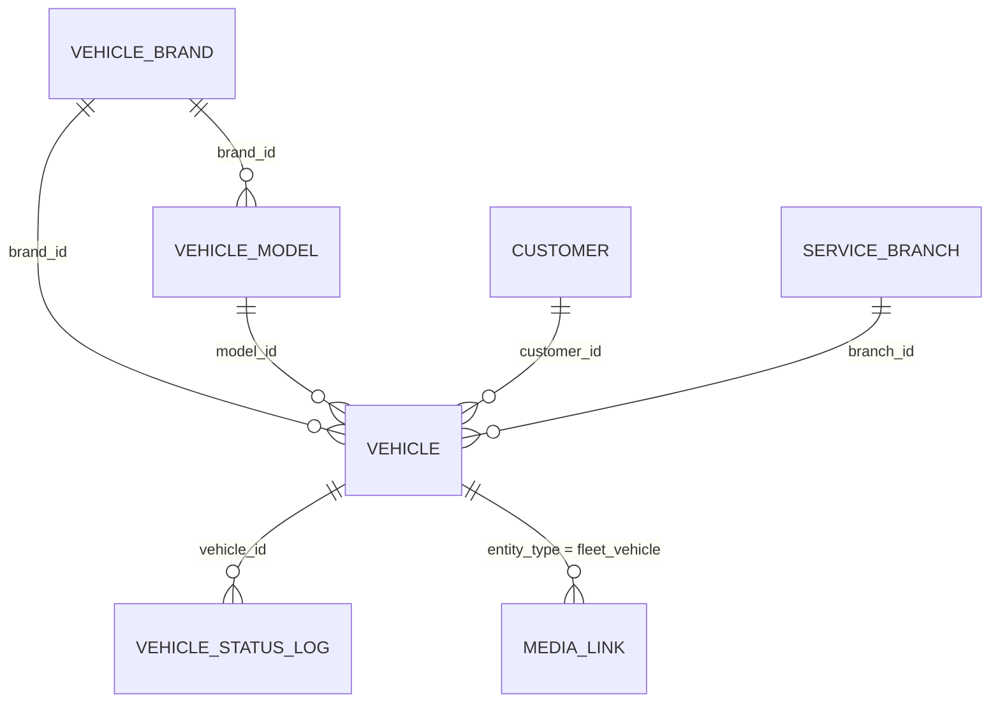

# Fleet (`fleet`)

Fleet is the vehicle register of the ECS (car‑service) package: it stores vehicles (own fleet or customers' external cars) with identification (plate, VIN, ORV id), technical data, status/ownership, service deadlines (STK, insurance, vignette, tyres, warranty) and a status history. It integrates with a brand/model catalogue (remote vehiclesdb + local brands/models), the Czech ORV vehicle‑registry API for auto‑filling technical data, [Media](media.md) for vehicle photos, [Calendar](calendar.md) for deadline reminders and [Customers](customers.md) for ownership. [CarService](carservice.md) consumes the `fleet` capability to attach vehicles to service orders.

## At a glance

| Item | Value |
| --- | --- |
| Module id | `fleet` |
| Version | `1.8.0` (`modules/Fleet/module.php`, `FleetModule::version()`; `README.md` says v1.7.7) |
| Directory | `modules/Fleet/` |
| Class | `Modules\Fleet\FleetModule` |
| Requires | `core ^1.0` |
| Optional | `customers ^1.0`, `media ^1.0`, `calendar ^1.0` (module.php); runtime `class_exists`/`capabilities->has()` guards also for CarService (`carservice.branch_context`, `ServiceBranch`) |
| Capabilities provided | `fleet` → `Application/FleetProvider` |
| Capabilities consumed | `media` (`VehicleMediaService`), `calendar` (`VehicleCalendarService`), `carservice.branch_context` (branch filter/column) |
| Groups / packages | `ecs` (`module.php`); `config/module_groups.php` group **ECS** lists `fleet` as a required module |
| Permissions | `fleet.view` (`perm.fleet.view`), `fleet.manage` (`perm.fleet.manage`) – group `perm.group.fleet` |

## Domain model

| Entity | Table | Key fields | Relations |
| --- | --- | --- | --- |
| `Domain/Vehicle.php` | `fleet_vehicles` (indexes on `plate`, `status`, `customer_id`) | `id: string(36)` UUID · `plate: string(32)` (normalised via `Vehicle::normalizePlate()`) · `vin: ?string(32)` · `orv_id: ?string(64)` · `brand`, `model: ?string(80)` · `brand_id`, `model_id: ?string(36)` · `model_year: ?int` · `color: ?string` · `fuel: ?string` · `gearbox: ?string` · `motorization: ?string` · `mileage: ?int` · `fuel_level: ?string(16)` · `condition_json: ?json` (interior/exterior/damage) · `status: string` (`available`) · `ownership: string` (`owned`) · `customer_id: ?string(36)` · `branch_id: ?string(36)` · `stk_at`, `insurance_until`, `vignette_until`, `tires_at`, `warranty_until: ?date_immutable` · `note: ?text` · `tech_json: ?json` (ORV technical extras) · `created_at`, `updated_at` | `customer_id` → Customers `Customer`; `branch_id` → CarService `ServiceBranch`; `brand_id` → `VehicleBrand`; `model_id` → `VehicleModel` |
| `Domain/VehicleBrand.php` | `fleet_vehicle_brands` (unique `uniq_fleet_brands_name` on `name`) | `id` · `name` · `created_at` | parent of `VehicleModel` |
| `Domain/VehicleModel.php` | `fleet_vehicle_models` (index on `brand_id`; unique `uniq_fleet_models_brand_name` on `brand_id, name`) | `id` · `brand_id` · `name` · `created_at` | `brand_id` → `VehicleBrand` |
| `Domain/VehicleStatusLog.php` | `fleet_vehicle_status_logs` (index on `vehicle_id`) | `id` · `vehicle_id` · `from_status: ?string` · `to_status: string` · `reason: ?string` · `user_id: ?string` · `created_at` | `vehicle_id` → `Vehicle` |

Enums (`Vehicle` constants): `STATUSES` = `available`, `rented`, `in_service`, `repair_wait`, `out_of_service`, `returned_to_client` (labels `fleet.status.*`); `OWNERSHIPS` = `owned`, `external`; `FUELS` = `petrol`, `diesel`, `lpg`, `cng`, `hybrid`, `electric`, `other` (`fleet.fuel.*`); `GEARBOXES` = `manual`, `automatic`; `FUEL_LEVELS` = `full`, `three_quarters`, `half`, `quarter`, `empty`; `CONDITIONS` = `clean`, `wash`, `dirty`.

Form metadata: `#[FormEntity('fleet.save')]`, `#[FormGenerator(cols: 2, exclude: [id, orvId, brandId, modelId, conditionJson, techJson, createdAt, updatedAt])]`; field groups `identity`, `vehicle`, `status`, `dates`, `condition`, `tech`. The `tech` group (`generation`, `vehicle_kind`, `body_type`, `category`, `emission`, `engine_code`, `power_kw`, `displacement_cc`, `weight_kg`, `seats`, `max_speed`, `consumption`, `tire_size`, `tp_number`, `first_registered_at`, `homologation`, `version_code`, `orv_notes`) and `condition_interior/exterior/damage` are **form‑only mirrors** (not ORM‑mapped) persisted inside `tech_json` / `condition_json` (`Vehicle::tech()`, `techJson()`). Helpers: `label()` (plate + display model), `displayModel()`, `generation()` (from tech_json or `VehicleGeneration::resolve()`), `statusLabel()`, `ownershipLabel()`.

## Admin UI

Menu (`boot()`; all items are children of the CarService menu `carservice`):

| Id | Label | Icon | Route | Permission | Order | Hidden |
| --- | --- | --- | --- | --- | --- | --- |
| `fleet` | `nav.fleet` | `car` | `admin.fleet.index` | `fleet.view` | 50 | no |
| `fleet.list` | `nav.fleet.list` | – | `admin.fleet.index` | `fleet.view` | 51 | yes |
| `fleet.brands` | `nav.fleet.catalog` | – | `admin.fleet.brands` | `fleet.view` | 52 | yes |
| `fleet.create` | `nav.fleet.create` | – | `admin.fleet.create` | `fleet.manage` | 53 | yes |

Command palette: `fleet.index` (`palette.fleet.index`, `/admin/fleet`, icon `car`, keywords `vozidlo, fleet, spz, auto, vehicle, orv`). Admin search provider `fleet.vehicles` (fields plate/VIN/brand/model/ORV id, hit URL `/admin/fleet/{id}`, group `fleet.title`).

Routes (`register()`, prefix `/admin/fleet`, middleware `auth`):

| Method | Path | Route name | Controller::action | Permission |
| --- | --- | --- | --- | --- |
| GET | `/admin/fleet` | `admin.fleet.index` | `VehicleController::index` | `fleet.view` |
| GET | `/admin/fleet/brands` | `admin.fleet.brands` | `BrandController::index` | `fleet.view` |
| GET | `/admin/fleet/brands/catalog` | `admin.fleet.brands.catalog` | `BrandController::catalogSearch` (JSON, `?q=`) | `fleet.view` |
| POST | `/admin/fleet/brands` | `admin.fleet.brands.store` | `BrandController::storeBrand` | `fleet.manage` |
| GET | `/admin/fleet/brands/{id}` | `admin.fleet.brands.show` | `BrandController::show` | `fleet.view` |
| POST | `/admin/fleet/brands/{id}/import` | `admin.fleet.brands.import` | `BrandController::importModels` (models from catalogue) | `fleet.manage` |
| POST | `/admin/fleet/brands/{id}/delete` | `admin.fleet.brands.destroy` | `BrandController::destroyBrand` | `fleet.manage` |
| POST | `/admin/fleet/models` | `admin.fleet.models.store` | `BrandController::storeModel` | `fleet.manage` |
| POST | `/admin/fleet/models/{id}/delete` | `admin.fleet.models.destroy` | `BrandController::destroyModel` | `fleet.manage` |
| GET | `/admin/fleet/settings` | `admin.fleet.settings` | `SettingsController::edit` (redirects to `admin.fleet.brands`) | `fleet.view` |
| POST | `/admin/fleet/settings` | `admin.fleet.settings.update` | `SettingsController::update` (redirects to `admin.settings`) | `fleet.manage` |
| POST | `/admin/fleet/orv-lookup` | `admin.fleet.orv_lookup` | `VehicleController::orvLookup` (JSON; ruleset `fleet.orv`) | `fleet.manage` |
| GET | `/admin/fleet/create` | `admin.fleet.create` | `VehicleController::create` (`?customer=` prefill) | `fleet.manage` |
| POST | `/admin/fleet` | `admin.fleet.store` | `VehicleController::store` | `fleet.manage` |
| POST | `/admin/fleet/bulk` | `admin.fleet.bulk` | `VehicleController::bulk` (ruleset `fleet.bulk`, `action=delete`) | `fleet.manage` |
| GET | `/admin/fleet/{id}` | `admin.fleet.show` | `VehicleController::show` | `fleet.view` |
| GET | `/admin/fleet/{id}/edit` | `admin.fleet.edit` | `VehicleController::edit` | `fleet.manage` |
| POST | `/admin/fleet/{id}` | `admin.fleet.update` | `VehicleController::update` | `fleet.manage` |
| POST | `/admin/fleet/{id}/status` | `admin.fleet.status` | `VehicleController::updateStatus` | `fleet.manage` |
| POST | `/admin/fleet/{id}/media` | `admin.fleet.media` | `VehicleController::uploadMedia` | `fleet.manage` |
| POST | `/admin/fleet/{id}/media/{linkId}/cover` | `admin.fleet.media.cover` | `VehicleController::setMediaCover` | `fleet.manage` |
| POST | `/admin/fleet/{id}/delete` | `admin.fleet.destroy` | `VehicleController::destroy` | `fleet.manage` |

Screens (`Resources/views/`):

- **Vehicle list** `vehicles/index.html.twig` – `ListQuery` (sortable `plate|status|updatedAt|createdAt|brand`, default `updatedAt desc`; search over plate/VIN/brand/model; filters `status`, `ownership`, `customer`); restricted to the selected CarService branch when `carservice.branch_context` is available; cover thumbnails from Media; bulk delete.
- **Vehicle detail** `vehicles/show.html.twig` – vehicle card, customer link, status change form with reason (writes `VehicleStatusLog`), status history, media gallery with upload/cover selection, ORV notes (`OrvClient::formatOrvNotesLines`), plus hook sections from filter `fleet.vehicle.show.sections` (CarService adds service orders).
- **Vehicle form** `vehicles/form.html.twig` – generated from `Vehicle` form attributes (ruleset `fleet.save`), brand datalist, ORV lookup button (`admin.fleet.orv_lookup` fills fields returned by `OrvClient::mapToVehicleFields()`), branch selector when branch context exists, customer validation (`class_exists(Customer::class)`).
- **Catalogue** `brands/index.html.twig`, `brands/show.html.twig` – local brands/models with logos (`VehicleCatalogClient::logoUrl`), remote catalogue search and model import.
- **Customer detail section** `partials/customer_vehicles.html.twig` – injected into Customers via `customers.show.sections` (order 42).

Settings: the module defines `fleet.orv_api_key` (encrypted) and reads it in `OrvClient`; it is edited on the core settings page – the module's own `/admin/fleet/settings` routes only redirect.

## Public / REST API

`/api/v1/fleet` (`$context->api()->module('fleet', ...)`, controller `Http/Api/VehicleApiController.php`; scopes `fleet.read`, `fleet.write`; see `../architecture/api.md`):

| Method | Path | Scope | Action | Notes |
| --- | --- | --- | --- | --- |
| GET | `/` | `fleet.read` | `index` | `ApiQuery`: sortable `plate, status, createdAt, updatedAt, brand`; filterable `status, ownership, customer_id`; search |
| POST | `/` | `fleet.write` | `store` | validates against `fleet.save`; emits `fleet.vehicle_created` |
| GET | `/{id}` | `fleet.read` | `show` | |
| PATCH | `/{id}` | `fleet.write` | `update` | emits `fleet.vehicle_updated` (+ `fleet.vehicle_status_changed` when status changed) |
| POST | `/{id}/status` | `fleet.write` | `updateStatus` | `status`, `reason`; logs `VehicleStatusLog`; emits `fleet.vehicle_status_changed` |
| DELETE | `/{id}` | `fleet.write` | `destroy` | emits `fleet.vehicle_deleted` |

Serializer (`FleetProvider::serialize()`): `id, plate, vin, orv_id, brand, model, brand_id, model_id, model_year, color, fuel, gearbox, motorization, mileage, fuel_level, condition, status, ownership, customer_id, branch_id, stk_at, insurance_until, vignette_until, tires_at, warranty_until, note, tech, label, created_at, updated_at`. No `/api/public/*` endpoints.

## Events, hooks & webhooks

Platform events (all `webhookEnabled(true)`), emitted from `VehicleController` and `VehicleApiController` with subject `{type: fleet_vehicle, id}`:

| Event | Description | Emitted on |
| --- | --- | --- |
| `fleet.vehicle_created` | Vozidlo vytvořeno | store (admin/API) |
| `fleet.vehicle_updated` | Vozidlo upraveno | update, status change |
| `fleet.vehicle_deleted` | Vozidlo smazáno | destroy, bulk delete |
| `fleet.vehicle_status_changed` | Změněn stav vozidla | update with status change, `updateStatus` |

Hooks: **exposes** filter `fleet.vehicle.show.sections` (`(array $sections, Vehicle $vehicle)`; consumed by CarService); **adds** filter `customers.show.sections` (Customers detail, section `fleet.vehicles`, requires `fleet.view`). Audit log entries `fleet.created`, `fleet.updated` (`VehicleController::store/update`); status changes and deletions are not audited separately. Calendar integration creates/updates `CalendarEvent`s with `externalProvider = fleet`, `externalId = fleet:{vehicleId}:{stk|insurance|vignette|tires|warranty}`, type `deadline`. No queue jobs, scheduled tasks or publishables.

## Dashboard widgets

| Widget id | Type | Class | Shows | Permission | Order |
| --- | --- | --- | --- | --- | --- |
| `fleet.shortcut` | shortcut | `Application/Widgets/FleetShortcutWidget.php` | Link to vehicle list (hint `admin.dashboard.hint.fleet`) | `fleet.view` | 35 |
| `fleet.stats` | metric | `Application/Widgets/FleetStatsWidget.php` | Vehicle count / status breakdown (`fleet.widget.stats.*`) | `fleet.view` | 66 |
| `fleet.deadlines` | panel | `Application/Widgets/FleetDeadlinesWidget.php` | Upcoming deadlines (STK, insurance, vignette, tyres, warranty) within 30 days, "today/tomorrow/soon (7 d)" labels, up to 100 candidate vehicles | `fleet.view` | 33 |

See `../architecture/dashboard-widgets.md`.

## Services & extension points

| Class | Responsibility |
| --- | --- |
| `Application/FleetProvider.php` | Capability facade: `find()`, `findByPlate()` (normalised), `list(filters{status, ownership, customer_id, q}, limit, offset)`, `forCustomer()`, `setStatus(id, status, reason?, userId?)` (writes `VehicleStatusLog`), `ensureForCustomer(customerId, plateData)` (find‑or‑create external vehicle by plate – used by CarService order intake; flips `owned`→`external` when re‑assigned), `ensureBrandModel(vehicle)` (creates brand/model rows from free‑text), `serialize()`. |
| `Application/OrvClient.php` | Client for `https://api.dataovozidlech.cz/api/vehicletechnicaldata/v2` (cURL, header `api_key`), `configured()`, `lookup(orvId)` → `{ok, code, data, error}`, `mapToVehicleFields()` (maps registry payload to form fields incl. tech group), `formatOrvNotes()/formatOrvNotesLines()`. |
| `Application/VehicleCatalogClient.php` | Remote brand/model catalogue from `vehiclesdb` JSON on jsDelivr (cached 7 days under `basePath`), brand logos from `car-logos-dataset` CDN; `searchMakes()`, `modelsForBrand()`, `resolveCanonicalName()`, `logoUrl()`. |
| `Application/VehicleGeneration.php` | Static brand/model/year → generation map (`resolve()`, `formatModel()`, `extractFromName()`). |
| `Application/VehicleMediaService.php` | Media bridge (`ENTITY_TYPE = fleet_vehicle`): `available()`, `forVehicle()`, `coverPhoto()`, `coverLinkId()`, `coversForVehicles()`, `upload()/uploadMany()/uploadManyGuessed()` (label guessed from filename – `guessLabel()`), `setCover()` (reorders `MediaLink.sort_order`). Requires `media` capability and `MediaAsset` class. |
| `Application/VehicleCalendarService.php` | `available()` (needs `calendar` capability + `CalendarEvent`), `syncReminders(vehicle)` upserting deadline events with fixed colours (STK amber, insurance red, vignette blue, tyres green, warranty purple). |

Extension points: `fleet` capability; filter `fleet.vehicle.show.sections`; `MediaLink` label convention (`photo`, cover = lowest sort order). Consumers: [CarService](carservice.md) (`CarServiceProvider`, `ServiceOrderController`, `OrderCalendarService`, `OrderEsignService`, `ServiceDocumentService`, tracker, API), [Documents](documents.md) (`DocumentController` filters by linked vehicle), [PartsCatalog](partscatalog.md) (`CatalogController`).

## CLI commands

None.

## Configuration & translations

| Setting | Type | Default | Label |
| --- | --- | --- | --- |
| `fleet.orv_api_key` | encrypted | `` | `fleet.settings.orv_api_key` |

External endpoints: `api.dataovozidlech.cz` (ORV), `cdn.jsdelivr.net/gh/vehiclesdb/vehiclesdb`, `raw.githubusercontent.com/filippofilip95/car-logos-dataset`. Catalogue cache lives under the application base path (`VehicleCatalogClient` constructor `basePath`).

Translations: `Resources/translations/messages.{cs,en}.php` (242 EN keys) – prefixes `fleet.field.*`, `fleet.error.*`, `fleet.brands.*`, `fleet.catalog.*`, `fleet.flash.*`, `fleet.media.*`, `fleet.widget.*`, `fleet.bulk.*`, `fleet.form.*`, `fleet.settings.*`, `fleet.fuel.*`, `fleet.status.*`, `fleet.orv.*`, `fleet.partial.*`, `nav.fleet*`, `palette.fleet.*`, `perm.fleet.*`, `perm.group.fleet`, `module.fleet.description`, `admin.dashboard.hint.fleet`.

## Database migrations

| File | Purpose |
| --- | --- |
| `Database/Migrations/2026_09_05_000001_fleet.php` | No‑op marker; SchemaTool creates `fleet_vehicles`, `fleet_vehicle_status_logs`. |
| `Database/Migrations/2026_09_05_000002_fleet_brands.php` | No‑op marker; SchemaTool adds `fleet_vehicle_brands`, `fleet_vehicle_models`, `vignette_until`. |
| `Database/Migrations/2026_09_05_000003_fleet_tech_json.php` | No‑op marker; SchemaTool adds `fleet_vehicles.tech_json`. |

## Notes

- All schema changes rely on SchemaTool; migration files are empty markers.
- Menu items are attached under the CarService parent `carservice`; without CarService the Fleet menu has no visible parent.
- `SettingsController` is a stub: both routes redirect (`edit` → brands, `update` → core settings).
- Tech/condition fields are form‑only properties mirrored into JSON columns; API `tech` is the raw `tech_json` object.
- Calendar reminder titles ("STK", "Pojištění", "Známka", "Pneu", "Garanční kontrola") and event descriptions are Czech literals.
- `FleetProvider` is instantiated twice (`register()` for the capability and `boot()` for search/hook) rather than resolved from the container.
- `README.md` version (1.7.7) lags `module.php` (1.8.0).
