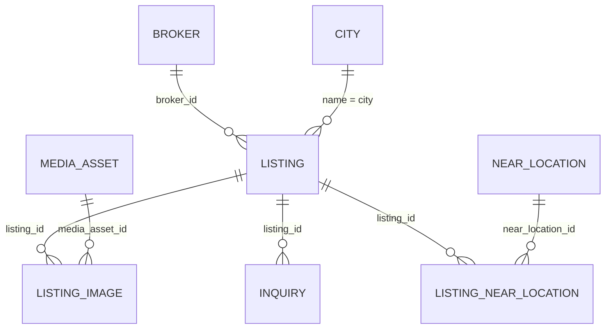

# Listings (`listings`)

Listings is the core real‑estate module of the RealEstates package: it manages property offers (sale/rent of apartments, houses, land, commercial), their image galleries (Media assets or external URLs), brokers, cities (location tiles) and "near locations" (points of interest linked to a listing with distance/walk time). It exposes a **public JSON API** under `/api/public/*` consumed by the React storefront (`FE2/`), including inquiry intake that creates [Customers](customers.md) leads and [CRM](crm.md) deals. Listings, brokers and cities take part in the staging → production publishing workflow (`publishables`). Consumed by [Viewings](viewings.md), [Portals](portals.md), [WebPlus](webplus.md) (route mapping, dynamic meta, Google feed) and the [Ai](ai.md) tools.

## At a glance

| Item | Value |
| --- | --- |
| Module id | `listings` |
| Version | `1.3.2` (`modules/Listings/module.php`, `ListingsModule::version()`; `README.md` says v1.2.9) |
| Directory | `modules/Listings/` |
| Class | `Modules\Listings\ListingsModule` |
| Requires | `core ^1.0`, `currency ^1.1` |
| Optional | `customers ^1.0`, `crm ^1.0`, `viewings ^1.0`, `portals ^1.0`, `documents ^1.0`, `media ^1.0` |
| Capabilities provided | `listings` → `Application/ListingsProvider`, `brokers` → `Application/BrokersProvider`, `near_locations` → `Application/NearLocationsProvider`, `cities` → `Application/CitiesProvider` |
| Capabilities consumed | `media` (image attach/upload; `class_exists(MediaAsset)`), [Currency](currency.md) `CurrencyBuilder` (hard dependency in `ListingController`), Customers `Customer` and CRM `Deal` (guarded `class_exists` in inquiry intake) |
| Groups / packages | `realestates` (`module.php`); `config/module_groups.php` group **RealEstates** lists `listings` as required |
| Permissions | `listings.view` (`perm.listings.view`), `listings.manage` (`perm.listings.manage`) – group `perm.group.listings` |

## Domain model

| Entity | Table | Key fields | Relations |
| --- | --- | --- | --- |
| `Domain/Listing.php` | `listings` (unique `uniq_listings_slug`; indexes on `status`, `city`, `featured`) | `id: string(36)` · `title: string(190)` · `slug: string(190)` · `status: string(32)` (`draft`) · `market_status: string(32)` (`available`) · `offer_type: string(16)` (`sale`) · `property_type: string(32)` (`apartment`) · `featured: bool` · `price: decimal(14,2)` (`0.00`) · `currency: string(3)` (`CZK`) · `area_m2: ?float` · `rooms`, `floor`, `floors: ?int` · `city: string(120)` · `city_part`, `street`, `zip`, `address: ?string` · `latitude`, `longitude: ?float` · `description: ?text` · `cover_image_url: ?string(500)` (denormalised by `ListingsProvider::syncCover()`) · `images: json` (legacy) · `balcony`, `terrace`, `cellar`, `garage`, `elevator: bool` · `parking_lots: ?int` · `energy_rating: ?string(1)` · `broker_id: ?string(36)` + denormalised `broker_name`, `broker_email`, `broker_phone`, `broker_position`, `broker_photo_url` · `published_at` · `created_at`, `updated_at` | `broker_id` → `Broker`; `city` (name) → `City.name` (soft) |
| `Domain/ListingImage.php` | `listing_images` (indexes on `listing_id`, `media_asset_id`) | `id` · `listing_id` · `media_asset_id: ?string(36)` · `external_url: ?string` · `sort_order: int` · `is_primary: bool` · `alt: ?string` · `created_at` | `listing_id` → `Listing`; `media_asset_id` → [Media](media.md) `MediaAsset` |
| `Domain/Inquiry.php` | `listing_inquiries` (index on `listing_id`) | `id` · `listing_id` · `name` · `email` · `phone: ?string` · `message` · `created_at` | `listing_id` → `Listing` |
| `Domain/Broker.php` | `brokers` (indexes on `email`, `active`) | `id` · `first_name`, `last_name: string(120)` · `email: string(190)` · `phone: ?string(64)` · `position: ?string(120)` · `skills: ?text` · `description: ?text` · `photo_url: ?string(500)` · `active: bool` · `sort_order: int` · timestamps | referenced by `Listing.broker_id` |
| `Domain/City.php` | `listing_cities` (unique `uniq_listing_cities_name`; index on `active`) | `id` · `name: string(120)` · `image_url: ?string(500)` · `active: bool` · `sort_order: int` · timestamps | matched to `Listing.city` by name |
| `Domain/NearLocation.php` | `near_locations` (indexes on `category`, `active`) | `id` · `name: string(190)` · `category: string(32)` (`other`) · `address`, `city: ?string` · `description: ?text` · `latitude`, `longitude: ?float` · `active: bool` · `sort_order: int` · timestamps | linked via `ListingNearLocation` |
| `Domain/ListingNearLocation.php` | `listing_near_locations` (unique `uniq_listing_near_location` on `listing_id, near_location_id`; index on `listing_id`) | `id` · `listing_id` · `near_location_id` · `distance_m: ?int` · `walk_minutes: ?int` · `sort_order: int` · `created_at` | join `Listing` ↔ `NearLocation` |

Enums: `Listing::STATUSES` = `draft`, `published`, `archived` (`publish()` sets `published_at`, `unpublish()` → draft, `archive()`); `MARKET_STATUSES` = `available`, `reserved`, `sold`, `rented` (`listings.market.*`); `OFFERS` = `sale`, `rent`; `TYPES` = `apartment`, `house`, `land`, `commercial` (`listings.type.*`); `ENERGY` = `A`–`G`; amenities (`amenityLabels()`): `balcony`, `terrace`, `cellar`, `garage`, `elevator`, `parking` (`listings.amenity.*`). `NearLocation::CATEGORIES` = `school`, `kindergarten`, `shop`, `supermarket`, `transport`, `metro`, `tram`, `bus`, `office`, `post`, `park`, `restaurant`, `health`, `sport`, `other`.

Form metadata: `Listing` `#[FormEntity('listings.save')]`, `#[FormGenerator(cols: 3, exclude: [id, images, coverImageUrl, publishedAt, createdAt, updatedAt, broker*])]` with groups `basic`, `location`, `amenities`, `broker`; `Broker` (`listings.brokers.save`), `City` (`listings.cities.save`), `NearLocation` (`listings.near.save`) also carry `#[FormEntity]`/`#[FormGenerator]`.

## Admin UI

Menu (`boot()`, group `Reality`):

| Id | Label | Icon | Route | Permission | Order | Hidden |
| --- | --- | --- | --- | --- | --- | --- |
| `listings` | `nav.listings` | `home` | `admin.listings.index` | `listings.view` | 28 | no |
| `listings.properties` | `nav.listings.properties` | – | `admin.listings.index` | `listings.view` | 29 | no |
| `listings.brokers` | `nav.listings.brokers` | – | `admin.listings.brokers.index` | `listings.view` | 30 | no |
| `listings.near` | `nav.listings.near` | – | `admin.listings.near.index` | `listings.view` | 31 | no |
| `listings.cities` | `nav.listings.cities` | – | `admin.listings.cities.index` | `listings.view` | 32 | no |
| `listings.create` / `listings.brokers.create` / `listings.near.create` / `listings.cities.create` | `nav.listings.*.create` | – | respective `*.create` routes | `listings.manage` | 33–36 | yes |

Command palette: `listings.index`, `listings.create` (group `Akce`), `listings.brokers.index`, `listings.brokers.create`, `listings.near.index`, `listings.near.create`, `listings.cities.index`, `listings.cities.create` (labels `palette.listings.*`).

Routes (`register()`, prefix `/admin/listings`, middleware `auth`):

| Method | Path | Route name | Controller::action | Permission |
| --- | --- | --- | --- | --- |
| GET | `` | `admin.listings.index` | `ListingController::index` | `listings.view` |
| GET | `/create` | `admin.listings.create` | `ListingController::create` | `listings.manage` |
| POST | `` | `admin.listings.store` | `ListingController::store` | `listings.manage` |
| POST | `/bulk` | `admin.listings.bulk` | `ListingController::bulk` (`publish|draft|archive|feature|unfeature|delete`) | `listings.manage` |
| GET | `/{id}` | `admin.listings.show` | `ListingController::show` | `listings.view` |
| GET | `/{id}/edit` | `admin.listings.edit` | `ListingController::edit` | `listings.manage` |
| POST | `/{id}` | `admin.listings.update` | `ListingController::update` | `listings.manage` |
| POST | `/{id}/publish` | `admin.listings.publish` | `ListingController::togglePublish` | `listings.manage` |
| POST | `/{id}/feature` | `admin.listings.feature` | `ListingController::toggleFeature` | `listings.manage` |
| POST | `/{id}/images` | `admin.listings.images.store` | `ListingController::storeImage` (upload via Media) | `listings.manage` |
| POST | `/{id}/images/attach` | `admin.listings.images.attach` | `ListingController::attachImage` (`media_asset_id`) | `listings.manage` |
| POST | `/{id}/images/url` | `admin.listings.images.url` | `ListingController::storeUrlImage` (`external_url`) | `listings.manage` |
| POST | `/{id}/images/{imageId}/primary` | `admin.listings.images.primary` | `ListingController::setPrimaryImage` | `listings.manage` |
| POST | `/{id}/images/{imageId}/move` | `admin.listings.images.move` | `ListingController::moveImage` | `listings.manage` |
| POST | `/{id}/images/{imageId}/delete` | `admin.listings.images.destroy` | `ListingController::destroyImage` | `listings.manage` |
| POST | `/{id}/near-locations` | `admin.listings.near_links.store` | `ListingController::attachNearLocation` | `listings.manage` |
| POST | `/{id}/near-locations/{linkId}` | `admin.listings.near_links.update` | `ListingController::updateNearLocation` | `listings.manage` |
| POST | `/{id}/near-locations/{linkId}/delete` | `admin.listings.near_links.destroy` | `ListingController::destroyNearLocation` | `listings.manage` |
| POST | `/{id}/delete` | `admin.listings.destroy` | `ListingController::destroy` | `listings.manage` |
| GET/POST | `/brokers`, `/brokers/create`, `/brokers/{id}`, `/brokers/{id}/edit`, `/brokers/{id}/toggle-active`, `/brokers/{id}/delete` | `admin.listings.brokers.{index,create,store,show,edit,update,toggle_active,destroy}` | `BrokerController::*` | view / manage |
| GET/POST | `/near-locations…` | `admin.listings.near.{index,create,store,show,edit,update,toggle_active,destroy}` | `NearLocationController::*` | view / manage |
| GET/POST | `/cities…` | `admin.listings.cities.{index,create,store,show,edit,update,toggle_active,destroy}` | `CityController::*` | view / manage |

Screens (`Resources/views/`): `index.html.twig` (`ListQuery` sortable `title|price|city|status|createdAt`, filters `status`, `offer_type`, `market_status`, `property_type`, `featured`, search, bulk bar), `form.html.twig` (generated 3‑column form, currency select via `CurrencyBuilder`, broker picker that copies broker contact data into the denormalised `broker_*` columns), `show.html.twig` (tabs `listings.tab.*`: details, gallery with upload/attach/URL/primary/reorder, near locations with auto distance from GPS, publish/feature toggles, status badges), `brokers/*`, `cities/*`, `near_locations/*` (list/form/show each; cities show linked listings via `CitiesProvider::listingsForCity()`).

Publishing: `store`/`update`/`togglePublish`/`bulk`/`destroy` work with the core `Gereq\Publish\ProductionFreeze` service (`stageCreate()`, `stageDelete()`, `hasFreeze()`, `isPendingDelete()`, `pendingDeleteKeys()`) so that changes to already published rows are staged and flashed as `publish.flash.staged`; see `../architecture/publishing-i18n-settings.md`.

No settings page or module settings.

## Public / REST API

No `/api/v1/listings` module is registered. The module provides the storefront **public API** (`/api/public/*`), protected by the site public API key (`Bearer grq_pub_*` or `X-Api-Key`, `src/Api/Http/PublicApiAuthMiddleware.php`) and CORS via `Gereq\Http\PublicCors` (`GET, POST, OPTIONS`; explicit `OPTIONS` routes `api.public.*.options`). See `../frontend/public-frontends.md` and `../architecture/api.md`.

| Method | Path | Route name | Controller::action |
| --- | --- | --- | --- |
| GET | `/api/public/listings` | `api.public.listings.index` | `Http/Public/PublicListingsController::index` |
| GET | `/api/public/listings/{slug}` | `api.public.listings.show` | `PublicListingsController::show` |
| POST | `/api/public/inquiries` | `api.public.inquiries.store` | `PublicListingsController::inquire` |
| GET | `/api/public/brokers` | `api.public.brokers.index` | `Http/Public/PublicBrokersController::index` |
| GET | `/api/public/brokers/{id}` | `api.public.brokers.show` | `PublicBrokersController::show` |
| GET | `/api/public/cities` | `api.public.cities.index` | `Http/Public/PublicCitiesController::index` |

**Listings index** – query filters (`ListingsProvider::published()`): `city` (LIKE over `city`, `city_part`, `street`), `offer_type` (`sale|rent`), `property_type`, `market_status`, `featured` (bool), `min_price`, `max_price`, `min_rooms`, `min_area`, `limit` (default 24, clamped 1–100). Only `status = published`; sorted `featured DESC, published_at DESC`. Response `ApiResponse::collection(items, {total})`. In production read context the result is reconciled with frozen snapshots (`FrozenPublicReader`): pending‑create rows are hidden, snapshot `status` must be `published`, and published snapshots without a live row are appended; in staging, pending‑delete rows are filtered out.

**Listing serializer** (`ListingsProvider::serialize($listing, $full)`): base fields `id, title, slug, status, market_status, offer_type, property_type, featured, price (float), currency, area_m2, rooms, floor, floors, city, city_part, cover_image_url (absolute), amenities[], energy_rating, published_at`. Full (`show`): adds `street, zip, address, latitude, longitude, description, images[] (absolute URLs, Media or external), balcony, terrace, cellar, garage, elevator, parking_lots, broker {id, name, email, phone, position, photo_url, skills, description}` (from `Broker` row, else denormalised broker columns with `id: null`), `created_at, updated_at, near_locations[]` (`NearLocationsProvider::serializeForListing()`: `id, name, category, address, city, description, latitude, longitude, active, distance_m, walk_minutes, distance_auto, sort_order`, sorted by distance then sort order; missing distances computed from GPS by `GeoDistance`) and `similar[]` (up to 3 published listings sharing city, type or offer). In production, snapshot values override `title, slug, status, market_status, offer_type, property_type, featured, price, currency, city, description`. `show` returns 404 for non‑published listings.

**Inquiry intake** (`POST /api/public/inquiries`, JSON or form body): rate limit 5 per 10 min per IP (`RateLimiter` key `listing:inquiry:{ip}`, 429 `rate_limited`); required `listing_slug` (or `slug`), `name`, `email` (valid), `message`; optional `phone`; 422 `validation_error`, 404 `listing_not_found` for unknown/unpublished slug. Creates `Inquiry`; when Customers exists, finds or creates a `Customer` by e‑mail (status `lead`, note `Poptávka z webu: <title>`; reactivates `inactive`), and when CRM exists creates a `Deal` (`Poptávka: <title>`, amount = price, currency, stage `lead`, note = message). Emits `listing.inquiry` and, if a deal was created, `deal.created` (with `source: listing.inquiry`, `listing_id`, `listing_slug`, `inquiry_id`). Returns 201 `{id, listing_id, listing_slug, listing_title, customer_id, deal_id, name, email, phone, message}`.

**Brokers**: index returns active brokers (`BrokersProvider::allActive()`), show returns one active broker; serializer `id, first_name, last_name, name, email, phone, position, skills, description, photo_url, active` (frozen snapshot used in production).

**Cities**: `with_listings` (bool) hides cities without published listings, `limit` (0–50); items `id, name, image_url (public URL), sort_order, active, listing_count`, sorted by `listing_count DESC, sort_order ASC`.

## Events, hooks & webhooks

- Platform event `listing.inquiry` (`Poptávka z veřejného webu`, `webhookEnabled(true)`); the module also emits CRM's `deal.created` from inquiry intake.
- Hooks **added**: filter `admin.dashboard.listing_title_ids` (collects listing ids from recent inquiries) and action `admin.dashboard.warmup` (pre‑loads titles via `ListingsProvider::warmTitles()`).
- Publishables (staging → production): `listings` (`publish.category.listings`, `Gereq\Publish\Adapter\ListingPublishAdapter`, order 40), `listings.brokers` (`BrokerPublishAdapter`, 45), `listings.cities` (`CityPublishAdapter`, 46) – adapters live in core `src/Publish/Adapter/`.
- Queue jobs / scheduled tasks: none. Validation rulesets: `listings.save`, `listings.image.upload`, `listings.image.attach`, `listings.image.url`, `listings.brokers.save`, `listings.near.save`, `listings.cities.save`, `listings.near_link.save`, `listings.near_link.update`, `listings.bulk`.

## Dashboard widgets

| Widget id | Type | Class | Shows | Permission | Order |
| --- | --- | --- | --- | --- | --- |
| `listings.create.hero` | hero | `Application/Widgets/ListingCreateHeroWidget.php` | Call‑to‑action to create a listing | `listings.manage` | 20 |
| `listings.status.chart` | panel | `Application/Widgets/ListingStatusChartWidget.php` | Listings by status chart | `listings.view` | 17 |
| `listings.inquiries` | panel | `Application/Widgets/ListingInquiriesWidget.php` | Recent inquiries (`ListingsProvider::recentInquiries(8)`) with listing titles | `listings.view` | 19 |
| `listings.shortcut` | shortcut | `Application/Widgets/ListingsShortcutWidget.php` | Link to listings | `listings.view` | 28 |
| `listings.stats` | metric | `Application/Widgets/ListingStatsWidget.php` | Listing counts (`listings.widget.*`) | `listings.view` | 42 |

See `../architecture/dashboard-widgets.md`.

## Services & extension points

| Class | Responsibility |
| --- | --- |
| `Application/ListingsProvider.php` | Capability `listings`: `find()`, `findBySlug()` (snapshot‑aware), `published(filters, limit)`, `similar()`, `serialize()`, `recentInquiries()`, `warmTitles()/titlesByIds()`, `warmForSerialization()`/`warmMedia()`/`mediaAssetsFor()` (batch‑load Media assets), `gallery()`, `imageUrl()` (Media public URL or external), `galleryUrls()`, `syncCover()` (primary image → `cover_image_url`). Depends on `ContentReadContext` and `FrozenPublicReader` for staging/production behaviour. |
| `Application/BrokersProvider.php` | Capability `brokers`: `find()`, `allActive()`, `all()`, `options()`, `serialize()` (snapshot‑aware). |
| `Application/CitiesProvider.php` | Capability `cities`: `find()`, `findByName()`, `allActive()`, `all()`, `listingsForCity()`, `publishedCounts()`, `serialize(city, listingCount)` with public image URL resolution. |
| `Application/NearLocationsProvider.php` | Capability `near_locations`: `find()`, `findMany()`, `placesForLinks()`, `allActive()`, `all()`, `options()`, `forListing()`, `findLink()`, `serialize()`, `serializeForListing()`, `fillDistanceFromCoords()`. |
| `Application/GeoDistance.php` | Haversine `meters()` and `walkMinutes()` helpers. |

Consumers: [Viewings](viewings.md) (`ViewingsModule`, `ViewingController`, `PublicViewingsController` – booking a viewing for a listing), [Portals](portals.md) (`PortalsProvider`, publication of listings to portals), [WebPlus](webplus.md) (`RouteMappingCatalog`, `DynamicMetaResolver`, `BuiltInGoogleFeedCollectors`), [Ai](ai.md) (`ListingsSearchTool`, `ListingsGetTool`, documents tools), seeders (`src/Database/Seeder.php`, `RealEstateAutomationDemoSeeder.php`). No interfaces are declared for extension; integration is through capabilities and hooks.

## CLI commands

None.

## Configuration & translations

- No `settings()` keys and no module‑specific env vars. Public API access uses the core public API key; image URLs are made absolute with the core `Router`.
- Translations: `Resources/translations/messages.{cs,en}.php` (296 EN keys) – prefixes `listings.near.*`, `listings.field.*`, `listings.images.*`, `listings.brokers.*`, `listings.cities.*`, `listings.bulk.*`, `listings.near_links.*`, `listings.flash.*`, `listings.widget.*`, `listings.tab.*`, `listings.section.*`, `listings.amenity.*`, `listings.type.*`, `listings.market.*`, `listings.error.*`, `nav.listings*`, `palette.listings.*`, `perm.listings.*`, `perm.group.listings`, `module.listings.description`; publish labels `publish.category.listings|brokers|cities` come from core translations.

## Database migrations

| File | Purpose |
| --- | --- |
| `Database/Migrations/2026_01_01_000001_listings.php` | Empty `up()`/`down()`; `listings`, `listing_images`, `listing_inquiries`, `brokers`, `near_locations`, `listing_near_locations` are created by SchemaTool. |
| `Database/Migrations/2026_09_05_000002_cities.php` | No‑op marker; `listing_cities` created by SchemaTool from `City`. |

## Notes

- Public API messages (`Příliš mnoho poptávek…`, `Vyplňte jméno…`, `Nabídka neexistuje.`) and generated customer/deal texts are Czech literals.
- `Listing.images` (JSON) is a legacy column; galleries are stored in `listing_images`, and `cover_image_url` is denormalised from the primary image.
- Broker contact data is copied into `Listing.broker_*` columns at save time; changes to a `Broker` are not propagated to existing listings, but the public serializer prefers the live `Broker` row when `broker_id` is set.
- `ListingsProvider::serialize()` instantiates `NearLocationsProvider` inline (`new NearLocationsProvider($this->em)`) rather than using the container.
- Listing list endpoint returns at most 100 rows and has no pagination or sort parameters; `total` equals the returned count.
- Inquiry intake has no honeypot/captcha – only the IP rate limit and the public API key.
- `README.md` version (1.2.9) lags `module.php` (1.3.2).
