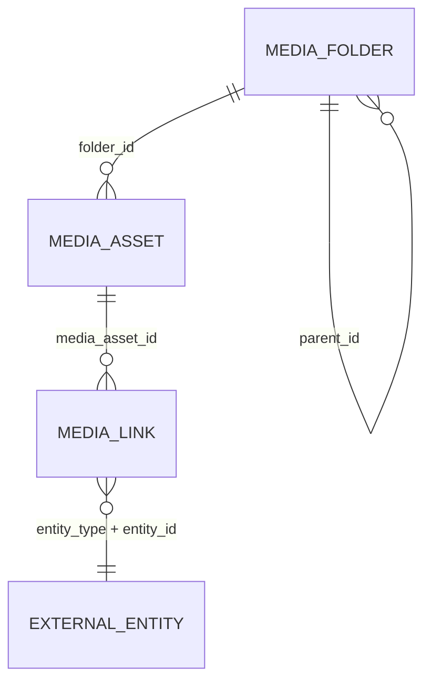

# Media (`media`)

Media is the shared asset library of the platform: images, PDFs and videos uploaded through the admin or the REST API, organised into a nested **folder tree**, and attached to records of other modules through polymorphic `MediaLink` rows (e.g. listing photos, vehicle "before/after" pictures, ORV scans, product images, CMS blocks). Files are stored through the core `Gereq\File\FileManager` (Flysystem local adapter under `storage/uploads`, automatic AVIF/WebP conversion) and served through an authenticated admin route or the public `/media/{id}/file` route (images only) that the public frontends consume. Used by content editors and, indirectly, by [Listings](listings.md), [Cms](cms.md), [Fleet](fleet.md), [CarService](carservice.md), [BikeService](bikeservice.md), [Products](products.md)/[Shop](shop.md), [PartsCatalog](partscatalog.md) and [Ai](ai.md).

## At a glance

| Item | Value |
| --- | --- |
| Module id | `media` |
| Version | `1.3.0` (`modules/Media/module.php`, `MediaModule::version()`; `README.md` says v1.2.5) |
| Directory | `modules/Media/` |
| Class | `Modules\Media\MediaModule` |
| Requires | `core ^1.0` |
| Optional | none |
| Capabilities provided | `media` → `Application/MediaProvider` (resolved from the container) |
| Capabilities consumed | none |
| Groups / packages | `module.php`: `ecs`; `config/module_groups.php`: listed in `ecs`, `ebs`, `realestates` (**required** in `realestates`) |
| Permissions | `media.view` (`perm.media.view`), `media.manage` (`perm.media.manage`) – group `perm.group.media` |

## Domain model

| Entity | Table | Key fields | Relations |
| --- | --- | --- | --- |
| `Domain/MediaAsset.php` | `media_assets` (indexes `idx_media_assets_mime`, `idx_media_assets_created`, `idx_media_assets_folder`) | `id: string(36)` UUID v7 · `title: string(190)` · `path: string(255)` (relative to uploads root, `Y/m/<32hex>.<ext>` for uploads, `seed/<sha1>.<ext>` for imports) · `mime: string(120)` · `size: int` · `alt: ?string(255)` · `width: ?int`, `height: ?int` · `uploaded_by: ?string(36)` · `folder_id: ?string(36)` · `created_at`. Helper `isImage()`. | `folder_id` → `MediaFolder.id`; `uploaded_by` → core user |
| `Domain/MediaFolder.php` | `media_folders` (indexes `idx_media_folders_parent`, `idx_media_folders_name`) | `id` · `name: string(190)` (trimmed, truncated) · `parent_id: ?string(36)` · `created_at`. `rename()`, `moveTo()`. | `parent_id` → `MediaFolder.id` (self‑referencing tree) |
| `Domain/MediaLink.php` | `media_links` (indexes `idx_media_link_entity` on `entity_type, entity_id`, `idx_media_link_asset`) | `id` · `media_asset_id: string(36)` · `entity_type: string(80)` · `entity_id: string(36)` · `label: ?string(64)` (phase/role, e.g. `before`, `after`, `orv`) · `sort_order: int` · `created_at` | `media_asset_id` → `MediaAsset.id`; `(entity_type, entity_id)` → any module record |

Form metadata: `MediaAsset` has `#[FormEntity('media.save')]`, `#[FormEntity('media.upload')]`, `#[FormGenerator(exclude: [id, path, mime, size, width, height, uploadedBy, createdAt], form: 'media.save', cols: 1)]`; fields `title` (hint `media.field.title.hint`), `alt`, `folder_id` (searchable select). `MediaFolder` has `#[FormEntity('media.folder.save')]` with required `name`.

Domain events (`Domain/Events/`): `AbstractMediaEvent` (`PlatformEvent`, envelope version `1`, resource `{type: media_asset, id}`) with `MediaUploaded` (`media.uploaded`), `MediaUpdated` (`media.updated`), `MediaDeleted` (`media.deleted`).

Statuses/enums: none.

## Admin UI

Menu (`boot()`):

| Id | Label | Icon | Route | Permission | Order | Notes |
| --- | --- | --- | --- | --- | --- | --- |
| `media` | `nav.media` | `image` | `admin.media.index` | `media.view` | 50 | group `Obsah` |
| `media.upload` | `nav.media.upload` | – | `admin.media.upload` | `media.manage` | 51 | parent `media`, hidden |

Command palette: `media.index` (`palette.media.index`, `/admin/media`, keywords `média, media, obrázky, assets, galerie, složky`), `media.upload` (`palette.media.upload`, `/admin/media/upload`, icon `plus`, group `Akce`, `media.manage`).

Routes (`register()`, middleware `auth`, controller `Http/MediaController.php`):

| Method | Path | Route name | Action | Permission |
| --- | --- | --- | --- | --- |
| GET | `/admin/media` | `admin.media.index` | `index` | `media.view` |
| GET | `/admin/media/upload` | `admin.media.upload` | `create` | `media.manage` |
| POST | `/admin/media` | `admin.media.store` | `store` | `media.manage` |
| POST | `/admin/media/bulk` | `admin.media.bulk` | `bulk` | `media.manage` |
| GET | `/admin/media/folders/create` | `admin.media.folders.create` | `createFolder` | `media.manage` |
| POST | `/admin/media/folders` | `admin.media.folders.store` | `storeFolder` | `media.manage` |
| GET | `/admin/media/folders/{id}/edit` | `admin.media.folders.edit` | `editFolder` | `media.manage` |
| POST | `/admin/media/folders/{id}` | `admin.media.folders.update` | `updateFolder` | `media.manage` |
| GET | `/admin/media/folders/{id}/move` | `admin.media.folders.move` | `moveFolderForm` | `media.manage` |
| POST | `/admin/media/folders/{id}/move` | `admin.media.folders.move.submit` | `moveFolder` | `media.manage` |
| POST | `/admin/media/folders/{id}/delete` | `admin.media.folders.destroy` | `destroyFolder` | `media.manage` |
| GET | `/admin/media/{id}` | `admin.media.show` | `show` | `media.view` |
| GET | `/admin/media/{id}/edit` | `admin.media.edit` | `edit` | `media.manage` |
| POST | `/admin/media/{id}` | `admin.media.update` | `update` | `media.manage` |
| GET | `/admin/media/{id}/move` | `admin.media.move` | `moveForm` | `media.manage` |
| POST | `/admin/media/{id}/move` | `admin.media.move.submit` | `move` | `media.manage` |
| GET | `/admin/media/{id}/file` | `admin.media.file` | `file` (any MIME, auth) | `media.view` |
| POST | `/admin/media/{id}/delete` | `admin.media.destroy` | `destroy` | `media.manage` |
| GET | `/media/{id}/file` | `media.public.file` | `publicFile` (**no auth, images only**) | – |

Screens (`Resources/views/`): `index.html.twig` (folder browser: sub‑folders of the current folder + assets in it, breadcrumbs, `?folder=`, `?mime=` exact or `image/*`, search over `title/alt/path` – searching flattens the tree, sortable `title|mime|size|createdAt`, bulk bar with actions `delete` (needs `confirmed`) and `move` (`folder_id`)), `form.html.twig` (upload with title/alt/folder; `?folder=` preselect), `show.html.twig` (preview, metadata, dimensions, `MediaLink` list), `edit.html.twig`, `move.html.twig`, `folder_form.html.twig` (create/rename), `folder_move.html.twig` (with self/descendant guards `media.folder.error.into_self|into_descendant`). Folders can be deleted only when empty (`media.folder.error.not_empty`).

File serving (`serveFile()`): ETag + Last‑Modified, `X-Content-Type-Options: nosniff`; images and public route → `public, max-age=<cache.media_ttl>, stale-while-revalidate=min(86400, ttl)` with 304 support; other MIME → `private, max-age=300` and ASCII‑safe inline `Content-Disposition`. Path is resolved with a `realpath` jail under `files.local_path`.

Settings pages / keys: none.

## Public / REST API

`$context->api()->module('media', …)`; scopes `media.read`, `media.write`. Controller `Http/Api/MediaApiController.php`.

| Method | Path | Scope | Action | Notes |
| --- | --- | --- | --- | --- |
| GET | `/api/v1/media` | `media.read` | `index` | `ApiQuery`: search `title, alt`; filter `mime` (exact or `type/*`); sortable `title|createdAt|size|mime`; paginated collection |
| POST | `/api/v1/media` | `media.write` | `store` | multipart `file` (required), `title`, `alt` (ruleset `media.upload`; `folder_id` validated but **not applied**); dimensions from `StoredFile::metadata()` or `getimagesize`; 201; dispatches `MediaUploaded` |
| GET | `/api/v1/media/{id}` | `media.read` | `show` | serialized asset |
| PATCH | `/api/v1/media/{id}` | `media.write` | `update` | `title` (required), `alt` (ruleset `media.save`); dispatches `MediaUpdated` |
| DELETE | `/api/v1/media/{id}` | `media.write` | `destroy` | removes row, best‑effort deletes file, dispatches `MediaDeleted`; `{id, deleted: true}` |

Serializer: `id, title, path, mime, size, alt, width, height, folder_id, uploaded_by, url` (`/media/{id}/file`), `created_at`. Admin serializer (`MediaController::serialize`) is identical minus `url`.

Public endpoints: `GET /media/{id}/file` (`media.public.file`) – anonymous, image MIME only, long public cache; this is the URL every other module embeds (`'/media/' . $id . '/file'` in Listings, Cms, Products, Shop, PartsCatalog, Seeder). `Listings\Application\ListingsProvider` builds absolute URLs via `router->url('media.public.file')`. See `../frontend/public-frontends.md` and `../architecture/api.md`.

## Events, hooks & webhooks

Platform events (all `webhookEnabled(true)`, Czech descriptions): `media.uploaded`, `media.updated`, `media.deleted`, dispatched as `PlatformEvent` objects from admin and API controllers (admin `move`/bulk‑move also emit `media.updated`). Audit log (admin only): `media.uploaded`, `media.updated`, `media.moved`, `media.deleted`, `media.folder.created|renamed|moved|deleted`.

Validation rulesets: `media.save`, `media.upload`, `media.move`, `media.bulk`, `media.folder.save`, `media.folder.move`. Hooks, queue jobs, scheduled tasks, publishables: none.

## Dashboard widgets

| Widget id | Type | Class | Shows | Permission | Order |
| --- | --- | --- | --- | --- | --- |
| `media.shortcut` | shortcut | `Application/Widgets/MediaShortcutWidget.php` | Link to library (hint `admin.dashboard.hint.media`) | `media.view` | 50 |
| `media.stats` | metric | `Application/Widgets/MediaStatsWidget.php` | Asset count; hint = total bytes (`formatBytes()`) · number of images | `media.view` | 56 |
| `media.uploads.chart` | panel (`chart_panel.html.twig`, wide) | `Application/Widgets/MediaUploadsChartWidget.php` | Bar chart of uploads per day over 30 days (`ChartSeries`), stats: count + bytes | `media.view` | 30 |

See `../architecture/dashboard-widgets.md`.

## Services & extension points

| Class | Responsibility |
| --- | --- |
| `Application/MediaProvider.php` | Capability service. `find(id)`, `search(query, limit, mimePrefix)` (title/alt/path), `images(limit)`, `attach(assetId, entityType, entityId, label, sortOrder)` → `MediaLink` (throws `InvalidArgumentException('media.error.not_found')`), `detach(linkId)`, `forEntity(entityType, entityId, label?, limit)` → `list<{link, asset}>` ordered by `sortOrder ASC, createdAt DESC`. Consumers: `Fleet\Application\VehicleMediaService`, `CarService\Application\OrderMediaService`, `BikeService\Application\OrderMediaService`, `PartsCatalog\Http\CatalogController` (all via `capabilities()->get('media')` + `instanceof` guard). |
| `Application/MediaImporter.php` | Downloads a remote image (`file_get_contents`, 20 s timeout, UA `RealEstates-Seeder/1.0`, TLS verified), sniffs MIME with `finfo`, converts via `Gereq\File\ImageConverter` (AVIF → WebP fallback), stores to `storage/uploads/seed/<sha1(url)>.<ext>` and creates a `MediaAsset` (idempotent by hash; `reconcilePathExtension()` repairs rows pointing at a missing `.jpg` when an `.avif/.webp` exists). Factory `fromBasePath(em, basePath)`. Consumers: `src/Database/Seeder.php`, `Ai\Application\Tools\MediaImportUrlTool`, `PartsCatalog\Application\PartsCatalogImageService`. |

Storage & variants: there are **no derived thumbnails/variants**; a single file per asset is kept. Optimisation happens once at upload in `FileManager::store()` (`files.image_convert.enabled`, AVIF quality `files.image_convert.avif_quality` = 55, WebP `files.image_convert.webp_quality` = 82; GIF and non‑images are left untouched) and `width/height` are recorded on the asset. Size/MIME limits come from `files.max_size` (10 MB default) and `files.allowed_mimes`.

## CLI commands

None.

## Configuration & translations

Config keys read: `cache.media_ttl` (`config/cache.php`, env `CACHE_MEDIA_TTL`, default 604800 s) for public cache headers; `files.local_path` (`config/files.php`, default `storage/uploads`) for path resolution; indirectly `files.max_size`, `files.allowed_mimes`, `files.image_convert.*`, `files.driver` through `FileManager`. Module settings: none.

Translations: `Resources/translations/messages.{cs,en}.php` – prefixes `media.*` (`bulk`, `error`, `field`, `filter`, `flash`, `folder`, `links`, `move`, `upload`, `widget`), `nav.media*`, `palette.media.*`, `perm.media.*`, `perm.group.media`, `module.media.description`. Uses core keys `nav.overview`, `empty.generic`, `common.size`, `admin.dashboard.hint.media`.

## Database migrations

| File | Purpose |
| --- | --- |
| `Database/Migrations/2026_01_01_000001_init.php` | Empty placeholder (`media_assets` created by SchemaTool from the entity). |
| `Database/Migrations/2026_09_05_000002_media_links.php` | `up()` empty (comment: SchemaTool creates `media_links`); `down()` drops `media_links`. |
| `Database/Migrations/2026_09_06_000003_media_folders.php` | `up()` empty (SchemaTool: `media_folders` + `media_assets.folder_id`); `down()` drops the column and table. |

## Notes

- API `store` validates `folder_id` but never passes it to the asset (always root); API `update` cannot move assets between folders.
- Deleting an asset does **not** remove its `MediaLink` rows; `MediaProvider::forEntity()` silently drops links whose asset is missing.
- The public route relies on UUIDv7 ids as the only access control for images; non‑image assets always 404 there.
- `MediaController::absolutePath()` duplicates `FileManager::absolutePath()`.
- `MediaImporter` uses `file_get_contents` (no proxy/redirect limit config) and falls back to `image/jpeg` when MIME cannot be determined.
- Migrations rely on SchemaTool for `up()`; `down()` is the only schema code in them.
- `README.md` version (1.2.5) is out of sync with `module.php` (1.3.0).
