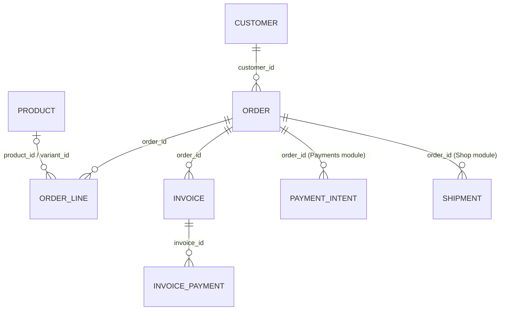
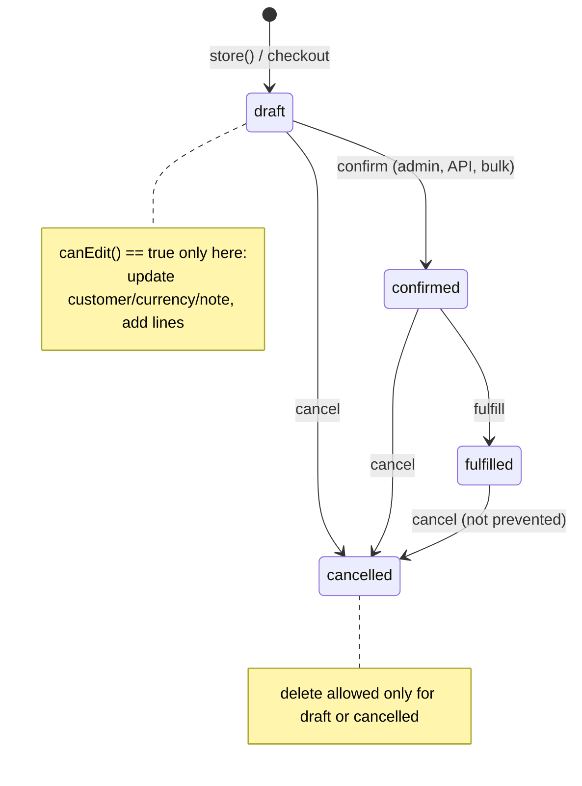

# Orders (`orders`)

Order and invoice management for the commerce stack. An **order** belongs to a [Customer](customers.md), carries priced **lines** (optionally linked to [Products](products.md)/variants), shipping and payment snapshots, JSON billing/shipping addresses and a status lifecycle `draft → confirmed → fulfilled | cancelled`. **Invoices** are created from confirmed/fulfilled orders, issued (numbered, due date, seller/buyer snapshot, SPAYD QR payload), rendered to PDF/HTML in `storage/invoices`, e-mailed to the customer and settled by **invoice payments**. The module reacts to `payment.intent_paid` from [Payments](payments.md) to auto-issue invoices, sends lifecycle e-mails on confirm/fulfil, and exposes REST APIs for orders and invoices. Store operators and accounting staff use it from *Obchod → Orders / Invoices*; [Shop](shop.md) checkout creates orders programmatically.

## At a glance

| | |
|---|---|
| Module id | `orders` |
| Version | `1.99.0` (`modules/Orders/module.php`, `OrdersModule::version()`) |
| Directory | `modules/Orders/` |
| Requires | `core ^1.0`, `customers ^1.0`, `products ^1.0`, `currency ^1.1`; optional: `documents ^1.0`, `notifications ^1.0` |
| Capabilities | provides `orders` (payload `Application/OrdersProvider`); consumed by [Shop](shop.md) (`CheckoutService`, requires `orders ^1.0`) and [Payments](payments.md) (`PaymentService`, `ImapBankMatcher` import `Order`) |
| Groups / packages | none in `module.php`; not in `config/module_groups.php` |
| Permissions | `orders.view` (View orders), `orders.manage` (Manage orders), `invoices.view` (View invoices), `invoices.manage` (Manage invoices) — all in group `perm.group.orders` |
| Menu group | `Obchod` |

## Domain model

| Entity | Table | Key fields | Enum values | Relations |
|---|---|---|---|---|
| `Domain/Order` | `orders` (indexes `idx_orders_customer (customer_id)`, `idx_orders_status (status)`; unique `uniq_orders_number (number)`) | `id: string(36)` UUIDv7; `customer_id: string(36)`; `number: string(64)` (`<prefix><YYYY>-<0001>`); `status: string(32)` default `draft`; `currency: string(3)` default `CZK`; `subtotal`, `tax_total`, `discount_total`, `total: decimal(14,2)`; `coupon_code: ?string(64)` (upper-cased); `shipping_method_code: ?string(64)`, `shipping_method_name: ?string(190)`, `shipping_price: decimal(14,2)`, `parcel_point_id: ?string(64)`, `parcel_point_label: ?string(190)`; `payment_method_code: ?string(64)`, `payment_method_name: ?string(190)`, `payment_status: string(32)` default `unpaid`; `tracking_number: ?string(128)`; `billing_address_json`, `shipping_address_json: ?text` (JSON arrays); `access_token_hash: ?string(64)` (public order lookup token, set by Shop); `note: ?text`; `created_at`, `updated_at` | `STATUSES = draft, confirmed, fulfilled, cancelled` (`setStatus()` throws `orders.error.invalid_status`); `payment_status` free string, values seen in code: `unpaid`, `paid`, `pending` | `customer_id` → `customers.id` |
| `Domain/OrderLine` | `order_lines` (index `idx_order_lines_order (order_id)`) | `id`; `order_id`; `product_id: ?string(36)`; `variant_id: ?string(36)`; `sku: ?string(64)` upper-cased; `title: string(190)`; `qty: decimal(18,4)`; `unit_price: decimal(14,2)`; `tax_rate: decimal(6,2)` (percent); `item_note: ?text`; `meta_json: ?text` (personalisation, see migration 000010) | — | `order_id` → `orders.id`; `product_id` → `products.id`; `variant_id` → `product_variants.id` |
| `Domain/Invoice` | `invoices` (index `idx_invoices_order (order_id)`; unique `uniq_invoices_number (number)`) | `id`; `order_id`; `number: string(64)`; `status: string(32)` default `draft`; `issued_at: ?datetime`; `due_at: ?date`; `total: decimal(14,2)`; `currency: string(3)` default `CZK`; `seller_json`, `buyer_json: ?text` (party snapshots: name, ico, dic, address, email, iban/account/bank_code); `payment_reference: ?string(64)` (= order number); `spayd_payload: ?text`; `created_at`, `updated_at` | `STATUSES = draft, issued, paid, cancelled` (`issue()`, `markPaid()`; `cancelled` never set in code) | `order_id` → `orders.id` |
| `Domain/InvoicePayment` | `invoice_payments` (index `idx_invoice_payments_invoice (invoice_id)`) | `id`; `invoice_id`; `amount: decimal(14,2)`; `paid_at: datetime`; `method: string(64)` (free text) | — | `invoice_id` → `invoices.id` |

### Order status state machine

`Order::setStatus()` only validates membership in `STATUSES`; **no transition guard exists** — any status may be set from any other (admin and API `confirm/fulfill/cancel` call it directly). Business rules are enforced around it:

* Every transition emits the specific event (`order.confirmed|fulfilled|cancelled`) **and** `order.updated`.
* `confirmed` / `fulfilled` trigger customer e-mails via `OrderMailer` (hook on `platform.event.dispatched`).
* Invoices can be created from an order only when its status is `confirmed` or `fulfilled` (`InvoiceController::createFromOrder`, `orders.error.invoice_order_status`).
* `payment_status` is separate: set to `paid` by `Payments\PaymentService::markPaid()`; by checkout via `setPayment(code, name, status)`.

### Totals computation (`Application/OrderTotals`, `Domain/OrderLine`)

* `OrderLine::lineSubtotal() = round(qty × unit_price, 2)`; `lineTax() = round(lineSubtotal × tax_rate / 100, 2)`; `lineTotal() = lineSubtotal + lineTax`.
* `OrderTotals::recalculate(Order, list<OrderLine>, discountTotal = '0')`: `subtotal = Σ lineSubtotal`, `tax_total = Σ lineTax`, `discount = max(0, discountTotal)`, `total = max(0, subtotal + tax − discount)` → `Order::setTotals(subtotal, tax, total, discount)`.
* Shipping price and payment fee are **not** included by `OrderTotals` — `shipping_price` is stored separately; Shop's checkout is responsible for adding shipping/fee lines or adjusting totals (see [Shop](shop.md)).
* Rounding is per line (2 dp) then summed; floats are used throughout and normalised with `number_format`.

### Invoices & PDF (`Application/InvoiceIssuingService`, `NumberSequencer`, `SimpleInvoicePdf`)

* Numbering: `NumberSequencer::nextOrderNumber()` / `nextInvoiceNumber()` = `sprintf('%s%s-%04d', prefix, year, count(existing with prefix+year) + 1)`; prefixes from settings `orders.number_prefix` (`ORD-`), `invoices.number_prefix` (`INV-`). Count-based, not lock-protected.
* `issueForOrder(Order, sendEmail = true)`: reuses an existing invoice for the order (issues it if still `draft`), otherwise creates one; `fillFromOrder()` copies currency/total, sets `payment_reference = order.number`, seller snapshot from `invoices.seller_*` + `payments.bank_*` settings, buyer from `billing_address_json` (fallback customer name/e-mail), builds SPAYD via `Modules\Payments\Application\SpaydBuilder` (VS = digits of invoice number); due date = +14 days; emits `invoice.issued` (only for newly created invoices); e-mails the customer with the PDF attached.
* `renderAndStore()`: renders `@orders/invoice_pdf.html.twig` (fallback inline HTML) to `storage/invoices/<number>.html`, then PDF via **Dompdf** when installed, else the dependency-free `SimpleInvoicePdf` (Helvetica, ASCII-transliterated, max ~55 lines). `pathFor()` returns PDF, else HTML.
* Manual flow: `createFromOrder` (draft) → `issue` (due date from form, default +14 d) → `recordPayment` (sums `invoice_payments`; when `Σ ≥ total − 0.001` → `markPaid()` + `invoice.paid`).

## Admin UI

### Menu & palette (`OrdersModule::boot()`)

| Kind | Id | Label key | Icon | Route / URL | Permission | Order |
|---|---|---|---|---|---|---|
| Menu item | `orders` | `nav.orders` | `cart` | `admin.orders.index` | `orders.view` | 30 (group `Obchod`) |
| Menu item | `orders.invoices` (parent `orders`) | `nav.invoices` | — | `admin.invoices.index` | `invoices.view` | 31 |
| Menu item (hidden) | `orders.create` (parent `orders`) | `nav.orders.create` | — | `admin.orders.create` | `orders.manage` | 32 |
| Palette | `orders.index` | `palette.orders.index` | `cart` | `/admin/orders` | `orders.view` | keywords objednávka, order, invoice |
| Palette | `invoices.index` | `palette.invoices.index` | `receipt` | `/admin/invoices` | `invoices.view` | keywords faktura, invoice |

### Routes (`register()`, middleware `auth`)

| Method | Path | Route name | Controller::action | Permission |
|---|---|---|---|---|
| GET | `/admin/orders` | `admin.orders.index` | `OrderController::index` | `orders.view` |
| GET | `/admin/orders/create` | `admin.orders.create` | `OrderController::create` | `orders.manage` |
| POST | `/admin/orders` | `admin.orders.store` | `OrderController::store` | `orders.manage` |
| POST | `/admin/orders/bulk` | `admin.orders.bulk` | `OrderController::bulk` | `orders.manage` |
| GET | `/admin/orders/{id}` | `admin.orders.show` | `OrderController::show` | `orders.view` |
| GET | `/admin/orders/{id}/edit` | `admin.orders.edit` | `OrderController::edit` | `orders.manage` |
| POST | `/admin/orders/{id}` | `admin.orders.update` | `OrderController::update` | `orders.manage` |
| POST | `/admin/orders/{id}/delete` | `admin.orders.destroy` | `OrderController::destroy` | `orders.manage` |
| POST | `/admin/orders/{id}/confirm` | `admin.orders.confirm` | `OrderController::confirm` | `orders.manage` |
| POST | `/admin/orders/{id}/fulfill` | `admin.orders.fulfill` | `OrderController::fulfill` | `orders.manage` |
| POST | `/admin/orders/{id}/cancel` | `admin.orders.cancel` | `OrderController::cancel` | `orders.manage` |
| POST | `/admin/orders/{id}/lines` | `admin.orders.lines.add` | `OrderController::addLine` | `orders.manage` |
| POST | `/admin/orders/{id}/shipment/create` | `admin.orders.shipment.create` | `OrderShipmentController::create` | `orders.manage` |
| POST | `/admin/orders/{id}/shipment/sync` | `admin.orders.shipment.sync` | `OrderShipmentController::sync` | `orders.manage` |
| GET | `/admin/invoices` | `admin.invoices.index` | `InvoiceController::index` | `invoices.view` |
| GET | `/admin/invoices/{id}` | `admin.invoices.show` | `InvoiceController::show` | `invoices.view` |
| POST | `/admin/invoices/from-order/{orderId}` | `admin.invoices.from_order` | `InvoiceController::createFromOrder` | `invoices.manage` |
| POST | `/admin/invoices/{id}/issue` | `admin.invoices.issue` | `InvoiceController::issue` | `invoices.manage` |
| POST | `/admin/invoices/{id}/payments` | `admin.invoices.pay` | `InvoiceController::recordPayment` | `invoices.manage` |
| GET | `/admin/invoices/{id}/pdf` | `admin.invoices.pdf` | `InvoiceController::pdf` | `invoices.view` |

### Screens

* **Orders list** (`Resources/views/orders/index.html.twig`) — `ListQuery`: search `number`, `note`, `shippingMethodName`, `paymentMethodName`; sortable `number`, `status`, `total`, `createdAt`, `updatedAt` (default `createdAt desc`); filters `status`, `customer`, `payment_status`, `currency` (distinct values from DB, fallback `CurrencyBuilder::activeCodes()`); bulk actions `confirm | fulfill | cancel | delete` (delete requires `confirmed=1` and only draft/cancelled orders).
* **Order form** (`orders/form.html.twig`) — customer (select, label `name · company`), currency, note; `?customer=<id>` preselects. Edit only while `canEdit()` (draft).
* **Order detail** (`orders/show.html.twig`) — header with status actions, lines (add-line form: product select of first 100 products, title, qty, unit price, tax rate), customer card, invoices of the order, shipments (when `Modules\Shop\Domain\Shipment` exists) with *create/sync shipment* buttons (`OrderShipmentController` → `Shop\Application\ShippingCarrierRegistry`, carrier guessed from `shipping_method_code`: `packeta`/`zasilkovna` → `packeta`, `ppl` → `ppl`, else `manual`).
* **Invoices list / detail** (`invoices/index.html.twig`, `invoices/show.html.twig`) — search `number`, filter `status`, sortable `number`, `status`, `total`, `createdAt`, `issuedAt`, `dueAt`; detail shows order, payments, issue form (due date), record-payment form (amount, method, paid_at), PDF link (inline `BinaryFileResponse`, PDF or HTML).
* **Customer page section** — filter `customers.show.sections` adds `orders.list` (order 35) rendering `partials/customer_orders.html.twig` with the last 10 orders (`OrdersProvider::forCustomer()`) for users with `orders.view`.

Validation rulesets: `orders.save` (`customer_id` required ≤36, `currency` ≤3, `note` ≤20000; bound to `Order` via `forms()->entity()`), `orders.line.save` (`product_id` ≤36, `title` ≤190, `qty` required, `unit_price` required, `tax_rate`), `orders.payment.save` (`amount` required, `method` required ≤64, `paid_at`), `orders.bulk` (`action` required ≤32, `confirmed`).

### Settings (`register()`, module `orders`)

| Key | Type | Default | Purpose |
|---|---|---|---|
| `orders.number_prefix` | string | `ORD-` | order numbering |
| `invoices.number_prefix` | string | `INV-` | invoice numbering |
| `invoices.seller_name` | string | `''` (falls back to `app.name`) | seller snapshot on invoices |
| `invoices.seller_ico` | string | `''` | |
| `invoices.seller_dic` | string | `''` | |
| `invoices.seller_address` | string | `''` | |
| `invoices.seller_email` | string | `''` | |
| `invoices.auto_issue_on_paid` | boolean | `true` | issue + e-mail invoice when `payment.intent_paid` arrives |

Also read: `payments.bank_iban`, `payments.bank_account`, `payments.bank_code` (from [Payments](payments.md)) for the seller bank details / SPAYD, `app.name`.

## Public / REST API

Two API modules (`registerApi()`); scopes `orders.read`, `orders.write`, `invoices.read`, `invoices.write`. See [API](../architecture/api.md).

| Method | Path | Scope | Controller::action | Notes |
|---|---|---|---|---|
| GET | `/api/v1/orders/` | `orders.read` | `Http/Api/OrderApiController::index` | `ApiQuery`: search `number`, `note`; filters `status`, `customer_id`, `currency`; sortable `number`, `status`, `total`, `createdAt` (default) |
| POST | `/api/v1/orders/` | `orders.write` | `store` | `orders.save`; 422 when customer unknown; generates number; emits `order.created`; 201 |
| GET | `/api/v1/orders/{id}` | `orders.read` | `show` | order + `lines[]` |
| PATCH | `/api/v1/orders/{id}` | `orders.write` | `update` | 409 `conflict` unless draft; full `orders.save` payload |
| DELETE | `/api/v1/orders/{id}` | `orders.write` | `destroy` | deletes lines + order — **no status check** (unlike admin) and no event |
| POST | `/api/v1/orders/{id}/confirm` | `orders.write` | `confirm` | emits `order.confirmed` + `order.updated` |
| POST | `/api/v1/orders/{id}/fulfill` | `orders.write` | `fulfill` | emits `order.fulfilled` + `order.updated` |
| POST | `/api/v1/orders/{id}/cancel` | `orders.write` | `cancel` | emits `order.cancelled` + `order.updated` |
| POST | `/api/v1/orders/{id}/lines` | `orders.write` | `addLine` | 409 unless draft; `orders.line.save`; recalculates totals; emits `order.updated`; 201 with line |
| GET | `/api/v1/invoices/` | `invoices.read` | `Http/Api/InvoiceApiController::index` | search `number`; filters `status`, `order_id`; sortable `number`, `status`, `total`, `createdAt` |
| POST | `/api/v1/invoices/` | `invoices.write` | `store` | body `order_id`; creates **draft** invoice with order total; 422 if order unknown; no status check on order |
| GET | `/api/v1/invoices/{id}` | `invoices.read` | `show` | |
| POST | `/api/v1/invoices/{id}/issue` | `invoices.write` | `issue` | 409 unless draft; optional `due_at`; emits `invoice.issued`; **does not render PDF** |
| POST | `/api/v1/invoices/{id}/payments` | `invoices.write` | `pay` | `orders.payment.save`; no status check; marks paid + `invoice.paid` when covered; 201 `{payment, invoice}` |

Serializers — order: `id, customer_id, number, status, currency, subtotal, tax_total, total, note, created_at, updated_at` (no shipping/payment/address fields); line: `id, order_id, product_id, title, qty, unit_price, tax_rate, line_total`; invoice: `id, order_id, number, status, issued_at, due_at (Y-m-d), total, created_at, updated_at`. Bodies accept form or JSON. No `/api/public/*` endpoints in this module (public order lookup via `access_token_hash` is implemented in [Shop](shop.md)).

## Events, hooks & webhooks

Platform events (`registerPlatformEvents()`, all `webhookEnabled(true)`, Czech literal descriptions):

| Event | Emitted from |
|---|---|
| `order.created` | admin `store`, API `store` (and Shop checkout) |
| `order.updated` | admin/API `update`, `addLine`, every status transition |
| `order.confirmed` / `order.fulfilled` / `order.cancelled` | admin `confirm/fulfill/cancel`, `bulk`, API transitions |
| `invoice.issued` | `InvoiceIssuingService::issueForOrder()` (new invoices only), admin `issue`, API `issue` |
| `invoice.paid` | admin `recordPayment`, API `pay` when payments cover the total |

Hooks added in `boot()`:

| Hook | Kind | Purpose |
|---|---|---|
| `customers.show.sections` | filter (`HookPriority::NORMAL`) | injects the customer's orders section |
| `platform.event.dispatched` | action | `registerOrderMailHooks()`: on `order.confirmed` → `OrderMailer::sendStatus(..., 'confirmed')`, on `order.fulfilled` → `'shipped'` (plain-text Czech e-mails, tracking number included) |
| `platform.event.dispatched` | action | `registerPaidInvoiceHook()`: on `payment.intent_paid` (from [Payments](payments.md)) and `invoices.auto_issue_on_paid = true` → `InvoiceIssuingService::issueForOrder($order, true)` |

Consumed by [Notifications](notifications.md) (`order.created`, `order.confirmed`, `invoice.issued`, `invoice.paid` are in its whitelist). Audit log: `orders.created|updated|deleted|status|confirmed|fulfilled|cancelled`, `invoices.created|issued|payment`. Queue jobs / scheduled tasks / publishables: none. Idempotency: `issueForOrder()` is idempotent per order (reuses the existing invoice); `recordPayment`/`pay` are not (each call appends a payment row). See [hooks, events & webhooks](../architecture/hooks-events-webhooks.md).

## Dashboard widgets

All registered in `boot()`; see [Dashboard widgets](../architecture/dashboard-widgets.md).

| Widget id | Type | Class | Shows | Permission | Order |
|---|---|---|---|---|---|
| `orders.create.hero` | hero (`hero_action.html.twig`) | `Application/Widgets/OrderCreateHeroWidget` | Call-to-action to `admin.orders.create` (`nav.orders.create`) | `orders.manage` | 10 |
| `orders.shortcut` | shortcut | `OrdersShortcutWidget` | Link to orders list | `orders.view` | 10 |
| `orders.invoices.shortcut` | shortcut | `InvoicesShortcutWidget` | Link to invoices list | `invoices.view` | 15 |
| `orders.revenue.chart` | panel (`chart_panel.html.twig`) | `OrderRevenueChartWidget` | 30-day revenue chart (`ChartSeries`), non-cancelled orders; stats: revenue sum, order count, daily average (formatted by `CurrencyBuilder`) | `orders.view` | 15 |
| `orders.status.chart` | panel (`chart_panel.html.twig`) | `OrderStatusChartWidget` | Order count per status (`GROUP BY status`), labels `orders.status.*` | `orders.view` | 16 |
| `orders.stats` | metric | `OrderStatsWidget` | Total orders; hint: open orders (`draft` + `confirmed`) | `orders.view` | 30 |
| `orders.revenue` | metric | `OrderRevenueWidget` | Σ `total` of non-cancelled orders created in last 30 days, formatted in default currency | `orders.view` | 35 |

## Services & extension points

| Class | Responsibility |
|---|---|
| `Application/OrdersProvider` | Capability payload; `forCustomer(customerId, limit = 10)`. |
| `Application/OrderTotals` | Static totals recalculation (see above). |
| `Application/NumberSequencer` | Order/invoice number generation from settings prefixes. |
| `Application/InvoiceIssuingService` | Invoice creation/issuing, HTML/PDF rendering, storage, e-mailing (constructor arg `basePath` → `storage/invoices`). |
| `Application/SimpleInvoicePdf` | Minimal PDF 1.4 writer used when Dompdf is absent. |
| `Application/OrderMailer` | Customer e-mails: templates `confirmed`, `fulfilled|shipped`, `review_request`, default. |
| `Http/OrderController`, `Http/InvoiceController`, `Http/OrderShipmentController` | Admin UI. |
| `Http/Api/OrderApiController`, `Http/Api/InvoiceApiController` | REST API. |

Cross-module integration:

* **Shop** (`modules/Shop/Application/CheckoutService.php`) creates `Order`/`OrderLine`s, sets shipping/payment/address snapshots and `access_token_hash`, and calls Payments to create an intent. `OrderShipmentController` depends directly on `Modules\Shop\Application\ShippingCarrierRegistry` and `Modules\Shop\Domain\Shipment` (guarded by `class_exists` in `OrderController::show`, **not** guarded in the shipment controller).
* **Payments**: `PaymentService::markPaid()` sets `Order::setPaymentStatus('paid')`; `InvoiceIssuingService` uses `SpaydBuilder` (hard import, Payments not declared as a dependency).
* **Customers**: hard dependency for customer lookup/validation; **Products**: product select when adding lines.

## CLI commands

None.

## Configuration & translations

Settings: table above. Env/config: `app.name` (via `Settings` then `Config`); mailer via Symfony `MailerInterface`; optional `dompdf/dompdf` package. Files are written to `<basePath>/storage/invoices/`.

Translations: `Resources/translations/messages.cs.php`, `messages.en.php`. Prefixes: `module.orders.description`, `nav.orders*`, `nav.invoices`, `palette.orders.index`, `palette.invoices.index`, `perm.orders.*`, `perm.invoices.*`, `perm.group.orders`, `orders.title|new|edit|search|empty`, `orders.status.*`, `orders.invoice.status.*`, `orders.field.*`, `orders.flash.*`, `orders.error.*`, `orders.bulk.*`, `orders.invoices.*`, `orders.settings.*` (+ `.help`). Dashboard chart/metric labels use core keys `admin.dashboard.chart.*`, `admin.dashboard.revenue`, `admin.dashboard.open_orders`, `admin.dashboard.hint.orders|invoices`. Twig namespace `@orders`; templates `invoice_pdf.html.twig` (PDF), `partials/customer_orders.html.twig`.

## Database migrations

| File | Purpose |
|---|---|
| `Database/Migrations/2026_01_01_000001_orders.php` | Empty `up()`/`down()`; tables `orders`, `order_lines`, `invoices`, `invoice_payments` are created by the platform schema sync (`src/Database/Migrator::syncSchema()` → Doctrine `SchemaTool`). |
| `Database/Migrations/2026_09_05_000010_order_line_personalization.php` | Adds nullable `item_note` and `meta_json` columns to `order_lines` (product personalisation data captured at checkout, see [Products](products.md)). |

## Notes

* No state-machine guards: `fulfilled → confirmed` or `cancelled → fulfilled` are possible via the confirm/fulfill/cancel endpoints; admin `edit`/`addLine` are blocked only for non-draft orders.
* API `DELETE /orders/{id}` ignores the draft/cancelled rule enforced in the admin controller and leaves invoices/payment intents referencing the deleted order.
* `NumberSequencer` derives the sequence from `COUNT(number LIKE prefix-year-%)`; concurrent creates or deleted orders can produce duplicate numbers (caught only by the unique index) or gaps.
* `OrderTotals` ignores `shipping_price`; the order total therefore depends on the caller adding shipping as a line or setting totals directly. The admin add-line path recalculates with `discountTotal = 0`, dropping any coupon discount previously stored on the order.
* `InvoiceIssuingService::issueForOrder()` skips `invoice.issued` when it issues a pre-existing draft invoice; API `issue` emits the event but never renders the PDF (rendered lazily on first `pdf` download).
* `InvoiceController::recordPayment` double-counts nothing but computes `Σ existing + new` before flush; the API `pay` variant ignores `paid_at`.
* E-mail bodies/subjects in `OrderMailer` and `InvoiceIssuingService::emailInvoice()` are hard-coded Czech strings (not translated); `SimpleInvoicePdf` output is ASCII-transliterated (no diacritics).
* `OrderShipmentController` flashes hard-coded Czech messages and imports Shop classes unconditionally — the route fails if Shop is disabled.
* Invoice `cancelled` status exists but has no transition; payment `method` on `InvoicePayment` is free text (not linked to `payment_methods`).
* Related: [Customers](customers.md), [Products](products.md), [Payments](payments.md), [Shop](shop.md), [Currency](currency.md), [Notifications](notifications.md), [Documents](documents.md), [MoneyS3](moneys3.md) / [iDoklad](idoklad.md) (accounting export candidates).
