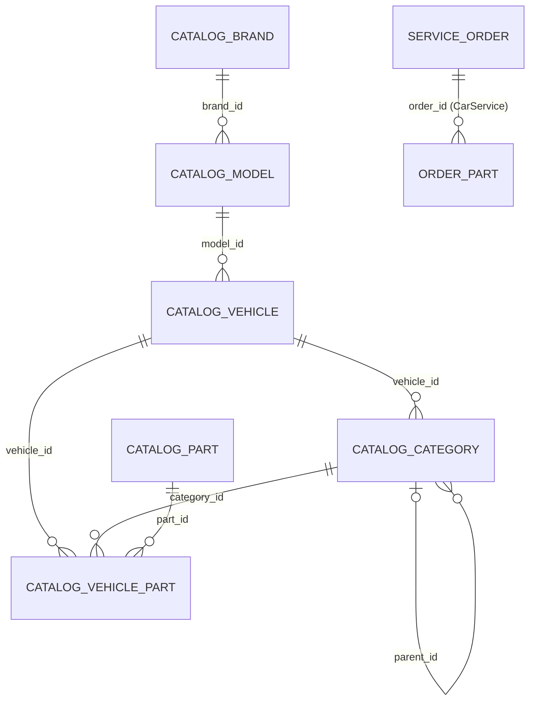

# PartsCatalog (`partscatalog`)

Spare-parts catalogue browser for the automotive service vertical. Mechanics pick a vehicle (from a [Fleet](fleet.md) vehicle, or brand → model → year from the Fleet vehicle catalogue), browse the engine-variant category tree, search by OEM/article number, open part detail pages and **attach parts to a [CarService](carservice.md) service order** (`OrderPart`). Catalogue data comes from a single scraping/AJAX provider — `autodily-jama.cz` (`JamaCatalogProvider`) — with a three-layer cache: normalised DB tables (`partscatalog_*`, filled by the `partscatalog:sync-jama` CLI dump), a raw API-response cache (`partscatalog_api_cache`), and per-request HTTP. Attached parts flow into iDoklad invoice items via a CarService hook. Optional integrations: [Media](media.md) (fleet photos, part image import), [SearchEngines](searchengines.md) (OEM price comparison links).

## At a glance

| | |
|---|---|
| Module id | `partscatalog` |
| Version | `1.99.0` (`modules/PartsCatalog/module.php`, `PartsCatalogModule::version()`; `README.md` still says v1.13.11) |
| Directory | `modules/PartsCatalog/` |
| Requires | `core ^1.0`, `currency ^1.1`; optional `carservice ^1.0`, `fleet ^1.0`, `media ^1.0`, `searchengines ^1.0` |
| Capabilities | provides `partscatalog` (payload `Application/PartsCatalogFacade`); consumes `media`, `searchengines` (guarded) |
| Groups / packages | `groups: ['ecs']` (`config/module_groups.php` → group `ecs`, label `admin.modules.group.ecs`) |
| Permissions | `partscatalog.view` (`perm.partscatalog.view`), `partscatalog.manage` (`perm.partscatalog.manage`) — group `perm.group.partscatalog` |
| Menu | children of `carservice` menu item |

## Domain model

| Entity | Table | Key fields | Enum values | Relations |
|---|---|---|---|---|
| `Domain/OrderPart` | `partscatalog_order_parts` (index `idx_pc_order_parts_order (order_id)`) | `id: string(36)`; `order_id: string(36)`; `oem: ?string(64)`; `brand: ?string(80)`; `name_cs: string(255)`; `name_original: ?string(255)`; `qty: decimal(10,2)` default `1`; `unit_price: ?decimal(12,2)`; `source: string(32)` (provider id, e.g. `jama`); `external_id: ?string(80)`; `created_at` | — | `order_id` → CarService `service_orders.id` |
| `Domain/CatalogBrand` | `partscatalog_brands` (unique `(provider, slug)`, index `provider`) | `id`; `provider: string(32)`; `slug: string(120)`; `name: string(160)`; `synced_at`; `created_at` | — | — |
| `Domain/CatalogModel` | `partscatalog_models` (unique `(brand_id, slug)`) | `id`; `brand_id`; `slug: string(180)`; `name: string(220)`; `synced_at`; `created_at` | — | `brand_id` → `partscatalog_brands.id` |
| `Domain/CatalogVehicle` | `partscatalog_vehicles` (unique `external_id`; indexes `model_id`, `sync_status`) | `id`; `model_id`; `external_id: string(255)` (`jama:<brand>:<model>:<motor>`); `motor_slug: string(180)`; `label: string(255)`; `path: string(320)`; `sync_status: string(24)`; `error_message: ?text`; `synced_at`; `created_at` | `STATUS_PENDING = pending`, `STATUS_CATEGORIES = categories`, `STATUS_PARTS = parts`, `STATUS_DONE = done`, `STATUS_ERROR = error` | `model_id` → `partscatalog_models.id` |
| `Domain/CatalogCategory` | `partscatalog_categories` (unique `(vehicle_id, path)`; indexes `vehicle_id`, `parent_id`) | `id`; `vehicle_id`; `parent_id: ?string(36)`; `path: string(400)`; `name: string(220)`; `has_children: bool`; `has_products: bool`; `synced_at`; `created_at` | — | `vehicle_id` → `partscatalog_vehicles.id`; `parent_id` self-reference |
| `Domain/CatalogPart` | `partscatalog_parts` (unique `(provider, external_id)`; indexes `oem`, `brand`) | `id`; `provider`; `external_id: string(255)`; `name: string(255)`; `oem: ?string(64)`; `brand: ?string(80)`; `image_url: ?string(500)`; `source_url: ?string(500)`; `attrs_json: ?text`; `synced_at`; `created_at` | — | — |
| `Domain/CatalogVehiclePart` | `partscatalog_vehicle_parts` (unique `(vehicle_id, category_id, part_id)`; indexes on each id) | `id`; `vehicle_id`; `category_id`; `part_id`; `created_at` | — | link table vehicle × category × part |
| `Domain/CatalogApiCache` | `partscatalog_api_cache` (unique `cache_key`; index `provider`) | `id`; `provider: string(32)`; `cache_key: string(64)` (hash); `logical_key: string(255)`; `payload_json: text`; `fetched_at` | — | — |

DTOs (`Application/Dto/`): `CatalogVehicleOption {id, label, hint, url}`, `CatalogNode {id, name, nameOriginal, hasChildren, hasProducts, children, icon}` (`withChildren()`, `withPresentation()`), `CatalogArticle {id, name, nameOriginal, oem, brand, imageUrl, mediaId, attrs}`, `CatalogProductDetail {id, name, oem, brand, price, description, properties, references, imageUrls, mediaIds, sourceUrl}`.

## Admin UI

### Menu & palette (`boot()`)

| Kind | Id | Label key | Icon | Route / URL | Permission | Order |
|---|---|---|---|---|---|---|
| Menu | `partscatalog` (parent `carservice`) | `nav.partscatalog` | `package` | `admin.partscatalog.browse` | `partscatalog.view` | 54 |
| Menu | `partscatalog.settings` (parent `carservice`) | `nav.partscatalog.settings` | `settings` | `admin.partscatalog.settings` | `partscatalog.manage` | 55 |
| Palette | `partscatalog.browse` | `palette.partscatalog.browse` | `package` | `/admin/parts-catalog` | `partscatalog.view` | keywords díly, katalog, autodoc, tecdoc, oem, náhradní |

### Routes (`register()`, middleware `auth`)

| Method | Path | Route name | Controller::action | Permission |
|---|---|---|---|---|
| GET | `/admin/parts-catalog` | `admin.partscatalog.browse` | `Http/CatalogController::browse` | `partscatalog.view` |
| GET | `/admin/parts-catalog/settings` | `admin.partscatalog.settings` | `CatalogController::settings` | `partscatalog.manage` |
| POST | `/admin/parts-catalog/settings` | `admin.partscatalog.settings.update` | `CatalogController::updateSettings` | `partscatalog.manage` |
| GET | `/admin/parts-catalog/detail` | `admin.partscatalog.detail` | `CatalogController::detail` | `partscatalog.view` |
| POST | `/admin/parts-catalog/attach` | `admin.partscatalog.attach` | `CatalogController::attach` | `partscatalog.manage` |
| POST | `/admin/parts-catalog/parts/{id}/delete` | `admin.partscatalog.detach` | `CatalogController::detach` | `partscatalog.manage` |

### Screens

* **Browse** (`Resources/views/browse/index.html.twig`) — query params: `fleet` (Fleet vehicle id → *fleet mode*, brand/model/year picker disabled, catalogue engine variants ranked by `filterVehiclesForFleet()` scoring year/fuel/kW/displacement/engine code), `brand`/`car`/`year` (Fleet `VehicleBrand`/`VehicleModel` catalogue cascade), `vehicle` (catalogue vehicle id `jama:<brand>:<model>:<motor>`), `parent`/`node` (category path), `q`/`oem` (article search; vehicle-scoped via synced parts + api cache, else global `searchByArticle` with api-cache fallback), `gq` (group filter), `order_id` (target service order for *attach*), `history_forget`. Shows fleet vehicles with photos, category tree (one level of children preloaded from DB/cache only, localised via `CategoryTaxonomy`), product list, search results, session-based search history (`partscatalog.search_history`, max 24 entries, brand logos via `Fleet\Application\VehicleCatalogClient`), breadcrumbs, OEM price-comparison context (`SearchEngines`), attribution. Session lock is released before outbound HTTP (`releaseSessionLock()`).
* **Detail** (`browse/detail.html.twig`) — `p=<product path>` → `PartsCatalogFacade::productDetail()`; back link preserves browse context.
* **Settings** (`settings.html.twig`) — single field `partscatalog.jama.base_url` (`SETTING_KEYS`), posted as `partscatalog__jama__base_url`. Translations contain labels for FAPI/Srotas/Tambov/AUTODOC/TecDoc sections that are **not** backed by settings definitions or code.
* **Attach / detach** — `attach` creates an `OrderPart` (fields `order_id`, `name`, `source`, `oem`, `brand`, `name_original`, `qty` 1..9999, `external_id`, `unit_price|price`), refuses when the CarService order is not open (`partscatalog.error.order_locked`); returns JSON `{ok, id}` for `Accept: application/json`/`ajax`, otherwise redirects to `admin.carservice.show`. `detach` removes an `OrderPart` under the same lock rule.
* **CarService order section** — filter `carservice.order.show.sections` adds `partials/order_parts.html.twig` (id `partscatalog`, order 55) listing the order's parts with a *browse* link `?order_id=`; editable only when the order is open.

No validation rulesets are registered; `attach` parses the request manually.

## Public / REST API

None. (No `$context->api()->module(...)` registration and no `/api/public/*` routes.)

## Events, hooks & webhooks

* Platform events: none registered.
* Hooks added (`registerHooks()`, only when `Modules\CarService\Domain\ServiceOrder` exists):
  * filter `carservice.order.show.sections` (`HookPriority::NORMAL`) — order-parts section (requires `partscatalog.view`).
  * filter `carservice.idoklad.invoice_items` (`HookPriority::NORMAL`) — appends one iDoklad item per `OrderPart` (`Name` = name · OEM (brand), `Amount` = max(0.01, qty), `Unit` = `ks`, `UnitPrice` = unit_price or 0). See [iDoklad](idoklad.md) / [CarService](carservice.md).
* Queue jobs / scheduled tasks / publishables / webhooks: none. Audit log: none.
* File log: `Application/CatalogCallLogger` appends every browse/provider/HTTP call to `storage/logs/partscatalog.log`.

## Dashboard widgets

| Widget id | Type | Class | Shows | Permission | Order |
|---|---|---|---|---|---|
| `partscatalog.stats` | metric | `Application/Widgets/PartsCatalogStatsWidget` | Count of synced `CatalogPart` rows; hint = last `synced_at` (`partscatalog.widget.stats.hint_synced`) or `hint_never` | `partscatalog.view` | 68 |
| `partscatalog.recent_parts` | panel (`list_panel.html.twig`) | `PartsCatalogRecentPartsWidget` | Last 8 `OrderPart`s (name, OEM/brand, qty hint) + total value formatted by `CurrencyBuilder`; link to browse | `partscatalog.view` | 34 |

See [Dashboard widgets](../architecture/dashboard-widgets.md).

## Services & extension points

| Class | Responsibility |
|---|---|
| `Application/Provider/CatalogProviderInterface` | Provider contract: `id()`, `isConfigured()`, `vehicles(?query)`, `tree(vehicleId, ?parentNodeId)`, `products(vehicleId, nodeId)`. |
| `Application/Provider/JamaCatalogProvider` | Only implementation (`id() = 'jama'`). Scrapes `autodily-jama.cz` SSR pages + `getProducts` AJAX via `HttpJsonClient` (cURL, browser UA, cookie jar); `BRAND_PATHS` map (Škoda, VW, Audi, Seat, Ford, Opel, Renault, Peugeot, Citroën, Fiat, Mercedes, BMW, Hyundai, Kia, Toyota); limits `MAX_VEHICLES = 60`, `MAX_PRODUCTS = 120`; `listAllBrands/Models/Motors()` for sync; `treesFromCache()` (TTL 7 days); `searchByArticle()`, `suggestVehicleId()`, `productDetail()`, `softError()` (non-fatal message surfaced in UI). |
| `Application/PartsCatalogFacade` | Capability payload; delegates to Jama, reads/writes `CategoryTreeStore` first (`tree()`, `treesLocal()`), `providersMeta()`, `activeProviderId()`. |
| `Application/CategoryTreeStore` | Persists category nodes per vehicle into `partscatalog_categories`; `tryLoad`, `tryLoadMany`, `remember`. |
| `Application/CatalogApiCacheStore` | Raw response cache in `partscatalog_api_cache` (`prefetch`, `getDecoded(provider, key, ttl)`, `remember`, `searchProducts`, `searchProductsForVehicle`, `listRecentProducts`). |
| `Application/JamaCatalogSync` | Full catalogue dump into normalised tables with resume via `CatalogVehicle.sync_status` (`pending → categories → parts → done | error`); options brand filter, structure-only, parts-only, vehicle limit, delay. |
| `Application/CategoryTaxonomy` | Static map of Jama category slugs → i18n labels (`partscatalog.category.*`) + icons; `resolve()`, `leafSlug()`. |
| `Application/PartsCatalogImageService` | Imports part images into Media via `MediaImporter` (idempotent), `publicUrl()`. |
| `Application/HttpJsonClient` | Thin HTTP client (JSON/HTML) logging to `storage/logs/partscatalog.log`. |
| `Application/CatalogCallLogger` | Static append-only logger. |

Integrations (all guarded by `class_exists` / `CapabilityRegistry::has`): [CarService](carservice.md) (`ServiceOrder::isOpen()` lock, order sections, iDoklad items), [Fleet](fleet.md) (`Vehicle`, `VehicleBrand`, `VehicleModel`, `VehicleCatalogClient::logoUrl()` — note: `VehicleCatalogClient` is a **hard constructor dependency** of `CatalogController`), [Media](media.md) (`MediaProvider::forEntity('fleet_vehicle', …)`, `admin.media.file`), [SearchEngines](searchengines.md) (`SearchEnginesProvider::availableSourceIds()`, routes `admin.searchengines.search|offers`, filtered by setting `carservice.market_sources`).

## CLI commands

| Command | Class | Purpose |
|---|---|---|
| `partscatalog:sync-jama [--brand=<slug>] [--structure-only] [--parts-only] [--limit-vehicles=N] [--delay-ms=200]` | `Console/SyncJamaCatalogCommand` → `JamaCatalogSync::sync()` | Downloads brands, models, motorisations, categories and parts from autodily-jama.cz into `partscatalog_*` tables; resumable per vehicle; prints stats (brands, models, vehicles, categories, parts, links, vehicles_done, vehicles_error, soft_error). |

## Configuration & translations

| Setting | Type | Default | Used by |
|---|---|---|---|
| `partscatalog.jama.base_url` | string | `https://www.autodily-jama.cz` | `JamaCatalogProvider`, settings screen |

Also read: `carservice.market_sources` (default `heureka,seznam,hledejceny,jama,autodilypro,autokelly`). No env vars. Files: `storage/logs/partscatalog.log`. Session key `partscatalog.search_history`.

Translations: `Resources/translations/messages.cs.php`, `messages.en.php`. Prefixes: `module.partscatalog.description`, `nav.partscatalog*`, `palette.partscatalog.browse`, `perm.partscatalog.*`, `perm.group.partscatalog`, `partscatalog.browse.*` (55 keys), `partscatalog.category.*` (55 taxonomy labels), `partscatalog.settings.*` (27), `partscatalog.detail.*`, `partscatalog.widget.*`, `partscatalog.col.*`, `partscatalog.action.*`, `partscatalog.partial.*`, `partscatalog.flash.*`, `partscatalog.error.*`, `partscatalog.oem_market.*`, `partscatalog.confirm`, `partscatalog.attribution`. Twig namespace `@partscatalog`.

## Database migrations

| File | Purpose |
|---|---|
| `Database/Migrations/2026_09_05_000001_partscatalog_order_parts.php` | `up()` no-op (table `partscatalog_order_parts` comes from Doctrine SchemaTool); `down()` drops it. |
| `Database/Migrations/2026_09_05_000002_partscatalog_api_cache.php` | Same pattern for `partscatalog_api_cache`. |
| `Database/Migrations/2026_09_06_000003_partscatalog_catalog_tables.php` | Same pattern for `partscatalog_brands`, `partscatalog_models`, `partscatalog_vehicles`, `partscatalog_categories`, `partscatalog_parts`, `partscatalog_vehicle_parts`. |
| `Database/Migrations/2026_09_06_000004_partscatalog_order_part_price.php` | Marker for `partscatalog_order_parts.unit_price` (SchemaTool-managed). |

## Notes

* Only the Jama provider exists in code. Translation keys (`partscatalog.settings.fapi_*`, `srotas_*`, `tambov_*`, `autodoc_*`, `tecdoc_*`, `module.partscatalog.description` = "FAPI + Srotas / Tambov / AU.C / TecDoc") and `HttpJsonClient`'s docblock describe providers that are not implemented; `PartsCatalogFacade::provider()` ignores its `$id` argument.
* `CatalogController` requires `Modules\Fleet\Application\VehicleCatalogClient` in its constructor although `fleet` is only an optional dependency — the controller cannot be instantiated without the Fleet module.
* `OrderPart` has no FK to CarService and stores `unit_price` without currency; the iDoklad hook assumes unit `ks`.
* `attach` does no server-side validation ruleset; `qty` is rounded to an integer despite the `decimal(10,2)` column.
* Vehicle ids and node ids are provider-prefixed strings (`jama:…`, category paths); stale ids from other providers (`cat:`, `mod:`, `motor:`) are dropped in `browse`.
* Scraping relies on the third-party site's HTML/AJAX structure and a hard-coded desktop Chrome user agent; failures surface as `softError()` messages rather than exceptions.
* `CatalogCallLogger` writes to a fixed path resolved from `__DIR__` (see comment questioning the `dirname` depth in `Application/CatalogCallLogger.php`).
* Related docs: [CarService](carservice.md), [Fleet](fleet.md), [Media](media.md), [SearchEngines](searchengines.md), [iDoklad](idoklad.md), [module system](../architecture/module-system.md).
