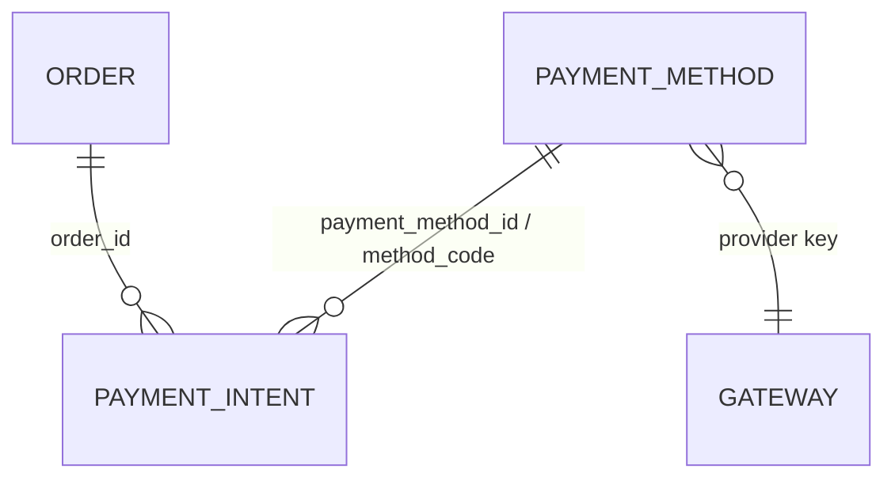

# Payments (`payments`)

Payment infrastructure for the commerce stack: **payment methods** (bank transfer, card, COD, online, wallet — each with fixed/percent fees and an optional provider key) and **payment intents** (one attempt to collect the total of an [Order](orders.md) through a gateway). The module ships a provider-agnostic `PaymentGatewayInterface` + `PaymentGatewayRegistry` and one built-in driver, `ManualBankGateway` (offline bank transfer with SPAYD QR payload and variable symbol). Real gateways — Comgate, Stripe, GoPay — live in `integrations/` and register themselves into the registry; their public notify endpoints and the [Webhooks](webhooks.md) inbound registry mark intents paid. A CLI IMAP matcher can auto-match bank e-mails to pending intents. Shop administrators manage methods under *Obchod → Payment methods*; checkout ([Shop](shop.md)) creates intents; [Orders](orders.md) listens to `payment.intent_paid`.

## At a glance

| | |
|---|---|
| Module id | `payments` |
| Version | `1.99.0` (`modules/Payments/module.php`, `PaymentsModule::version()`) |
| Directory | `modules/Payments/` |
| Requires | `core ^1.0`, `currency ^1.1`; optional: `comgate ^1.0`, `stripe ^1.0`, `gopay ^1.0`, `webhooks ^1.0` |
| Capabilities | provides `payments` (payload `Application/PaymentsProvider`) and `payment_gateways` (payload `Application/PaymentGatewayRegistry`); consumed by `modules/Shop/Application/CheckoutService.php` (`PaymentService`, `PaymentsProvider`), `modules/Orders/Application/InvoiceIssuingService.php` (`SpaydBuilder`), `integrations/Comgate|Stripe|GoPay` (registry) |
| Groups / packages | none in `module.php`; not in `config/module_groups.php`. The gateway integrations form plugin group `plugin.payments` ("Platby": `comgate`, `stripe`, `gopay`) in `config/module_groups.php`. |
| Permissions | `payments.view` (View payment methods), `payments.manage` (Manage payment methods) — group `perm.group.payments` |
| Menu group | `Obchod` |

## Domain model

| Entity | Table | Key fields | Enum values | Relations |
|---|---|---|---|---|
| `Domain/PaymentMethod` | `payment_methods` (unique `uniq_payment_methods_code (code)`; migration also adds `idx_payment_methods_active_sort (is_active, sort_order)`) | `id: string(36)` UUIDv7; `code: string(64)` upper-cased; `name: string(190)`; `type: string(32)` default `bank_transfer`; `provider: ?string(64)` gateway key (`manual`, `comgate`, `stripe`, `gopay`…); `fee_fixed: decimal(14,2)`; `fee_percent: decimal(8,4)`; `currency: string(3)` default `CZK`; `sort_order: int`; `instructions: ?text`; `is_active: bool` (property `active`); `created_at`, `updated_at` | `TYPES = bank_transfer, card, cod, online, wallet` (unknown → `bank_transfer`) | none (referenced by `payment_intents.payment_method_id`) |
| `Domain/PaymentIntent` | `payment_intents` (indexes `idx_payment_intents_order (order_id)`, `idx_payment_intents_status (status)`, `idx_payment_intents_external (provider, external_id)`) | `id`; `order_id: string(36)`; `payment_method_id: ?string(36)`; `method_code: string(64)`; `provider: string(64)` default `manual`; `amount: decimal(14,2)`; `currency: string(3)`; `status: string(32)` default `pending`; `external_id: ?string(190)` (gateway transaction id); `redirect_url: ?text`; `payment_reference: ?string(64)` (variable symbol); `spayd_payload: ?text`; `meta_json: ?text` (JSON, accessed via `meta()`); `paid_at`; `created_at`; `updated_at` | `STATUSES = pending, redirect, paid, failed, cancelled, refunded` (`setStatus()` validates; `paid` stamps `paid_at` once; `markPaid(?externalId)`) | `order_id` → `orders.id`; `payment_method_id` → `payment_methods.id` |

`PaymentMethod::feeForAmount(amount)` = `max(0, fee_fixed + amount × fee_percent / 100)` rounded to 2 dp — used by checkout to add a payment fee line. `PaymentMethod` has `#[FormEntity('payments.method.save')]` / `#[FormGenerator(cols: 2)]` metadata (code, name, type select, provider with hint, fees, currency, sort order, instructions textarea, active switch).

### Intent lifecycle

```mermaid
stateDiagram-v2
    [*] --> pending : createForOrder() (manual / COD)
    [*] --> redirect : createForOrder() (gateway returned redirect)
    pending --> paid : markPaid() (admin API, IMAP match, gateway notify)
    redirect --> paid : gateway notify status=paid
    redirect --> failed : gateway notify
    redirect --> cancelled : gateway notify
    pending --> failed
    pending --> cancelled
    paid --> refunded : (status exists; no code path sets it)
```

## Admin UI

### Menu & palette (`PaymentsModule::boot()`)

| Kind | Id | Label key | Icon | Route / URL | Permission | Order |
|---|---|---|---|---|---|---|
| Menu item | `payments` | `nav.payments` ("Payment methods") | `credit-card` | `admin.payments.methods.index` | `payments.view` | 32 (group `Obchod`) |
| Menu item (hidden) | `payments.methods.create` (parent `payments`) | `nav.payments.methods.create` | — | `admin.payments.methods.create` | `payments.manage` | 33 |
| Palette | `payments.methods` | `palette.payments.methods` | `credit-card` | `/admin/payments/methods` | `payments.view` | keywords: platba, payment, platební |

### Routes (`register()`, group `/admin/payments/methods`, middleware `auth`)

| Method | Path | Route name | Controller::action | Permission |
|---|---|---|---|---|
| GET | `/admin/payments/methods` | `admin.payments.methods.index` | `PaymentMethodController::index` | `payments.view` |
| GET | `/admin/payments/methods/create` | `admin.payments.methods.create` | `PaymentMethodController::create` | `payments.manage` |
| POST | `/admin/payments/methods` | `admin.payments.methods.store` | `PaymentMethodController::store` | `payments.manage` |
| GET | `/admin/payments/methods/{id}/edit` | `admin.payments.methods.edit` | `PaymentMethodController::edit` | `payments.manage` |
| POST | `/admin/payments/methods/{id}` | `admin.payments.methods.update` | `PaymentMethodController::update` | `payments.manage` |
| POST | `/admin/payments/methods/{id}/delete` | `admin.payments.methods.destroy` | `PaymentMethodController::destroy` | `payments.manage` |

### Screens

* **Methods list** (`Resources/views/methods/index.html.twig`) — all methods ordered by `sort_order, code`; `?q=` search across `code`, `name`, `provider` (`self_repair_search`).
* **Method form** (`methods/form.html.twig`) — generated from entity form metadata; code uniqueness enforced in `store()`/`update()` (422 `payments.error.code_taken`); currency normalised through `Modules\Currency\Application\CurrencyBuilder::code()`. Audit: `payments.method.created|updated|deleted` (update logs old/new code+name).
* There is **no admin screen for payment intents** — they are visible only via dashboard widgets, the REST API and the order detail in [Orders](orders.md).

### Settings

Defined in `register()` (module `payments`), edited via the core settings UI (no module-specific settings page):

| Key | Type | Default | Used by |
|---|---|---|---|
| `payments.bank_iban` | string | `''` | `ManualBankGateway` → SPAYD `ACC` |
| `payments.bank_account` | string | `''` | `ManualBankGateway` (converted to IBAN when IBAN empty) |
| `payments.bank_code` | string | `''` | same |
| `payments.bank_recipient` | string | `''` (falls back to `app.name`, then `GEREQ`) | SPAYD `RN` |
| `payments.imap_mailbox` | string | `''` | `ImapBankMatcher` (e.g. `{imap.example.com:993/imap/ssl}INBOX`) |
| `payments.imap_user` | string | `''` | `ImapBankMatcher` |
| `payments.imap_password` | encrypted | `''` | `ImapBankMatcher` |

Translations also contain labels for `payments.settings.comgate_*`, `gopay_*`, `stripe_*` keys — those settings are defined by the respective integration modules, not here.

## Public / REST API

`$context->api()->module('payments', …)`; scopes `payments.read`, `payments.write`. See [API](../architecture/api.md).

| Method | Path | Scope | Controller::action | Notes |
|---|---|---|---|---|
| GET | `/api/v1/payments/methods` | `payments.read` | `Http/Api/PaymentMethodApiController::index` | **active methods only**; `ApiQuery` search (`code`, `name`, `provider`), filters `type`, `provider`, sortable `code`, `name`, `sortOrder` (default), `createdAt`; secondary sort `code` |
| POST | `/api/v1/payments/methods` | `payments.write` | `store` | ruleset `payments.method.save`; 422 `Code taken`; emits `payment.method_created`; 201 |
| GET | `/api/v1/payments/methods/{id}` | `payments.read` | `show` | |
| PATCH | `/api/v1/payments/methods/{id}` | `payments.write` | `update` | full payload required (`code`, `name`, `type` are `required`); emits `payment.method_updated` |
| DELETE | `/api/v1/payments/methods/{id}` | `payments.write` | `destroy` | emits `payment.method_deleted` |
| GET | `/api/v1/payments/intents/{id}` | `payments.read` | `Http/Api/PaymentIntentApiController::show` | |
| POST | `/api/v1/payments/intents/{id}/mark-paid` | `payments.write` | `markPaid` | `PaymentService::markPaid()` — sets intent `paid`, order `payment_status = paid`, emits `payment.intent_paid` |
| GET | `/api/v1/payments/orders/{orderId}/intents` | `payments.read` | `forOrder` | last 20 intents of an order, newest first |

Serializers — method: `id, code, name, type, provider, fee_fixed, fee_percent, currency, instructions, sort_order, active, created_at, updated_at`; intent (`PaymentService::serialize()`): `id, order_id, method_code, provider, amount, currency, status, external_id, redirect_url, payment_reference, spayd_payload, meta, paid_at, created_at`.

### Public notify / return endpoints (provided by integrations)

The Payments module itself registers **no** unauthenticated routes. Gateway integrations add public (no Bearer) notify routes on the same prefix and delegate to an `*InboundProvider` that calls `gateway->handleNotify()` and then `PaymentService::markPaid()` / `setStatus('failed'|'cancelled')`:

| Integration | Route | Methods | Name |
|---|---|---|---|
| `integrations/Comgate` | `/api/v1/payments/notify/comgate` | GET, POST | `api.payments.notify.comgate` |
| `integrations/Stripe` | `/api/v1/payments/notify/stripe` | POST | `api.payments.notify.stripe` |
| `integrations/GoPay` | `/api/v1/payments/notify/gopay` | GET, POST | `api.payments.notify.gopay` |

Each integration also registers a `payment.gateway.<key>` capability and an inbound webhook provider with `InboundWebhookRegistry` when the Webhooks module is present. Details: [`../integrations/payments.md`](../integrations/payments.md).

## Events, hooks & webhooks

Platform events (`registerPlatformEvents()`, all `webhookEnabled(true)`, Czech literal descriptions):

| Event | Emitted from |
|---|---|
| `payment.method_created` | admin `store`, API `store` |
| `payment.method_updated` | admin `update`, API `update` |
| `payment.method_deleted` | admin `destroy`, API `destroy` |
| `payment.intent_created` | `PaymentService::createForOrder()` |
| `payment.intent_paid` | `PaymentService::markPaid()` — consumed by `modules/Orders/OrdersModule.php` (hook on `platform.event.dispatched`, marks the order paid / issues invoice; see [Orders](orders.md)) |

Additionally `ImapBankMatcher::run()` emits `payment.imap_scan` (`{matched, scanned}`) which is **not** registered as an `EventDefinition`.

Hooks: none added by this module. Queue jobs / scheduled tasks: none (IMAP matching is a CLI command meant for cron). Publishables: none.

**Idempotency of financial POSTs:** `PaymentIntent::setStatus('paid')` only stamps `paid_at` the first time; `*InboundProvider`s skip `markPaid()` when the intent is already `paid` (`$intent->status() !== 'paid'` guard). `POST /intents/{id}/mark-paid` has no idempotency-key handling of its own — repeated calls re-emit `payment.intent_paid` and re-set order `payment_status`. Checkout-level idempotency lives in `modules/Shop/Http/Api/CheckoutApiController.php` (`src/Api/IdempotencyService.php`), not here. See [hooks, events & webhooks](../architecture/hooks-events-webhooks.md).

## Dashboard widgets

| Widget id | Type | Class | Shows | Permission | Order |
|---|---|---|---|---|---|
| `payments.shortcut` | shortcut | `Application/Widgets/PaymentsShortcutWidget` | Link to methods list, icon `credit-card`, hint `admin.dashboard.hint.payments` | `payments.view` | 40 |
| `payments.stats` | metric | `Application/Widgets/PaymentStatsWidget` | Intents `paid` this month (by `paid_at`); hint: active methods count · pending/redirect intents | `payments.view` | 46 |
| `payments.recent` | panel (`list_panel.html.twig`) | `Application/Widgets/RecentPaymentsWidget` | Last 8 intents: amount + currency, method code · provider · VS, status badge (`ok/warn/danger/muted`), icon per status | `payments.view` | 30 |

Registered in `boot()`. See [Dashboard widgets](../architecture/dashboard-widgets.md).

## Services & extension points

| Class | Responsibility |
|---|---|
| `Application/PaymentGatewayInterface` | Contract for gateway drivers: `key(): string`; `createPayment(PaymentIntent, PaymentMethod, array $context): array{status, redirect_url, external_id, payment_reference, spayd_payload, meta}`; `handleNotify(array $payload): array{ok, status, external_id, message}`. Context passed by `PaymentService` includes `order_number`, `order_id` plus caller data (`return_url`, `customer_email`, …). |
| `Application/PaymentGatewayRegistry` | Keyed registry (`register()`, `get(key)`, `getOrManual(key)` → falls back to `manual` or throws `payments.error.no_gateway`, `all()`). Exposed as capability `payment_gateways`. Implemented by `integrations/Comgate/Application/ComgateGateway`, `integrations/Stripe/Application/StripeGateway`, `integrations/GoPay/Application/GoPayGateway`. |
| `Application/Gateways/ManualBankGateway` | Key `manual`. Derives the variable symbol from `order_number` digits (fallback: first 10 alphanumerics of the order id / intent id), builds a SPAYD payload for `bank_transfer` methods when bank settings exist, returns `status = pending` with `meta {instructions, type}`. `handleNotify()` always returns `ok = false`. |
| `Application/PaymentService` | Orchestrator: `createForOrder(Order, methodCode, context)` (validates active method, resolves gateway from `method.provider`, persists intent with order total/currency, applies gateway result, emits `payment.intent_created`); `markPaid(intent, ?externalId)` (intent + `Order::setPaymentStatus('paid')` + `payment.intent_paid`); `serialize()`. |
| `Application/PaymentsProvider` | Capability `payments`: `find(id)`, `findByCode(code)`, `activeMethods()` (ordered `sortOrder, name`). |
| `Application/SpaydBuilder` | Czech Short Payment Descriptor: `build([...])` → `SPD*1.0*ACC:…*AM:…*CC:…*X-VS:…*MSG:…*RN:…`; `czechAccountToIban(account, bankCode)` (prefix-number parsing, mod-97 check). Also used by `Orders\Application\InvoiceIssuingService` for invoice QR codes. |
| `Application/ImapBankMatcher` | Polls `UNSEEN` messages via ext-imap, extracts a 4–16 digit VS and optional amount (`CZK|Kč|EUR`), matches `payment_intents.payment_reference` (status `pending`) or falls back to `orders.number`, rejects if amount differs by > 0.05, marks paid with `external_id = imap:<vs>` and flags the mail `\Seen`. |

### Integrating a new gateway

1. Implement `PaymentGatewayInterface` in an integration module; `key()` must match the `provider` value administrators enter on a payment method.
2. In `register()`: `$context->get(PaymentGatewayRegistry::class)->register($gateway)`.
3. Add a public notify route (`/api/v1/payments/notify/<key>`) whose handler calls `handleNotify()` and `PaymentService::markPaid()` (see `integrations/Comgate/Application/ComgateInboundProvider.php` for the reference flow), optionally registering an inbound webhook provider.

## CLI commands

| Command | Class | Purpose |
|---|---|---|
| `payments:imap-match [--limit=50]` | `Console/ImapMatchCommand` | Runs `ImapBankMatcher::run()`; prints `IMAP: <message> — scanned N, matched M`; exit code 0 for `ok` / `IMAP not configured`, 1 otherwise (missing ext-imap, connect failure). Intended for cron. |

## Configuration & translations

Settings: see table above (`payments.bank_*`, `payments.imap_*`). Env vars: none read directly. Requires PHP `imap` extension for the matcher.

Translations: `Resources/translations/messages.cs.php`, `messages.en.php`. Prefixes: `module.payments.description`, `nav.payments*`, `palette.payments.methods`, `perm.payments.*`, `perm.group.payments`, `payments.methods.*`, `payments.field.*`, `payments.type.*`, `payments.active|inactive`, `payments.error.*`, `payments.flash.*`, `payments.settings.*` (incl. `.help`), `payments.widget.*` (incl. `status.*`). `admin.dashboard.hint.payments` is a core key. Twig namespace `@payments`.

## Database migrations

| File | Purpose |
|---|---|
| `Database/Migrations/2026_01_01_000001_payment_methods.php` | Creates `payment_methods` (all columns, PK, unique `code`, index `is_active + sort_order`) if missing. `payment_intents` has no file migration — it is created by the platform schema sync (`src/Database/Migrator::syncSchema()`). |

## Notes

* `README.md` states `v1.3.2` while the manifest is `1.4.0`.
* `Resources/views/methods/Untitled` is an empty stray file.
* `ManualBankGateway::createPayment()` contains a no-op ternary (`$method->type() === 'cod' ? 'pending' : 'pending'`).
* `PaymentService` hard-imports `Modules\Orders\Domain\Order` although `orders` is not declared in `requires`/`optional` of `module.php`; the module cannot function for intents without Orders installed.
* `payment.imap_scan` is emitted without a registered `EventDefinition`, so it cannot be webhook-enabled via the platform registry.
* `ImapBankMatcher::matchMessage()` takes the **first** 4–16 digit token in subject+body as the VS — bank e-mails containing account numbers or dates before the VS may mismatch; only the first match is attempted per message.
* Refund status exists on the intent but no service or endpoint transitions to `refunded`.
* Translations include labels for Comgate/GoPay/Stripe settings although those settings are defined in the integrations, suggesting they once lived here.
* Related: [Orders](orders.md), [Shop](shop.md), [Currency](currency.md), [Webhooks](webhooks.md), [`../integrations/payments.md`](../integrations/payments.md).
