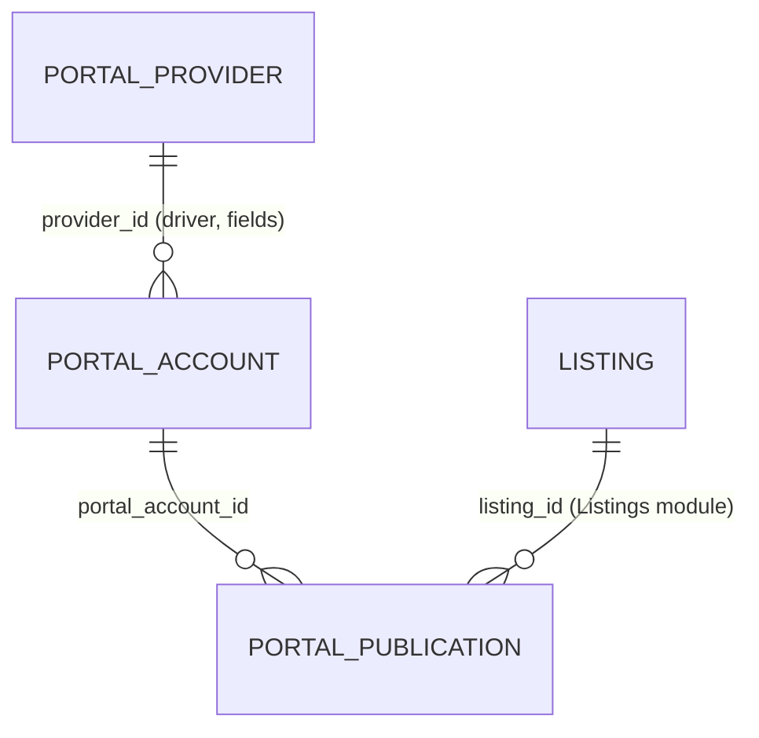

# Portals (`portals`)

Real-estate portal export for [Listings](listings.md). The module keeps a **provider code list** (`PortalProvider`: Sreality, iDNES Reality, Bezrealitky, custom — each with a driver key, API base URL, optional OpenAPI URL, built-in API spec and a JSON definition of credential fields), **portal accounts** (`PortalAccount`: one configured login per provider, values stored in `config` JSON) and **publications** (`PortalPublication`: one row per account × listing with status, payload snapshot, external id and last error). Queuing a listing builds a provider-specific export payload through a `PortalDriverInterface` driver and stores it as a snapshot; the only driver with a real protocol mapping is Sreality (XML-RPC `addAdvert`, `SrealityAdvertMapper` + `SrealityImportClient`), but **no remote call is performed anywhere yet** — publications are marked published manually. Users: brokers/administrators in the *Reality* menu group; REST clients via `/api/v1/portals`.

## At a glance

| | |
|---|---|
| Module id | `portals` |
| Version | `1.99.0` (`modules/Portals/module.php`, `PortalsModule::version()`) |
| Directory | `modules/Portals/` |
| Requires | `core ^1.0`, `listings ^1.0`; optional `media ^1.0`, `webhooks ^1.0` |
| Capabilities | provides `portals` (payload `Application/PortalsProvider`); no capability consumption (Listings used via hard import + `class_exists` guards) |
| Groups / packages | `groups: ['realestates']` (`config/module_groups.php` → group `realestates`, label `admin.modules.group.realestates`) |
| Permissions | `portals.view` (`perm.portals.view`), `portals.manage` (`perm.portals.manage`) — group `perm.group.portals` |
| Menu group | `Reality` |
| Author | `RealEstates` |

## Domain model

| Entity | Table | Key fields | Enum values | Relations |
|---|---|---|---|---|
| `Domain/PortalProvider` | `portal_providers` (unique `uniq_portal_providers_code (code)`; index `idx_portal_providers_active (is_active)`) | `id: string(36)`; `code: string(64)` lower-cased; `name: string(190)`; `driver: string(32)` default `custom`; `description: ?text`; `api_base_url: ?string(500)`; `openapi_url: ?string(500)`; `api_spec: ?json` (built-in spec, e.g. Sreality XML-RPC methods + codebooks); `fields: json` (list of `{key, label, type, required, hint, placeholder}`; key `^[a-z][a-z0-9_]*$`); `is_active: bool`; `sort_order: int` default 100; `created_at`, `updated_at` | `DRIVERS = sreality, idnes, bezrealitky, custom`; `FIELD_TYPES = text, password, url, email, number` | — |
| `Domain/PortalAccount` | `portal_accounts` (unique `uniq_portal_accounts_code (code)`; index `idx_portal_accounts_provider (provider_id)`) | `id`; `code: string(64)` lower-cased; `name: string(190)`; `provider_id: string(36)`; `is_active: bool` default true; `config: ?json` (values for provider `fields`, e.g. `client_id`, `password`, `software_key`, `api_key`, `partner_id`, `endpoint`, `api_base_url`); `created_at`, `updated_at` | — | `provider_id` → `portal_providers.id` |
| `Domain/PortalPublication` | `portal_publications` (unique `uniq_portal_pub_account_listing (portal_account_id, listing_id)`; indexes `status`, `listing_id`) | `id`; `portal_account_id`; `listing_id: string(36)`; `external_id: ?string(190)`; `status: string(32)` default `draft`; `last_error: ?text`; `payload_snapshot: ?json`; `last_synced_at: ?datetime`; `created_at`, `updated_at` | `STATUSES = draft, queued, published, error, unpublished`; `markQueued()`, `markSynced(externalId)` → `published`, `markError(msg)` | `portal_account_id` → `portal_accounts.id`; `listing_id` → `listings.id` |

`Domain/PortalDriverInterface`: `key(): string`, `buildPayload(array $listing, array $config): array` (no remote call).

Publication lifecycle (`PortalsProvider::queuePublication`, `markPublished`): `draft` (constructor) → `queued` (payload built & snapshotted; re-queue rebuilds snapshot) → `published` (manual confirm, `external_id` = given or `manual-<8 chars>`); `error` and `unpublished` exist but are never set by module code.

## Admin UI

### Menu & palette (`boot()`)

| Kind | Id | Label key | Icon | Route / URL | Permission | Order |
|---|---|---|---|---|---|---|
| Menu | `portals` | `nav.portals` | `link` | `admin.portals.index` | `portals.view` | 30 (group `Reality`) |
| Menu | `portals.providers` (parent `portals`) | `nav.portals.providers` | — | `admin.portals.providers.index` | `portals.view` | 30 |
| Menu | `portals.publications` (parent `portals`) | `nav.portals.publications` | — | `admin.portals.publications.index` | `portals.view` | 31 |
| Palette | `portals.index` | `palette.portals.index` | `link` | `/admin/portals` | `portals.view` | keywords portál, sreality, idnes, bezrealitky, export |
| Palette | `portals.providers` | `palette.portals.providers` | `link` | `/admin/portal-providers` | `portals.view` | číselník, poskytovatel, provider, sreality |
| Palette | `portals.publications` | `palette.portals.publications` | `link` | `/admin/portals-publications` | `portals.view` | publikace, export, portál |

### Routes (`register()`, middleware `auth`; provider group registered first so it wins over `/admin/portals/{id}`)

| Method | Path | Route name | Controller::action | Permission |
|---|---|---|---|---|
| GET | `/admin/portal-providers` | `admin.portals.providers.index` | `Http/ProviderController::index` | `portals.view` |
| GET | `/admin/portal-providers/create` | `admin.portals.providers.create` | `ProviderController::create` | `portals.manage` |
| POST | `/admin/portal-providers` | `admin.portals.providers.store` | `ProviderController::store` | `portals.manage` |
| GET | `/admin/portal-providers/{id}` | `admin.portals.providers.show` | `ProviderController::show` | `portals.view` |
| GET | `/admin/portal-providers/{id}/edit` | `admin.portals.providers.edit` | `ProviderController::edit` | `portals.manage` |
| POST | `/admin/portal-providers/{id}` | `admin.portals.providers.update` | `ProviderController::update` | `portals.manage` |
| POST | `/admin/portal-providers/{id}/toggle` | `admin.portals.providers.toggle` | `ProviderController::toggle` | `portals.manage` |
| POST | `/admin/portal-providers/{id}/delete` | `admin.portals.providers.destroy` | `ProviderController::destroy` | `portals.manage` |
| GET | `/admin/portals` | `admin.portals.index` | `Http/PortalController::index` | `portals.view` |
| GET | `/admin/portals/create` | `admin.portals.create` | `PortalController::create` | `portals.manage` |
| POST | `/admin/portals` | `admin.portals.store` | `PortalController::store` | `portals.manage` |
| POST | `/admin/portals/bulk` | `admin.portals.bulk` | `PortalController::bulk` | `portals.manage` |
| GET | `/admin/portals/{id}` | `admin.portals.show` | `PortalController::show` | `portals.view` |
| GET | `/admin/portals/{id}/edit` | `admin.portals.edit` | `PortalController::edit` | `portals.manage` |
| POST | `/admin/portals/{id}` | `admin.portals.update` | `PortalController::update` | `portals.manage` |
| POST | `/admin/portals/{id}/toggle` | `admin.portals.toggle` | `PortalController::toggle` | `portals.manage` |
| POST | `/admin/portals/{id}/delete` | `admin.portals.destroy` | `PortalController::destroy` | `portals.manage` |
| POST | `/admin/portals/{id}/queue` | `admin.portals.queue` | `Http/PublicationController::queue` | `portals.manage` |
| GET | `/admin/portals-publications` | `admin.portals.publications.index` | `PublicationController::index` | `portals.view` |
| GET | `/admin/portals-publications/{id}` | `admin.portals.publications.show` | `PublicationController::show` | `portals.view` |
| POST | `/admin/portals-publications/{id}/publish` | `admin.portals.publications.publish` | `PublicationController::markPublished` | `portals.manage` |
| POST | `/admin/portals-publications/{id}/delete` | `admin.portals.publications.destroy` | `PublicationController::destroy` | `portals.manage` |

### Screens

* **Providers** (`Resources/views/providers/*.html.twig`) — list (`ListQuery` sortable `name`, `code`, `sortOrder`, `driver`), form generated from `#[FormGenerator]` on `PortalProvider` (code, name, driver select `portals.driver.*`, api_base_url, openapi_url, sort_order, description, active) plus a manual field-definition editor (`fields[]`), detail page showing OpenAPI operations fetched live by `Application/OpenApiSpecReader::read(openapi_url)` (grouped by tag; falls back to built-in `api_spec.methods`), codebook/method counts and number of accounts; toggle/delete (audit `portals.provider_created|updated|deleted`).
* **Portal accounts** (`index|form|show.html.twig`) — list with filter `provider_id`, sortable `name`, `code`, `createdAt`; form from `#[FormGenerator]` on `PortalAccount` (code, name, active) + provider card picker + dynamic credential fields from the provider's `fields` (stored in `config`); detail shows the provider, last 50 publications with listing titles, and a *queue listing* form (`listing_id` select built from Listings, `class_exists(Listing)` guarded); bulk `activate | deactivate | delete` (`delete` requires `confirmed`; deleting an account removes its publications via `deleteAccount()`).
* **Publications** (`publications/index|show.html.twig`) — list (search `listingId`, `externalId`, `portalAccountId`; filter `status`; sortable `status`, `updatedAt`, `createdAt`), detail with account, provider, listing and the `payload_snapshot` JSON; actions *mark published* (optional `external_id`) and delete.

Validation rulesets: `portals.account.save` (`code` 2..64, `name` ≤190, `provider_id` ≤36, `active`; bound to `PortalAccount`), `portals.provider.save` (`code`, `name`, `driver in:sreality,idnes,bezrealitky,custom`, `description` ≤5000, `api_base_url` ≤500, `openapi_url` ≤500, `sort_order`, `active`; bound to `PortalProvider`), `portals.queue` (`listing_id`, `portal_account_id`), `portals.bulk` (`action in:activate,deactivate,delete`).

Settings pages / setting keys: none (all configuration lives in `portal_providers` / `portal_accounts.config`).

## Public / REST API

Scopes `portals.read`, `portals.write`; see [API](../architecture/api.md).

| Method | Path | Scope | Controller::action | Notes |
|---|---|---|---|---|
| GET | `/api/v1/portals/accounts` | `portals.read` | `Http/Api/PortalApiController::accounts` | search `name`/`code` (LIKE); filters `provider_id`, `active` (bool); sortable `name` (default), `providerId`, `createdAt` |
| GET | `/api/v1/portals/publications` | `portals.read` | `publications` | filters `status`, `listing_id`, `portal_account_id`; sortable `status`, `updatedAt` (default) |
| POST | `/api/v1/portals/queue` | `portals.write` | `queue` | JSON/form body `{listing_id, portal_account_id}` (`portals.queue`); 404 `portal_inactive` when account missing/inactive; 404 when listing missing; emits `portal.queued`; 201 with detail serializer |

Serializers (`PortalsProvider`): account — `id, code, name, provider_id, provider_code, provider_name, driver, active, config, created_at, updated_at` (**`config` including credentials is returned verbatim**); publication — `id, portal_account_id, listing_id, external_id, status, last_error, last_synced_at, created_at, updated_at` (+ `payload_snapshot` in detail). No `/api/public/*` endpoints.

## Events, hooks & webhooks

Platform events (`register()`, all `webhookEnabled(true)`, Czech literal descriptions):

| Event | Emitted from |
|---|---|
| `portal.account_created` | `PortalController::store` |
| `portal.account_updated` | `PortalController::update` |
| `portal.queued` | `PublicationController::queue`, `PortalApiController::queue` (resource type `portal_publication`) |
| `portal.published` | `PublicationController::markPublished` |
| `portal.publication_deleted` | `PublicationController::destroy` |

Hooks added/exposed: none. Queue jobs / scheduled tasks / publishables: none — "queued" is a status only; there is no worker that pushes to portals. Idempotency: `queuePublication()` upserts on `(portal_account_id, listing_id)` (unique index), so re-queuing the same listing updates the existing publication. Audit log: `portals.account_created|account_updated|account_deleted|accounts_bulk`, `portals.provider_created|provider_updated|provider_deleted`, `portals.queued`, `portals.publication_deleted`. See [hooks, events & webhooks](../architecture/hooks-events-webhooks.md) and [Webhooks](webhooks.md).

## Dashboard widgets

| Widget id | Type | Class | Shows | Permission | Order |
|---|---|---|---|---|---|
| `portals.shortcut` | shortcut | `Application/Widgets/PortalsShortcutWidget` | Link to portals list, hint `admin.dashboard.hint.portals` | `portals.view` | 30 |
| `portals.accounts` | panel (`list_panel.html.twig`) | `PortalAccountsStatusWidget` | Up to 8 accounts with published/queued counts and a status badge (inactive / errors / queued / published / idle); link to publications | `portals.view` | 24 |
| `portals.stats` | metric | `PortalStatsWidget` | Number of active accounts; hint with published/error counts and last sync date (`portals.widget.stats.hint` / `hint_no_sync`) | `portals.view` | 48 |

See [Dashboard widgets](../architecture/dashboard-widgets.md).

## Services & extension points

| Class | Responsibility |
|---|---|
| `Application/PortalsProvider` | Capability payload and application service: `findAccount/Publication/PublicationFor/Provider/ProviderByCode`, `driverFor(account)` (driver key from provider, fallback `custom`), `queuePublication(account, listing)` (serialises listing via `Modules\Listings\Application\ListingsProvider::serialize($listing, true)` when available, else a reduced inline array; merges provider `api_base_url` and `_api_spec` into the driver config), `markPublished()`, `serializeAccount()`, `serializePublication()`. |
| `Domain/PortalDriverInterface` | Contract for export drivers. Registered drivers (constructed in `PortalsModule::register()`): |
| `Application/Drivers/SrealityDriver` (`sreality`) | Builds XML-RPC `addAdvert` payload: `protocol: xmlrpc`, `endpoint` (config `api_base_url` → spec `endpoint` → `https://import.sreality.cz/RPC2`), `method`, `external_ready: true`, `api_version`, `credentials {client_id, has_password, has_software_key}`, `advert` (from `Application/Sreality/SrealityAdvertMapper::map()` using codebooks), `images`, `codebooks_ref`. |
| `Application/Drivers/IdnesDriver` (`idnes`) | Stub payload (`external_ready: false`, `partner_id`, title/price/locality/text/photos). |
| `Application/Drivers/BezrealitkyDriver` (`bezrealitky`) | Stub payload (`external_ready: false`, `api_key_set`, listing summary with location). |
| `Application/Drivers/CustomPortalDriver` (`custom`) | Pass-through payload (`endpoint`, full `listing`, `meta`). |
| `Application/Sreality/SrealityApiSpec` | Loads the built-in spec from `Resources/sreality/api_spec.php` (version `3.0.0`, endpoint, `methods` with auth flags, `codebooks`). |
| `Application/Sreality/SrealityImportClient`, `XmlRpcClient`, `XmlRpcBinary` | Ready-made XML-RPC client for `import.sreality.cz/RPC2` (`login` via getHash/session rotation, `addAdvert`, `delAdvert`, `listAdvert`, `addPhoto`, `delPhoto`, `listPhoto`, `version`, `logout`; UA `GEREQ-Portals/1.3`). **Not referenced by any controller or driver yet.** |
| `Application/OpenApiSpecReader` | Fetches OpenAPI 3 / Swagger 2 JSON from a URL and extracts endpoint groups for the provider detail page. |
| `Application/PortalDemoSeeder` | Idempotent demo data: providers (Sreality/Idnes/Bezrealitky with fields and API URLs), accounts and listing links; used by `portals:seed-demo` and `src/Database/Seeder::seedPortalsDemo()`. |

Integration with other modules: [Listings](listings.md) (`Listing` entity, `ListingsProvider` serializer — hard dependency for queuing; `class_exists(Listing::class)` guards in controllers), [Media](media.md) only indirectly through listing images in the serialised payload, [Webhooks](webhooks.md) via platform events. Adding a new portal: implement `PortalDriverInterface`, add its key to `PortalProvider::DRIVERS` and the `portals.provider.save` `in:` rule, inject it into `PortalsProvider`, add `portals.driver.<key>` translations.

## CLI commands

| Command | Class | Purpose |
|---|---|---|
| `portals:seed-demo` | `Console/SeedDemoPortalsCommand` → `PortalDemoSeeder::seed()` | Creates sample providers (Sreality/Idnes/Bezrealitky), accounts and links them to existing listings; idempotent. Registered in `src/Console/ConsoleKernel.php`. |

## Configuration & translations

No `settings()->define()` keys and no env vars. Per-account configuration is schema-driven by `PortalProvider::fields` and stored in `portal_accounts.config` (JSON, unencrypted — includes passwords/API keys as plain text; Sreality expects an MD5 password hash per `SrealityImportClient` docblock).

Translations: `Resources/translations/messages.cs.php`, `messages.en.php` (≈180 keys). Prefixes: `module.portals.description`, `nav.portals*`, `palette.portals.*`, `perm.portals.*`, `perm.group.portals`, `portals.title|new|edit|search|all_providers|activate|deactivate|confirm_delete|confirm_pub_delete|mark_published|payload`, `portals.field.*`, `portals.field_type.*`, `portals.form.*`, `portals.driver.*`, `portals.providers.*` (62 keys), `portals.publications.*`, `portals.pub.status.*`, `portals.queue.*`, `portals.flow.*`, `portals.howto.*`, `portals.stats.*`, `portals.widget.*`, `portals.bulk.*`, `portals.flash.*`, `portals.error.*`, `portals.empty.*`. Core key `admin.dashboard.hint.portals`. Twig namespace `@portals`. Built-in Sreality spec: `Resources/sreality/api_spec.php`.

## Database migrations

| File | Purpose |
|---|---|
| `Database/Migrations/2026_09_06_000001_portals.php` | Empty; `portal_accounts` and `portal_publications` are created by Doctrine schema sync. |
| `Database/Migrations/2026_09_07_000002_portal_providers.php` | Creates `portal_providers` (id, code, name, driver, description, api_base_url, fields JSON, is_active, sort_order, timestamps) with unique code / active index. |
| `Database/Migrations/2026_09_07_000003_portal_provider_openapi.php` | Adds nullable `portal_providers.openapi_url`. |
| `Database/Migrations/2026_09_07_000004_sreality_api_spec.php` | Adds nullable JSON `portal_providers.api_spec`; upserts the built-in Sreality provider row (code, endpoint `https://import.sreality.cz/RPC2`, spec from `Resources/sreality/api_spec.php`). |

## Notes

* No outbound synchronisation exists: `queuePublication()` only stores a payload snapshot and the `queued` status; `markPublished()` fabricates `external_id = manual-<id prefix>`. `SrealityImportClient` is complete but unused; `error`/`unpublished` statuses are never produced.
* `PortalApiController::accounts` and the admin serializer expose `config` (credentials) in full; `config` is stored unencrypted.
* `PortalAccount.code` and `PortalProvider.code` uniqueness is enforced only by DB unique indexes (no pre-check in controllers beyond validation).
* `ProviderController::destroy` refuses to delete a provider that still has accounts (`portals.providers.error.in_use`); account deletion cascades to publications in code (`deleteAccount()`), but there are no DB foreign keys between the three tables or to `listings`.
* `PortalsProvider::serializeListing()` resolves `ListingsProvider` through the global `gereq()` container and silently falls back to a reduced listing array on any exception.
* `OpenApiSpecReader::read()` performs a live HTTP fetch on every provider detail page view (no caching).
* Related docs: [Listings](listings.md), [Media](media.md), [Webhooks](webhooks.md), [module system](../architecture/module-system.md).
