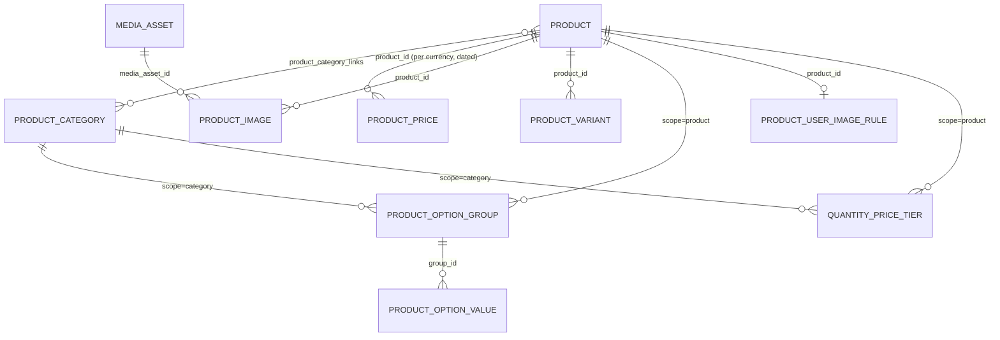

# Products (`products`)

Product catalogue for the commerce stack: products with SKU/unit/status, many-to-many categories, multi-currency dated price lists, media-backed images, option groups → option values (with price modifiers) at product or category scope, generated variants (concrete SKUs), quantity price tiers, and storefront personalisation rules (customer note mode, customer-uploaded images with crop config). It exposes an authenticated REST API, a **public CORS catalogue API** for the Vue/React storefront (`/api/public/store/*`), integrates with the staging → production publish system (`FreezeService`/`ProductPublishAdapter`), and is consumed by [Shop](shop.md), [Orders](orders.md), [Warehouse](warehouse.md), [ProductDiscounts](product_discounts.md), [Feeds](feeds.md), [WebPlus](webplus.md) and [BikeService](bikeservice.md). Users: catalogue managers (admin), storefront (public API), integrators (REST).

## At a glance

| | |
|---|---|
| Module id | `products` |
| Version | `1.8.4` (`modules/Products/module.php`, `ProductsModule::version()`) |
| Directory | `modules/Products/` |
| Requires | `core ^1.0`, `currency ^1.1`; optional `media ^1.0` |
| Capabilities | provides `products` (payload `Application/ProductsProvider`); consumes `media` and `product_discounts` when present (guarded via `CapabilityRegistry::has()` + `class_exists`) |
| Groups / packages | none in `module.php`; not listed in `config/module_groups.php` |
| Permissions | `products.view` (`perm.products.view`), `products.manage` (`perm.products.manage`) — group `perm.group.products` |
| Menu group | `Obchod` |

## Domain model

| Entity | Table | Key fields | Enum values | Relations |
|---|---|---|---|---|
| `Domain/Product` | `products` | `id: string(36)` UUIDv7; `sku: string(64)` unique, upper-cased; `name: string(190)`; `description: ?text`; `status: string(32)` default `draft`; `unit: string(32)` default `ks`; `customer_note_mode: string(16)` default `off`; `inherit_category_options: bool` default `false`; `created_at`, `updated_at` | `STATUSES = draft, active, archived`; `NOTE_MODES = off, optional, required` | `ManyToMany ProductCategory` via join table `product_category_links` (Doctrine-managed) |
| `Domain/ProductCategory` | `product_categories` | `id`; `name: string(120)`; `slug: string(120)` unique | — | inverse side of `Product::categories` |
| `Domain/ProductPrice` | `product_prices` | `id`; `product_id: string(36)`; `currency_code: string(3)` upper-cased; `amount: decimal(14,4)`; `valid_from: ?date`; `valid_to: ?date` | — | `product_id` → `products.id` |
| `Domain/ProductImage` | `product_images` (indexes `idx_product_images_product`, `idx_product_images_media`) | `id`; `product_id`; `media_asset_id: string(36)` ([Media](media.md) asset); `sort_order: int`; `is_primary: bool`; `alt: ?string(255)`; `created_at` | — | `media_asset_id` → `media_assets.id` |
| `Domain/ProductOptionGroup` | `product_option_groups` (index `idx_product_option_groups_scope (scope_type, scope_id)`; unique `uniq_product_option_groups_scope_code (scope_type, scope_id, code)`) | `id`; `scope_type: string(16)`; `scope_id: string(36)`; `code: string(64)` lower-cased slug; `name: string(190)`; `sort_order: int`; `is_required: bool` default `true` | `SCOPE_PRODUCT = product`, `SCOPE_CATEGORY = category` | `scope_id` → `products.id` or `product_categories.id` |
| `Domain/ProductOptionValue` | `product_option_values` (index `idx_product_option_values_group`; unique `uniq_product_option_values_code (group_id, code)`) | `id`; `group_id`; `code: string(64)`; `name: string(190)`; `sort_order: int`; `price_adjust_kind: string(16)` default `none`; `price_adjust_value: decimal(14,2)` default `0.00` | `ADJUST_KINDS = none, amount, percent`; `applyToPrice(base)` = `max(0, base + v)` or `max(0, base × (1 + v/100))`, rounded to 2 dp | `group_id` → `product_option_groups.id` |
| `Domain/ProductVariant` | `product_variants` (index `idx_product_variants_product`; unique `uniq_product_variants_sku (sku)`) | `id`; `product_id`; `sku: string(64)` upper-cased; `name: ?string(190)`; `attributes_json: text` (`{group_code: value_code}`, keys sorted); `price_amount: ?decimal(14,2)`; `price_currency: ?string(3)`; `stock_qty: ?int`; `ean: ?string(64)`; `is_active: bool` default `true`; `created_at`, `updated_at` | — | `product_id` → `products.id` |
| `Domain/QuantityPriceTier` | `quantity_price_tiers` (index `idx_qty_tiers_scope (scope_type, scope_id)`) | `id`; `scope_type: string(32)` (`category`/`product`); `scope_id`; `min_qty: int` ≥ 1; `max_qty: ?int`; `unitPrice: decimal(14,2)` (column name defaults to `unitPrice`); `currency: string(3)` default `CZK`; `sort_order: int`; `matches(qty)` | — | `scope_id` → product or category |
| `Domain/ProductUserImageRule` | `product_user_image_rules` (unique `uniq_product_user_image_rule (product_id)`) | `id`; `product_id`; `max_images: int` default 1 (clamped 0..20); `crop_required: bool`; `is_active: bool`; `crop_config_json: ?text` (default preset `square-1-1`, 1200×1200); `created_at`, `updated_at`; `requiredImageCount()`, `allowsImages()` | — | `product_id` → `products.id` (1:1) |

`Domain/Events/*` — `ProductCreated`, `ProductUpdated`, `ProductActivated`, `ProductDeactivated`, `ProductPriceChanged` extend `AbstractPlatformEvent` (`PlatformEvent` implementation, envelope version `1`, resource `{type: product, id}`).

Pricing resolution (public API, `Http/Public/PublicStoreCatalogController`): current `ProductPrice` for the default currency = newest `valid_from` whose window contains today → base price; variant price = own `price_amount` if set, otherwise base with option-value modifiers applied (`ProductVariantOptionsService::applyAttributePriceAdjust`); then [ProductDiscounts](product_discounts.md) `priceForProduct()/pricesForProducts()` when the capability exists. Quantity tiers are only exposed via `/api/v1/products/{id}/variants`, not applied in pricing.

## Admin UI

### Menu & palette (`ProductsModule::boot()`)

| Kind | Id | Label key | Icon | Route / URL | Permission | Order |
|---|---|---|---|---|---|---|
| Menu | `products` | `nav.products` | `package` | `admin.products.index` | `products.view` | 30 (group `Obchod`) |
| Menu | `products.list` (parent `products`) | `nav.products.list` | — | `admin.products.index` | `products.view` | 31 |
| Menu | `products.categories` | `nav.products.categories` | — | `admin.products.categories.index` | `products.view` | 32 |
| Menu (hidden) | `products.create` | `nav.products.create` | — | `admin.products.create` | `products.manage` | 33 |
| Palette | `products.index` | `palette.products.index` | `package` | `/admin/products` | `products.view` | keywords produkty, katalog, sku, products |
| Palette | `products.categories` | `palette.products.categories` | `package` | `/admin/product-categories` | `products.view` | kategorie, categories |
| Palette | `products.create` | `palette.products.create` | `plus` | `/admin/products/create` | `products.manage` | group `Akce` |

### Routes (`register()`, middleware `auth`)

| Method | Path | Route name | Controller::action | Permission |
|---|---|---|---|---|
| GET | `/admin/products` | `admin.products.index` | `ProductController::index` | `products.view` |
| GET | `/admin/products/create` | `admin.products.create` | `ProductController::create` | `products.manage` |
| POST | `/admin/products` | `admin.products.store` | `ProductController::store` | `products.manage` |
| POST | `/admin/products/bulk` | `admin.products.bulk` | `ProductController::bulk` | `products.manage` |
| GET | `/admin/products/{id}` | `admin.products.show` | `ProductController::show` | `products.view` |
| GET | `/admin/products/{id}/edit` | `admin.products.edit` | `ProductController::edit` | `products.manage` |
| POST | `/admin/products/{id}` | `admin.products.update` | `ProductController::update` | `products.manage` |
| POST | `/admin/products/{id}/status` | `admin.products.status` | `ProductController::setStatus` | `products.manage` |
| POST | `/admin/products/{id}/prices` | `admin.products.prices.store` | `ProductController::storePrice` | `products.manage` |
| POST | `/admin/products/{id}/prices/{priceId}/delete` | `admin.products.prices.destroy` | `ProductController::destroyPrice` | `products.manage` |
| POST | `/admin/products/{id}/variants` | `admin.products.variants.store` | `ProductController::storeVariant` | `products.manage` |
| POST | `/admin/products/{id}/variants/generate` | `admin.products.variants.generate` | `ProductController::generateVariants` | `products.manage` |
| POST | `/admin/products/{id}/variants/{variantId}` | `admin.products.variants.update` | `ProductController::updateVariant` | `products.manage` |
| POST | `/admin/products/{id}/variants/{variantId}/delete` | `admin.products.variants.destroy` | `ProductController::destroyVariant` | `products.manage` |
| POST | `/admin/products/{id}/option-groups` | `admin.products.option_groups.store` | `ProductController::storeOptionGroup` | `products.manage` |
| POST | `/admin/products/{id}/option-groups/{groupId}` | `admin.products.option_groups.update` | `ProductController::updateOptionGroup` | `products.manage` |
| POST | `/admin/products/{id}/option-groups/{groupId}/delete` | `admin.products.option_groups.destroy` | `ProductController::destroyOptionGroup` | `products.manage` |
| POST | `/admin/products/{id}/inherit-category-options` | `admin.products.inherit_category_options` | `ProductController::setInheritCategoryOptions` | `products.manage` |
| POST | `/admin/products/{id}/images` | `admin.products.images.store` | `ProductController::storeImage` | `products.manage` |
| POST | `/admin/products/{id}/images/attach` | `admin.products.images.attach` | `ProductController::attachImage` | `products.manage` |
| POST | `/admin/products/{id}/images/{imageId}/primary` | `admin.products.images.primary` | `ProductController::setPrimaryImage` | `products.manage` |
| POST | `/admin/products/{id}/images/{imageId}/delete` | `admin.products.images.destroy` | `ProductController::destroyImage` | `products.manage` |
| POST | `/admin/products/{id}/delete` | `admin.products.destroy` | `ProductController::destroy` | `products.manage` |
| GET | `/admin/product-categories` | `admin.products.categories.index` | `CategoryController::index` | `products.view` |
| GET | `/admin/product-categories/create` | `admin.products.categories.create` | `CategoryController::create` | `products.manage` |
| POST | `/admin/product-categories` | `admin.products.categories.store` | `CategoryController::store` | `products.manage` |
| POST | `/admin/product-categories/bulk` | `admin.products.categories.bulk` | `CategoryController::bulk` | `products.manage` |
| GET | `/admin/product-categories/{id}/edit` | `admin.products.categories.edit` | `CategoryController::edit` | `products.manage` |
| POST | `/admin/product-categories/{id}` | `admin.products.categories.update` | `CategoryController::update` | `products.manage` |
| POST | `/admin/product-categories/{id}/delete` | `admin.products.categories.destroy` | `CategoryController::destroy` | `products.manage` |
| POST | `/admin/product-categories/{id}/option-groups` | `admin.products.categories.option_groups.store` | `CategoryController::storeOptionGroup` | `products.manage` |
| POST | `/admin/product-categories/{id}/option-groups/{groupId}` | `admin.products.categories.option_groups.update` | `CategoryController::updateOptionGroup` | `products.manage` |
| POST | `/admin/product-categories/{id}/option-groups/{groupId}/delete` | `admin.products.categories.option_groups.destroy` | `CategoryController::destroyOptionGroup` | `products.manage` |

### Screens

* **Product list** (`Resources/views/products/index.html.twig`) — `ListQuery`: search `name`, `sku`; sortable `sku`, `name`, `status`, `unit`, `updatedAt` (default desc), `createdAt`; filters `status`, `category_id`, `unit` (distinct units); primary thumbnails; hides products with a pending staged delete; bulk `activate | draft | archive | delete` (`delete` requires `confirmed`).
* **Product form** (`products/form.html.twig`, generated from `#[FormGenerator]` on `Product`, groups `basic` / `personalization`) — sku, name, unit, status, description, categories (`category_ids[]`), `customer_note_mode`, user-image rule (`user_images_enabled`, `user_images_max`, `user_images_crop`) persisted through `ProductPersonalizationService::upsertRule()`.
* **Product detail** (`products/show.html.twig`) — price list per currency (`products.price.save`, currencies from [Currency](currency.md) `Currency` entity, active only), images (upload → Media `FileStorage`, or attach existing `media_asset_id`; set primary; delete), option groups (product-owned + read-only inherited category groups of the primary = first category; `options_text` one value per line, `Label|+500`, `Label|-10%`), *generate variants* (cartesian product of effective groups; prunes obsolete attribute variants, keeps blank manual ones), variants table (sku, name, price, stock, EAN, active), discounts panel when [ProductDiscounts](product_discounts.md) is enabled, status change form.
* **Categories** (`categories/index|form.html.twig`) — name, slug (auto-slug), category option groups; bulk actions; product discounts per category when available.

Validation rulesets (`registerValidation()`): `products.product.save` (bound to `Product`), `products.category.save` (bound to `ProductCategory`), `products.price.save`, `products.image.upload`, `products.image.attach`, `products.variant.save`, `products.variant.update`, `products.option_group.save`, `products.bulk`, `products.categories.bulk`.

Settings pages: none. Setting keys: none owned by this module (currency default from [Currency](currency.md) `CurrencyBuilder::defaultCode()`).

## Public / REST API

Scopes `products.read`, `products.write` (`registerApi()`); see [API](../architecture/api.md).

| Method | Path | Scope | Controller::action | Notes |
|---|---|---|---|---|
| GET | `/api/v1/products/` | `products.read` | `Http/Api/ProductApiController::index` | search `name`, `sku`, `description`; filters `status`, `sku` (exact, upper-cased); sortable `sku`, `name`, `status`, `createdAt`, `updatedAt` (default) |
| POST | `/api/v1/products/` | `products.write` | `store` | `products.product.save`; 422 on duplicate SKU / invalid status; dispatches `product.created` (+ `product.activated` if active); 201 |
| GET | `/api/v1/products/categories` | `products.read` | `categoriesIndex` | search `name`, `slug`; sortable `name`, `slug` |
| GET | `/api/v1/products/{id}` | `products.read` | `show` | product + `prices[]` (`id, currency_code, amount, valid_from, valid_to`) + `images[]` (`id, media_asset_id, sort_order, is_primary, alt, url`, plus `title, mime, width, height` when Media is loaded) |
| PATCH | `/api/v1/products/{id}` | `products.write` | `update` | full payload; dispatches `product.updated`, `product.activated`/`product.deactivated` on status change |
| DELETE | `/api/v1/products/{id}` | `products.write` | `destroy` | removes prices, images, category links, product (variants/option groups/rules **not** removed); no publish staging |
| GET | `/api/v1/products/{productId}/variants` | `products.read` | `Http/Api/VariantApiController::index` | `{product_id, option_groups[] (product scope only), variants[], quantity_tiers[]}` |
| POST | `/api/v1/products/{productId}/variants` | `products.write` | `storeVariant` | `products.variant.save`; `attributes` object; 201 |
| POST | `/api/v1/products/{productId}/option-groups` | `products.write` | `storeOptionGroup` | `products.option_group.save`; creates group only (no values; `options_text` ignored here) |

Product serializer: `id, sku, name, description, status, unit, categories[] {id, name, slug}, created_at, updated_at`. Variant: `id, product_id, sku, name, attributes, price_amount, price_currency, stock_qty, ean, active`.

### Public storefront API (`Http/Public/PublicStoreCatalogController`, no auth, CORS via `Gereq\Http\PublicCors`)

| Method | Path | Route name | Notes |
|---|---|---|---|
| OPTIONS | `/api/public/store/products`, `/api/public/store/products/{id}`, `/api/public/store/categories` | `api.public.store.*.options` | 204 preflight, `GET, OPTIONS` |
| GET | `/api/public/store/categories` | `api.public.store.categories` | all categories by name; respects publish freeze (`FrozenPublicReader`: hides pending creates, serves frozen snapshots, keeps pending deletes visible) |
| GET | `/api/public/store/products` | `api.public.store.products` | only `status = active`; query `category` (slug or id), `q` (name/sku/description), `page`, `limit`/`per_page` (1..100, default 48); excludes pending-create products and frozen snapshots whose status ≠ active; meta `{page, per_page, total, pages}` |
| GET | `/api/public/store/products/{id}` | `api.public.store.products.show` | by id or SKU (upper-cased); active only; detail adds `images[]`, `option_groups[]` (effective incl. inherited, with `price_adjust_*`), `variants[]` (active, priced), `inherit_category_options`, `base_price`, `customer_note_mode`, `user_image_rule` |

List item fields: `id, sku, name, description, unit, price {amount, currency_code}, original_price, discount, image_url (/media/<asset>/file), categories[], customer_note_mode, has_user_images, has_variants`.

## Events, hooks & webhooks

Platform events (`registerPlatformEvents()`, all `webhookEnabled(true)`; dispatched as `Domain/Events/*` objects, envelope version `1`):

| Event | Dispatched from |
|---|---|
| `product.created` | admin `store`, API `store` |
| `product.updated` | admin `update`, `setStatus`, `bulk`; API `update` |
| `product.activated` | any transition to `active` (create/update/status/bulk, admin + API) |
| `product.deactivated` | transition from `active` to another status |
| `product.price_changed` | admin `storePrice`, `destroyPrice` |

Publishables (`register()`): `products` (label `publish.category.products`, adapter `Gereq\Publish\Adapter\ProductPublishAdapter`, order 50) and `products.categories` (`ProductCategoryPublishAdapter`, order 51). Staging behaviour in controllers via `FreezeService`: editing/deleting an **active** (public) product first freezes a snapshot (`ProductPublishAdapter::capture()`: id, sku, name, description, status, unit, category_ids…), a newly activated product is `stageCreate`d, deleting an active product is `stageDelete`d instead of removed; categories are always staged (create/update/delete). Public API reads through `FrozenPublicReader` so production sees the frozen state until publish (core `src/Publish/`). See [hooks, events & webhooks](../architecture/hooks-events-webhooks.md).

Hooks added: none. Queue jobs / scheduled tasks: none. Audit log keys: `product.created|updated|status_changed|price_changed|price_removed|variant_created|variant_deleted|image_uploaded|image_attached|image_primary|image_removed|delete_staged|deleted`, `product_category.created|updated|delete_staged|deleted`. When an image is uploaded and `Modules\Media\Domain\Events\MediaUploaded` exists, that event is dispatched too.

## Dashboard widgets

| Widget id | Type | Class | Shows | Permission | Order |
|---|---|---|---|---|---|
| `products.stats` | metric | `Application/Widgets/ProductStatsWidget` | Active product count; hint `products.widget.active` (`%count% active of %total%`) | `products.view` | 50 |
| `products.create.hero` | hero (`hero_action.html.twig`) | `ProductCreateHeroWidget` | CTA to `admin.products.create` | `products.manage` | 20 |
| `products.shortcut` | shortcut | `ProductsShortcutWidget` | Link to product list, hint `admin.dashboard.hint.products` | `products.view` | 20 |

See [Dashboard widgets](../architecture/dashboard-widgets.md).

## Services & extension points

| Class | Responsibility |
|---|---|
| `Application/ProductsProvider` | Capability payload: `find(id): ?ProductReference`, `search(query, limit = 20)` over name/sku. |
| `Application/ProductReference` | Immutable DTO `{id, sku, name, status}`. |
| `Application/ProductVariantOptionsService` | Option groups/values CRUD (`createGroup`, `updateGroup`, `deleteGroup`, `syncValues`), option line parsing/formatting (`Label|+500`, `Label|-10%`), effective groups (category-inherited + product override by code), serialisation, `applyAttributePriceAdjust()`, `generateMissingVariants()` (cartesian SKUs `<SKU>-<VAL1>-<VAL2>`, unique suffixing), `codeFromLabel()`. |
| `Application/ProductPersonalizationService` | User-image rules (`findRule`, `activeRule`, `upsertRule`), storefront serialisation, `assertLinePersonalization()` (throws `products.error.note_required|images_not_allowed|images_required|images_too_many`) — used by Shop cart/checkout. |
| `Http/Public/PublicStoreCatalogController` | Public catalogue + pricing composition. |
| `Domain/Events/*` | Typed platform events. |
| `src/Publish/Adapter/ProductPublishAdapter`, `ProductCategoryPublishAdapter` (core) | Snapshot capture/apply for staging → production. |

Consumers of `Modules\Products\Domain\Product` / the `products` capability (hard or guarded imports): `modules/Shop/Application/CartService.php`, `CheckoutService.php`; `modules/Orders/Http/OrderController.php`; `modules/Warehouse/**` (`StockService`, `StockController`, `LowStockItemsWidget`); `modules/ProductDiscounts/**`; `modules/Feeds/Application/FeedsProvider.php`; `modules/WebPlus/Application/GoogleFeed/BuiltInGoogleFeedCollectors.php`; `modules/BikeService/Application/Catalog/PartsSearchService.php`; `src/Database/DemoSeeder.php`; `src/Console/Command/ImportLaravelCommand.php`.

Optional integrations inside the module: [Media](media.md) (`capabilities->has('media')` + `class_exists(MediaAsset)` for uploads/attach/thumbnails; `/media/{asset}/file` URLs), [ProductDiscounts](product_discounts.md) (`product_discounts` capability for admin panels and public pricing).

## CLI commands

| Command | Class | Purpose |
|---|---|---|
| `products:import-csv --file=<path> [--dry-run]` | `Console/ImportProductsCsvCommand` | Import products from CSV with columns `sku,name[,price,currency,status]`; skips existing SKUs; creates a `ProductPrice` when `price` is numeric (currency default `CZK`). |

## Configuration & translations

No module settings or env vars. Depends on [Currency](currency.md) `CurrencyBuilder::defaultCode()` for public pricing and the `Currency` entity for price-list options.

Translations: `Resources/translations/messages.cs.php`, `messages.en.php` (≈136 keys). Prefixes: `module.products.description`, `nav.products*`, `palette.products.*`, `perm.products.*`, `perm.group.products`, `products.title|new|edit|list|add|search|empty.*|filter.*|confirm_delete|change_status`, `products.field.*`, `products.status.*`, `products.note_mode.*`, `products.prices.*`, `products.images.*`, `products.categories.*`, `products.bulk.*`, `products.flash.*`, `products.error.*`, `products.widget.*`. Core keys used: `admin.dashboard.hint.products`, `publish.category.products`, `publish.category.product_categories`, `publish.flash.staged`. Twig namespace `@products`.

## Database migrations

| File | Purpose |
|---|---|
| `Database/Migrations/2026_01_01_000001_init.php` | Empty; base tables (`products`, `product_categories`, `product_category_links`, `product_prices`, `product_variants`, `product_option_groups`, `product_option_values`, `quantity_price_tiers`) are created by Doctrine schema sync. |
| `Database/Migrations/2026_09_04_000002_product_images.php` | Creates `product_images` (id, product_id, media_asset_id, sort_order, is_primary, alt, created_at) with two indexes. |
| `Database/Migrations/2026_09_05_000003_product_personalization.php` | Adds `products.customer_note_mode`; creates `product_user_image_rules` (unique per product). |
| `Database/Migrations/2026_09_05_000004_option_group_required.php` | Adds `product_option_groups.is_required` (default true). |
| `Database/Migrations/2026_09_05_000005_category_option_groups.php` | Adds `scope_type`/`scope_id` to `product_option_groups` (migrating from `product_id`), new unique/scope indexes; adds `products.inherit_category_options`. |
| `Database/Migrations/2026_09_05_000006_option_value_price_adjust.php` | Adds `price_adjust_kind` / `price_adjust_value` to `product_option_values`. |

## Notes

* `QuantityPriceTier` has no admin UI or API write path; it is only read in `VariantApiController::index` (seeded by `src/Database/DemoSeeder.php`) and not applied in storefront pricing.
* `ProductVariant.sku` is globally unique but not checked against `products.sku`; generated variant SKUs are `<product sku>-<VALUE CODES>` truncated to 64 chars with `-N` suffixing.
* Deleting a product (admin or API) removes prices, images and category links but leaves `product_variants`, `product_option_groups/values`, `product_user_image_rules` and `quantity_price_tiers` orphaned.
* The REST API (`ProductApiController`) bypasses the publish/freeze staging used by the admin controllers; API writes to active products go live immediately.
* `products.product.save` does not validate SKU uniqueness itself; controllers check `findOneBy(['sku'])` and return 422 / flash. Czech literal messages in API 422 responses (`'SKU už existuje.'`, `'Neplatný stav.'`).
* Public list pricing uses only the default currency; `ProductVariant.price_currency` is returned as-is even if it differs from the default.
* `effectiveGroupsForProduct()` treats the *first* category in the collection as primary — category order is not deterministic beyond Doctrine's join-table ordering.
* `ProductOptionGroup::productId()` and `ProductVariantOptionsService::serializeGroups()` are marked `@deprecated`.
* Related docs: [Shop](shop.md), [Orders](orders.md), [Warehouse](warehouse.md), [ProductDiscounts](product_discounts.md), [Coupons](coupons.md), [Bundles](bundles.md), [Media](media.md), [Feeds](feeds.md), [Currency](currency.md), [module system](../architecture/module-system.md).
