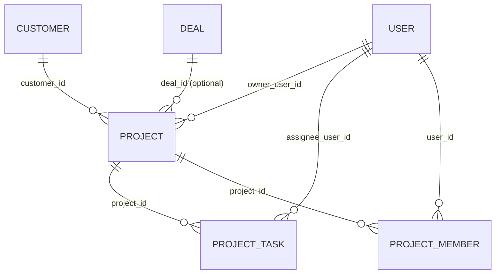

# Projects (`projects`)

Simple project and task tracking attached to customers. A **project** belongs to exactly one [Customer](customers.md), has a lifecycle (`planning → active → done | cancelled`), optional start/due dates, an owner user and an optional link to a CRM deal; **tasks** live inside a project with a `todo / doing / done` status, assignee and due date. Project members (owner/member) are recorded when a project owner is set. The module is used by account managers and delivery staff; it surfaces a "Projects" section on the customer detail page, emits platform events for all changes and pushes an in-app notification to a task assignee through the [Notifications](notifications.md) capability.

## At a glance

| | |
|---|---|
| Module id | `projects` |
| Version | `1.99.0` (`modules/Projects/module.php`, `ProjectsModule::version()`) |
| Directory | `modules/Projects/` |
| Requires | `core ^1.0`, `customers ^1.0`; optional: `crm ^1.0`, `notifications ^1.0` |
| Capabilities | provides `projects` (payload: `Application/ProjectsProvider`); consumes `notifications` (duck-typed); [Calendar](calendar.md) lists `projects` as optional |
| Groups / packages | none in `module.php`; not listed in `config/module_groups.php` |
| Permissions | `projects.view` (View projects), `projects.manage` (Manage projects) — group `perm.group.projects` |
| Menu group | `Práce` |

## Domain model

| Entity | Table | Key fields | Enum values | Relations |
|---|---|---|---|---|
| `Domain/Project` | `projects` (indexes `idx_projects_customer (customer_id)`, `idx_projects_status (status)`) | `id: string(36)` UUIDv7; `customer_id: string(36)` required; `name: string(190)`; `status: string(32)` default `planning`; `start_at: ?date_immutable`; `due_at: ?date_immutable`; `owner_user_id: ?string(36)`; `deal_id: ?string(36)`; `created_at`, `updated_at` | `STATUSES = planning, active, done, cancelled` (`setStatus()` throws `InvalidArgumentException('projects.error.invalid_status')` otherwise) | `customer_id` → `customers.id`; `owner_user_id` → `users.id`; `deal_id` → CRM deal id (free text, not validated) |
| `Domain/ProjectTask` | `project_tasks` (index `idx_project_tasks_project (project_id)`) | `id`; `project_id: string(36)`; `title: string(190)`; `status: string(32)` default `todo`; `assignee_user_id: ?string(36)`; `due_at: ?date_immutable`; `created_at`, `updated_at` | `STATUSES = todo, doing, done` | `project_id` → `projects.id`; `assignee_user_id` → `users.id` |
| `Domain/ProjectMember` | `project_members` (unique `uniq_project_member (project_id, user_id)`) | `id`; `project_id`; `user_id`; `role: string(32)` default `member` | `ROLES = owner, member` | `project_id` → `projects.id`; `user_id` → `users.id` |

`Project` carries `#[FormEntity('projects.save')]` / `#[FormGenerator(cols: 2)]` with fields customer (select), name, status (select from `STATUSES`, labels `projects.status.*`), start/due (date), owner (select), deal. `ProjectTask` and `ProjectMember` have no form metadata (tasks are edited inline on the project page).

## Admin UI

### Menu & palette (`ProjectsModule::boot()`)

| Kind | Id | Label key | Icon | Route / URL | Permission | Order |
|---|---|---|---|---|---|---|
| Menu item | `projects` | `nav.projects` | `clipboard` | `admin.projects.index` | `projects.view` | 40 (group `Práce`) |
| Menu item (hidden) | `projects.create` (parent `projects`) | `nav.projects.create` | — | `admin.projects.create` | `projects.manage` | 41 |
| Palette | `projects.index` | `palette.projects.index` | `clipboard` | `/admin/projects` | `projects.view` | keywords: projekt, project, task |

### Routes (`register()`, group `/admin/projects`, middleware `auth`)

| Method | Path | Route name | Controller::action | Permission |
|---|---|---|---|---|
| GET | `/admin/projects` | `admin.projects.index` | `ProjectController::index` | `projects.view` |
| GET | `/admin/projects/create` | `admin.projects.create` | `ProjectController::create` | `projects.manage` |
| POST | `/admin/projects` | `admin.projects.store` | `ProjectController::store` | `projects.manage` |
| GET | `/admin/projects/{id}` | `admin.projects.show` | `ProjectController::show` | `projects.view` |
| GET | `/admin/projects/{id}/edit` | `admin.projects.edit` | `ProjectController::edit` | `projects.manage` |
| POST | `/admin/projects/{id}` | `admin.projects.update` | `ProjectController::update` | `projects.manage` |
| POST | `/admin/projects/{id}/status` | `admin.projects.status` | `ProjectController::updateStatus` | `projects.manage` |
| POST | `/admin/projects/{id}/delete` | `admin.projects.destroy` | `ProjectController::destroy` | `projects.manage` |
| POST | `/admin/projects/{id}/tasks` | `admin.projects.tasks.store` | `TaskController::store` | `projects.manage` |
| POST | `/admin/projects/{id}/tasks/{taskId}` | `admin.projects.tasks.update` | `TaskController::update` | `projects.manage` |
| POST | `/admin/projects/{id}/tasks/{taskId}/delete` | `admin.projects.tasks.destroy` | `TaskController::destroy` | `projects.manage` |

### Screens

* **List** (`Resources/views/projects/index.html.twig`) — `ListQuery`: search `name`; sortable `name`, `status`, `updatedAt`, `createdAt`, `dueAt` (default `updatedAt desc`); filters `status`, `customer`. Customer names are resolved in one query (`customerMap()`).
* **Form** (`projects/form.html.twig`) — create/edit; `?customer=<id>` preselects the customer (used from the customer page). Customer options = all customers by name; owner options = active users. On create, setting an owner also persists a `ProjectMember(role: owner)`.
* **Detail** (`projects/show.html.twig`) — project header with inline status change (`updateStatus`), customer card, task list (newest first) with inline add/edit/delete forms (title, status, assignee, due date).
* **Customer detail section** — `boot()` adds filter `customers.show.sections` (priority `HookPriority::NORMAL`) rendering `Resources/views/partials/customer_projects.html.twig` (last 10 projects via `ProjectsProvider::forCustomer()`, id `projects.list`, order 45) when the current user has `projects.view`.

Validation rulesets: `projects.save` (`customer_id` required ≤36, `name` 2–190, `status` in `planning,active,done,cancelled`, `start_at`, `due_at`, `owner_user_id` ≤36, `deal_id` ≤36) bound to `Project` via `forms()->entity()`; `projects.task.save` (`title` 1–190, `status` in `todo,doing,done`, `assignee_user_id` ≤36, `due_at`). Admin `validated()` additionally 422s if the customer does not exist (`projects.error.invalid_customer`).

Settings pages / setting keys: none.

## Public / REST API

`$context->api()->module('projects', …)`; known scopes `projects.read`, `projects.write`. Controller `Http/Api/ProjectApiController`. See [API](../architecture/api.md).

| Method | Path | Scope | Action | Notes |
|---|---|---|---|---|
| GET | `/api/v1/projects/` | `projects.read` | `index` | `ApiQuery`: search on `name` (`self_repair_search` helper), filters `status`, `customer_id`, sortable `name`, `status`, `createdAt`, `updatedAt` (default `updatedAt`), paginated with `meta(total)` |
| POST | `/api/v1/projects/` | `projects.write` | `store` | validates `projects.save`; 422 `validation_error` when customer unknown; sets only customer, name, status; emits `project.created`; 201 |
| GET | `/api/v1/projects/{id}` | `projects.read` | `show` | project + `tasks[]` |
| PATCH | `/api/v1/projects/{id}` | `projects.write` | `update` | requires full `projects.save` payload (customer_id + name); emits `project.updated` |
| DELETE | `/api/v1/projects/{id}` | `projects.write` | `destroy` | removes tasks and project (**not** members); no event emitted |
| GET | `/api/v1/projects/{id}/tasks` | `projects.read` | `tasksIndex` | ordered `updatedAt desc`, meta `total` |
| POST | `/api/v1/projects/{id}/tasks` | `projects.write` | `tasksStore` | validates `projects.task.save`; emits `task.created` (+ `task.assigned` if assignee); `due_at` is ignored; 201 |
| PATCH | `/api/v1/projects/{id}/tasks/{taskId}` | `projects.write` | `tasksUpdate` | 404 if task not in project; emits `task.updated`, `task.completed` on transition to `done`; `due_at` ignored; no `task.assigned` |

Serializers: project → `id, customer_id, name, status, start_at (Y-m-d), due_at (Y-m-d), owner_user_id, deal_id, created_at (ATOM), updated_at (ATOM)`; task → `id, project_id, title, status, assignee_user_id, due_at (Y-m-d), created_at, updated_at`. Bodies accept form data or JSON (merged). No `/api/public/*` endpoints.

## Events, hooks & webhooks

Platform events (all `webhookEnabled(true)`, Czech literal descriptions):

| Event | Emitted from |
|---|---|
| `project.created` | `ProjectController::store`, API `store` |
| `project.updated` | `ProjectController::update`, `updateStatus` (in addition to `status_changed`), API `update` |
| `project.deleted` | `ProjectController::destroy` (payload `{id, name}`); **not** from API `destroy` |
| `project.status_changed` | `ProjectController::updateStatus` |
| `task.created` | `TaskController::store`, API `tasksStore` |
| `task.updated` | `TaskController::update`, API `tasksUpdate` |
| `task.completed` | both `update` paths when status becomes `done` |
| `task.assigned` | `TaskController::store/update` (assignee set/changed), API `tasksStore` (assignee present) |

Resource envelopes: `['type' => 'project' | 'project_task', 'id' => …]`.

Hooks: filter `customers.show.sections` (adds the projects section). Consumed notification hook: `task.assigned` is in the Notifications whitelist, so admins get an inbox item; additionally `TaskController::notify()` sends a targeted `notifyUser(...)` (`projects.notify.assigned_title/body`, meta `{task_id, project_id}`) to the assignee via the `notifications` capability, swallowing any exception.

Audit log: `projects.created`, `projects.updated` (no audit for status change, delete, or tasks). Queue jobs, scheduled tasks, publishables: none. See [hooks, events & webhooks](../architecture/hooks-events-webhooks.md).

## Dashboard widgets

| Widget id | Type | Class | Shows | Permission | Order |
|---|---|---|---|---|---|
| `projects.shortcut` | shortcut | `Application/Widgets/ProjectsShortcutWidget` | Link to projects list, icon `clipboard`, hint `admin.dashboard.hint.projects` | `projects.view` | 40 |
| `projects.tasks.stats` | metric | `Application/Widgets/ProjectTasksStatsWidget` | Count of tasks with `status != done`; hint: how many are overdue (`due_at < today`) | `projects.view` | 46 |
| `projects.tasks.due` | panel (`list_panel.html.twig`) | `Application/Widgets/ProjectTasksDueWidget` | Up to 8 open tasks with a due date, soonest first; "Today"/"Tomorrow" labels, `alert` icon + `danger` tone when overdue, `info` tone for `doing`; links to the project |  `projects.view` | 18 |

Registered in `boot()`. See [Dashboard widgets](../architecture/dashboard-widgets.md).

## Services & extension points

| Class | Responsibility |
|---|---|
| `Application/ProjectsProvider` | Capability payload; `forCustomer(customerId, limit = 10)` — latest projects of a customer (used by the customer-page section). |
| `Http/ProjectController` | Admin CRUD, status change, cascading delete of tasks + members. |
| `Http/TaskController` | Inline task CRUD on the project page; assignee notification bridge. |
| `Http/Api/ProjectApiController` | REST API. |

Cross-module integration: hard dependency on `Gereq\Customers\Domain\Customer` (imports, validation, listing); optional CRM link is a bare `deal_id` string (no lookup); optional Notifications via capability with `method_exists` guards (`bridge()`, `notifyUser()`).

## CLI commands

None.

## Configuration & translations

Settings / env vars: none.

Translations: `Resources/translations/messages.cs.php`, `messages.en.php`. Prefixes: `module.projects.description`, `nav.projects*`, `palette.projects.index`, `perm.projects.*`, `perm.group.projects`, `projects.title|new|edit|search|empty|all_statuses`, `projects.status.*`, `projects.task.status.*`, `projects.field.*`, `projects.tasks.*`, `projects.partial.*`, `projects.flash.*`, `projects.error.*`, `projects.notify.*`, `projects.widget.*`. `admin.dashboard.hint.projects` is a core key. Twig namespace `@projects`.

## Database migrations

| File | Purpose |
|---|---|
| `Database/Migrations/2026_01_01_000001_projects.php` | Empty `up()`/`down()`; tables `projects`, `project_tasks`, `project_members` are created by the platform schema sync (`src/Database/Migrator::syncSchema()` → Doctrine `SchemaTool`). |

## Notes

* `ProjectMember` rows are created only for the owner at project creation; there is no UI or API to manage members, and updating the owner later does not update `project_members`.
* The REST API ignores `start_at`, `due_at`, `owner_user_id`, `deal_id` on project create/update and `due_at` on tasks, although the validation ruleset accepts them; `DELETE /projects/{id}` leaves `project_members` orphaned and emits no `project.deleted` event.
* `PATCH` project/task endpoints require the full ruleset payload (`customer_id`/`name`, `title` are `required`), so they behave like PUT.
* Source files `Project.php`, `ProjectTask.php`, `ProjectMember.php`, `ProjectsModule.php`, `ProjectApiController.php` use a compressed one-line-per-member formatting style unlike the rest of the codebase.
* Related: [Customers](customers.md), [Crm](crm.md), [Notifications](notifications.md), [Calendar](calendar.md).
