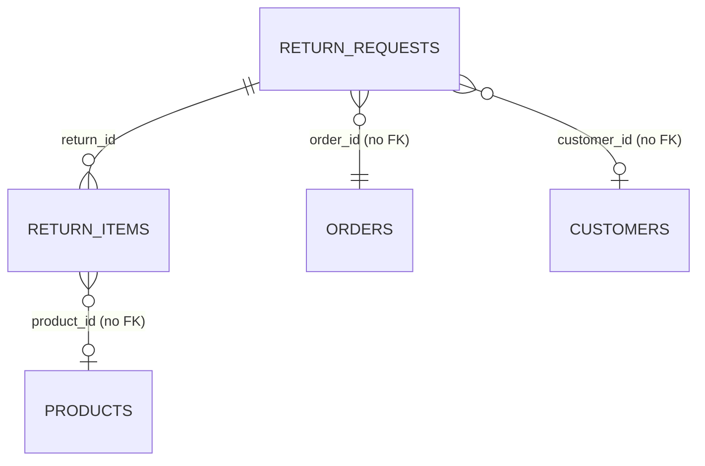
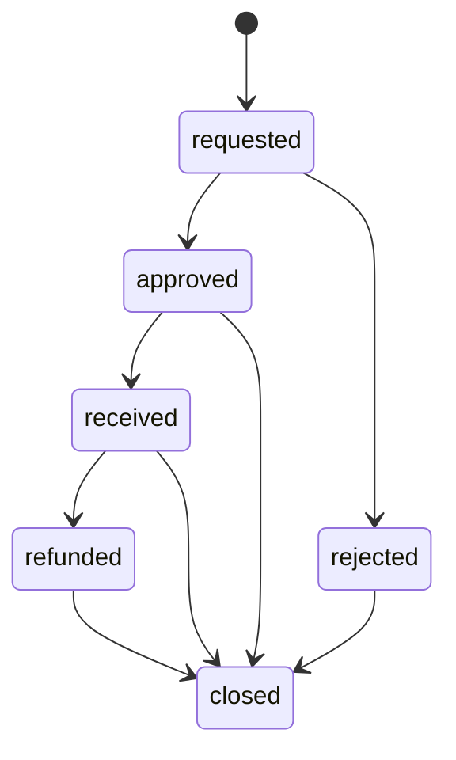

# Returns (`returns`)

The Returns module handles RMA / return requests (Czech: *reklamace*) raised against orders. Shop staff create a return request referencing an order id (and optionally a customer id), attach the returned line items, pick a resolution (refund, exchange, store credit, none) and move the request through a fixed status workflow. Every change is emitted as a platform event so [Webhooks](webhooks.md) and other modules can react. The module is used by e-commerce back-office operators and, through the REST API, by external systems (storefronts, ERPs).

## At a glance

| Item | Value |
| --- | --- |
| Module id | `returns` |
| Version | `1.99.0` (`modules/Returns/module.php`, `ReturnsModule::version()`) |
| Directory | `modules/Returns/` |
| Requires | `core ^1.0`, `currency ^1.1` |
| Optional | `orders ^1.0`, `shop ^1.0`, `warehouse ^1.0` (declared in manifest; no hard code dependency on them) |
| Capabilities provided | `returns` (registered with `ReturnsProvider` as the capability object) |
| Capabilities consumed | none explicitly; `Modules\Currency\Application\CurrencyBuilder` is injected into the admin controller (hard dependency on [Currency](currency.md)); `Modules\Customers\Domain\Customer` is used behind `class_exists()` in `OpenReturnsWidget` |
| Groups / packages | none in `module.php`; not listed in `config/module_groups.php` (ungrouped module) |
| Permissions | `returns.view` (`perm.returns.view`), `returns.manage` (`perm.returns.manage`) — group `perm.group.returns` |
| API scopes | `returns.read`, `returns.write` |
| Author | GEREQ |

Manifest icon: `undo`. Description key: `module.returns.description`.

## Domain model

Both entities live in `modules/Returns/Domain/` and use UUID v7 string primary keys (36 chars). There are no Doctrine associations; relations are by id columns.

### `ReturnRequest` → table `return_requests`

Attributes: `#[ORM\UniqueConstraint(uniq_return_requests_number)]` on `number`, indexes `idx_return_requests_order (order_id)`, `idx_return_requests_status (status)`. The entity is also a form entity: `#[FormEntity('returns.save')]` + `#[FormGenerator(exclude: [id, number, status, createdAt, updatedAt], form: 'returns.save', cols: 2)]`, so the admin form is generated from `#[FormField]` attributes.

| Field | Column / type | Notes |
| --- | --- | --- |
| `id` | `id` string(36) PK | UUID v7 |
| `number` | `number` string(64), unique | `RMA-<YYYY>-<NNNN>` generated by `ReturnsProvider::nextNumber()` |
| `orderId` | `order_id` string(36) | required; free reference to an [Orders](orders.md) id (no FK) |
| `customerId` | `customer_id` string(36) nullable | reference to [Customers](customers.md) |
| `status` | `status` string(32) | default `requested`; see statuses below |
| `reason` | `reason` text | required |
| `resolution` | `resolution` string(32) nullable | one of `RESOLUTIONS` |
| `refundAmount` | `refund_amount` decimal(14,2) nullable | normalised with `number_format(..., 2, '.', '')` |
| `currency` | `currency` string(3) | default `CZK`, upper-cased |
| `note` | `note` text nullable | |
| `createdAt` / `updatedAt` | `created_at`, `updated_at` datetime | `touch()` on every setter |

Constants:

- `ReturnRequest::STATUSES = ['requested', 'approved', 'rejected', 'received', 'refunded', 'closed']`
- `ReturnRequest::RESOLUTIONS = ['refund', 'exchange', 'store_credit', 'none']`

`setStatus()` / `setResolution()` throw `InvalidArgumentException` with translation keys `returns.error.invalid_status` / `returns.error.invalid_resolution` for unknown values. `statusLabel()` returns `returns.status.<status>`, `resolutionLabel()` returns `returns.resolution.<resolution>`.

### `ReturnItem` → table `return_items`

Index `idx_return_items_return (return_id)`.

| Field | Column / type | Notes |
| --- | --- | --- |
| `id` | `id` string(36) PK | UUID v7 |
| `returnId` | `return_id` string(36) | parent `ReturnRequest.id` |
| `productId` | `product_id` string(36) nullable | reference to [Products](products.md) |
| `title` | `title` string(190) | required |
| `qty` | `qty` integer | default 1, clamped to `>= 1` |
| `reason` | `reason` text nullable | per-line reason |

### Status transitions

The code does not enforce a state machine: `ReturnRequest::setStatus()` accepts any value from `STATUSES`, and both the admin `updateStatus` action and the API `POST /{id}/status` allow jumping from any status to any other. The intended flow (as reflected by widget grouping in `ReturnStatsWidget::OPEN_STATUSES = ['requested', 'approved', 'received']`) is:

`requested`, `approved`, `received` are treated as "open" (need shop action); `rejected`, `refunded`, `closed` are terminal for reporting purposes. Every status change emits `return.status_changed` and (admin only) `return.updated`.

## Admin UI

### Menu (`ReturnsModule::boot()`)

| Menu id | Label key | Icon | Route | Permission | Order / group |
| --- | --- | --- | --- | --- | --- |
| `returns` | `nav.returns` | `undo` | `admin.returns.index` | `returns.view` | 33, group `Obchod` |
| `returns.create` | `nav.returns.create` | — | `admin.returns.create` | `returns.manage` | 34, parent `returns`, hidden |

Command palette entry: `returns.index` (`palette.returns.index`, URL `/admin/returns`, keywords `reklamace`, `return`, `rma`, `vrácení`).

### Routes (`ReturnsModule::register()`, group `/admin/returns`, middleware `auth`)

| Method | Path | Route name | Controller::action | Permission |
| --- | --- | --- | --- | --- |
| GET | `/admin/returns` | `admin.returns.index` | `ReturnController::index` | `returns.view` |
| GET | `/admin/returns/create` | `admin.returns.create` | `ReturnController::create` | `returns.manage` |
| POST | `/admin/returns` | `admin.returns.store` | `ReturnController::store` | `returns.manage` |
| GET | `/admin/returns/{id}` | `admin.returns.show` | `ReturnController::show` | `returns.view` |
| POST | `/admin/returns/{id}/status` | `admin.returns.status` | `ReturnController::updateStatus` | `returns.manage` |
| POST | `/admin/returns/{id}/delete` | `admin.returns.destroy` | `ReturnController::destroy` | `returns.manage` |

Controller: `modules/Returns/Http/ReturnController.php`.

### Screens

- **Index** (`Resources/views/index.html.twig`): paginated list via `ListQuery` (sortable `status`, `number`, `createdAt`; default `createdAt desc`; search over `number`, `orderId`, `reason`; filter `status`).
- **Create form** (`form.html.twig`): generated fields from `ReturnRequest` (`order_id`, `customer_id`, `reason`, `resolution`, `refund_amount`, `currency`, `note`) plus repeatable line rows posted as parallel arrays `item_title[]`, `item_qty[]`, `item_product_id[]`, `item_reason[]` (parsed in `ReturnController::parseItems()`; rows with an empty title are skipped). Currency is normalised through `CurrencyBuilder::code()`.
- **Detail** (`show.html.twig`): hero with status/resolution/refund, reason and note, items table, status change form (`status`, optional `resolution`, `refund_amount`, `note`) and a delete form using `data-confirm`.

There is no edit route for an existing request in the admin UI; edits after creation are limited to the status form (status, resolution, refund amount, note). Full update is only available via the API `PATCH`.

### Settings

None. The module reads no settings keys.

## Public / REST API

Registered via `$context->api()->module('returns', ...)`, base path `/api/v1/returns` (see `../architecture/api.md`). Controller `modules/Returns/Http/Api/ReturnApiController.php`.

| Method | Path | Scope | Action |
| --- | --- | --- | --- |
| GET | `/api/v1/returns/` | `returns.read` | `index` — `ApiQuery` (sortable `status`, `number`, `createdAt`; filters `status`, `order_id`; search on `number`, `orderId` via `self_repair_search()`) |
| POST | `/api/v1/returns/` | `returns.write` | `store` — validates ruleset `returns.save`; optional `items[]` array of `{title, qty, product_id, reason}`; returns 201 |
| GET | `/api/v1/returns/{id}` | `returns.read` | `show` (with `items`) |
| PATCH | `/api/v1/returns/{id}` | `returns.write` | `update` — full `returns.save` validation (`order_id`, `reason` required) |
| DELETE | `/api/v1/returns/{id}` | `returns.write` | `destroy` — deletes items then request; returns `{id, deleted: true}` |
| POST | `/api/v1/returns/{id}/status` | `returns.write` | `updateStatus` — ruleset `returns.status`; optional `resolution`, `refund_amount` |

Body parsing merges form fields with a JSON body (`ReturnApiController::body()`).

Serializer (`ser()`): `id`, `number`, `order_id`, `customer_id`, `status`, `reason`, `resolution`, `refund_amount`, `currency`, `note`, `created_at`, `updated_at` (ATOM); with `items` (`id`, `product_id`, `title`, `qty`, `reason`) on show/store/update/status.

Public (`/api/public/*`) endpoints: None.

## Events, hooks & webhooks

Platform events registered in `register()` (all `webhookEnabled(true)`, source module `returns`, Czech descriptions):

| Event | Description | Emitted from |
| --- | --- | --- |
| `return.created` | Reklamace vytvořena | admin `store`, API `store` |
| `return.updated` | Reklamace upravena | admin `updateStatus` (together with `status_changed`), API `update` |
| `return.status_changed` | Změněn stav reklamace | admin `updateStatus`, API `updateStatus` |
| `return.deleted` | Reklamace smazána | admin `destroy` (payload `{id, number}`), API `destroy` (payload `{id}`) |

Emission uses `EventBus::emit($name, ['type' => 'return_request', 'id' => ...], $payload)`; the payload is the same shape as the API serializer. See `../architecture/hooks-events-webhooks.md`.

Audit log entries (`Gereq\Audit\Auditor`): `returns.created`, `returns.deleted` (admin controller only).

Validation rulesets (`$context->validation()`):

- `returns.save`: `order_id required|max:36`, `customer_id nullable|max:36`, `reason required|min:2|max:20000`, `resolution nullable|in:refund,exchange,store_credit,none`, `refund_amount nullable`, `currency nullable|max:3`, `note nullable|max:20000`; bound to the entity via `$context->forms()->entity('returns.save', ReturnRequest::class)`.
- `returns.status`: `status required|in:requested,approved,rejected,received,refunded,closed`.

Hooks, queue jobs, scheduled tasks, publishables: None.

## Dashboard widgets

All widgets extend `Gereq\Admin\Dashboard\TwigDashboardWidget` and are registered in `boot()` (see `../architecture/dashboard-widgets.md`).

| Widget id | Type | Class | Shows | Permission | Order |
| --- | --- | --- | --- | --- | --- |
| `returns.shortcut` | shortcut | `Application/Widgets/ReturnsShortcutWidget.php` | Link to `admin.returns.index`, icon `undo`, hint `admin.dashboard.hint.returns` | `returns.view` | 33 |
| `returns.stats` | metric | `Application/Widgets/ReturnStatsWidget.php` | Count of open returns (`requested`+`approved`+`received`), hint with number still `requested` | `returns.view` | 56 |
| `returns.open` | panel | `Application/Widgets/OpenReturnsWidget.php` | Up to 8 oldest open returns with customer name (if [Customers](customers.md) present) or shortened reason, refund amount, status badge tone | `returns.view` | 30 |

Templates used: `admin/dashboard/widgets/shortcut.html.twig`, `metric.html.twig`, `list_panel.html.twig` (core).

## Services & extension points

| Class | Responsibility |
| --- | --- |
| `Modules\Returns\Application\ReturnsProvider` | Capability object for `returns`: `find(id)`, `forOrder(orderId, limit = 50)` (newest first), `nextNumber()` (`RMA-YYYY-NNNN`, count-based per year). Other modules (e.g. [Orders](orders.md)) can resolve it via the capability registry to list returns for an order. |
| `Modules\Returns\Http\ReturnController` | Admin CRUD-ish controller; depends on `CurrencyBuilder` from [Currency](currency.md) for currency code normalisation. |
| `Modules\Returns\Http\Api\ReturnApiController` | REST controller. |

Integration guards: `OpenReturnsWidget::customerNames()` checks `class_exists(Modules\Customers\Domain\Customer::class)` and wraps the query in `try/catch`. No integration code exists for the optional `orders`, `shop` or `warehouse` dependencies (no stock return-to-warehouse or order status linkage).

## CLI commands

None.

## Configuration & translations

- Settings keys: none.
- Environment variables: none.
- Translations: `modules/Returns/Resources/translations/messages.cs.php`, `messages.en.php`. Prefixes: `module.returns.*`, `nav.returns*`, `palette.returns.*`, `perm.returns.*`, `perm.group.returns`, `returns.*` (`returns.status.*`, `returns.resolution.*`, `returns.field.*`, `returns.flash.*`, `returns.error.*`, `returns.widget.*`). The shortcut hint `admin.dashboard.hint.returns` lives in core `resources/translations/messages.*.php`.

## Database migrations

| File | Purpose |
| --- | --- |
| `Database/Migrations/2026_01_01_000001_returns.php` | Placeholder with empty `up()`/`down()`; tables `return_requests` and `return_items` are created by the platform's `SchemaTool` sync from entity metadata (`src/Database/Migrator.php`). |

## Notes

- No state machine: any status can be set from any status (admin and API). `ReturnStatsWidget::OPEN_STATUSES` is the only place that groups statuses semantically.
- `nextNumber()` is count-based (`COUNT(number LIKE 'RMA-YYYY-%') + 1`), so deleting a return can lead to a duplicate number attempt on the next create (blocked by the unique constraint, surfaces as a DB error).
- Return line items cannot be edited or removed after creation via the admin UI; `PATCH /api/v1/returns/{id}` does not touch items either.
- `order_id`, `customer_id` and `product_id` are plain strings without foreign keys or existence validation; the admin form asks for raw ids.
- API `store` emits `return.created` with items in the payload; admin `store` emits without items.
- `README.md` in the module still says v1.0.3 while the manifest is 1.1.0.
- Event descriptions passed to `EventDefinition::description()` are Czech literals, not translation keys.
