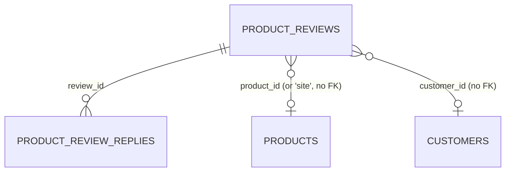

# Reviews (`reviews`)

The Reviews module stores customer reviews and ratings (1–5 stars) for products, and — using the reserved subject id `site` — site-wide testimonials for agencies (the RealEstates storefront home page consumes them). Reviews arrive from the admin (manually entered references), from the authenticated REST API (storefront or importers of Google/Facebook reviews) and are moderated by staff (`pending → approved / rejected`). Approved reviews are published through a CORS-enabled public endpoint. The module ships settings for Google Places / Facebook review sources, merchant replies and a default locale.

## At a glance

| Item | Value |
| --- | --- |
| Module id | `reviews` |
| Version | `1.99.0` (`modules/Reviews/module.php`, `ReviewsModule::version()`) |
| Directory | `modules/Reviews/` |
| Requires | `core ^1.0` |
| Optional | `products ^1.0`, `customers ^1.0` (declared only; no code references to those modules) |
| Capabilities provided | `reviews` (capability object `ReviewsProvider`) |
| Capabilities consumed | none |
| Groups / packages | none in `module.php`; listed in `config/module_groups.php` under package **`realestates`** (not required) |
| Permissions | `reviews.view` (`perm.reviews.view`), `reviews.manage` (`perm.reviews.manage`) — group `perm.group.reviews` |
| API scopes | `reviews.read`, `reviews.write` |
| Author | GEREQ |

Manifest icon: `star`. Description key: `module.reviews.description`.

## Domain model

Entities in `modules/Reviews/Domain/`, UUID v7 string keys, no Doctrine associations (id columns only).

### `ProductReview` → table `product_reviews`

Indexes: `idx_product_reviews_product (product_id)`, `idx_product_reviews_status (status)`, `idx_product_reviews_source (source)`; unique `uniq_product_reviews_external (source, external_id)`.

| Field | Column / type | Notes |
| --- | --- | --- |
| `id` | `id` string(36) PK | UUID v7 |
| `productId` | `product_id` string(36) | required; [Products](products.md) id or `ProductReview::SITE_PRODUCT_ID = 'site'` for site-wide testimonials |
| `customerId` | `customer_id` string(36) nullable | [Customers](customers.md) id |
| `authorName` | `author_name` string(190) | required |
| `authorEmail` | `author_email` string(190) nullable | |
| `rating` | `rating` integer | 1–5, validated in constructor and `setRating()` (`reviews.error.invalid_rating`) |
| `title` | `title` string(190) nullable | |
| `body` | `body` text | required |
| `status` | `status` string(32), default `pending` | see statuses |
| `source` | `source` string(32), default `local` | see sources |
| `externalId` | `external_id` string(190) nullable | id at external source |
| `externalUrl` | `external_url` string(500) nullable | link to the external review |
| `isVerifiedPurchase` | `is_verified_purchase` bool, default `false` | |
| `helpfulCount` | `helpful_count` int, default `0` | `markHelpful()` increments, `setHelpfulCount()` clamps `>= 0` |
| `locale` | `locale` string(16), default `cs` | `setLocale('')` falls back to `cs` |
| `createdAt` / `updatedAt` | `created_at`, `updated_at` datetime | |

Constants:

- `STATUSES = ['pending', 'approved', 'rejected']` — `approve()` / `reject()` helpers, `statusLabel()` → `reviews.status.<status>`
- `SOURCES = ['local', 'google', 'facebook']` — `sourceLabel()` → `reviews.source.<source>`
- `SITE_PRODUCT_ID = 'site'`

Status flow: new reviews start `pending` (API) or the status chosen in the admin form (default `approved`). Moderation sets `approved` or `rejected`; `PATCH /api/v1/reviews/{id}` can also set any of the three statuses, including back to `pending`.

### `ProductReviewReply` → table `product_review_replies`

Index `idx_product_review_replies_review (review_id)`.

| Field | Column / type | Notes |
| --- | --- | --- |
| `id` | `id` string(36) PK | |
| `reviewId` | `review_id` string(36) | parent `ProductReview.id` |
| `authorName` | `author_name` string(190) | |
| `body` | `body` text | `setBody()` touches `updatedAt` |
| `isOfficial` | `is_official` bool, default `true` | merchant reply flag |
| `createdAt` / `updatedAt` | datetime | |

## Admin UI

### Menu (`ReviewsModule::boot()`)

| Menu id | Label key | Icon | Route | Permission | Order / group |
| --- | --- | --- | --- | --- | --- |
| `reviews` | `nav.reviews` | `star` | `admin.reviews.index` | `reviews.view` | 52, group `Obsah` |
| `reviews.settings` | `nav.reviews.settings` | `settings` | `admin.reviews.settings` | `reviews.manage` | 53, parent `reviews`, group `Obsah` |

Command palette: `reviews.index` (`palette.reviews.index`, `/admin/reviews`), `reviews.create` (`palette.reviews.create`, `/admin/reviews/create`, icon `plus`), `reviews.settings` (`palette.reviews.settings`, `/admin/reviews/settings`).

### Routes (group `/admin/reviews`, middleware `auth`)

| Method | Path | Route name | Controller::action | Permission |
| --- | --- | --- | --- | --- |
| GET | `/admin/reviews` | `admin.reviews.index` | `ReviewController::index` | `reviews.view` |
| GET | `/admin/reviews/create` | `admin.reviews.create` | `ReviewController::create` | `reviews.manage` |
| POST | `/admin/reviews` | `admin.reviews.store` | `ReviewController::store` | `reviews.manage` |
| GET | `/admin/reviews/settings` | `admin.reviews.settings` | `ReviewSettingsController::edit` | `reviews.manage` |
| POST | `/admin/reviews/settings` | `admin.reviews.settings.update` | `ReviewSettingsController::update` | `reviews.manage` |
| GET | `/admin/reviews/{id}` | `admin.reviews.show` | `ReviewController::show` | `reviews.view` |
| POST | `/admin/reviews/{id}/approve` | `admin.reviews.approve` | `ReviewController::approve` | `reviews.manage` |
| POST | `/admin/reviews/{id}/reject` | `admin.reviews.reject` | `ReviewController::reject` | `reviews.manage` |
| POST | `/admin/reviews/{id}/replies` | `admin.reviews.replies.store` | `ReviewController::storeReply` | `reviews.manage` |
| POST | `/admin/reviews/{id}/replies/{replyId}/delete` | `admin.reviews.replies.destroy` | `ReviewController::destroyReply` | `reviews.manage` |
| POST | `/admin/reviews/{id}/delete` | `admin.reviews.destroy` | `ReviewController::destroy` | `reviews.manage` |

Controllers: `modules/Reviews/Http/ReviewController.php`, `ReviewSettingsController.php`.

### Screens

- **Index** (`Resources/views/index.html.twig`): `ListQuery` list, sortable `rating`, `createdAt`, `status` (default `createdAt desc`), search over `authorName`, `title`, `body`, `productId`, filter `status`.
- **Create** (`form.html.twig`): admin-entered review; ruleset `reviews.admin.create`. Empty `product_id` becomes `site`; status defaults to `approved`; `locale` optional. Emits `review.created` and, when approved, also `review.approved`.
- **Detail** (`show.html.twig`): review body, rating, source, product average rating (`ReviewsProvider::averageRating()`), approve / reject / delete actions, list of `ProductReviewReply` rows with create/delete forms when `reviews.manage` and `reviews.replies_enabled` (`reviews.replies.*` labels). Author defaults to `brand.name`, then signed-in user name, then `reviews.replies.default_author`.
- **Settings** (`settings.html.twig`): three sections — Google (`reviews.google_enabled`, `reviews.google_place_id`, `reviews.google_api_key`), Facebook (`reviews.facebook_enabled`, `reviews.facebook_page_id`, `reviews.facebook_access_token`), General (`reviews.replies_enabled`, `reviews.default_locale`). Secrets (encrypted type or key containing `token`/`api_key`/`secret`/`password`) are not overwritten when submitted empty. Field names are the key with `.` replaced by `__`. Saving logs audit `reviews.settings.updated`.

## Public / REST API

### Authenticated API (`/api/v1/reviews`, see `../architecture/api.md`)

Controller `modules/Reviews/Http/Api/ReviewApiController.php`.

| Method | Path | Scope | Action |
| --- | --- | --- | --- |
| GET | `/api/v1/reviews/product/{productId}` | `reviews.read` | `forProduct` — approved reviews (max 50, newest first); meta `total`, `average_rating`, `product_id` |
| POST | `/api/v1/reviews/` | `reviews.write` | `store` — ruleset `reviews.create`; rating must be 1–5 (422 `validation_error` otherwise); `source` other than `local` emits `review.imported` instead of `review.created`; new review is `pending` |
| PATCH | `/api/v1/reviews/{id}` | `reviews.write` | `moderate` — ruleset `reviews.moderate` (`status in pending,approved,rejected`); emits `review.approved` / `review.rejected` |

Serializer (`ser()`): `id`, `product_id`, `customer_id`, `author_name`, `author_email`, `rating`, `title`, `body`, `status`, `source`, `external_id`, `external_url`, `is_verified_purchase`, `helpful_count`, `locale`, `created_at`, `updated_at`.

There is no list/index, show, or delete endpoint in the v1 API.

### Public storefront API (no token)

Controller `modules/Reviews/Http/Public/PublicReviewsController.php`, CORS via `Gereq\Http\PublicCors::apply(..., 'GET, OPTIONS')`.

| Method | Path | Route name | Description |
| --- | --- | --- | --- |
| OPTIONS | `/api/public/reviews` | `api.public.reviews.options` | CORS preflight (204) |
| GET | `/api/public/reviews` | `api.public.reviews.index` | Approved reviews. Query: `product_id` (default `site`; `*` or `all` = all products), `locale`, `limit` (default 12, clamped 1–100). Meta: `total`, `average_rating`, `product_id` (`all` when unfiltered) |

Public serializer (`ReviewsProvider::serializePublic()`): `id`, `product_id`, `author_name`, `rating`, `title`, `body`, `source`, `external_url`, `locale`, `created_at` (no email, customer id or status).

Consumed by `storefront/src/lib/api.ts` (`/api/public/reviews`) for the home page testimonials; see `../frontend/public-frontends.md`.

## Events, hooks & webhooks

Platform events (`EventDefinition`, source `reviews`, all `webhookEnabled(true)`):

| Event | Description (Czech literal) | Emitted from |
| --- | --- | --- |
| `review.created` | Recenze vytvořena | admin `store`; API `store` with `source = local` |
| `review.approved` | Recenze schválena | admin `approve`; admin `store` when status approved; API `moderate` |
| `review.rejected` | Recenze zamítnuta | admin `reject`; API `moderate` |
| `review.deleted` | Recenze smazána | admin `destroy` (payload `{id}`) |
| `review.imported` | Externí recenze importována | API `store` with `source` `google`/`facebook` |
| `review.replied` | Odpověď na recenzi vytvořena | admin `storeReply` |

Subject passed to `EventBus::emit()` is `['type' => 'product_review', 'id' => ...]`. See `../architecture/hooks-events-webhooks.md` and [Webhooks](webhooks.md).

Audit entries: `reviews.created`, `reviews.approved`, `reviews.rejected`, `reviews.deleted`, `reviews.replied`, `reviews.reply_deleted`, `reviews.settings.updated`.

Validation rulesets: `reviews.create` (API), `reviews.admin.create` (admin form; `product_id` optional, `status`, `locale`), `reviews.moderate`, `reviews.reply.create` (`body`, optional `author_name`).

Hooks, queue jobs, scheduled tasks, publishables: None.

## Dashboard widgets

All in `modules/Reviews/Application/Widgets/`, registered in `boot()`; see `../architecture/dashboard-widgets.md`.

| Widget id | Type | Class | Shows | Permission | Order |
| --- | --- | --- | --- | --- | --- |
| `reviews.shortcut` | shortcut | `ReviewsShortcutWidget` | Link to `admin.reviews.index`, hint `admin.dashboard.hint.reviews` | `reviews.view` | 52 |
| `reviews.stats` | metric | `ReviewStatsWidget` | Count of `pending` reviews; hint with average rating and count of approved (`reviews.widget.stats.hint`) or `no_approved` | `reviews.view` | 54 |
| `reviews.pending` | panel | `PendingReviewsWidget` | Up to 6 oldest `pending` reviews with star string aside (`list_panel.html.twig`) | `reviews.view` | 26 |
| `reviews.rating.chart` | panel | `ReviewRatingChartWidget` | Bar chart of approved reviews per star (1–5), total and average (`chart_panel.html.twig`) | `reviews.view` | 27 |

## Services & extension points

| Class | Responsibility |
| --- | --- |
| `Modules\Reviews\Application\ReviewsProvider` | Capability `reviews`. `forProduct(productId, onlyApproved = true, limit = 50)`, `approved(?productId, limit = 24, ?locale)` (clamped 1–100), `averageRating(?productId)` (rounded to 2 decimals, `null` when none), `find(id)`, `serializePublic()`. Intended entry point for [Products](products.md) / CMS / storefront integrations. |
| `Modules\Reviews\Http\Public\PublicReviewsController` | Public JSON with CORS for storefront. |

No `class_exists` guards or cross-module calls exist; the optional `products` / `customers` dependencies are only referenced by id columns.

## CLI commands

None.

## Configuration & translations

Settings defined in `register()` (all owned by module `reviews`):

| Key | Type | Default | Label key |
| --- | --- | --- | --- |
| `reviews.google_enabled` | boolean | `false` | `reviews.settings.google_enabled` |
| `reviews.google_place_id` | string | `''` | `reviews.settings.google_place_id` |
| `reviews.google_api_key` | encrypted | `''` | `reviews.settings.google_api_key` |
| `reviews.facebook_enabled` | boolean | `false` | `reviews.settings.facebook_enabled` |
| `reviews.facebook_page_id` | string | `''` | `reviews.settings.facebook_page_id` |
| `reviews.facebook_access_token` | encrypted | `''` | `reviews.settings.facebook_access_token` |
| `reviews.replies_enabled` | boolean | `true` | `reviews.settings.replies_enabled` |
| `reviews.default_locale` | string | `cs` | `reviews.settings.default_locale` |

`reviews.replies_enabled` is enforced on the review detail reply form and `storeReply`. Google / Facebook keys remain configuration placeholders for importers that are not part of this module. Environment variables: none.

Translations: `Resources/translations/messages.cs.php`, `messages.en.php`; prefixes `module.reviews.*`, `nav.reviews*`, `palette.reviews.*`, `perm.reviews.*`, `perm.group.reviews`, `reviews.*` (`reviews.status.*`, `reviews.source.*`, `reviews.settings.*`, `reviews.replies.*`, `reviews.widget.*`, `reviews.flash.*`, `reviews.error.*`). `admin.dashboard.hint.reviews` and `admin.dashboard.chart.total` come from core.

## Database migrations

| File | Purpose |
| --- | --- |
| `2026_01_01_000001_reviews.php` | Empty placeholder; base table is created by `SchemaTool` from entity metadata. |
| `2026_09_05_000002_external_sources.php` | Adds `source` (default `local`), `external_id`, `external_url`, index `idx_product_reviews_source`, unique `uniq_product_reviews_external`; `afterUp()` backfills `source = 'local'`. |
| `2026_09_05_000003_verified_purchase.php` | Adds `is_verified_purchase` bool default `false`. |
| `2026_09_05_000004_helpful_votes.php` | Adds `helpful_count` int default `0`. |
| `2026_09_05_000005_review_locale.php` | Adds `locale` string(16) default `cs`; `afterUp()` backfills. |
| `2026_09_05_000006_review_replies.php` | Creates `product_review_replies` table with index on `review_id`. |

## Notes

- Merchant replies: create/delete on the review detail page when `reviews.replies_enabled` is on; emits `review.replied` and audits `reviews.replied` / `reviews.reply_deleted`.
- `is_verified_purchase` and `helpful_count` are stored and serialized but never written by any code path (`setVerifiedPurchase()` / `markHelpful()` are unused).
- Google / Facebook settings are defined and editable but there is no importer in this module; imports are expected to arrive via `POST /api/v1/reviews/` with `source` + `external_id` (unique per source).
- Admin-created reviews default to `approved` and skip moderation; API-created reviews are always `pending`.
- Public endpoint defaults to `product_id=site`, so a storefront wanting product reviews must pass the product id explicitly.
- Event descriptions are Czech literals rather than translation keys.
