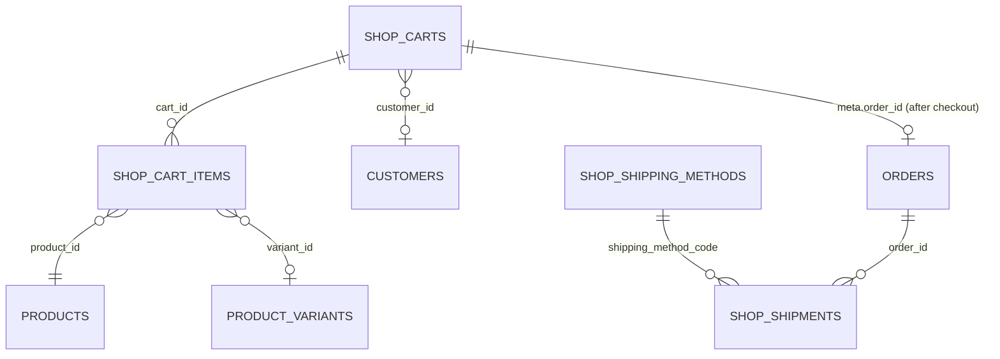

# Shop (`shop`)

The Shop module is the storefront transaction layer of GEREQ: persistent shopping carts (guest carts keyed by `session_key`, customer carts keyed by `customer_id`), cart line items with variant / personalisation support, shipping methods, a carrier-driver registry (manual, PPL scaffold, Packeta via `integrations/Packeta`) and a checkout service that turns a cart into an [Orders](orders.md) order, creates a payment intent ([Payments](payments.md)), applies a coupon ([Coupons](coupons.md)), drafts a `Shipment` and optionally decrements [Warehouse](warehouse.md) stock. Admin users monitor and abandon carts and maintain shipping methods; storefronts (Vue `frontend/`, REST clients) drive the cart through the public and authenticated APIs.

## At a glance

| Item | Value |
| --- | --- |
| Module id | `shop` |
| Version | 1.6.1 (`modules/Shop/module.php`, `ShopModule::version()`) |
| Directory | `modules/Shop/` |
| Requires | `core ^1.0`, `products ^1.2`, `currency ^1.1` |
| Optional | `orders ^1.0`, `customers ^1.0`, `warehouse ^1.0`, `customer_uploads ^1.0`, `packeta ^1.0` |
| Capabilities provided | `shop` (`ShopProvider`), `shipping_carriers` (`ShippingCarrierRegistry`) |
| Capabilities consumed | `orders`, `payments`, `coupons`, `product_discounts` (checked via `CapabilityRegistry::has()`); hard dependencies on [Products](products.md) (`Product`, `ProductVariant`, `ProductPrice`, `ProductImage`, `ProductPersonalizationService`, `ProductVariantOptionsService`) and [Currency](currency.md) (`CurrencyBuilder`) |
| Groups / packages | none in `module.php`; not listed in `config/module_groups.php` |
| Permissions | `shop.view` (`perm.shop.view`), `shop.manage` (`perm.shop.manage`) — group `perm.group.shop` |
| API scopes | `shop.read`, `shop.write` |
| Author | GEREQ |

Manifest icon: `bag`. Description key: `module.shop.description`.

## Domain model

All entities in `modules/Shop/Domain/`, UUID v7 string ids, no Doctrine associations.

### `Cart` → `shop_carts`

Indexes: `idx_shop_carts_customer (customer_id)`, `idx_shop_carts_session (session_key)`, `idx_shop_carts_status (status)`.

| Field | Column / type | Notes |
| --- | --- | --- |
| `id` | string(36) PK | |
| `customerId` | `customer_id` string(36) nullable | [Customers](customers.md) id |
| `sessionKey` | `session_key` string(64) nullable | guest storefront key |
| `currency` | string(3) | upper-cased, default `CZK` |
| `status` | string(32) | `open` (default), `converted`, `abandoned` (`Cart::STATUSES`) |
| `meta` | `meta` json nullable | checkout snapshot (`order_id`, `shipping`, `payment`, `coupon`, `totals`, addresses, `note`); `mergeMeta()` |
| `createdAt` / `updatedAt` | datetime | |

`isOpen()`, `statusLabel()` → `shop.cart.status.<status>`. Status flow: `open → converted` (checkout) or `open → abandoned` (admin action); `CartService::assertOpen()` blocks mutations on non-open carts (`shop.error.cart_not_open`).

### `CartItem` → `shop_cart_items`

Indexes: `idx_shop_cart_items_cart (cart_id)`, `idx_shop_cart_items_product (product_id)`.

| Field | Column / type | Notes |
| --- | --- | --- |
| `id` | string(36) PK | |
| `cartId` | `cart_id` string(36) | parent `Cart` |
| `productId` | `product_id` string(36) | [Products](products.md) product |
| `variantId` | `variant_id` string(36), default `''` | `ProductVariant` id; getter returns `null` when empty |
| `title` | string(190) | product name (+ ` — variant name`) |
| `sku` | string(64) | upper-cased |
| `qty` | decimal(18,4) | stored as string |
| `unitPrice` | `unit_price` decimal(14,2) | resolved at add time |
| `currency` | string(3) | |
| `itemNote` | `item_note` text nullable | customer personalisation note |
| `metaJson` | `meta_json` text nullable | JSON; `upload_ids[]` (CustomerUploads) |

Helpers: `lineTotal()`, `uploadIds()`, `isPersonalized()` (note or uploads present).

### `ShippingMethod` → `shop_shipping_methods`

Unique `uniq_shop_shipping_code (code)`. Form entity `#[FormEntity('shop.shipping.save')]` with `#[FormGenerator(exclude: [id, createdAt, updatedAt], cols: 2)]`.

| Field | Column / type | Notes |
| --- | --- | --- |
| `code` | string(64) | upper-cased, unique |
| `name` | string(190) | |
| `carrier` | string(64) nullable | key in `ShippingCarrierRegistry` (`manual`, `ppl`, `packeta`, `zasilkovna`, …) |
| `type` | string(32), default `courier` | `ShippingMethod::TYPES = ['pickup', 'courier', 'parcel_shop', 'post', 'express']`; unknown → `courier` |
| `price` | decimal(14,2) | |
| `currency` | string(3) | |
| `estimatedDays` | `estimated_days` int nullable | |
| `sortOrder` | `sort_order` int, default 0 | |
| `description` | text nullable | |
| `active` | `is_active` bool | form field name `active` |
| `createdAt` / `updatedAt` | datetime | |

### `Shipment` → `shop_shipments`

Indexes: `idx_shop_shipments_order (order_id)`, `idx_shop_shipments_status (status)`. "Generic shipment record for any carrier driver."

| Field | Column / type | Notes |
| --- | --- | --- |
| `orderId` | `order_id` string(36) | [Orders](orders.md) order |
| `carrier` | string(64) | lower-cased, default `manual` |
| `shippingMethodCode` | `shipping_method_code` string(64) nullable | |
| `status` | string(32) | `Shipment::STATUSES = ['draft', 'created', 'label_ready', 'in_transit', 'delivered', 'returned', 'cancelled']`, default `draft` |
| `trackingNumber` | `tracking_number` string(128) nullable | |
| `externalId` | `external_id` string(190) nullable | carrier-side id |
| `parcelPointId` | `parcel_point_id` string(64) nullable | |
| `labelUrl` | `label_url` text nullable | |
| `metaJson` | `meta_json` text nullable | carrier response |
| `createdAt` / `updatedAt` | datetime | |

## Admin UI

### Menu (`ShopModule::boot()`)

| Menu id | Label key | Icon | Route | Permission | Order / group |
| --- | --- | --- | --- | --- | --- |
| `shop` | `nav.shop` | `bag` | `admin.shop.carts.index` | `shop.view` | 28, group `Obchod` |
| `shop.carts` | `nav.shop.carts` | — | `admin.shop.carts.index` | `shop.view` | 29, parent `shop` |
| `shop.shipping` | `nav.shop.shipping` | — | `admin.shop.shipping.index` | `shop.view` | 30, parent `shop` |

Command palette: `shop.carts` (`palette.shop.carts`, `/admin/shop/carts`, icon `cart`), `shop.shipping` (`palette.shop.shipping`, `/admin/shop/shipping-methods`, icon `truck`).

### Routes (middleware `auth`)

| Method | Path | Route name | Controller::action | Permission |
| --- | --- | --- | --- | --- |
| GET | `/admin/shop/carts` | `admin.shop.carts.index` | `CartController::index` | `shop.view` |
| POST | `/admin/shop/carts/bulk` | `admin.shop.carts.bulk` | `CartController::bulk` | `shop.manage` |
| GET | `/admin/shop/carts/{id}` | `admin.shop.carts.show` | `CartController::show` | `shop.view` |
| POST | `/admin/shop/carts/{id}/abandon` | `admin.shop.carts.abandon` | `CartController::abandon` | `shop.manage` |
| GET | `/admin/shop/shipping-methods` | `admin.shop.shipping.index` | `ShippingMethodController::index` | `shop.view` |
| GET | `/admin/shop/shipping-methods/create` | `admin.shop.shipping.create` | `ShippingMethodController::create` | `shop.manage` |
| POST | `/admin/shop/shipping-methods` | `admin.shop.shipping.store` | `ShippingMethodController::store` | `shop.manage` |
| POST | `/admin/shop/shipping-methods/bulk` | `admin.shop.shipping.bulk` | `ShippingMethodController::bulk` | `shop.manage` |
| GET | `/admin/shop/shipping-methods/{id}/edit` | `admin.shop.shipping.edit` | `ShippingMethodController::edit` | `shop.manage` |
| POST | `/admin/shop/shipping-methods/{id}` | `admin.shop.shipping.update` | `ShippingMethodController::update` | `shop.manage` |
| POST | `/admin/shop/shipping-methods/{id}/toggle` | `admin.shop.shipping.toggle` | `ShippingMethodController::toggle` | `shop.manage` |
| POST | `/admin/shop/shipping-methods/{id}/delete` | `admin.shop.shipping.destroy` | `ShippingMethodController::destroy` | `shop.manage` |

Controllers: `modules/Shop/Http/CartController.php`, `ShippingMethodController.php`.

### Screens

- **Carts index** (`Resources/views/carts/index.html.twig`): `ListQuery` sortable `updatedAt`, `createdAt`, `status`, `currency`; filters `status`, `has_customer` (`1`/`0`), `currency`; search over `id`, `customerId`, `sessionKey`; totals per row via `CartService::totalsMap()`; customer names resolved when `Modules\Customers\Domain\Customer` exists. Bulk actions (`shop.carts.bulk` ruleset): `abandon`, `delete` (requires `confirmed`).
- **Cart detail** (`carts/show.html.twig`): items, totals, meta (checkout snapshot), customer (guarded `class_exists(Customer::class)`), abandon action (only for open carts; audit `shop.cart.abandoned`).
- **Shipping methods index** (`shipping/index.html.twig`): sortable `sortOrder`, `code`, `name`, `price`; filters `active`, `type`, `carrier`; search `code`, `name`, `carrier`; bulk `activate` / `deactivate` / `delete` (`shop.shipping.bulk`).
- **Shipping method form** (`shipping/form.html.twig`): generated from `ShippingMethod` form fields (ruleset `shop.shipping.save`). Store/update/toggle/destroy emit `shipping.method_*` events and audit `shop.shipping.created|updated|toggled|deleted`.

### Settings

The module defines settings but ships no settings page; `shop.store_name`, `shop.default_currency` and `shop.checkout_enabled` are written by the core setup wizard (`src/Admin/Http/SetupController.php`). Labels `shop.settings.*` exist in the translations (including Packeta keys used by `integrations/Packeta`).

## Public / REST API

### Authenticated API (`/api/v1/shop`, see `../architecture/api.md`)

| Method | Path | Scope | Controller::action | Notes |
| --- | --- | --- | --- | --- |
| GET | `/api/v1/shop/cart` | `shop.read` | `CartApiController::show` | Resolves cart by `cart_id` query/body, else by `customer_id` (query) / `X-Session-Key` header or `session_key` query |
| POST | `/api/v1/shop/cart` | `shop.write` | `CartApiController::store` | `resolveOrCreate(customer_id, session_key, currency)` |
| POST | `/api/v1/shop/cart/items` | `shop.write` | `CartApiController::addItem` | ruleset `shop.cart.item.add` (`product_id`, `qty`, `cart_id`, `session_key`, `customer_id`) + `variant_id`, `note`, `upload_ids[]` |
| PATCH | `/api/v1/shop/cart/items/{id}` | `shop.write` | `CartApiController::updateItem` | ruleset `shop.cart.item.update` (`qty`; `qty <= 0` removes) |
| DELETE | `/api/v1/shop/cart/items/{id}` | `shop.write` | `CartApiController::removeItem` | returns `{id, deleted, cart}` |
| GET | `/api/v1/shop/shipping-methods` | `shop.read` | `ShippingMethodApiController::index` | `ApiQuery` sortable `code`, `name`, `price`, `sortOrder`; filters `active`, `currency`, `type`, `carrier`; search `code`, `name`, `carrier` |
| POST | `/api/v1/shop/shipping-methods` | `shop.write` | `ShippingMethodApiController::store` | ruleset `shop.shipping.save`; 422 `Code taken` |
| GET | `/api/v1/shop/shipping-methods/{id}` | `shop.read` | `ShippingMethodApiController::show` | |
| PATCH | `/api/v1/shop/shipping-methods/{id}` | `shop.write` | `ShippingMethodApiController::update` | |
| DELETE | `/api/v1/shop/shipping-methods/{id}` | `shop.write` | `ShippingMethodApiController::destroy` | |
| POST | `/api/v1/shop/checkout` | `shop.write` | `CheckoutApiController::store` | ruleset `shop.checkout`; supports `Idempotency-Key` header (`Gereq\Api\IdempotencyService`); returns 201 with `cart`, `order_id`, `order_number`, `access_token`, `mode`, `totals`, `shipping`, `payment`, `payment_intent`, `coupon` |

Serializers: cart — `CartService::serialize()` (`id`, `customer_id`, `session_key`, `currency`, `status`, `meta`, `totals{subtotal, shipping, payment_fee, discount, total, currency, item_count}`, `created_at`, `updated_at`, `items[]`); item — `serializeItem()` (`id`, `cart_id`, `product_id`, `variant_id`, `title`, `sku`, `qty`, `unit_price`, `currency`, `line_total`, `note`, `upload_ids`, `image_url` (`/media/<asset>/file`), `customer_note_mode`); shipping method — `id`, `code`, `name`, `carrier`, `type`, `description`, `price`, `currency`, `active`, `estimated_days`, `sort_order`, `created_at`, `updated_at`.

### Public storefront API (no token, CORS via `Gereq\Http\PublicCors`)

Controllers `Http/Public/PublicStoreCartController.php` ("Public cart + checkout for Vue storefront (session_key, no Bearer)") and `PublicStoreShippingController.php`. Guest identity is the `session_key` (body or `?session_key=`). See `../frontend/public-frontends.md`.

| Method | Path | Route name | Description |
| --- | --- | --- | --- |
| OPTIONS | `/api/public/store/cart`, `/cart/items`, `/cart/items/{id}`, `/checkout` | `api.public.store.*.options` | preflight, `GET, POST, PATCH, DELETE, OPTIONS` |
| GET | `/api/public/store/cart` | `api.public.store.cart` | resolve-or-create guest cart for `session_key` |
| POST | `/api/public/store/cart` | `api.public.store.cart.store` | create with optional `currency` (201) |
| POST | `/api/public/store/cart/items` | `api.public.store.cart.items` | `product_id`, `qty`, `variant_id`, `note`, `upload_ids[]`; `shop.*` / `products.*` error keys are translated |
| PATCH | `/api/public/store/cart/items/{id}` | `api.public.store.cart.items.update` | `qty`, optional `note` |
| DELETE | `/api/public/store/cart/items/{id}` | `api.public.store.cart.items.delete` | |
| POST | `/api/public/store/checkout` | `api.public.store.checkout` | requires `cart_id` and matching `session_key` (`hash_equals`, else 404); body `customer{name,email,phone,address}`, `shipping{method (default PICKUP), address}`, `payment_method`, `note`; returns 201 `{order_id, order_number, access_token}` |
| OPTIONS/GET | `/api/public/store/shipping-methods` | `api.public.store.shipping` | active methods excluding `parcel_shop`; fields `code`, `name`, `type`, `description`, `price`, `currency`, `estimated_days` |

Public cart shape (`storeCart()`): `id`, `currency`, `items[{id, product_id, variant_id, name, sku, qty (float), unit_price, line_total, note, upload_ids, image_url, customer_note_mode}]`, `totals{items, grand}`.

## Events, hooks & webhooks

Platform events (`EventDefinition`, source `shop`, all `webhookEnabled(true)`):

| Event | Description | Emitted from |
| --- | --- | --- |
| `cart.updated` | Košík aktualizován | `CartService` on create / add / update / remove (payload = serialized cart) |
| `cart.converted` | Košík převeden | `CheckoutService::checkout()` |
| `checkout.completed` | Checkout dokončen | `CheckoutService::checkout()` — payload `cart_id`, `order_id`, `order_number`, `mode` (`order`/`cart`), `totals`, `shipping`, `payment`, `coupon`, `customer_id` |
| `shipping.method_created` / `_updated` / `_deleted` | Způsob dopravy … | admin + API shipping method controllers (toggle emits `_updated`) |

`CheckoutService::createOrder()` additionally emits **`order.created`** (owned by [Orders](orders.md)) with `source: 'shop.checkout'`.

Audit entries: `shop.cart.abandoned`, `shop.cart.deleted`, `shop.shipping.created|updated|toggled|deleted`.

Validation rulesets: `shop.carts.bulk`, `shop.shipping.bulk`, `shop.shipping.save` (bound to `ShippingMethod`), `shop.cart.item.add`, `shop.cart.item.update`, `shop.checkout`.

Hooks, queue jobs, scheduled tasks, publishables: None. See `../architecture/hooks-events-webhooks.md`.

## Dashboard widgets

| Widget id | Type | Class | Shows | Permission | Order |
| --- | --- | --- | --- | --- | --- |
| `shop.shortcut` | shortcut | `Application/Widgets/ShopShortcutWidget.php` | Link to carts, hint `admin.dashboard.hint.shop` | `shop.view` | 28 |
| `shop.carts.stats` | metric | `ShopCartStatsWidget.php` | Count of open carts, hint with open-cart value and abandoned count (`shop.widget.stats.hint`) | `shop.view` | 46 |
| `shop.carts.recent` | panel | `RecentCartsWidget.php` | 8 most recently updated carts with customer name / guest, item count and total, status badge | `shop.view` | 24 |

See `../architecture/dashboard-widgets.md`.

## Services & extension points

| Class | Responsibility |
| --- | --- |
| `Application\CartService` | Cart lifecycle: `resolveOrCreate(customerId, sessionKey, currency)` (customer cart wins, then session; adopts missing ids; switches currency only on empty carts), `find`, `items`, `itemsByCartIds`, `addItem` (validates active product, resolves variant — required when the product has active variants — enforces personalisation via `ProductPersonalizationService::assertLinePersonalization`, merges non-personalised identical lines), `updateItem`, `removeItem`, `totals` / `totalsMap` (`subtotal + shipping + payment_fee`, `discount` always `0.00` here), `serialize`, `serializeItem`. Price resolution: current `ProductPrice` for cart currency → variant `priceAmount` or attribute adjust (`ProductVariantOptionsService::applyAttributePriceAdjust`) → `product_discounts` capability (`ProductDiscountsProvider::priceForProduct`) when present. |
| `Application\CheckoutService` | `checkout(cart, shippingMethodCode, customerId, note, warehouseId, paymentMethodCode, couponCode, billingAddress, shippingAddress, parcelPointId, parcelPointLabel, customerEmail, customerName, createPaymentIntent)`. Checks `shop.checkout_enabled`, open + non-empty cart, personalisation; soft-registers a customer via `Modules\Customers\Application\StoreAuthService::softRegister()` when only an email is given; resolves coupon (`coupons` capability, `CouponsProvider::validateForCart`), shipping (`ShippingMethod` by code, active; `parcel_shop` requires `parcel_point_id`), payment (`payments` capability, `PaymentsProvider::findByCode`, `feeForAmount`). With `orders` capability: creates `Order` + `OrderLine`s (plus shipping and payment-fee lines), `OrderTotals::recalculate`, order access token (`StoreAuthService::issueOrderAccessToken`), coupon `incrementUsedCount`, links `CustomerUpload`s to the order, creates a `Shipment` draft through the carrier driver, optional `PaymentService::createForOrder`. Without `orders`: stores the checkout snapshot in `cart.meta` (`mode = cart`). Finally decrements stock via `Warehouse\Application\StockService::createMovement(..., 'out', ...)` when `warehouse_id` is given, marks cart `converted`. |
| `Application\ShippingCarrierInterface` | Contract for carrier drivers: `key()`, `createShipment(Shipment, context): {status, tracking_number, external_id, label_url, meta}`, `syncStatus(Shipment): {status, tracking_number, meta}`. |
| `Application\ShippingCarrierRegistry` | Capability `shipping_carriers`: `register()`, `registerAlias(alias, carrier)` (e.g. `zasilkovna` → Packeta), `get()`, `getOrManual()` (falls back to `manual`, else `shop.error.no_carrier`), `all()`. Consumed by `integrations/Packeta/PacketaModule.php` (registers `PacketaCarrier` + alias) and `modules/Orders/Http/OrderShipmentController.php` (create/sync shipments from the order detail). See `../integrations/shipping.md`. |
| `Application\Carriers\ManualCarrier` | Key `manual`; marks shipment `created`, `external_id = shipment id`, no label. |
| `Application\Carriers\PplCarrier` | Key `ppl`; scaffold — returns `draft` with `meta.error = 'PPL not configured'` when `shop.ppl_api_token` is empty, otherwise `draft` with a note that PPL MyAPI2 is not implemented. |
| `Application\ShopProvider` | Capability `shop`: `openCartsCount()`, `findCart(id)`, `activeShippingMethods()`. |

Cross-module guards used: `CapabilityRegistry::has('orders'|'payments'|'coupons'|'product_discounts')`, `class_exists()` + `ContainerInterface::has()` for `Order`, `PaymentService`, `CouponsProvider`, `StoreAuthService`, `StockService`, `Warehouse`, `CustomerUploadService`, `ProductPersonalizationService`, `Customer` (widgets / admin controller).

## CLI commands

None.

## Configuration & translations

Settings defined in `register()` (module `shop`):

| Key | Type | Default | Read by |
| --- | --- | --- | --- |
| `shop.store_name` | string | `GEREQ Shop` | `integrations/Packeta/Application/PacketaCarrier.php` (fallback e-shop name); set by setup wizard |
| `shop.default_currency` | string | `CZK` | `modules/Currency/Application/CurrencyBuilder.php`; set by setup wizard |
| `shop.checkout_enabled` | boolean | `true` | `CheckoutService::checkout()` (`shop.error.checkout_disabled`) |
| `shop.ppl_api_token` | string | `''` | `PplCarrier` |

Environment variables: none. Translations: `Resources/translations/messages.cs.php`, `messages.en.php`; prefixes `module.shop.description`, `nav.shop*`, `palette.shop.*`, `perm.shop.*`, `perm.group.shop`, `shop.*` (`shop.cart.status.*`, `shop.shipping.type.*`, `shop.field.*`, `shop.settings.*` (incl. Packeta/PPL labels), `shop.carts.*`, `shop.bulk.*`, `shop.flash.*`, `shop.error.*`, `shop.widget.*`).

## Database migrations

| File | Purpose |
| --- | --- |
| `2026_01_01_000001_shop.php` | Empty placeholder; tables come from `SchemaTool` entity sync. |
| `2026_09_05_000002_cart_item_personalization.php` | Adds nullable `item_note` (text) and `meta_json` (text) to `shop_cart_items`. |

## Notes

- `CartService::totals()` always reports `discount = 0.00`; the coupon discount is applied only inside `CheckoutService` after the fact, and the shipping/payment fee amounts are added without currency conversion (shipping method currency may differ from cart currency).
- Public checkout hard-codes `country = CZ`, empty `city`/`zip`, and defaults the shipping method to `PICKUP` when the storefront sends none; a `PICKUP` method must therefore exist or checkout fails with `shop.error.invalid_shipping`.
- `createOrder()` requires a customer id (`shop.error.customer_required`); guest checkout works only when [Customers](customers.md) is installed so `StoreAuthService::softRegister()` can create the account from the email.
- `PplCarrier` is a scaffold — it never calls the PPL API. `Shipment::syncStatus` drivers for `manual`/`ppl` just echo the stored state.
- `shop_shipments` rows are created only when `orders` is available and a shipping method was selected.
- Stock decrement happens after order creation and is not transactional with it; a stock failure (`shop.error.invalid_warehouse`) leaves the order created but the cart still `open`.
- `README.md` says v1.5.2 while the manifest is 1.6.0.
- Event descriptions are Czech literals rather than translation keys.
