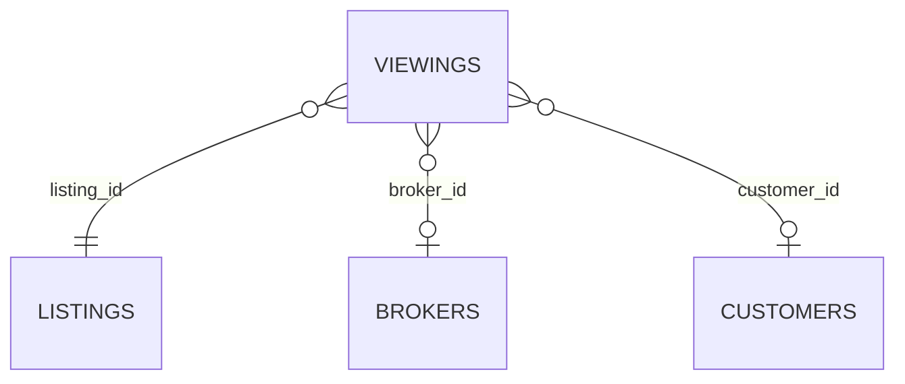
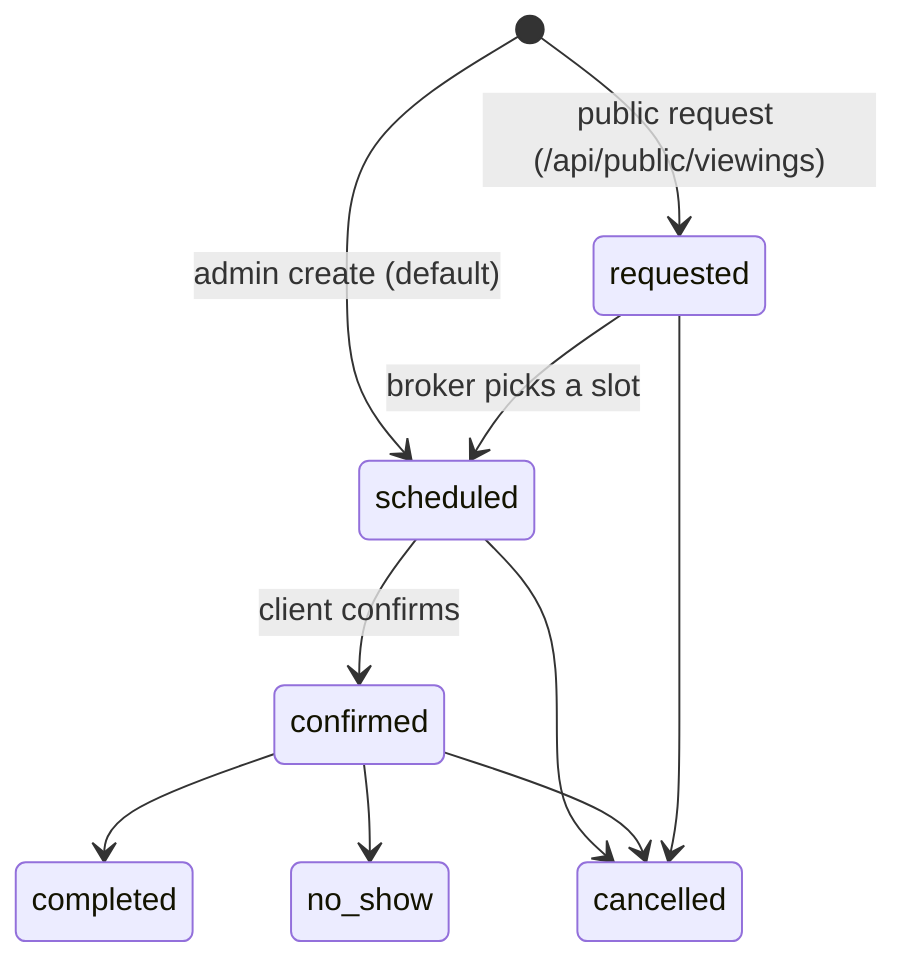

# Viewings (`viewings`)

The Viewings module (RealEstates package) manages property viewing appointments (*prohlídky*) for [Listings](listings.md). A viewing links a listing to a contact person (name, email, phone), optionally to a [Customers](customers.md) record and a listing broker, has a scheduled time and a status workflow from `requested` through `scheduled` / `confirmed` to `completed`, `cancelled` or `no_show`. Public storefronts can submit viewing requests without authentication (rate-limited), brokers and back-office users manage them in the admin, and integrations use the `/api/v1/viewings` REST API. Every change emits platform events for [Webhooks](webhooks.md) and notifications.

## At a glance

| Item | Value |
| --- | --- |
| Module id | `viewings` |
| Version | `1.1.2` (`modules/Viewings/module.php`, `ViewingsModule::version()`) |
| Directory | `modules/Viewings/` |
| Requires | `core ^1.0`, `listings ^1.0` |
| Optional | `customers ^1.0`, `crm ^1.0`, `calendar ^1.0`, `notifications ^1.0` |
| Capabilities provided | `viewings` (capability object `ViewingsProvider`) |
| Capabilities consumed | none via registry; hard dependency on `Modules\Listings\Application\ListingsProvider` (widget) and `Modules\Listings\Domain\Listing` (public request); `class_exists` guards for `Listing`, `Listings\Domain\Broker`, `Customers\Domain\Customer` in the admin controller |
| Groups / packages | manifest `groups: ['realestates']`; `config/module_groups.php` lists it in package **`realestates`** (not required) |
| Permissions | `viewings.view` (`perm.viewings.view`), `viewings.manage` (`perm.viewings.manage`) — group `perm.group.viewings` |
| API scopes | `viewings.read`, `viewings.write` |
| Author | RealEstates |

Manifest icon: `eye` (menu uses `calendar`). Description key: `module.viewings.description`.

## Domain model

### `Viewing` → table `viewings`

Indexes: `idx_viewings_listing (listing_id)`, `idx_viewings_status (status)`, `idx_viewings_scheduled (scheduled_at)`. Form entity `#[FormEntity('viewings.save')]`, `#[FormGenerator(exclude: [id, number, createdAt, updatedAt], cols: 2)]` — the admin form is generated from `#[FormField]` attributes (searchable selects for listing / customer / broker).

| Field | Column / type | Notes |
| --- | --- | --- |
| `id` | `id` string(36) PK | UUID v7 |
| `number` | `number` string(64) | `VW-<YYYY>-<NNNN>` from `ViewingsProvider::nextNumber()` (count-based per year, no unique constraint) |
| `listingId` | `listing_id` string(36) | required; [Listings](listings.md) `Listing.id` |
| `customerId` | `customer_id` string(36) nullable | [Customers](customers.md) id |
| `brokerId` | `broker_id` string(36) nullable | `Modules\Listings\Domain\Broker` id |
| `status` | `status` string(32) | default `requested`; see statuses |
| `scheduledAt` | `scheduled_at` datetime nullable | appointment time |
| `contactName` | `contact_name` string(190) | required |
| `contactEmail` | `contact_email` string(190) nullable | |
| `contactPhone` | `contact_phone` string(64) nullable | |
| `note` | `note` text nullable | |
| `createdAt` / `updatedAt` | datetime | |

`Viewing::STATUSES = ['requested', 'scheduled', 'confirmed', 'completed', 'cancelled', 'no_show']`; `setStatus()` throws `viewings.error.invalid_status` for unknown values; `statusLabel()` → `viewings.status.<status>`.

### Status transitions

Transitions are not enforced by code (any status may be set from any other via admin status form, admin edit, or API `PATCH`); the flow implied by defaults and widgets is:

- Public requests always start as `requested`; admin-created viewings default to `scheduled` (`ViewingController::validated()` falls back to `scheduled` when the posted status is missing or invalid).
- Dashboard logic treats `scheduled` + `confirmed` with a future `scheduled_at` as "upcoming" and `requested` as "awaiting a slot"; `completed` is counted as a conversion in the trend chart; `cancelled` / `no_show` are terminal.

## Admin UI

### Menu (`ViewingsModule::boot()`)

| Menu id | Label key | Icon | Route | Permission | Order / group |
| --- | --- | --- | --- | --- | --- |
| `viewings` | `nav.viewings` | `calendar` | `admin.viewings.index` | `viewings.view` | 28, group `Reality` |
| `viewings.create` | `nav.viewings.create` | — | `admin.viewings.create` | `viewings.manage` | 29, parent `viewings`, hidden |

Command palette: `viewings.index` (`palette.viewings.index`, `/admin/viewings`), `viewings.create` (`palette.viewings.create`, `/admin/viewings/create`).

### Routes (group `/admin/viewings`, middleware `auth`)

| Method | Path | Route name | Controller::action | Permission |
| --- | --- | --- | --- | --- |
| GET | `/admin/viewings` | `admin.viewings.index` | `ViewingController::index` | `viewings.view` |
| GET | `/admin/viewings/create` | `admin.viewings.create` | `ViewingController::create` | `viewings.manage` |
| POST | `/admin/viewings` | `admin.viewings.store` | `ViewingController::store` | `viewings.manage` |
| GET | `/admin/viewings/{id}` | `admin.viewings.show` | `ViewingController::show` | `viewings.view` |
| GET | `/admin/viewings/{id}/edit` | `admin.viewings.edit` | `ViewingController::edit` | `viewings.manage` |
| POST | `/admin/viewings/{id}` | `admin.viewings.update` | `ViewingController::update` | `viewings.manage` |
| POST | `/admin/viewings/{id}/status` | `admin.viewings.status` | `ViewingController::updateStatus` | `viewings.manage` |
| POST | `/admin/viewings/{id}/delete` | `admin.viewings.destroy` | `ViewingController::destroy` | `viewings.manage` |

Controller: `modules/Viewings/Http/ViewingController.php`.

### Screens

- **Index** (`Resources/views/index.html.twig`): `ListQuery` sortable `status`, `number`, `scheduledAt`, `createdAt`; filter `status`; search over `number`, `listingId`, `contactName`, `contactEmail`, `contactPhone`. Listing titles are resolved in bulk when `Modules\Listings\Domain\Listing` exists.
- **Create / edit** (`form.html.twig`): generated form (`viewings.save`): searchable listing select (`listingOptions()` from `Listing`), customer select (`customerOptions()` guarded by `class_exists(Customer::class)`), broker select (`brokerOptions()` from `Listings\Domain\Broker`), status, `scheduled_at` (`datetime-local`), contact fields, note.
- **Detail** (`show.html.twig`): viewing facts, linked listing and broker (loaded via `class_exists` guards), status change form (`status` only), edit and delete actions. Status change emits `viewing.status_changed` and `viewing.updated`.

Audit entries: `viewings.created`, `viewings.updated`, `viewings.deleted`.

### Settings

None. The module defines no settings.

## Public / REST API

### Authenticated API (`/api/v1/viewings`, see `../architecture/api.md`)

Controller `modules/Viewings/Http/Api/ViewingApiController.php`.

| Method | Path | Scope | Action |
| --- | --- | --- | --- |
| GET | `/api/v1/viewings/` | `viewings.read` | `index` — `ApiQuery` sortable `status`, `number`, `scheduledAt`, `createdAt` (default `scheduledAt`); filters `status`, `listing_id`; search `LIKE` over `number`, `contactName`, `contactEmail`, `listingId` |
| POST | `/api/v1/viewings/` | `viewings.write` | `store` — ruleset `viewings.save`; hydrates `customer_id`, `broker_id`, `status`, `scheduled_at` (any `DateTimeImmutable`-parsable string; invalid → `null`), contact fields, `note`; 201 |
| GET | `/api/v1/viewings/{id}` | `viewings.read` | `show` (detail incl. `note`) |
| PATCH | `/api/v1/viewings/{id}` | `viewings.write` | `update` — partial hydrate with `array_key_exists` semantics for nullable fields |
| DELETE | `/api/v1/viewings/{id}` | `viewings.write` | `destroy` → `{id, deleted: true}` |

Serializer (`ViewingsProvider::serialize($v, $detail)`): `id`, `number`, `listing_id`, `customer_id`, `broker_id`, `status`, `scheduled_at` (ATOM or null), `contact_name`, `contact_email`, `contact_phone`, `created_at`, `updated_at`; `note` only when `$detail = true` (show/store/update/events).

### Public request intake (no token)

Controller `modules/Viewings/Http/Public/PublicViewingsController.php`, CORS `POST, OPTIONS` via `Gereq\Http\PublicCors`.

| Method | Path | Route name | Description |
| --- | --- | --- | --- |
| OPTIONS | `/api/public/viewings` | `api.public.viewings.options` | preflight |
| POST | `/api/public/viewings` | `api.public.viewings.store` | Body (JSON or form) validated by `viewings.public_request`: `listing_id` (required), `contact_name` (required), `contact_email`, `contact_phone`, `scheduled_at` (preferred time; invalid values ignored), `note`. Listing must exist and have `status = published`, otherwise 404. Rate limit: 5 requests per 600 s per client IP (`Gereq\Security\RateLimiter`, key `viewing:request:<ip>`, 429 `rate_limited`). Creates a `requested` viewing, copies the listing's `brokerId`, emits `viewing.requested` + `viewing.created`. Response 201 `{id, number, status}`. |

The current FE2 code base does not call this endpoint (no reference in `FE2/src`); it is intended for public listing detail pages (see `../frontend/public-frontends.md`).

## Events, hooks & webhooks

Platform events (`EventDefinition`, source `viewings`, all `webhookEnabled(true)`):

| Event | Description (Czech literal) | Emitted from |
| --- | --- | --- |
| `viewing.created` | Prohlídka vytvořena | admin `store`, API `store`, public `store` |
| `viewing.updated` | Prohlídka upravena | admin `update`, admin `updateStatus`, API `update` |
| `viewing.status_changed` | Změněn stav prohlídky | admin `updateStatus` only (API `PATCH` with a new status emits only `viewing.updated`) |
| `viewing.deleted` | Prohlídka smazána | admin `destroy`, API `destroy` (payload `{id, number}`) |
| `viewing.requested` | Veřejná žádost o prohlídku | public `store` |

Subject: `['type' => 'viewing', 'id' => ...]`; payload = detail serializer. See `../architecture/hooks-events-webhooks.md`.

Hooks: `boot()` adds a **filter** on `admin.dashboard.listing_title_ids` returning `ViewingsProvider::dashboardListingIds()` so that [Listings](listings.md) (`ListingsModule` action `admin.dashboard.warmup` → `ListingsProvider::warmTitles()`) pre-loads listing titles used by the upcoming-viewings widget.

Validation rulesets: `viewings.save` (bound to `Viewing` via `forms()->entity()`), `viewings.status`, `viewings.public_request`.

Queue jobs, scheduled tasks, publishables: None. The optional `crm`, `calendar` and `notifications` dependencies are declared in the manifest but no code in the module calls them.

## Dashboard widgets

| Widget id | Type | Class | Shows | Permission | Order |
| --- | --- | --- | --- | --- | --- |
| `viewings.shortcut` | shortcut | `Application/Widgets/ViewingsShortcutWidget.php` | Link to index, hint `admin.dashboard.hint.viewings` | `viewings.view` | 28 |
| `viewings.upcoming` | panel | `UpcomingViewingsWidget.php` | Up to 8 entries from `ViewingsProvider::dashboardViewings()` — scheduled/confirmed from one hour ago onward ordered by time, then newest `requested`; Today/Tomorrow labels, listing title via `ListingsProvider`, status badge (`inbox` icon for requests) | `viewings.view` | 16 |
| `viewings.stats` | metric | `ViewingStatsWidget.php` | Count of scheduled/confirmed viewings in the next 7 days; hint = number of `requested` awaiting a slot | `viewings.view` | 44 |
| `viewings.trend.chart` | panel | `ViewingsTrendChartWidget.php` | 14-day chart (`Gereq` `ChartSeries`) of created viewings vs. `completed` ones, with totals | `viewings.view` | 21 |

See `../architecture/dashboard-widgets.md`.

## Services & extension points

| Class | Responsibility |
| --- | --- |
| `Application\ViewingsProvider` | Capability `viewings`: `find(id)`, `dashboardViewings(limit = 8)` (request-memoised), `dashboardListingIds()`, `forListing(listingId, limit = 50)` (newest scheduled first), `nextNumber()` (`VW-YYYY-NNNN`), `serialize(v, detail)`. `src/Database/Seeder.php` instantiates it directly (guarded by `class_exists`) to seed demo viewings. |
| `Http\ViewingController` | Admin CRUD + status; builds searchable select options for listings, brokers and customers with `class_exists` guards. |
| `Http\Public\PublicViewingsController` | Public intake with rate limiting. |

Integration with other modules: [Listings](listings.md) is a hard dependency (entity lookups, `ListingsProvider` in the widget, published-status check on public intake); [Customers](customers.md) is optional (`class_exists`). No calls into CRM, Calendar or Notifications exist despite the manifest listing them as optional.

## CLI commands

None.

## Configuration & translations

- Settings keys: none.
- Environment variables: none.
- Translations: `Resources/translations/messages.cs.php`, `messages.en.php`; prefixes `module.viewings.description`, `nav.viewings*`, `palette.viewings.*`, `perm.viewings.*`, `perm.group.viewings`, `viewings.*` (`viewings.status.*`, `viewings.field.*`, `viewings.flash.*`, `viewings.error.*`, `viewings.widget.*`). `admin.dashboard.hint.viewings` and `empty.generic` come from core.

## Database migrations

| File | Purpose |
| --- | --- |
| `Database/Migrations/2026_09_06_000001_viewings.php` | Empty placeholder (`up()`/`down()` no-ops); the `viewings` table is created by `SchemaTool` sync from entity metadata. |

## Notes

- No state machine; any status can be set from any status in admin and API. `viewing.status_changed` is emitted only by the admin status form, so webhook consumers relying on it will miss status changes made through `PATCH /api/v1/viewings/{id}` or the admin edit form.
- `number` has no unique constraint and `nextNumber()` is count-based, so deleting a viewing can produce a duplicate number on the next create.
- The public endpoint accepts a free-form `scheduled_at` string parsed by `new DateTimeImmutable()` — relative expressions like `tomorrow` are accepted; time zone is the server default.
- Public requests are rate-limited per IP (5 / 10 min) but there is no CAPTCHA or email verification; error messages from the limiter are Czech literals.
- Rulesets `viewings.save` and `viewings.status` reference `Viewing::STATUSES` as a literal `in:` list — keep them in sync if statuses change.
- `README.md` says v1.0.3 while the manifest is 1.1.2.
- Event descriptions are Czech literals rather than translation keys.
