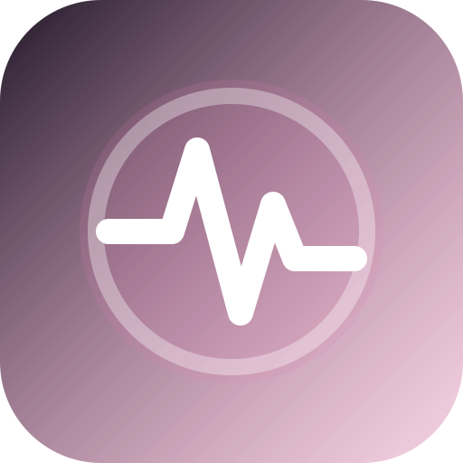

# GEREQ Pulse

<p align="center">
  
</p>

**Cursor / VS Code extension** — Toggl-style work tracking from the editor (files, diffs, focus, AI-edit heuristic). Local dashboard on **:8772**.

| | |
| --- | --- |
| **GitLab** | https://git.gereq.cz/gereq/tool-pulse |
| **Install** | `bash install.sh` → *Developer: Reload Window* |

## What it collects

| Event | Meaning |
| --- | --- |
| `open` / `close` / `save` | documents |
| `edit` | +/- lines, `source: user\|ai` |
| `focus` | time on file |
| `create` / `delete` / `rename` | filesystem |
| `git` | shortstat every 60s |

Data: `.cache/worklog/events.jsonl`

## Views

- **Timer** — entries + projects + 15min activity
- **Day** — vertical 0–24h calendar
- **Week** — 7 columns
- **Insights** — heatmap, languages, charts

## Dev UI

```bash
cd ui && bun install && bun run dev   # :8773 → proxy :8772
bun run build
```
